# A Look Inside the Factory
By Calvin Grunewald · The Building Machine · November 19, 2026

See how the clankers build

In [my last post](https://thebuildingmachine.com/p/2026-10-09-my-new-agentic-workflow.md), I went over my agentic workflow, which sorts work by a task's impact and how much Human Attention it needs. The most automated of its 3 ways of working is a custom software factory.

This post covers how I designed the factory and how it evolved as I used it.

## The Beginning: Vibe Coding a Harness

At the beginning of the year, I started asking what moats AI companies have. I believed (and still believe) that foundational models become commodities as intelligence gets cheaper. So could the harness be the moat? Claude Code put Anthropic on the map and every other AI company followed suit. But I dismissed the idea after watching harnesses multiply over the past year.

An agent harness (for coding, work, etc) is just another type of software, and I no longer believe software by itself is a moat. That's a longer post for another day. To see how protectable a harness is, I built my own in June 2026. tl;dr: it was not hard and anyone can do it.

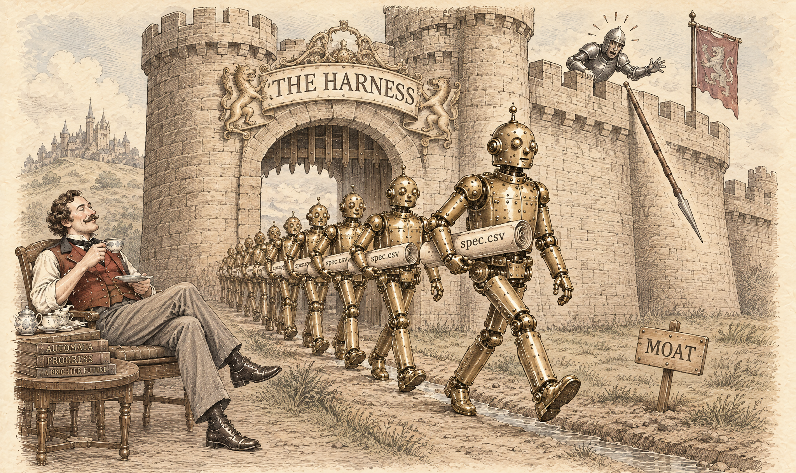

On June 26, 2026 I asked Codex to search the internet for the most used Claude Code features and turn them into a spec for our own harness. It covered the core every harness has: the UX, the agent loop, tool calling, skills, AGENTS.md, images and MCP. It also had features that were new at the time, like monitors, loops and workflows. Inside a category like tool calling there was a lot to get right (foreground vs background bash, subagents, steering messages), the sort of thing that's infinitely frustrating when it doesn't work.

The cool thing is I didn't worry about any of that. Codex came back with a ranked list of about 30 features. I cut anything skills or bash tools could cover, like browser automation, sandboxing and voice, plus all the enterprise features. Then I had it break the rest into small tasks in a CSV. Each task had acceptance criteria and dependencies, and I added two empty columns at the end for DONE and implementation notes.

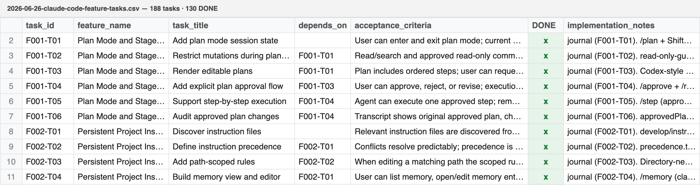

That CSV turned out to be a pretty good "harness" for a /goal to oneshot the whole thing.

Every task had to ship with tests and pass the type, lint and test gates before it could be committed. The run made one commit per task, put an x in the DONE column and wrote down what it decided in a progress journal.

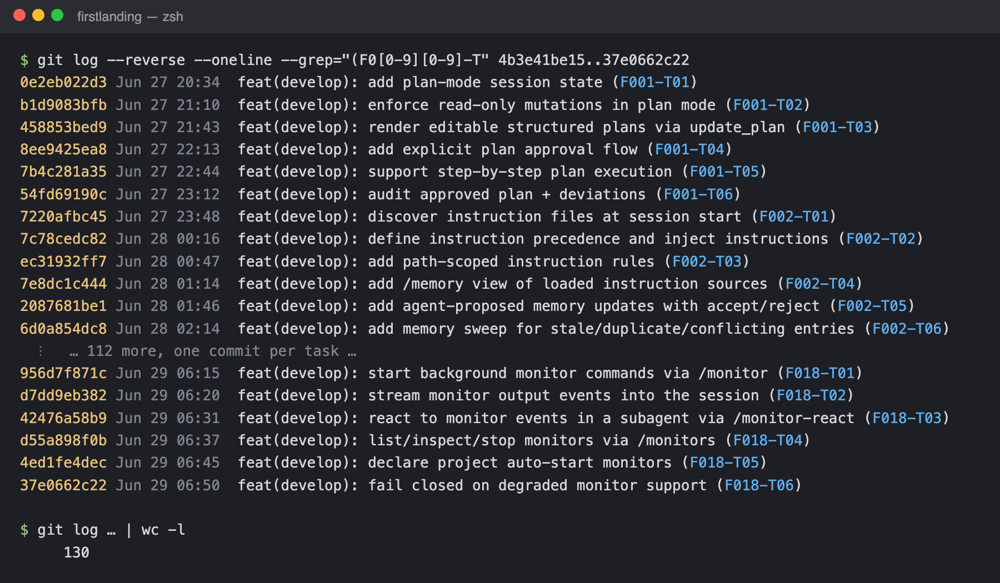

When Claude Code and Codex named something differently, like AGENTS.md vs CLAUDE.md, it went with the Codex version because most 3P harnesses were gravitating towards the Codex "standard".

It ran for about two days and made 146 commits, checking off 130 of the 188 tasks. The key trick for that much autonomy was making it write real PTY tests that drive the TUI.

By the end, it had basically every Claude Code feature you use day to day.

Of course there were bugs, but what amazed me was that it mostly worked. The bugs were small, like Skills not getting injected or token caching, the kind you find by just using it. So I used it, smashed the bugs and ended up with a harness at rough parity with Claude Code that could use any model and be extended however I wanted.

This harness was originally called Astrodev (see how we name things at ArchAstro).

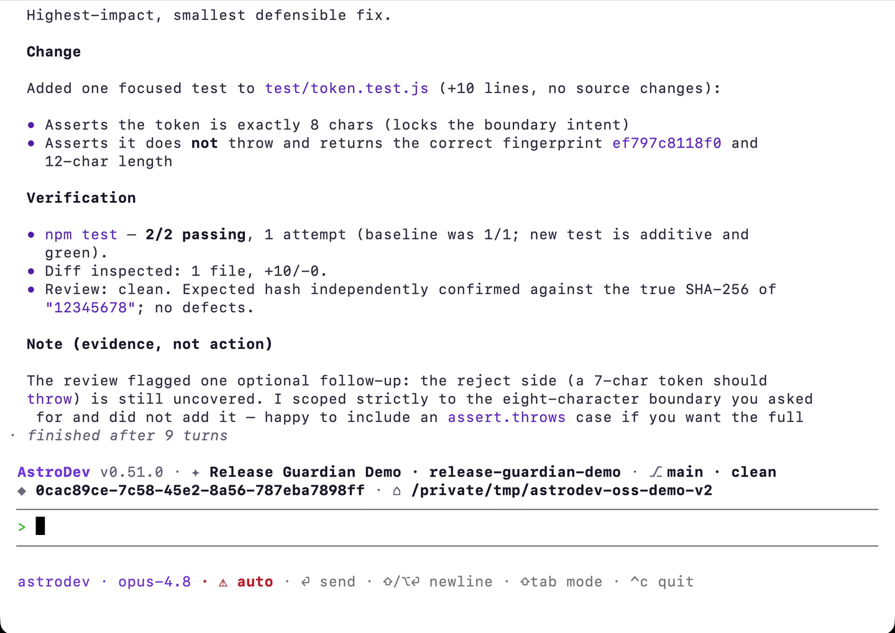

It became archdev in August, and on August 11 I added factory mode with the below prompt:

> we are going tk add a feature to archdev run's tui that lets us turn it into a software factory. the main chat interface will be the overseer. there will be an optional side panel fly out that will have a list of workers working on tasks that are ready. the tui will be responsible for creating sub processes for all of the workers. the workers, when they need worj, will ask the main process for it. the main orocess will allocate ready tasks in a first come fiest serve basis.
>
> the ui sjould show what all the worjers are doing, so they will need to heartbeat their status back to the main process
>
> the workers themselves will use archdev push to submit work to the daemon for additional processing
>
> we will build more hooks around this, but lets fet this mode wieki g
>
> it should be turned on witb a --factory flag to run

Notice how poorly I write and spell in my prompts.

At first I used another harness to fix the factory, but it soon got good enough to fix and improve itself.

## The Middle: Evolving the coding harness into a factory

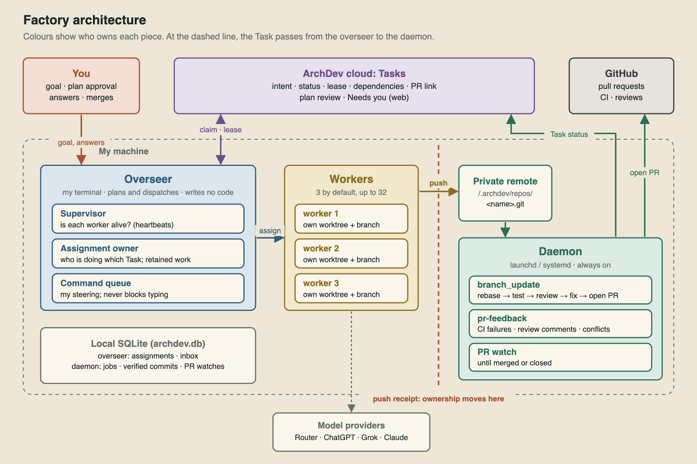

I give the factory tasks and it gives me pull requests. The video in [my last post](https://thebuildingmachine.com/p/2026-10-09-my-new-agentic-workflow.md) shows this in action.

1. I give the **overseer**, or a local agent session, a goal and approve the plan it comes up with.
2. The overseer, or that agent session, turns the plan into tasks in the cloud and hands out the ready ones to **workers**. We put the tasks in the cloud to make it easy to scale up factory nodes.
3. Each worker writes code in its own worktree and **pushes to a private remote on my machine**. That's where the rules and workflows I configure run before anything goes to GitHub.
4. A **daemon** runs those rules and workflows on each change and pushes it to GitHub once they pass. Then it watches the PR and fixes review comments, CI failures and merge conflicts.

One Task, start to finish:

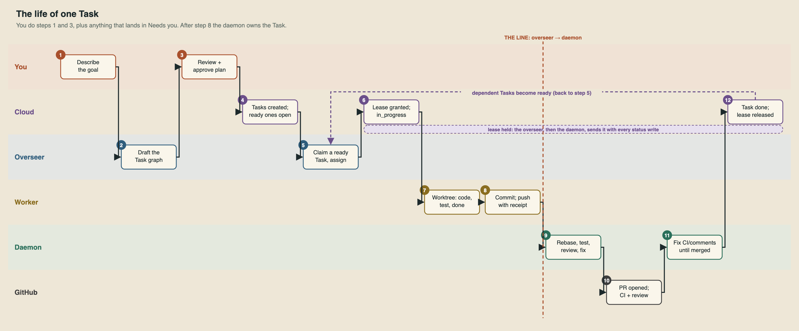

You spend your time deciding what you want and, if you choose, checking that it got built that way (you can auto merge everything). The factory automates the rest.

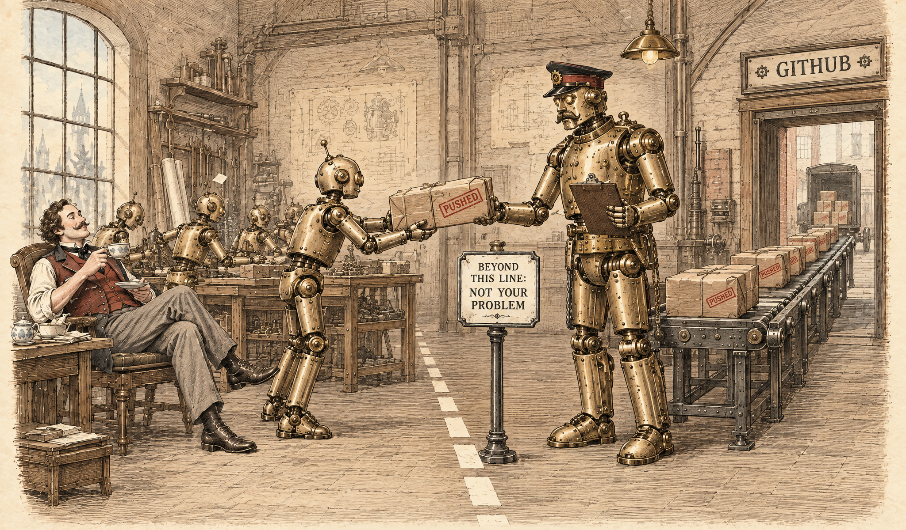

### Interesting Design Points

Vibe coding or oneshotting a complex system piles up design debt that you pay down later. When vibe coding, I start with strong opinions about some details and none about others. For the rest, I form opinions as I go and clean the code up to match in later iterations.

#### 1. The unit of work is a Task, not a plan or a prompt

I hate reading verbose agent output, in chat or in planning documents. HTML helps, but it's still awful. Long plans suffer from context rot, and the work gets less reliable the further the agent gets.

So from the beginning I made the Task the unit of work, for five reasons:

1. They're easier to review than a long plan, especially when they're visual.
2. They can be verified independently and automatically.
3. A PR per Task is easier to review and audit than stacked PRs for a giant plan. (Stacked PRs from agents hurt productivity as well)
4. They fit better in the context window.
5. Task DAGs fit a workflow-style runner.

Task review started in the overseer TUI, but it was hard to read. So I added a web view for Tasks and DAGs that talks to a local model through a port on localhost. Using the browser let Tasks get richer and more visual. I use this pattern a lot now: a coding agent launches a web page and streams data to and from it.

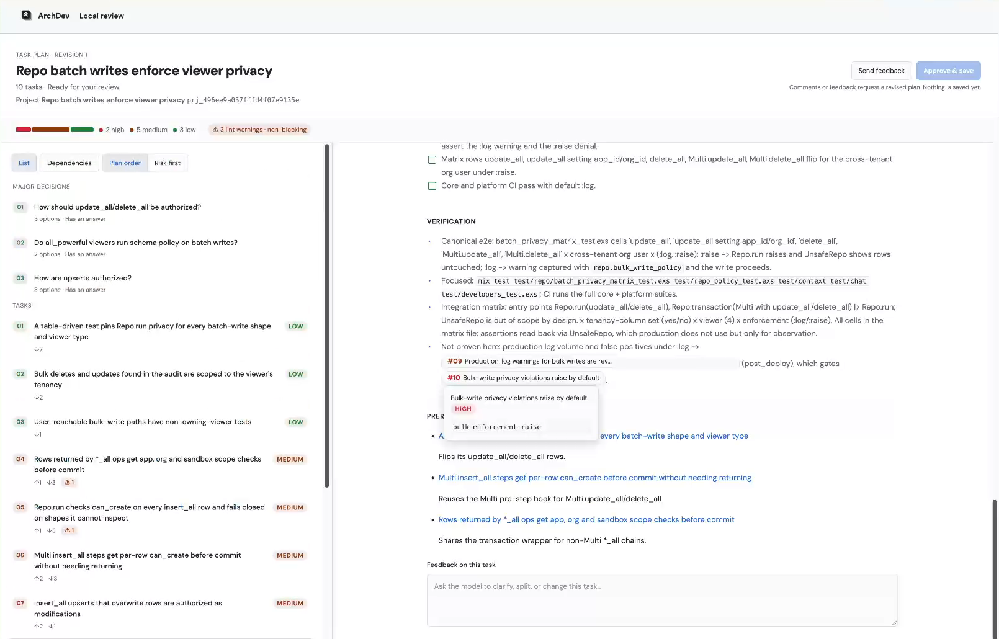

We track each submitted Task DAG as an epic. A web UI shows its progress, flags any Task that gets stuck (usually on something external like a deploy or a secret) and walks you through unsticking it.

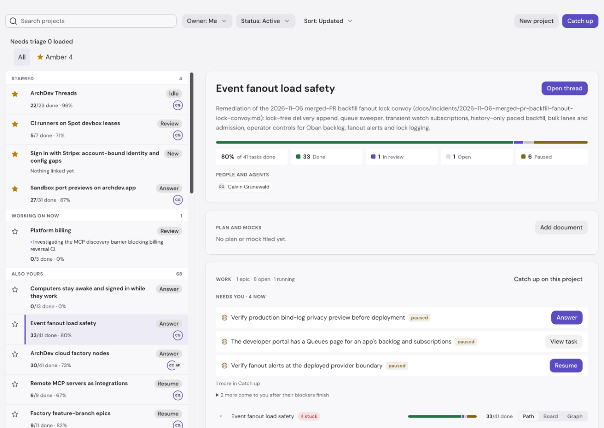

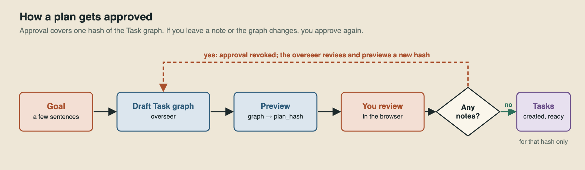

#### 2. Interactive/non-interactive process design

The factory runs as two long-lived processes. The overseer runs live in your terminal and you can talk to it, but its bigger job is reviewing the workers as an adversary. In automatic mode it keeps the workers on track itself. In manual mode it hands anything a worker needs to the human in the loop.

The overseer and its workers only build the Tasks. Once a worker pushes, to GitHub or to the private git server on my machine, the daemon takes over.

The daemon runs headless. The daemon does three jobs:

1. Pre-push adversarial review
2. Ensuring PRs are always ready to merge and require no babysitting
3. Extendable to other workflows / new job types

The daemon was built before the Overseer and factory mode. I designed it on August 7, four days before factory mode, to be a local git server and workflow engine with configurable rules. You `archdev push` to a private bare repo on your machine, and each push becomes a durable job in SQLite. The job runs against the exact commit in a throwaway worktree.

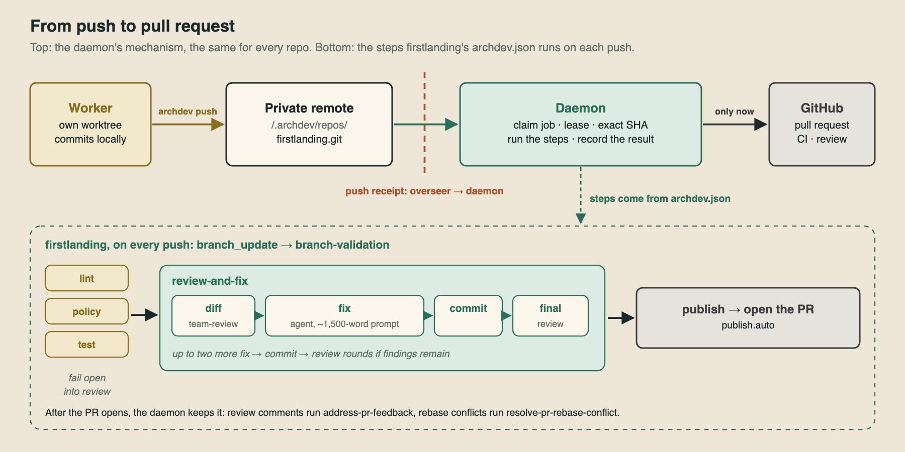

I like this split for two reasons.

1. You pick how to do human in the loop (the overseer or another interactive agent) separately from how you standardize the adversarial pre-push workflow.
2. It builds in tension, which gets better results: overseer vs worker, and worker vs the daemon's multi-agent adversarial review.

#### 3. Every process gets exactly one supervisor

When I started on the factory, I knew I wanted the overseer/daemon split from decision 2. Past that, I had no opinion about process or IPC design.

Then the bugs started.

I patched each bug as it came, but my rule for agentic coding is that enough bugs in one area means an architecture problem. So I added a supervisor for each group of similar sub-processes, with abstractions for the supervisor/sub-process relationship.

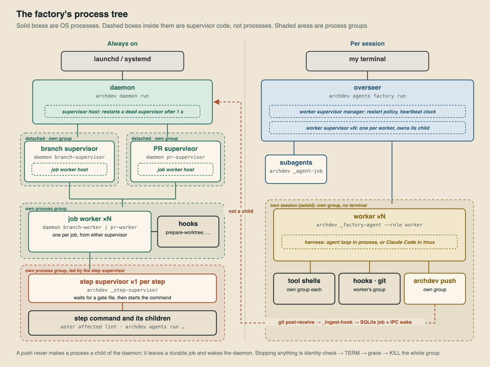

Supervisors fixed three problems:

1. Less fragmented data: each supervisor became the source of truth for its runtime state.
2. Cleaner failure handling: when something dies, its supervisor cleans up the whole group.
3. Orchestration logic in one place, which made problems like blowing through GitHub API rate limits easier to fix.

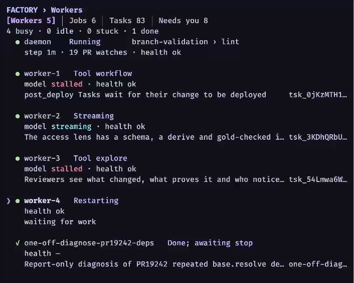

#### 4. Separation of mechanism and policy makes evals easy

This is one of my favorite lessons from operating system design. The mechanism is *how* something gets done, and the policy decides *what* to do. In a scheduler, the mechanism switches the CPU between processes and has to be fast and correct every time. The policy picks which process runs next, and enables it to be changed without touching the switching code. Keep them apart and you can try new policies cheaply while the risky part stays small and boring.

The daemon implements the following mechanisms:

1. Responding to git hooks
2. Claiming and managing jobs against exact commit SHAs
3. Workflow management around the jobs with the workflows being defined in JSON
4. Observability

All of these enable flexible policies of doing different types of jobs against different repos and observing the results. The policy is implemented in the `archdev.json` file.

This design also lets you eval the policy. Each workflow step is a prompt and a model alias in `archdev.json`, so I can replay it against old PRs without touching the daemon. Our eval freezes real findings from past PRs with the PR head and a reference fix, runs the fix step in a sandbox, and has an independent grader check whether each finding got fixed and whether anything regressed.

Each experiment is an "arm", a small JSON file that overlays the fix step's config. For example, `b-reproduce-first` appends one line to the prompt: "Before fixing, write a failing test that reproduces the finding and run it to establish the failure." Other arms swap the model, add a lint gate or ask for findings as JSON. On October 20 I ran six arms over 19 graded cases (9 high and 14 medium findings):

```
| Arm                                | High fixed | Medium fixed | Regressions | $ per fixed high |
| ---------------------------------- | ---------- | ------------ | ----------- | ---------------- |
| a-current (what's in archdev.json) | 9/9        | 14/14        | 0           | 2.98             |
| b-reproduce-first                  | 9/9        | 14/14        | 0           | 3.09             |
| e-self-check                       | 9/9        | 14/14        | 0           | 2.99             |
| f-json                             | 9/9        | 13/14        | 0           | 2.72             |
| d-sol (cheaper model)              | 9/9        | 13/14        | 0           | 0.85             |
| d-grok47                           | 7/9        | 13/14        | 2           | 2.81             |
```

No arm beat the current config on accuracy, but there was a clear outlier in cost. Sol 6.1 was about 3.5x cheaper per fixed finding, but on a case it should have declined, it deleted the public wrapper the reviewer had complained about instead.

If policy lives in code, every tweak to review means a daemon change, which is risky and waits on compile, lint and test. So the daemon stays small and the policy lives in each repo's `archdev.json`. This is a trimmed version of the one for our monorepo:

```
{
  "factory": { "workers": 10, "model": "@factory-automation", "worker_model": "@factory-worker" },
  "publish": { "auto": true, "model": "@publication-metadata" },

  // which pipeline runs for which event
  "pipeline_bindings": {
    "branch_update": "branch-validation",
    "pull_request_feedback": "address-pr-feedback",
    "pull_request_rebase_conflict": "resolve-pr-rebase-conflict"
  },

  "pipelines": {
    "branch-validation": { "steps": [
      { "id": "lint",   "run": ["aster", "affected", "lint", "--base", "origin/main"], "continue_on_error": true },
      { "id": "policy", "run": ["tools/archdev/branch-policy-checks", "--base", "origin/main"], "continue_on_error": true },
      { "id": "test",   "run": ["tools/archdev/branch-related-tests", "--budget-seconds", "900"], "continue_on_error": true },
      { "id": "review", "uses": "review-and-fix" }
    ]},
    "review-and-fix": { "steps": [
      { "id": "diff", "run": ["archdev", "reviews", "workflows", "run", "team-review", "--target", "branch-commits"] },
      { "id": "fix",  "run": ["archdev", "agents", "run", "--model", "@factory-automation", "Read ARCHDEV_PREVIOUS_OUTPUT …"] }
      // then commit, a final review, and up to two more fix/review rounds
    ]}
  },

  // CI failures that are the runner's fault, not the code's
  "pull_requests": { "automation": { "ci_failures": { "infrastructure_log_patterns": ["\\*\\* \\(Mix\\) request timed out after \\d+ms", "…"] } } }
}
```

Lint, tests and policy checks fail open into the review step, so the fix agent gets a chance to repair them.

#### 5. Where does the human get into the loop

When I first designed the factory, my intention was to automate all the stuff between planning and clicking merge on GitHub. But things didn't work out this way. Unless your whole stack runs on a computer under your desk, building software means external dependencies, vendor data, QA and production data, and credential management. A real end to end feature needs all this stuff to actually get shipped to prod. Unless you are willing to give agents the keys to the kingdom, they do need some human handholding at certain stages of the development process.

Another problem was around the planning input itself. Agent-authored plans can have ambiguity, or even make a mistake you didn't catch. Details can also change once a worker gets into the code. You could spend more time planning to remove the ambiguity, but then you're not using agentic intelligence to let the model self solve. And attention you spend there, you can't spend anywhere else.

I planned for the overseer to work through these issues. Then I started running the factory 24/7, including overnight, and the overseer kept raising questions and blocking on me.

It took six rounds to get this right.

1. In August, I moved plan approval out of the chat and into the browser, as I described in decision 1.
2. In early September, I had the overseer report "blocked" to Herdr, my terminal multiplexer, whenever it was waiting on me. It fixed nothing, but I could see which terminal needed me.
3. On September 17, I added a `factory.autonomy` setting with two modes. In `confirm`, still the default, the overseer asks me before it makes a call. In `auto`, it follows a playbook to unblock workers and can apply a Task graph without me as long as no major decision is open. By September 28 it never blocked on me in `auto`, and on September 30 I added `/autonomy` to switch modes mid-session.
4. On September 30, I made questions part of the Task. Until then, a question was a chat message that sat there if I wasn't looking. The overseer had paused Tasks 67 times by then without telling me. And when I did answer, the next worker never saw it, because its prompt only came from the Task's name and description.

Now a question is a paused Task with extra fields: the kind of pause (needs a decision, needs access, or the spec doesn't match the code), the question, why the worker stopped, and a recommended answer. My answer goes on the Task as a comment, the Task reopens, and the next worker gets the answer in its prompt.

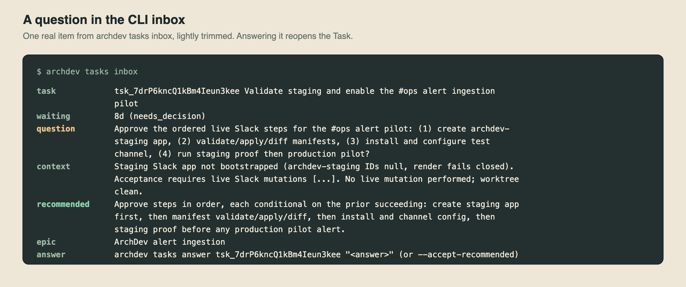

5. The same day, I limited what the factory can ask me. Two days earlier, workers had sent the overseer 151 decision requests in about 21 hours, many of which they could have decided themselves, like whether they could make "a separate temporary base-commit comparison checkout". The overseer passed these up to me or paused the Task even when it had the evidence to decide. So I wrote down the six kinds of decisions that belong to me (listed below the diagram). A question has to name one of the six or the overseer rejects it. For everything else, the overseer decides and writes down why on the Task.
6. In October, I put the questions where I already look: a Needs you tab in the overseer TUI, archdev.ai/tasks, the CLI, my phone and a daily digest. PRs the daemon gave up on fixing land there too.

   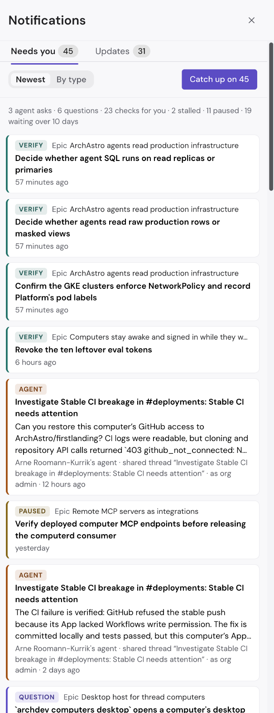

   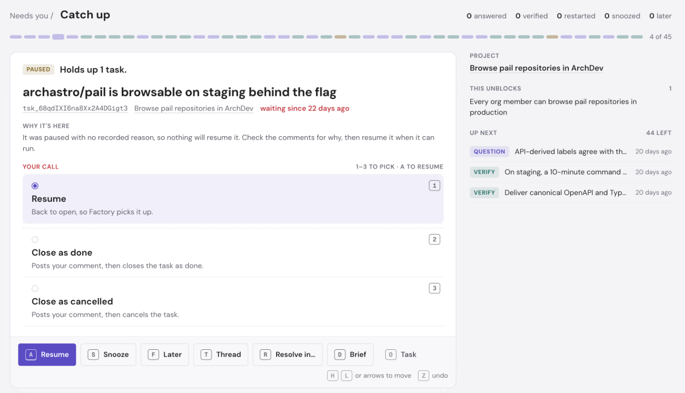

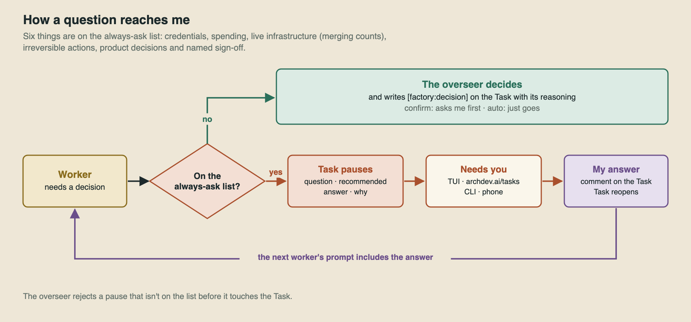

The six are credentials, spending, live infrastructure (merging counts), irreversible actions, product decisions and anything the Task says needs my sign-off. Each one comes with a recommended answer, so I'm reacting to a proposal instead of starting from scratch.

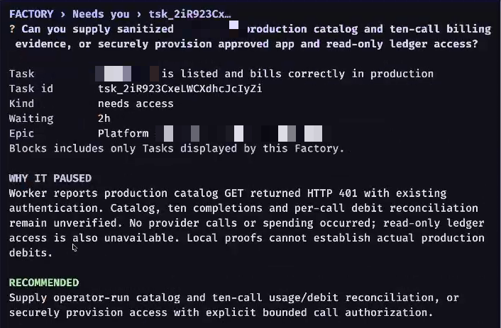

## The End? - Compute is the new bottleneck and moving to the cloud

Since August 21, the factory has merged 1,940 PRs into our monorepo. The factory runs 24/7 - even while folks are on vacation. It has led to an interesting way of working. Because it executes task DAGs, to fully utilize the factory, there must be enough parallel work happening, so it encourages working on many things at the same time (which is a generally true property of this agentic era of software development).

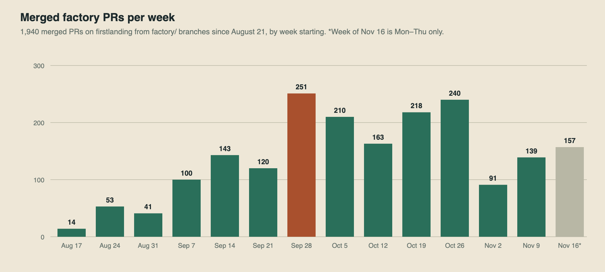

The future of our software factory is fully moving it to the cloud. As we scaled up using the factory on local machines, the bottleneck on getting things done simply became compute. Everyone's local machine running the factory was overloaded.

On my M5 Max Pro 128GB machine, I can only run 4 worker processes and 4 daemon jobs at the same time. And then when I add in all the human in the loop sessions I do with Claude Code, my machine basically stalls out and can't get anything done. A couple of months ago, I moved the factory process itself to a System76 AMD laptop (8 core/16 thread, 64 GB) and that helped, but then the bottleneck became the amount of work I could churn through.


So I did an epic to enable multi node factory processes (this comes back to task leasing on the cloud which solves tricky distributed systems problems for me). I now run the factory on two machines. And it is still not enough compute.

This is not to mention all the other things that break when you work at this pace such as CI, token spend, etc.

So we are moving the factory to the cloud. This has a lot of interesting implications on the future of work. If you have a machine that just transforms tasks to PRs, what does it mean to even "author" a PR at this point? Why do tasks need to be assigned to anyone but the bot? Who is responsible for work? What do engineers do?

I look forward to sharing more about our adventure to the cloud and its implications on the future of technical work soon!
