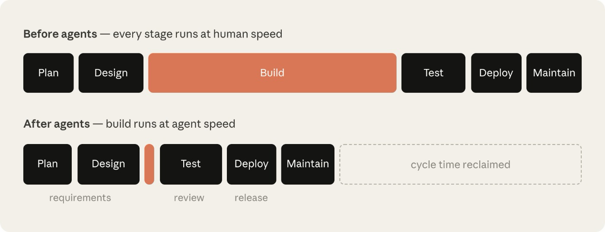
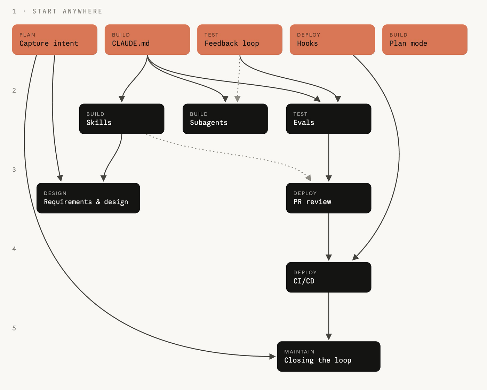

# After waterfall, agile, and DevOps — Anthropic’s AI-Native SDLC playbook
By vateo · Sep 22, 2026


I finished Anthropic’s *The AI-Native SDLC playbook* with one overwhelming impression: **it looks like a product manual, but it’s very likely the first sketch of the next paradigm in software development.**

Software development has cycled through paradigms for two decades: waterfall, agile, DevOps. The pattern never changes — tools shift first, process catches up, then the industry reorganizes around them. Agile spawned Jira and the Scrum Master. DevOps gave us Kubernetes and SRE.

Now it’s AI’s turn. Since coding AI went through its phase change last year, Cursor, Claude Code, and Codex have torn down the old IDE dynasty — yet at most companies the process, the org chart, and the management rituals look exactly like they did before. Human-led, AI-assisted.

**Build has collapsed from weeks to hours. Review still queues. Design still chases the UI. Approvals still wait for the weekly meeting.**

This playbook is Anthropic’s first real answer for the process layer — for what AI-native development actually looks like. And by their own disclosure, over 80% of the code merged at Anthropic is written by Claude. The people writing the standard are the people already running it.

## 1. The Problem the Playbook Solves

Here’s the experience most teams share once AI coding actually lands: code gets written much faster, delivery doesn’t.

You go through stages. First you blame yourself for using the tools badly. Then you blame the tools for not being strong enough. Eventually you realize what’s actually stuck: the process.

A bit about us. I’ve been driving an AI transformation in our engineering org since last year, starting with development. Step one: switch the coding tool to Claude Code — the easiest step, the fastest payoff. Step two: build on SDD to solve the harder problems — how many humans and many agents collaborate, how code stays consistent, how it all scales across versions. Today our dev work runs in three modes, by project complexity: AI-assisted, AI-collaborative, AI-autonomous. The gains are significant. Product, design, QA, and ops have all adopted AI too.

Then the problems show up. Product-to-UI handoff looks the same as ever: the deliverable is still a Figma mock the agent can’t consume. Dev-to-test handoff, the coordination between deploy and ops — all still the old pipeline.

**Every single step is faster. The whole flow isn’t. Local optimization can’t fix what is fundamentally a whole-pipeline autonomy problem — that takes an AI-native methodology.**

The playbook’s opening diagnosis is blunt. Once code stops being the bottleneck, three things happen at once:

- The bottleneck moves to either side of build — planning, review, deployment — still running at human speed.
- Agents write most of the diff, and line-by-line human review can’t keep up.
- Exceptions and approvals still route through weekly and monthly committees, so governance costs go up.

**The faster you code, the longer you wait.**



Management history has a ready-made analogy. When electricity first arrived, factory owners bolted motors onto the spot where the steam engine used to sit — same building, same shafts. The payoff took forty years to arrive, right up until factories were redesigned around electricity and the assembly line emerged.

## 2. What Is an AI-Native SDLC: The Loop, and the Plays

> ***The AI-native SDLC is a reimagined process that combines the old control objectives with new enforcement. Instead of a linear flow, the process becomes a loop, and AI is embedded at each point. The AI-native SDLC promotes automated handover and triggering of subsequent plays, helping to address the manual and clunky nature of handoff between the phases of the traditional SDLC.***


Structurally, the six phases survive: plan, design, build, test, deploy, maintain. What changes is how the phases hand off.

Instead of meetings, tickets, and sign-offs, each phase ends by committing a file to git, and the next phase starts by reading it:

**intent.md → spec.md → plan.md → code and tests → PR with review findings → incident record → back to a fresh intent.md.**

The trick is that humans and AI read the same file. A product owner can work with intent.md; so can an agent.

**Documents stop being memos written for humans. They become the API between humans and agents.**

And the commit chain doubles as the audit trail: who asked for what, what the AI did, who approved it — all of it in version history.

The body of the playbook isn’t philosophy. It’s plays — sixteen of them, grouped into six non-linear stages, each covering five things: what changes, how to start, the concrete steps, governance, and how to measure it.



Underneath everything sit four principles: artifacts are the evidence — everything goes into git; defense in depth — skills make violations rare, hooks make them nearly impossible; humans hold the judgment seats — intent, risk, and authorization always belong to people; coexist with what you have — Jira and Figma don’t need to be torn down.

## 3. Plan: Requirements Start with intent.md

Whoever has the idea talks to the AI directly, in their own words, until it’s clear. The AI shapes it into an intent.md: what’s the problem, what outcome, who’s affected, what constraints, what’s still open.

The playbook’s example is filed by J. Ortiz from claims operations — not a PM, not an engineer:

```
# Intent: claims status self-service 
Author: J. Ortiz (claims operations). Status: draft. 

## Problem 
Customers phone the contact center to ask where their claim is. Handlers spend roughly a third of call time on status-only queries. 

## Proposed outcome 
Customers see claim status, next step and expected date in the portal. 

## Affected users and systems 
Claims handlers, portal team, claims-core API. 

## Constraints 
No new PII in the portal session. Existing authentication only. 

## Open questions 
Do third-party loss adjusters need access too?
```

The product owner’s role shifts from writing requirements to reviewing intent — the clarification and the record-keeping are done by the agent.

Against today’s process, requirements analysis gets thinner and pushed earlier: it starts from user pain and insight, from the MRD and BRD. How exactly intent.md should be used, though, still takes tuning to your team and its people.

## 4. Design: Policy Binds at Write Time, Not Review Time

Prototype and requirements design collapse into a single session. intent.md goes to a design agent, which produces a mock or front-end page plus spec.md.

Security, compliance, and brand rules get written as skills, so the AI is constrained the moment it writes the spec. **Where rules conflict, the AI flags it as a risk item and routes it to the policy owner — before engineering ever sees it.**

In the old process these surfaced in a review meeting weeks later. By then, rework costs an order of magnitude more.

Our current practice uses a prd-spec.md — but going straight from requirements to designed pages still needs heavy involvement from designers.

## 5. Build: Review the Plan, Not the Code

Engineers start in plan mode. Give Claude the intent and the spec, and it drafts an implementation plan: which files change, in what order, what could break, what proves it done.

The bar is strict: **an engineer who never sat in on the discussion could implement the change from this plan alone.** Once the plan passes, implementation usually lands in one pass — the directional questions were settled at the document layer, and execution is exactly what AI is best at.

Three assets come with this phase: **CLAUDE.md**, the new-hire manual for your AI — commands, conventions, architecture, and the mistakes it keeps making; a mistake only gets written in the second time it happens, and the file stays under one page. **Skills** turn org knowledge into soft constraints on code. **Hooks** are hard constraints — blocked paths stay blocked, credentials never enter a diff.

One line to remember: **skills make compliance probable, hooks make it certain.**

Our current practice: a design/spec directory that captures these rules, by category and module, in real detail. Works quite well.

## 6. Test: The AI Checks Itself First

Before a session hands anything over, the AI runs the build, runs the tests, screenshots the UI — and fixes until green. “Done” includes the evidence.

The bug-fix discipline is clever. Have the AI first reproduce the bug as a failing test, commit that test, then fix the code — with a hook locking the test file so it can’t be touched. **A pre-existing test the agent can’t rewrite is the only proof the bug is actually gone.**

One layer out, the AI’s own configuration gets regression-tested like code: pick 20–50 real historical tasks as an eval suite; any change to CLAUDE.md, skills, or hooks reruns the whole set. Every production incident becomes a permanent eval case.

## 7. Deploy: The Agent Walks Up to the Production Gate — It Doesn’t Walk Through

Review goes both ways. AI reviews other people’s PRs under one policy, and works through the comments on its own PRs. Humans answer exactly two questions:

**Is this change what the plan called for? Is the risk acceptable?**

Governance doesn’t run on review meetings; it runs on hooks as gates. Autonomy is tiered: dev environments the AI ships freely, staging in between, production requires a named human’s sign-off.

One counterintuitive reminder from the playbook: **rollback should be the best-rehearsed path in your entire pipeline** — because the agent in the maintain phase may trigger it at any hour.

## 8. Maintain: The Loop Closes

Monitoring doesn’t use AI at all. Deterministic scripts watch metrics against statistical baselines, and only past the threshold does the AI get woken — with graduated authority: one standard deviation, log it; two, read-only diagnosis; three, act — and even then only two moves are allowed: open a PR into review, or trigger a pre-approved runbook.

The diagnosis is written as a new intent.md and flows back into Plan. **Production issues become input to the next round of development.** Traditional SDLC never had that.

The playbook shows a real Slack incident channel: 22:04, someone @-mentions Claude; three minutes later it delivers a diagnosis against the release diff; a human replies “Go”; four minutes after that, rollback complete, postmortem filed.


**Request, diagnosis, authorization, fix — all of it stays in the channel. The channel is the audit log.**

## 9. Why I Take It Seriously

First, it operates on the process layer. By the tools → process → industry pattern, this is exactly the step a paradigm shift opens with.

Second, it answers governance head-on. Compliance, audit, security — the last mile of enterprise adoption that the AI-coding conversation has mostly skipped. **What regulated companies can adopt is what gets to become the de facto standard.**

Third, the authors run it themselves. 80% of the code written by Claude, the test suite almost entirely Claude-written.

And the honest caveat: **the “de facto standard” is still a frontrunner’s draft, not a verdict.** Agile took nearly a decade from manifesto to global default. The AI-native process will need its own run-up — though I doubt it needs that long.

Plenty of teams have already brought AI into development to some degree. The next move is to push further against this playbook. In the AI era, don’t be a spectator — be a player.

**References**

- Anthropic, [The AI-Native SDLC playbook](https://claude.com/blog/the-ai-native-sdlc-playbook) (2026–08–21)
