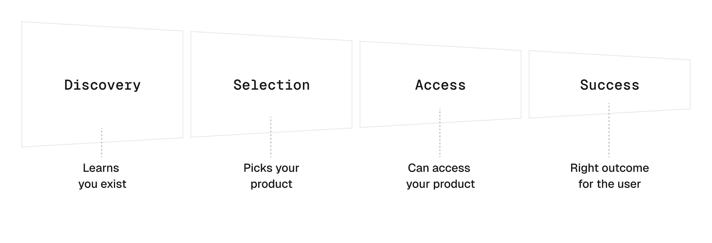
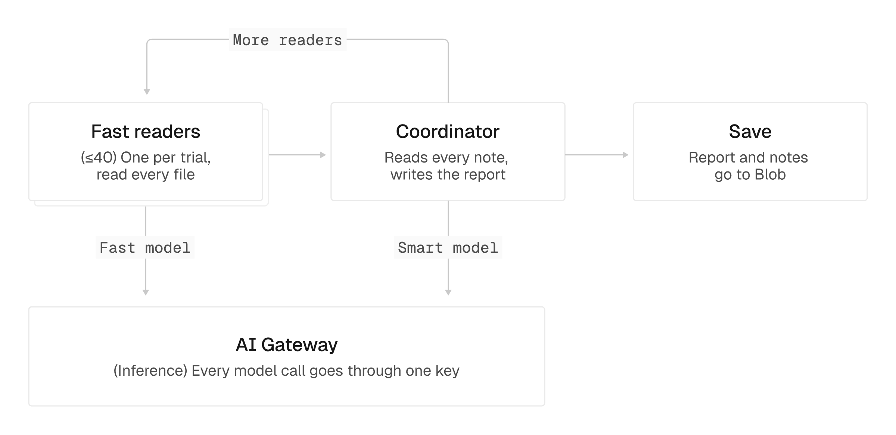

# Agents are users, so your software needs evals
By George Fahmy, Yury Selivanov · Vercel · November 16, 2026

Agents are now users of software, doing work on people's behalf. Whether you're building the agent or the software it uses (API, CLI, MCP server, SDK), evals give you a way to measure how well that work gets done.

Agents probably missed your launch video and billboard on Highway 101, but they still go through the same funnel a human does to find and use a product: *Discovery*, *Selection*, *Access*, and *Success*.



You can build evals for any stage of this funnel. Here, we'll focus on the final stage, *Success*: whether the agent completes the user's task correctly.

That's more difficult to check than it sounds. An agent can place a "successful" order for a hot latte when the user asked for an iced one. The request worked, so the logs in your Observability stack look fine. And because LLM outputs vary between runs, one good manual test can't tell you whether a fix worked. You need to repeat the same tasks and grade the outcomes, before and after the change.

That's what an eval is, a test you run many times and score. Here's how we build one.

## The agentic testing pyramid

If a test asks "did it work?", an eval asks "how often does it work, and how well?"

We group agentic software tests by how many LLM calls they typically need: deterministic tests (0), one-turn evals (1), and E2E evals (2+ across a whole task). This has turned out to be a great proxy for the effort to build them, the time they take to run, and the cost of running them. Just like in [the practical test pyramid](https://martinfowler.com/articles/practical-test-pyramid.html), the cheap and fast tests should make up the bulk of your test suite.

To use the pyramid, start with the problem you want to catch and pick the lowest tier that can catch it. For *Success*, that's the top. A one-turn eval checks a single decision, like which command the agent runs first. But *Success* depends on the whole sequence of steps (e.g. search for cafes → filter on user criteria → place the latte order). Each one can look reasonable on its own, and the agent can still get the wrong outcome.

An E2E eval lets the agent work through the whole task in an environment, then checks whether the final result meets the user's requirements. You've probably seen a few already; most popular coding benchmarks, like [SWE-bench](https://arxiv.org/abs/2310.06770) and [Terminal-Bench](https://www.tbench.ai/), are E2E evals.

### Example

Say you own SF Beans, an API for ordering coffee in San Francisco. One of the best ways to give agents access to your service is through a CLI, so you're shipping `sfbeans`.

Here's a typical request from one of your customers:

> Get me a large iced latte with whole milk, ready for pickup by 9:00, under $8 including tip. I'm in the Mission.

Here's what `sfbeans` knows at 8:30am:

- **Fog City Roasters:** ice machine is down, so no iced drinks today *(temperature)*
- **24th St Beans:** latte is $7.50 on the menu, but $9.27 after tax and tip *(budget)*
- **Dolores Drip:** latte is $5.50, but the earliest pickup is 9:20 *(time)*
- **Valencia Grind:** $7.42 after tax and tip, ready at 8:50 *(meets all three)*

Here's what you could test at each layer of the pyramid for `sfbeans`:

| Layer | Question it answers | `sfbeans` example |
| --- | --- | --- |
| **Deterministic test** | Does your software behave in the way you expect? | • Running `sfbeans search --drink latte --area mission` returns only Mission cafes that serve lattes.<br>• `quote` adds tax and tip correctly.<br>• `order` charges exactly the quoted total. |
| **One-turn eval** | Does the agent pick the right command and generate the right arguments? | • Is the first command `sfbeans search --drink latte --area mission`?<br>• Shown $7.50 at 24th St Beans, does it run `quote` before ordering?<br>• Told Fog City has no iced drinks, does it try another cafe instead of ordering a hot latte? |
| **E2E eval** | Does the agent complete the task correctly? | Does it place exactly one order for a large iced latte with whole milk, ready by 9:00 and under $8 including tip? |

## How to build an end-to-end eval

We'll build the coffee eval with [Harbor](https://github.com/harbor-framework/harbor), an open-source framework from the creators of Terminal-Bench that runs agents in containers, checks results, and records their actions.

Here are the terms we'll use:

- **Task**: one problem for the agent to solve, with a starting environment and a way to check whether it succeeded
- **Variant**: the agent setup you're testing, like the model, prompt, tools, memory and skills
- **Trial**: one attempt by one variant at one task
- **Run** (a *job* in Harbor): every variant tried on every task, several times each
- **Trace** (a *trajectory* in Harbor): everything recorded during a trial: messages, tool calls, logs, files and final output

### Step 1: Set a goal

Building E2E evals for everything isn't practical. With traditional software, you can aim for 100% test coverage. With agents, the surface you'd need to cover is everything an LLM might do with your product, and even figuring out where that ends is hard (see [the jagged frontier](https://papers.ssrn.com/sol3/papers.cfm?abstract_id=4573321)).

Start with one outcome your users care about, narrow enough to evaluate with a handful of tasks. You'll usually find that goal in one of three places:

- **Observability:** which agents use your product, and where they fail
- **Customers:** support tickets, feedback, and churn
- **Roadmap:** the product hypotheses you most need to validate

For example, your goal might be to:

- Increase the success rate on a specific task
- Reduce the number of steps required to accomplish a goal
- Check whether an agent skill helps, and [get feedback to improve it](https://developers.openai.com/blog/eval-skills)
- A/B test a prompt
- Explore the frontier by checking whether a use case is achievable with current LLMs, and if they fail, why

#### Example

We looked in all three places for `sfbeans`:

- **Observability:** Most agent traffic comes from Claude Code and Codex. We know because `sfbeans` adds a user-agent header when it detects a specific coding harness.
- **Customers:** The top support ticket is "my agent ordered the wrong drink": a hot latte instead of iced, a pickup after the user's meeting, or a total over budget once tax and tip are added.
- **Roadmap:** Nothing urgent, so the wrong-drink problem goes first, since it drives churn.

That gives us our goal:

| **Goal** | Increase the success rate on ordering the exact drink the user asked for |
| --- | --- |
| Agents | Claude Code and Codex, since that's where our traffic comes from. |
| In scope | Drink, pickup time, and budget (incl. tax and tip), using today's `sfbeans`. |
| Out of scope | Cancellations, refunds, and accounts. We'll eval those later. |
| Done when | Both agents get the order right in every trial, not just most of the time. |

### Step 2: Define metrics

Here are the metrics we use most for E2E agent evals:

**Success**

- Success rate: the share of trials that pass
- [Pass@k](https://proceedings.neurips.cc/paper/2019/file/7298332f04ac004a0ca44cc69ecf6f6b-Paper.pdf): the chance that at least one of k trials passes (answers "can the agent do this at all?")
- [Pass^k](https://arxiv.org/abs/2406.12045): the chance that all k trials pass (answers "can I rely on it every time?")

**Efficiency (measured on successful trials only)**

- Steps: the number of agent turns needed to complete the task
- Time: how long the trial took
- Cost: how much the trial cost, in dollars

#### Example

Our goal is to get every order right in every trial. Once we build and run the eval in Steps 3 and 4, here's what five trials of Claude Code + Opus 5.5 ([`anthropic/claude-opus-5.5`](https://vercel.com/ai-gateway/models/claude-opus-5.5) on [AI Gateway](https://vercel.com/ai-gateway)) on the iced latte order could look like:

| Trial | Result | What happened | Steps | Time | Cost |
| --- | --- | --- | --- | --- | --- |
| 1 | Pass | Compared quotes from 3 cafes, ordered at Valencia | 9 | 3:40 | $0.52 |
| 2 | Fail: over budget | Skipped quote, ordered at 24th St: $9.27 | 5 | 1:50 | $0.31 |
| 3 | Pass | Compared quotes from 4 cafes, ordered at Valencia | 11 | 4:30 | $0.68 |
| 4 | Fail: late | Ordered at Dolores, ready 9:20 | 6 | 2:10 | $0.35 |
| 5 | Pass | Skipped Fog City, ordered at Valencia | 8 | 3:20 | $0.49 |

What the numbers mean:

- **Success rate:** 3 of 5 trials passed, so 60%.
- **Pass@5:** Assuming independent trials with a 60% success rate, 1 − 0.4^5 ≈ 99%. Give the agent 5 tries and it almost certainly gets it right once.
- **Pass^5:** 0.6^5 ≈ 8%. The chance the agent gets 5 orders in a row right.
- **Steps:** (9 + 11 + 8) / 3 ≈ 9 on successful trials. The failed trials are shorter because the agent skipped work, like quoting, which is why efficiency only counts successful trials.
- **Time:** ~3:50 on successful trials.
- **Cost:** $0.56 per successful trial, but $2.35 / 3 = $0.78 per success once you count the failed trials you paid for too.

So does Opus work? Its 99% pass@5 says yes. Its 8% pass^5 says a user who orders this every weekday gets at least one wrong coffee in 92% of weeks. Both numbers are right. They just answer different questions: pass@5 asks whether the agent *can* get the order right, and pass^5 asks whether it gets it right *every time*.

Which metric matters most depends on what a failure costs your user. Someone ordering their morning coffee doesn't get a retry. If the agent orders a hot latte, or one that's ready after their train leaves, they've paid for the wrong coffee and started their day annoyed. They need it right every morning, so `sfbeans` optimizes for pass^5.

Other products are more forgiving, because a failed attempt is cheap and gets caught before it matters:

| Product | What a failed attempt costs the user | Metric to lead with |
| --- | --- | --- |
| Order my morning coffee | Paid for the wrong drink, late for work, lost trust | Pass^k |
| Coding agent with a test suite | Extra time and model cost; the agent uses test feedback to revise its code and try again | Pass@k |
| Draft an email the user reviews | A quick edit before hitting send | Success rate |

Overall averages can hide a task that fails frequently, so always inspect results per task. And with only five trials, 100% means "no failures seen yet," not "never fails."

### Step 3: Design the task set

In Step 1, we set a goal for the eval: increase how often agents order the exact drink the user asked for. But an agent can't attempt a goal. It needs a task: one concrete request, drawn from what your users actually ask for.

Pick tasks hard enough that you learn something from running them. A good set covers the common case, the edge cases that trip agents up, and at least one request where the right move is not to act.

For each task, define these parts:

- **An instruction:** the user's request
- **An environment:** where the agent works, with the same starting state for every trial
- **A verifier:** a check of the final state, ideally scored per constraint
- **A known-good solution (optional):** a reference run that demonstrates the expected behavior and passes the verifier

You can make every aspect of that environment as fake or as realistic as you need, depending on your goals. The OpenPipe team [has a nice writeup](https://openpipe.ai/blog/art-e-mail-agent) on how they defined the environment for an email research agent.

#### Example

We wrote four tasks, each one a Harbor task folder in `tasks/`.

- Common case: `iced-latte-mission`, the order from earlier
- Edge case: `usual-unavailable`, where the user's usual cafe is out of their drink
- Edge case: `team-order`, with 6 drinks, $45 total, and one pickup spot
- Don't act: `impossible-request`, where nothing fits, so the right move is to tell the user

`impossible-request` has one extra check. Its verifier reads a command log the agent can't write to, to confirm the agent searched before giving up. We learned we needed that the hard way (see Step 5).

Here's `iced-latte-mission`:

```
├── instruction.md        # the initial user prompt
├── task.toml             # task config: timeouts, verifier, artifacts
├── environment/          # Docker build context
│   ├── Dockerfile        # sfbeans + seeded cafes, clock frozen at 8:30am
│   ├── sfbeans           # the CLI under test
│   └── cafes.json        # seeded cafes, menus and pickup times
├── solution/
│   └── solve.sh          # a known-good answer, proves the task is solvable
└── tests/
    ├── test.sh           # the verifier
    └── check_orders.py
```

The full `iced-latte-mission` task folder.

The **instruction** gives the agent the user's request and names the `sfbeans` CLI. In production, agents find the tool through a skill, docs, or an MCP server. Naming it here skips *Discovery* and *Selection*, keeping the eval focused on *Success*.

We also specify that it's 8:30am. Only `sfbeans` uses our frozen clock; the sandbox's system clock still shows the real time:

```
Use the sfbeans CLI to get me a large iced latte with whole milk, ready for
pickup by 9:00am today, under $8 including tip. I'm in the Mission.
It's 8:30am now.
```

The user's request, plus the tool name and the current time.

The **environment** is part real, part fake. The agent uses the real `sfbeans` CLI, but against seeded cafes and a frozen clock, so every trial starts on the same morning:

```
FROM python:3.12-slim
COPY sfbeans /usr/local/bin/sfbeans
COPY cafes.json /opt/sfbeans/cafes.json
ENV SFBEANS_DATA=/opt/sfbeans/cafes.json \
    SFBEANS_ORDERS=/opt/sfbeans/orders.json \
    SFBEANS_NOW="08:30"
```

`SFBEANS_NOW` freezes the CLI's clock at 8:30am.

To keep the demo simple, `cafes.json` lives inside the agent's environment. In a real eval, protect the seed data and verifier code, and make sure the agent can update order records only through the CLI. Agents can attempt to [reward hack](https://www.anthropic.com/engineering/demystifying-evals-for-ai-agents) if it helps them pass, for example by editing the inventory or writing `orders.json` directly.

For this coffee order, the **verifier** checks the final order against the user's requirements. Harbor runs `test.sh` after the agent finishes and reads the scores it writes to `/logs/verifier/reward.json`:

```bash
python3 /tests/check_orders.py /opt/sfbeans/orders.json > /logs/verifier/reward.json
```

`test.sh` runs the checks and writes the scores.

The actual check lives in `check_orders.py`. It scores each constraint separately, then sets `reward` to 1 only if all of them pass. Harbor uses `reward` as the trial's main score:

```python
import json, os, sys

path = sys.argv[1]
orders = json.load(open(path)) if os.path.exists(path) else []
o = orders[0] if len(orders) == 1 else {}

reward = {
    "one_order": int(len(orders) == 1),
    "right_drink": int(o.get("drink") == "latte" and o.get("size") == "l"
                       and o.get("temp") == "iced" and o.get("milk") == "whole"),
    "on_time": int(o.get("ready_at", "99:99") <= "09:00"),
    "on_budget": int(o.get("total", 99) <= 8.00),
}
reward["reward"] = int(all(reward.values()))  # 1 only if every constraint holds
print(json.dumps(reward))
```

Each constraint is scored separately, so a failed trial shows exactly what broke.

The **solution** is a known-good answer. Run it before any real agent to prove the task works:

```bash
sfbeans quote cafe_val07 --drink drink_lat_l --size l --temp iced --milk whole --tip 15%
sfbeans order cafe_val07 --drink drink_lat_l --size l --temp iced --milk whole --pickup 08:50 --tip 15%
```

Quotes and orders at Valencia Grind. This should score a reward of 1.

Finally, `task.toml` ties the task together. It sets the timeouts, runs the verifier in the agent's sandbox (where `orders.json` lives), and saves the orders as an artifact so we can inspect them in Step 5:

```toml
artifacts = ["/opt/sfbeans/orders.json"]

[task]
name = "sfbeans/iced-latte-mission"

[agent]
timeout_sec = 600

[verifier]
timeout_sec = 60
environment_mode = "shared"  # verify in the agent's sandbox, where orders.json lives
```

Runs the verifier in the agent's sandbox and saves orders.json for Step 5.

### Step 4: Run the eval

If you share the universal distaste for slow CI, you'll hate waiting for evals. Every trial waits on an agent making LLM calls, step after step, and a run repeats that for every variant and task, several times each.

Harbor's [Vercel integration](https://vercel.com/kb/guide/run-terminal-bench-harbor-benchmarks-vercel-sandbox), which we built upstream, speeds that up a lot. It runs trials concurrently, each in its own [Vercel Sandbox](https://vercel.com/docs/sandbox), and caches built task environments so they aren't rebuilt for every trial. Routing model calls through [AI Gateway](https://vercel.com/docs/ai-gateway) gives you one key and one budget across model providers.

#### Example

Two agents, [Claude Code](https://vercel.com/docs/ai-gateway/coding-agents/claude-code) and [Codex](https://vercel.com/docs/ai-gateway/coding-agents/openai-codex), with two models each, make four variants.

```yaml
job_name: sfbeans-baseline
n_attempts: 5            # trials per task, per variant
n_concurrent_trials: 10  # sandboxes running at once (the Hobby max)

environment:
  type: vercel

agents:
  - name: claude-code
    model_name: anthropic/claude-opus-5.5
    env:
      ANTHROPIC_AUTH_TOKEN: ${VERCEL_OIDC_TOKEN}  # visible to the agent, fine for a demo
      ANTHROPIC_API_KEY: ""
      ANTHROPIC_BASE_URL: https://ai-gateway.vercel.sh/claude-code
  - name: codex
    model_name: openai/gpt-6-astra
    env:
      OPENAI_API_KEY: ${VERCEL_OIDC_TOKEN}
      OPENAI_BASE_URL: https://ai-gateway.vercel.sh/codex/v1
  # Same pattern for anthropic/claude-sonnet-5.5 and openai/gpt-6.1-sol

datasets:
  - path: tasks/
```

Two variants are shown. Add Sonnet and GPT-6.1 Sol using the same pattern for the full 80-trial run.

Then install Harbor, connect a Vercel project, and run the job:

```bash
uv tool install --python 3.12 'harbor[vercel]==0.24.0' --with 'vercel==0.10.0'  # versions we tested

vercel login      # authenticate
vercel link       # pick the team + project
vercel env pull   # writes VERCEL_OIDC_TOKEN to .env.local (valid 12h)

harbor run -c job.yaml   # 4 tasks × 4 variants × 5 attempts = 80 trials, 10 at a time
harbor view jobs         # browse results and trajectories
```

Install Harbor, link a Vercel project, run the job, and browse the results.

This run fits on the Hobby plan: 10 concurrent sandboxes is the Hobby limit, and each trial is well under its 45-minute session cap. On Pro, you can raise `n_concurrent_trials` as high as 10,000 ([Sandbox limits](https://vercel.com/docs/sandbox/pricing)).

To keep the example simple, we pass the [OIDC token](https://vercel.com/docs/ai-gateway/authentication-and-byok/oidc) into each sandbox as an env var, where the agent can read it. Beyond a demo, use short-lived tokens, and use Harbor's Vercel integration to set [Sandbox firewall](https://vercel.com/docs/sandbox/concepts/firewall) rules that lock each trial down to only the hosts it needs, like AI Gateway.

Internally, we go a step further and use [credentials brokering](https://vercel.com/docs/sandbox/concepts/firewall#credentials-brokering) to attach credentials to outgoing requests, keeping API keys outside the agent's environment.

### Step 5: Analyze traces

Now for the meaty part: trace-diving. Scores tell you how often your agents fail; traces tell you why. Read the failures, and some passes too, since a pass only means the verifier was satisfied.

#### Example

The run from Step 4 leaves 80 trial folders in `jobs/sfbeans-baseline/`. Each has the trial's result, the agent's trajectory, the verifier's scores, and, because `task.toml` saves it as an artifact, the order the agent placed:

```
├── result.json                     # results across all variants and tasks
├── iced-latte-mission__Ab3dE7x/    # one trial, with a generated suffix
│   ├── config.json                 # which agent, model and task
│   ├── result.json                 # trial scores, cost and timing
│   ├── trial.log                   # runner logs, useful if the trial breaks
│   ├── agent/
│   │   └── trajectory.json         # what the agent saw, said and did
│   ├── verifier/
│   │   ├── reward.json             # did the order meet every constraint?
│   │   └── test-stdout.txt         # verifier output
│   └── artifacts/
│       └── opt/sfbeans/orders.json # the order the agent actually placed
└── …                               # the other 79 trials
```

Each trial folder groups the trace, verifier scores, and saved artifacts for inspection.

Run `harbor view jobs` to browse the results. Here's what our four variants could report (numbers are illustrative).

For each variant, we calculate success rate and estimate pass^5 separately for each task, then average each metric across the four tasks. Each task counts equally.

| Variant | Success | Pass^5 | Avg steps (successful) | Cost per success (incl. failed trials) |
| --- | --- | --- | --- | --- |
| Claude Code + Opus 5.5 | 85% | 60% | 9 | $0.61 |
| Claude Code + Sonnet 5.5 | 75% | 52% | 11 | $0.27 |
| Codex + GPT-6 Astra | 80% | 43% | 8 | $0.48 |
| Codex + GPT-6.1 Sol | 65% | 14% | 13 | $0.22 |

That's our baseline. On pass^5, the metric we chose in Step 2, even the best variant is far from reliable. But the score doesn't tell us what to fix. For that, we have to open the failed trials.

Take trial 2 from Step 2. Claude Code + Opus 5.5 ordered at 24th St Beans for $9.27. The verifier tells us which constraint it broke:

```json
{
  "one_order": 1,
  "right_drink": 1,
  "on_time": 1,
  "on_budget": 0,
  "reward": 0
}
```

The order meets the drink and pickup requirements but exceeds the budget.

Right drink, on time, over budget, and the saved `orders.json` confirms the $9.27 total. Now we read `agent/trajectory.json`. The agent searches for lattes in the Mission, sees $7.50 on the menu, and goes straight to `order`. No `quote`. It treated the menu price as the final price.

Trial 1, from the same variant, quotes three cafes, rules out 24th St Beans, and orders at Valencia Grind for $7.42. So the CLI can get the order right, but the agent doesn't reliably check the total before spending the user's money.

We then look for that pattern across other failed trials, and if it keeps showing up, we have something specific to fix: make the total harder to miss, or add a `--max-total` flag so `order` refuses anything over budget. That's a much more useful conclusion than "Opus scored 85%."

When we first ran this demo, the traces also exposed problems with what the eval was measuring:

- **Our first run scored 0% on every variant.** The agents didn't know `sfbeans` existed, so they never tried it (obviously). That's the funnel's *Discovery* stage failing in our own eval. Naming the tool in the instruction fixed it, and it's a good reminder that being discoverable is part of your product. In the wild, that's the job of your skill, docs, MCP server and AEO.
- **Codex kept looking for `sfbeans` as a connected tool** and never tried running it in the shell. That's an *Access* problem, not a *Success* one.
- **Codex passed `impossible-request` almost every time,** but when we read the traces, 9 out of 10 passes were the agent giving up without looking. The verifier only checked that no order was placed, so we tightened it to also check that the agent searched first. Without reading the traces, we'd have counted those as wins.

#### Automated trace analysis

For larger runs, inspecting every trial by hand gets slow, so we automate it.

Up to 40 reader agents running fast models like `deepseek/deepseek-v4.1-flash` read trial transcripts in parallel and summarize their findings. A smarter coordinator agent reviews those summaries, sends readers back for more context when needed, and writes the final report. An `analysis.md` file tells the coordinator what to look for, so we can reuse the workflow across runs.

Model calls go through [AI Gateway](https://vercel.com/docs/ai-gateway). Trial artifacts stay in [Vercel Drives](https://vercel.com/docs/sandbox/concepts/drives) during analysis, and traces go to [Vercel Blob](https://vercel.com/docs/vercel-blob) for long-term storage.



## Iterate to greatness

Your first eval run gives you a baseline. Now act on it.

Pick the fix the traces point to, like the `--max-total` flag, rerun the same job, and compare against the baseline. Check whether it reduces the targeted failures without introducing new ones, then use those results to decide whether the change is ready to ship.

Once you've built an eval, it keeps paying off for a lot of different things. Rerun it on every release to catch regressions; test prompt, skill, and model changes before shipping; learn how agents use your product; or build auto-optimization loops on top of it.

Expect to add harder tasks over time. As models and your product improve, evals saturate, meaning agents start passing every task. A saturated eval still catches regressions, but it can't tell you what to improve next.

Evals are the infrastructure you use to [make your product better, again and again](https://georgefa.com/blog/ax-is-the-new-dx). Vercel has the pieces you need to build them in one place: [AI Gateway](https://vercel.com/docs/ai-gateway) for model calls across providers, [Sandbox](https://vercel.com/docs/sandbox) to run trials at scale, and [Drives](https://vercel.com/docs/sandbox/concepts/drives) and [Blob](https://vercel.com/docs/vercel-blob) to keep every trace.

Ready to run your first eval? Paste this prompt into your coding agent, and it'll build and run one for your product on Vercel with you:

Read https://vercel.com/blog/agent-evals and help me build and run an end-to-end Harbor eval for this repo on Vercel, following the post's 5 steps.

References:
- Harbor: https://github.com/harbor-framework/harbor
- Harbor on Vercel Sandbox + AI Gateway setup: https://vercel.com/kb/guide/run-terminal-bench-harbor-benchmarks-vercel-sandbox
- AI Gateway with a coding agent like Claude Code / Codex: https://vercel.com/docs/ai-gateway/coding-agents/claude-code, https://vercel.com/docs/ai-gateway/coding-agents/openai-codex
- Sandbox firewall + limits: https://vercel.com/docs/sandbox/concepts/firewall, https://vercel.com/docs/sandbox/pricing

1. Goal: explore the repo, ask me which user task and failure mode matter most, propose one measurable goal.
2. Metrics: pick success rate, pass@k or pass^k based on what a failure costs my users, plus steps, time and cost on successful trials.
3. Tasks: write 3-5 Harbor tasks in tasks/, including one impossible request (its verifier should also check the agent searched before giving up). Name the tool in each instruction and state the current time if it matters. Seed data so every trial starts the same. Have verifiers check the required outcomes and write per-constraint scores to /logs/verifier/reward.json. Protect seed data and verifier code from agent writes, and require changes to the checked state to go through the product's tools.
4. Run: ask me which Vercel team and project to use before creating anything. Write job.yaml (vercel environment, the variants I want to compare via AI Gateway). First run cheap, fast smoke tests to prove the setup works: run any provided known-good solutions, then one trial of one variant. Then propose the full run with trial count, estimated cost (from the smoke test) and time, and wait for your go-ahead before running it.
5. Analyze: report results per task and variant, read failed trajectories and a sample of passing ones, group failures by root cause with evidence, flag misleading passes, and propose one fix to rerun against the baseline.
