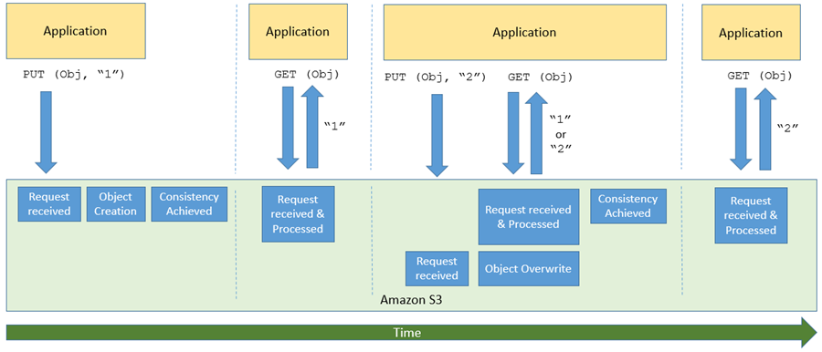

# Amazon S3 Update – Strong Read-After-Write Consistency
By Jeff Barr · AWS News Blog · December 1, 2020

When we [launched S3](https://aws.amazon.com/blogs/aws/amazon_s3/) back in 2006, I discussed its virtually unlimited capacity (“…easily store any number of blocks…”), the fact that it was designed to provide 99.99% availability, and that it offered durable storage, with data transparently stored in multiple locations. Since that launch, our customers have used S3 in an amazing diverse set of ways: backup and restore, data archiving, enterprise applications, web sites, big data, and (at last count) over 10,000 data lakes.

One of the more interesting (and sometimes a bit confusing) aspects of S3 and other large-scale distributed systems is commonly known as eventual consistency. In a nutshell, after a call to an S3 API function such as PUT that stores or modifies data, there’s a small time window where the data has been accepted and durably stored, but not yet visible to all GET or LIST requests. Here’s how I see it:

This aspect of S3 can become very challenging for big data workloads (many of which use [Amazon EMR](https://aws.amazon.com/emr/)) and for data lakes, both of which require access to the most recent data immediately after a write. To help customers run big data workloads in the cloud, Amazon EMR built [EMRFS Consistent View](https://docs.aws.amazon.com/emr/latest/ManagementGuide/emr-plan-consistent-view.html) and open source Hadoop developers built [S3Guard](https://hadoop.apache.org/docs/r3.0.3/hadoop-aws/tools/hadoop-aws/s3guard.html), which provided a layer of strong consistency for these applications.

## S3 is Now Strongly Consistent

After that overly-long introduction, I am ready to share some good news!

Effective immediately, all S3 [GET](https://docs.aws.amazon.com/AmazonS3/latest/API/API_GetObject.html), [PUT](https://docs.aws.amazon.com/AmazonS3/latest/API/API_PutObject.html), and [LIST](https://docs.aws.amazon.com/AmazonS3/latest/API/API_ListObjectsV2.html) operations, as well as operations that change [object tags](https://docs.aws.amazon.com/AmazonS3/latest/API/API_PutObjectTagging.html), [ACLs](https://docs.aws.amazon.com/AmazonS3/latest/API/API_PutObjectAcl.html), or metadata, are now strongly consistent. What you write is what you will read, and the results of a LIST will be an accurate reflection of what’s in the bucket. This applies to all existing and new S3 objects, works in all regions, and is available to you at no extra charge! There’s no impact on performance, you can update an object hundreds of times per second if you’d like, and there are no global dependencies.

This improvement is great for data lakes, but other types of applications will also benefit. Because S3 now has strong consistency, migration of on-premises workloads and storage to AWS should now be easier than ever before.

We’ve been working with the Amazon EMR team and developers in the open-source community to ensure that customers can take advantage of this update with their big data workloads. As a result of that you no longer need to use EMRFS Consistent View or S3Guard, further reducing the cost to run big data workloads in AWS.

To learn more about S3 strong consistency, visit the [feature page here](https://aws.amazon.com/s3/consistency/).

## A Word From Dropbox

Long-time AWS customer [Dropbox](https://www.dropbox.com/) recently migrated a 34 PB analytics data lake from on-premises Hadoop clusters to S3. Watch this video to learn more about strong consistency and how it has allowed Dropbox to simplify their data lake:

— [Jeff](https://twitter.com/jeffbarr);
