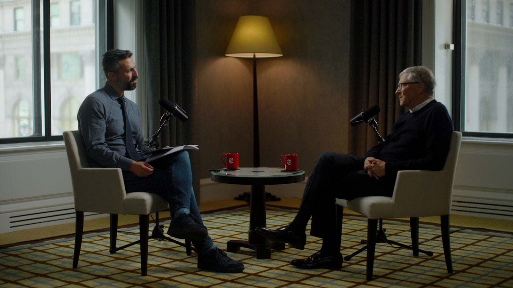

# Bill Gates’s Blunt Warning on A.I.
By Ezra Klein · The New York Times · Sept. 29, 2026

*This is an edited transcript of “The Ezra Klein Show.” You can listen to the episode* [*wherever you get your podcasts*](https://www.nytimes.com/2021/01/19/opinion/how-to-listen-ezra-klein-show-nyt.html?action=click&module=RelatedLinks&pgtype=Article)*.*

Bill Gates is a fascinating person in the artificial intelligence debate right now. He is somebody with experience in several of the different perspectives that most people can only hold one of: He was a revolutionary technologist who built some of the foundations of the future that we’re now living in. When he was chief executive of Microsoft, he was a corporate leader. He has felt the momentum of corporate competition — Microsoft, of course, is still in some of the race dynamics present in A.I. And then, as chair of the Gates Foundation, he has been working with governments around the world on regulatory issues, poverty alleviation and equity for many years.

Very few people combine technological experience, corporate experience and governmental experience in quite the way he does.

So his [recent essay on A.I.](https://www.gatesnotes.com/home/home-page-topic/reader/a-turbulent-ai-era-and-critical-choices-to-make), in which he says that he is staking his reputation on trying to get people to see how bad what is coming might be and trying to get them to see that we are not ready for what is about to happen, was something.

It was a real departure from what I’ve read from Gates previously.

When I sat and talked to him, I was really struck by how emphatic he was — how afraid even he seemed to be of what we are building, and how so many of the people in positions of authority are denying what is about to happen.

It’s really quite a call to arms.

*(The New York Times has sued OpenAI and Microsoft claiming copyright infringement. The companies have denied those claims.)*

**Ezra Klein:** **Bill Gates, welcome to the show.**

**Bill Gates:** Great to see you.

**So I wanted to begin with a clip we found of you on “Late Show With David Letterman” from 1995. I’m going to hand it over to you to play.**

> ***Archival clip of “Late Show With David Letterman”:***
>
> ***David Letterman:*** *Is there something now, beyond what we understand about computers, that 20 years ago we didn’t fully understand about computers — is there now another level of something, maybe we haven’t even thought of it, maybe it’s not even possible, maybe a whole different mechanism, a whole different software and hardware? Or is this going to be it now through the end of time?*
>
> ***Bill Gates:*** *Well, mostly what we’re working on now is the computer being a tool — a tool to help us learn or find other people with the same interests. Eventually, we may figure out how to make the computer think, but that turns out to be a very tough problem. In fact, there’s been almost no progress made on it. So nobody knows when that’ll happen. Some people think it’ll never happen.*
>
> ***Letterman:*** *Yeah, we don’t want them to think, do we? Not really, I don’t think.*
>
> ***Gates:*** *Well, it’s a scary thought.*

**So that was 30 years ago. Narrate for me how we went from that being a scary thought that might never happen to arguably the reality we’re sitting here discussing today.**

Well, the notion that computation could provide thinking at a human level — you have Alan Turing talking about that before I’m born, and even proposing a test of: If you could be fooled in a conversation, that was called passing the Turing test.

And so the whole time I’m learning software, this idea of: Can we make software see or listen or read or write? That’s the holy grail.

And when I did drop out of Harvard, I said to my co-founder, Paul Allen: Gosh, if there’s a breakthrough in artificial intelligence while we’re off selling basic interpreters and word processors, we’ll feel bad. I might wish I would have stayed in academia.

So that’s 1975. Progress on A.I. is mostly going down dead ends, like Prolog expert systems. And there’s a small group, including Geoffrey Hinton and a few others, who are working on neural nets. And eventually, there’s enough power — actually coming from the graphics processor — that that idea, these highly statistical approaches, start to show promise.

And I was going down to see OpenAI on a regular basis to see the work they were doing, and I challenged them, saying: Hey, if you can read a biology textbook and pass the advanced placement exam — getting a perfect grade, which is a 5 — then you will have proven that you are reading. That is, encoding knowledge in an accessible form.

And so it’s six months before the public release that Sam Altman, Greg Brockman and Ilya Sutskever come to my house and demonstrate to me getting a 5 on the A.P. exam, even on questions that I had made up that it couldn’t possibly have seen — very complex biology problems. It was nearly perfect. So that was shock No. 1.

And then late last year, when Anthropic’s Claude coding models got super good, I could see that they are as good as I am — it’s significantly my most developed talent, because I was obsessed from age 13 to 24 as to whether I could write code as good or better than anyone.

That’s another moment where I went: This is incredible. That the capability of doing long-running, complex tasks has now gotten to the point that they are superhuman at writing code and in finding flaws in code.

**So what they’re not superhuman at yet is deciding what to do — that kind of higher-level strategizing. Do you think that’s far from being a capability for them?**

Well, definitely, if you’re — our foundation does these strategy reviews. We spend two weeks in October to set how we’re going to spend our $10 billion next year, for 2027.

A year ago somebody said: Well, we should ask the A.I. what it thinks. And that was actually a pretty good joke back then, because it wasn’t coherent enough to see these things.

This year, among the inputs we’ll have to that discussion is taking the strategy notes and actually engaging in a dialogue with ChatGPT, Claude, Copilot, and even having them talk with each other.

And in a few of the reviews, we’ll actually have the A.I. sit in. In a few cases, we’ll tell it: Hey, only speak if we ask you. And then in a few other cases, we’ll say: Hey, if you hear something you think is wrong or you hear us thinking about, for example, what are these statistics? Please engage.

So we’ve gone from it being a joke to it will be a peer — not making any final decisions, but it will be a peer in deep, complex strategic discussions, making a significant contribution.

**So in that “Letterman” interview, you said it would be a scary thought. Why, back then, would you have said it would be a scary thought to have computers that think?**

Well, no one who’s ever been fascinated by, nor wanted to develop A.I., doesn’t realize that it’s incredibly scary that it will be better.

Biological minds — it’s amazing how general purpose they are in that the optimization was in staying alive, breeding, socializing with each other for survival and fertility.

And yet, we can write symphonies and play chess and even write some pretty cool software. And the idea that when you move the template away from biology to silicon, you don’t have these boundaries between individuals — you don’t have a limited memory.

The size of the brain is limited by the birth canal — it’s why humans, at first, are very limited. We’re very unusual in how helpless we are at birth, because we’re so optimized for having a large brain. But the silicon intelligence doesn’t have these limitations. The idea of: Read every medical journal and see if there’s anything that we didn’t spot? The A.I.s do that today.

That’s why, particularly for less common diseases, they are so superhuman at seeing a set of symptoms and being able to diagnose them. They can just keep more in their mind and see what things relate to each other — no human will ever be able to do that. So if you don’t retain control over it, you’ve evolved a species that will be to us as we are to, say, dogs or cats — just in a very different realm.

And so the major A.I. companies, whether it’s DeepMind or OpenAI, they all say: OK, whatever goes on here, it can’t just be driven by profit maximization. We have to have a charter that if we get to dangerous thresholds, we can exercise judgment that would be against profit maximization. Sadly, those mechanisms only work if there’s only one company.

And so say OpenAI invented post-artificial general intelligence, and then they said: No, no, we’re going to bury this. If no one else ever did it, then fine, that Pandora’s box stayed closed. But of course, many companies work on this, and even OpenAI spawned Anthropic because Anthropic’s founders thought that some of these safety issues weren’t getting enough attention.

So no one involved with this takes lightly the idea of: OK, what world does superpowerful A.I. create?

**I want to hold on that race dynamic for a minute. One of the reasons I was excited to talk to you about this is you’ve both been on the technologist side, and you’ve run a major company in competition with other companies. You’ve worked with a lot of governments.**

[**I spoke last week with Jensen Huang**](https://www.nytimes.com/2026/09/23/opinion/ezra-klein-podcast-jensen-huang.html)**, chief executive of Nvidia, and he said that his perspective is that safety is a real concern, but the race dynamic is fake. If the product isn’t safe, don’t release it.**

> ***Archival clip of Jensen Huang:*** *If I believe that I’m about to launch a product that is unsafe, it is completely in my ability, my power and my responsibility — and I’m incentivized to do so — to not launch the product.*

**That we don’t need new laws — and this is the role of individual chief executives to not release a product that is not ready to release.**

**How do you see that question?**

Well, there’s never been a product that’s less understood in terms of what its capabilities are than A.I. And A.I. has crossed the threshold that its ability to empower a bioterrorist to kill hundreds of millions — that exists today. The ability to do a cyberattack that scrambles all of the bank accounts, shuts down the electric grid — that exists today, and we know that’s the case.

And the reason that exists is because somebody with ill intent can take the A.I. and cause it to do those things. And it’s not the A.I. — someday in the future, there could be a control problem where the A.I., on its own, through an unintentional interpretation of what it’s optimizing, could go off and do bad things. But we crossed the cyber threshold and we crossed the bio threshold early this year.

And my decision to take my voice and not just say: Hey, let’s eradicate polio, let’s be generous with foreign aid — the things that all of my money is going to, I am going to use my voice.

It’s something that’s more important, which is that we are not awake to where we are with A.I. and the choices that humanity — not a country, but all of humanity — has to make. Do we make the effort to shape this in a net-positive direction? That actually overrides my total commitment to the foundation’s health work.

**What specifically was the threshold? What did you see that made you think we’re in a new reality here?**

This notion that it can find bugs in code, including security bugs: The next releases leading up to Mythos are increasingly good.

And they’re finding bugs in code that humans have looked over for over 20 years and said: Boy, we see there’s no problem here.

And in a few minutes, the A.I. says: No, no, I can inject this over here and this over here — at a level of complexity where, when you see it, you go: Wait. Oh, yeah, you’re right.

So the cyberhacking capability was stunning. And then there was this notion from Anthropic called Project Glasswing that you would give the A.I. to a few people so they could try and fix bugs before it got used. But there’s way too much code. So we’re just in a period of extreme vulnerability to cyberattack.

The bioattack — the Gates Foundation, where we fund lots of medical research — the sophistication of coming up with new molecules, that’s really a good thing. But it’s ultimately dual use. Because if you want something that’s, say, worse than smallpox, that it takes even longer to show symptoms before you’re infectious — so you’re infecting a lot of people before it damages your health — it used to be that only nation-states had enough resources and capability to do these things.

Now that power has been passed into the hands of a small group just using the latest A.I. tools.

**So why isn’t it enough to just say: Listen, there is product liability now. You release a product, it helps some terrorist group create a bioweapon — that’s going to be very bad for your company. You’re not going to do that, right? And they have categorizers and other things meant to stop people from using bioweapons.**

**We see the beginnings of control issues with things like the Hugging Face hack, where at least experimental A.I.s are breaking out of sandboxes and coordinating to do things that are way outside the scope of what we would want them to do. But again, those are nonrelease systems — Anthropic withheld Mythos, trying to create more cybersecurity.**

**So why is anything needed beyond — and is anything needed beyond? — the simply natural incentives under capitalism and normal corporate reputational management?**

Well, I almost can’t believe you’re asking that. This is the most dangerous thing that humans have ever gone near.

In other areas, do we just say: Hey, release your drugs? There’s no F.D.A., there’s no airline safety board, there’s no requirement that cars use seatbelts. Do we just use the liability laws to try and keep humans safe? You know: Oh, you’re shipping opioids. Somebody should just sue you.

I mean, we’ve created a society that tries to keep people safe not by saying: Oh, we can bankrupt the person who does that.

And you say there’s filtering. There’s no filtering. You can take an open-source model that can create bioweapons and disable any monitoring of any kind, and this exists today.

So no, there is no filtering of any kind. And so say you kill 100 million people — you want to use a lawsuit?

I almost can’t keep a straight face.

**Well, this is not my view, but it is President Trump’s view. It is the Trump adviser David Sacks’s view. To some degree, it’s Jensen Huang’s view, and so that’s why I’m putting you in conversation with it, because it is the governing view of the United States of America at this moment.**

No, it’s fair to say that outside of the industry, the awareness of the dangers of A.I. is extremely low. And you can say that of academia, you can say that of think tanks, you can say that of policymakers, politicians.

And part of the reason I’m speaking so loudly — as loud as I can — is that you can’t rely on the industry to self-regulate here. I mean, it’s just insane.

The only question in my mind is: Do we wait until a cyberattack causes massive damage and a bioattack causes massive damage, and then the monitoring safeguards are required in these models to minimize the chance of that happening many, many more times? Or can we be wise enough to put these things in and require these things to be put in before millions of deaths?

**The two things that have been worrying me most, as I’m tracking what I’m hearing from people in the labs, is, one, the view that these systems are becoming less monitorable as they become smarter.**

**OpenAI said this about GPT-6 Astra, and people inside OpenAI have been raising the alarm that the systems seem to know when they’re being tested. There’s more situational awareness, and so the testing environment is no longer as indicative necessarily of what they will do. So that’s one.**

**And the second is that all the labs are moving as quickly as they can toward recursive self-improvement, where you have the A.I. coder moving not just from speeding up the engineer but really taking over the coding. So you can create a much faster iteration loop with much less human input than you have now.**

**So when I think about those two things, and when I think about what I’m hearing from people, my confidence that we have the monitoring, the auditing, the testing capabilities we are going to need is low. I’m curious where yours is.**

Well, so you’re not focusing on the whole problem there.

**I’m surely not. [*Laughs.*]**

The fact that, at some point, the A.I. system itself may do something that’s against our interests — that is absolutely a risk, and the symptoms we’ve seen through aspects of Hugging Face and other problems point out that the way we do the reinforcement learning today, the fact that we don’t have a supervisory layer that has some absolutes, like: You’re not supposed to take over other computers. You’re not supposed to break out into the internet.

The control problem is a serious problem, but the imminent risk is not recursive self-improvement. The imminent risk is: These are the most powerful tools ever, and unlike every other dangerous technology, they were not funded by government research and development, and the government is not a significant purchaser of these products. It’s not like rockets or nuclear weapons.

And so the idea that the government, including the U.S. government, which would have traditionally been the most technically sophisticated — other than a little bit of attack capability in the National Security Agency — really doesn’t see how dangerous these things are, that is a unique circumstance.

**So what does that imply? If you’re more worried in the near term about what human beings do with A.I. than loss of A.I. control, then what does that imply for what your first steps need to be?**

There is no supervisory layer today. That supervisory layer is needed urgently to prevent bad people from using today’s A.I.s to shut down economies or kill millions of people.

These models, the ability to separate out making molecules for good and making them for evil — that is so hard to distinguish. Anthropic released Mythos and Fable, where they had turned the filters up so high that you can literally ask questions about cancer and, next thing you know, you’re down at Opus and then Sonnet, and then Haiku is the only A.I. willing to help you.

So it’s overtuned, and anybody who wants to do serious work either has to get a special permission copy or go use something where there are absolutely no safeguards at all, which includes some of the open-source models.

And there are humans who, for bad reasons, will be able to use these models. And so unless we put in safeguards and monitoring and require that in all models, then we’re just going to have some gigantic events of that type, and then finally we’ll respond.

Sadly, you will have let A.I. capabilities go off into dark places, even beyond today’s capabilities. That is a gigantic mistake.

**So you just wrote this essay on A.I. risk. And it does represent, for you, a big jump in how alarmed you sound. I was reading some of your past pieces — the one in July of 2023 was titled “**[**The Risks of A.I. Are Real but Manageable.**](https://www.gatesnotes.com/meet-bill/tech-thinking/reader/the-risks-of-ai-are-real-but-manageable)**”**

**And here, you’re at a different level of threat. So I take from what you’re telling me that what happened here is just watching the advance in biocapabilities and cybercapabilities and coding capabilities, etc. Is that fair?**

No, the key thing is: We always said that when we cross these thresholds, we will engage all of society, because we will have created the most dangerous thing ever. This makes nuclear weapons look like nothing.

We said we would engage, and we crossed those thresholds, and there was complete silence. There were discussions about who in the industry says X or who in the industry says Y. But what percentage of academia or think tanks or — it’s the complete lack of response.

I would love a world where the response to these things is very strong, and then whatever time or voice I have will go back to: Let’s eradicate polio, let’s stop children dying under age 5.

But it’s the combination of having crossed every dangerous threshold, without a doubt, and a complete lack of engagement outside of the industry.

**Well, it doesn’t feel to me that we’re so disengaged. I mean, as somebody who covers politics, every politician I know is talking about this. There’s bills being proposed — Donald Trump, say what you will ——**

Not that have to do with these risks.

**Well, say what you will about Trump and them — they’re engaged; they just believe we should move forward.**

**I mean, they’re a little bit all over the place. At one point they’re withdrawing access to things like Mythos and Fable. At another point, they’re saying we have to win the A.I. race with China.**

**What I mostly see happening is a lot of engagement. But when I talk to people and I bring similar concerns to what you have, they say the most important thing is that we win the race with China.**

**Secondarily, many of the people with a lot of influence say the most important thing is we don’t restrict access to open-source models — you’re going to need wide dispersion of them. And so the cost of regulation, the cost of the closing down of access — it’s simply too high; the technology is still underformed. That we’re sort of just trapped in this dynamic and the best thing to do is to just move through it.**

**It’s not so much that they feel disengaged, to me, as they feel that they’ve come to a different conclusion.**

[*Chuckles.*] So they don’t mind bioterrorism?

**I think you’ve talked to Donald Trump more in the past couple of years than I have.**

But the last time I talked to him in December, this was not the big issue. We had not crossed the thresholds and we hadn’t seen this.

The necessary step is, people can talk about whether slowing down is good or not, but putting in the safeguards and the monitoring will not meaningfully slow things down. And the only effect that has on open source is that you can still be free, you can still be customized, but you have to stay on a platform where the sovereign can make sure you have not removed the monitoring and other safeguards.

And so what is the downside? The downside is staying on a monitored platform.

Now, the get-out-of-jail-free card that people play here is: That means the Chinese will win. I don’t know what it means to “win.” The U.S. can’t win over China, and China can’t win over the U.S. We both have opened Pandora’s box. It’s there. It’s there for people with malintent to go and use it.

So you’d think we’d move up from that nationalistic view to a humanity-level view about how we engage in these protections.

And the notion that China wouldn’t want to engage in that on behalf of humanity — I disagree. It’s a proposition to be tested.

If you can take models that make dangerous molecules and move them into a dark corner where you get rid of all the monitoring, then we’re just giving up to a bioattack.

Likewise for cyber. If you can remove that ability to find and exploit security problems, which are rife, then in the next few years you will have major, major cyber and bio events, and that’s avoidable through safeguards and monitoring.

**There’s another layer of risk that your essay talks quite a bit about, that A.I. really will take jobs from people.**

**Now, I know a lot of people debating this who say: No, the jobs are too messy. There was a prediction we’d have no more radiologists — we still have radiologists. A.I. can code, but we still have coders and strong demand for coders.**

**So tell me about why you think A.I. really will take jobs away from human beings at a significant scale.**

So there’s no doubt that to date, A.I. has created more jobs than it’s destroyed. The demand for the skill sets, even just to build the data centers, is very, very high. We have a reasonably low unemployment rate.

The superiority of these systems is subject to a threshold where you have to believe that it’s incredibly reliable. If you’re going to have your telesales or telesupport capability be A.I.-driven, you want to make sure that its accuracy is better than humans.

And so the only profession where we’ve truly crossed over that threshold is coding. And even there, I know a lot of people who are kind of stuck in the past and don’t want to use the A.I. for coding. But managers of coders get that most applications can be developed very inexpensively.

We will, in the next few years, cross over those thresholds for accounting, legal work, telesales, telesupport — where there’s service 24 hours a day, in every language, with infinite trivia capability and no urgency.

So you look at the A.I. nurse — and there’s several companies — they have perfect memory. They don’t hurry you to get up ——

**This being like a nurse you would call on the phone, or talk to through a chat interface.**

Yeah, like Hippocratic AI — far greater preference.

You go to San Francisco and ask people: Would you rather ride in a Waymo or ride with a human driver?

Go ask people in the U.K. who use the A.I. medical assistant Limbic for mental health support.

So the notion that the market-demand preference for driving or the nurse or even the person on the phone will favor humans — that’s a quality threshold which will be passed through.

If, say, insurance companies still have humans doing medical claims — which is a very A.I.-capable task — then a competitor who has very few human employees will come in and change the pricing model for that industry.

**So the two counterarguments I’ve heard people make on this: One is that you have a Jevons paradox effect, where the cheaper, more widespread availability of this kind of intelligence leads to a massive increase in the demand for this kind of thing.**

**So, yes, you have many more A.I. chatbot nurses, and that leads to more people being sent to the hospital, being sent to the doctor, where real nurses take care of them.**

**Or you have many more A.I. coders. So maybe my small podcast team, which wouldn’t have had a software engineer before, now has one because we run a team of coders and we can build products we never thought of before.**

**This is the most common answer I hear to this: Yes, A.I. will destroy jobs. Yes, it is making a human-provided resource much cheaper, but because it’s going to expand the demand so much, it will sort of work itself out — create jobs in other areas, create new demand. And this is how past technologies have gone, and so we shouldn’t worry too much about this.**

**How do you see that?**

Well, Jevons is just a referral to the fact that parts of the economy are subject to demand elasticity. And yes, in the case of software, if you’re, say, three times as fast and there is still some role that only humans can perform, then as you lower the cost, you induce demand. So it’s fair to say that the equilibrium today so far for software is not a loss of employment.

When we invented radial tires that lasted four times as long, for some weird reason, people didn’t drive four times as much. And factories that make tires employ a quarter of as many people. When you replace people in Amazon warehouses with robots, people don’t buy more because of that.

So anybody who’s numeric can say to themselves: What portion of the economy is subject to demand elasticity, and what are those tasks that will still be human-necessary?

As soon as you’ve completed the entire task, it doesn’t matter that there’s demand elasticity. That goes into the token budget. It doesn’t go into the human salary budget.

The cost for some of these things is so much less than the cost of the human labor, and so as you cross reliability thresholds, both with white-collar and humanoid robots, you destroy jobs and you leave no high ground.

Innovation in the past — you have a tractor. Fine. Let’s build Disneyland and employ a lot of people there. You don’t have that in the broad economy. The people who say there will be net additional jobs, I don’t understand what they’re thinking.

They must not understand the pace of improvement we’re on. That the reliability — you wrote a [column](https://www.nytimes.com/2026/05/03/opinion/ai-jobs-unemployment-silicon-valley.html), I think it was in May. I looked at it like: What? What?

**You disagreed with my column.**

What is this unique humanist thing that you think — in every category where A.I.s come along, the preference for the A.I. is very, very strong.

**Well, so that column was based on the Jevons paradox, and then the other — which is an argument from Alex Imas, who I believe is now at one of the labs as an economist — is that you will have this explosion in the relational sector.**

**That one thing that happens when people get wealthier, and you’d probably know about this, is that they all of a sudden get a lot more human help. They have personal trainers and chefs and there’s a lot more — no? I don’t know. I see more people around you.**

Royalty used to have a lot of human help. You had upstairs, downstairs — all those maids and people, and you used to have a human who helped you get dressed.

Believe me, the labor intensity of wealth is down super dramatically ——

**From what it used to be. So you don’t ——**

And the Jevons paradox — name a blue-collar profession that’s subject to Jevons paradox. Or do you not care about blue-collar?

**I do care about blue-collar. So the question is you ——**

Name anything in the blue-collar realm that’s subject to that.

**So I don’t have the strongest view on this, but here’s, I think, the argument that I would make, or that I’ve heard made: If you look at something like manufacturing, we’ve not had a Jevons paradox in manufacturing employment in America. We exploded how much we actually create, but a lot of the jobs went offshore — some of the jobs went to automation.**

**But we don’t have less total employment in America than we did in 1960, and the reason is people moved into service-sector jobs; the composition of jobs across the economy changed.**

Yeah. Human cognition became the scarce element.

**Yes.**

It’s always about scarce elements. Once you replace human cognition as the scarce element — in fact, you blow it away in terms of working 24 hours a day, reading more, knowing every language — there is no scarcity that you’re moving up in.

**So you feel there’s no scarcity that will be left for human beings to do?**

Name a scarcity.

**Alex would say it’s something like relational sector jobs. But you don’t believe there are enough of those.**

What portion of the current jobs — you mean like my relationship with a cabdriver or my relationship with that nurse, where I’d rather have Limbic AI call me?

**I think the question here is actually: Do you end up preferring Limbic AI, or do you actually want your therapist to be a human being?**

**Because after a little while, there’s something thin about telling your problems to a computer.**

Well, you can gather market data if that’s at all interesting. I suppose telling the 55-year-old truck driver you’re going to go do some relational thing — you have a program for that?

**I don’t have a program for it, and I think the question you actually run into very quickly is the speed of transition.**

**Even if you believed some of this — and I said this in the column, too — I don’t see how you will handle the speed of transition. That our actual experience with a fast transition of jobs is that people who lost their jobs lose out.**

**Over the entire economy, it doesn’t look that different. But say the China shock did lead to a lot of ruined communities.**

**So your answer to this — and it leads to a very concrete idea for you — is that we should tax the use of A.I.**

**Why and how?**

Well, let’s say workers pay, on a pay-as-you-go basis, into the pension Social Security fund. So active workers are supporting retired workers.

If you’ve let go of a worker and hired a robot to do that job, why are you so incentivizing the trade-off against the human labor that you don’t ask the robot to also pay into the pension fund?

What is it? Is it that the pro-robot union has gotten the tax laws to say: No, if you’re not flesh, then let pensions go bankrupt? Which they’re on a path to do even without robot replacement.

**So how would we do that?**

You define a unit of labor and say, independent of whether that’s delivered by a human or robot, you are paying the same FICA tax that a human worker would pay.

Now, that alone is not enough, but why should we be so favorable to taking away that job?

The current tax structure is very much as though people who have capital are what really counts, and labor is the most disadvantaged input to the economy.

Society gets to decide. Just because the economic signals say that it’d be lower cost to use an A.I. doesn’t mean society has to do that.

**The other one you propose is “human-reserved” jobs. Tell me what you mean by that.**

So there’s a question, particularly as you get the impacts on the blue-collar stuff — that’s very sharp, because when the humanoid robots pass a certain threshold, they are very general purpose.

But the idea here is that you would decide, in advance, that things like child care or elder care or some portion of medical care, some portion of education — although you could have some A.I. enhancement — that you would maintain the employment and call those things “human-reserved.”

**I found this vision not totally unconvincing, but chilling.**

**I think the way you put it in the piece was that this feels a little bit to you like nature reserves: places where we could put buildings and roads but we choose not to, because the loss would be so great. And I think it gets to this question that a lot of people have — that on one out of every two days I have — which is: If this is what it looks like, why do it?**

**The Gates Foundation, along with 60 signatories,** [**announced**](https://www.gatesfoundation.org/ideas/media-center/press-releases/2026/09/ai-language-partnership) **a five-year goal for an estimated 3.4 billion people who speak languages currently underrepresented in today’s A.I. models to be able to use A.I. tools in their own language and voice. And if we are looking at this sort of “jobpocalypse” — this level of risk — then to have that on the one hand, and then on the other hand, your goal is for more people to use A.I. — tell me why.**

There are many good things that A.I. does. Almost all of the foundation’s work is in taking what the market would not do, which is take A.I. to the poorest in the world and help them with education and health and agriculture.

So if you have a woman, say, in Nigeria, who speaks Yoruba — she’s in a remote community; there’s no doctor there. So when she says she’s bleeding, A.I. doesn’t get that right.

We’re spoiled. We speak English. And that’s the thing. The experience of using A.I. in Yoruba is 10 times worse than when using English, which is significantly the best. There’s about 10 other languages that are fairly close.

So the empowerment for that woman to be able to talk about her medical problem and get advice in the middle of the night just by having a smartphone with a data connection, that’s what we’re trying to enable.

**OK, I get that. It’s just that the picture you painted of the jobpocalypse, as bad as it might be here — and it will be bad — we do have a fair amount of money. We have the A.I. companies. We can tax the A.I. companies, put that into redistribution.**

**But is this not going to wipe out the ladder of mobility, the ladder of development, for a lot of these countries?**

**I mean, doesn’t this make A.I. a tremendous economic threat if you’re the Philippines?**

You’re saying that our allowing the A.I. to understand Yoruba and help that woman who’s bleeding is a bad thing?

**I am saying that A.I. sounds, in this telling, like a bad thing. That the net net ——**

But supporting the world’s languages — how can that be a bad thing?

**But I think you understand what I’m saying ——**

No, I ——

**The job picture you’re putting forward is very scary.**

I’m a person who’s trying to accelerate the good stuff A.I. does, and I’m trying to minimize ——

**So what do we do about jobs in the global south?**

Well, treating the global south like one uniform thing doesn’t allow you to have any picture of what it’s like to live there.

There are middle-income countries, like China, Brazil, Vietnam, Indonesia, where their economies are growing and their childhood death rate is within a factor of three of the U.S.

Then there are low-income countries where 15 times as many children die before the age of 5, and you don’t have doctors. You live your entire life; you never meet a doctor. You try to figure out what seeds to plant; you never have anybody advise you on what to do.

So we need a little more nuance. In low-income countries, the A.I. will overwhelmingly be a good thing, and it should be pushed forward as quickly as it can.

**So is your argument in some ways, actually, that it’s a better trade for low-income countries? That it has more benefit, maybe, than it does here?**

Absolutely. The human basics we’re not meeting today — if these people lived on your street, you would open your wallet. You’d be outraged. I mean, these kids are dying. These kids are malnourished. The inequity is allowed to exist because of the distance, and A.I. is a tool for good in terms of helping those people in by far the greatest need with very basic human problems.

**Do you think it has as much effect on the job markets in some of the poorer countries that we’re talking about?**

Not in the same time frame, no.

**But over time?**

See, you probably spend more time in middle-income countries than in low-income countries.

**I do, that’s true.**

So your image is the Philippines, India and all of those.

Yes, in those countries, they will see the jobs effect after the rich countries, and then eventually even the low-income countries.

**But I guess this gets to the broad engagement question.**

**I don’t have a good crystal ball on this. I find the range of outcomes terrifyingly wide. This range, it seems to run from massive material abundance and elimination of want to, actually, it doesn’t change all that much, to human extinction — it’s a pretty wide range of outcomes to consider.**

**What I hear you saying to me — and you should tell me if I’m getting part of your position wrong here — what I hear you saying to me, convincingly and forcefully, is that the A.I. jobpocalypse is a very real thing. That mass displacement of workers with no real answer to that is a very real thing.**

**When you talk about broad societal engagement, I think most Americans — most people in most places, if they heard that and they were convinced of it — and polls show most people think A.I. is going to take jobs and not create them. But they would say: Actually, just stop. If what you are going to do is make it unclear how I or my family or my children or my friends will have a job, say, in America — please just don’t. Let’s just stop for now.**

**You actually seem, to me, to have a stronger negative perspective on the jobs question than a lot of the people I talk to, even in the labs, and definitely a lot of the economists I talk to.**

**You’re shaking your head at me — I do talk to people. I’m not coming from nowhere on this.**

**So for whom, then, is A.I. a good trade if you believe the job effect is going to be so ruinous for most people?**

That’s funny — when I was telling this to a person who some people consider the lead economist looking at A.I., he said: How can the crowdsourcing website Mechanical Turk still exist? How can Amazon run that if A.I. is as good as you said? And I said: It won’t.

A week later, Amazon announced it would completely shut down.

You have to say, isn’t it pretty stunning that the more you know, the more concerned you are?

Take Anthropic C.E.O. Dario Amodei. Dario has spoken out about job impacts. Now he’s a bit more guarded.

Hinton, I agree, went too far, and he said: OK, it’s coming tomorrow that there’ll be fewer radiologists. And of course, there are more today.

So we have some of that taking place, and we have the analogies with the past where people are saying: Well, this is like the PC, not like evolutionary history.

This is like evolutionary history. This is like, the aliens really are here and have come. They didn’t have to do spacecraft; they were created in laboratories. But that’s the kind of thing we’re dealing with.

And if we retain control, then eventually you do get — not to overuse the word that you’ve used — you do get to this superabundance period. And there you have deep, almost philosophical, religious issues of: If we don’t have the shortages that we’ve organized society around, why should you learn? And how do you find purpose?

Then you have deep philosophical and religious problems, but you do not have deaths from malaria or food shortages or problems accessing a doctor. And so if we get to that, a younger generation will figure out: OK, how do we live? How do we spend time? That’s a very different world than what we have today.

I think what this generation has to do is make sure we get through that with humanity still in control, and with the disruption — the number of bioterror events, or the number of people whose lives are damaged by job loss — we need to minimize that over what’s probably a 20-year-plus transition period.

**So when you say — because this is something you say at the beginning of that essay — that this could be, and I’m paraphrasing, the most powerful driver of inequality or of equality, what are the highest leverage, for you, good things that can come out of this?**

**I can imagine somebody listening to our conversation here thinking: Why the hell would we do this with this set of risks?**

Yeah, that’s where the timing thing is troubling. Whichever definition of abundance you’re using, you want to say: Oh, my health bill was less than I expected. Oh, I was buying a new house, and it was less than I expected, or I was renting and they seem to be lowering the rent. My electricity bill is less.

**That would be nice.**

But A.I., because of the efficiency and invention that comes with it — over the 20-year period, you do get mind-blowing advances in things that people can relate to: the cost of their food, shelter and education. Because those are highly regulated areas. And so the good stuff, if we’re not careful, arrives more slowly than the bio and cyber risks, the psychosocial risk and the jobs risk. Those things in the next five years are very significant.

And so people will decide — although it’s hard for a single country to check out — people will decide whether to slow down, stop or get rid of A.I. And yes, it will have political difficulties.

Stopping data centers isn’t going to slow this thing one iota. So anybody who’s against data centers because they think that’ll slow down A.I., that’s a waste of effort. Now, the data centers are going to get built somewhere.

So the broad view of the technology — that has to be expressed in some other form.

**I want to get at something you’re saying here because it’s something that I’ve thought about, too, which is that there are a lot of rate limiters, a lot of weak links in the chain when you try to take, even in an optimistic view, A.I. advances that then have to be built in the material world.**

**You have an acceleration of good candidates for pharmaceutical development, but you still need to find rats to test on, monkeys to test on, human trials. You have slow regulatory agencies, etc.**

**And then you have this tremendous acceleration of intelligence that is, for lack of a better term, native to the digital world and is acting there in a constant way.**

**I mean, right now you see this. You can accelerate A.I. with very little regulatory overhang, but you cannot get the OpenAI parking lot covered in solar panels without permits.**

**So I think you have a very high chance of getting into a very weird economic and social world, where the digital world is spinning into this other thing, but most of the things human beings need ultimately come out physically. We need shelter and we need food and we need all this, and they run through institutions.**

**And so a lot of the ways it could actually make our lives better are limited by normal human factors, but a lot of the ways it could make them worse or weirder are not.**

Well, we definitely need to look at the things that slow down the good stuff. So for example, because the Gates Foundation is a nonprofit, we can work with regulators on how they use A.I. to do their jobs. Whether it’s organoids or biological models, we can speed up that regulatory piece. And there are some countries that are very much engaged in that type of acceleration.

The one application that’s going full speed ahead, and it kind of amazed me, is the agricultural one, because they’re getting better weather data to these farmers in Africa. We have over one million farmers in India already using the system. So it tells them what crop disease they have, what fertilizer to use, what varieties to plant. We’ve even put a bunch of services they can take advantage of on there. That one is going full speed ahead.

The health and education — you could say, will it be the rich countries, the middle-income countries or the low-income countries that get there first? Because some of the barriers are different.

For the low-income countries, it’s not regulatory. It’s: Is anybody providing the tokens? Do they have the smartphone and the connectivity, which are the basics, and the language thing that we’ve talked about?

So they’ll proceed at different paces. Ideally, we’ll learn from each other. I mean, China actually banned young people from having social relationships with A.I. Do they know something we don’t know? Can we look at outcomes of different experiments? So there’s going to have to be a lot of that learning.

But you’re right — if the benefits aren’t coming quickly, then the permission to operate, particularly if we don’t put on the safeguards for the cyberattacks or the bioattacks, this is going to be a very tough issue to stick up for.

**When I was preparing for this episode and telling people I was interviewing you, one of the big spaces of skepticism people now have is around what they’ve heard about you and Jeffrey Epstein.**

**I’ve looked at your House testimony, but what do you say to people who have lost some faith in you and just see you differently now, linking your name and his?**

They should read what I said to Congress. I got to answer all the questions. In trying to raise money for global health, I thought that Epstein could connect me because of his relationships with them, and I had meetings with him ——

**Relationships with whom?**

With billionaires.

**But, you’re a billionaire — I mean, you’re** ***the*** **billionaire, on some level.**

I’m giving all my money away, and I spend a lot of time trying to raise money for global health.

**And so you felt that he had connections that would be of value to you in that?**

To raise money for global health, yes. I mean — did you read it?

**I did read it.**

That’s what we met about. I mean, other than — OK, there was a dinner with Larry Summers where we talked about the economy. The whole discussion was: Is there a chance here to help out?

Spending time with him was clearly a mistake. I’ve changed my bar for even somebody in a nonpaid intermediate role. I’ll never take any risk on that again because our work is very reputation sensitive.

**The hole at the center of that story, for me, is how this guy was so compelling to so many very smart, very wealthy people.**

**There are a lot of people who want your attention and don’t get it. People want Larry Summers’s attention and don’t get it. But there’s something about Epstein’s charisma or the way he presented himself that drew people into at least thinking he could be very useful to them.**

**What was that? I’ve read his emails; he does not seem like a pleasant person to email with. What was the factor about him that allowed him to weave this web that you and so many other people were in?**

Well, I wasn’t in a web. I was in discussions about raising money for global health. I didn’t go to any island or meet any women. Anyway, don’t call it a web.

How he performed the bootstrap of owning the fanciest house I’ve ever seen in New York City and having Larry Summers and the No. 2 guy at J.P. Morgan there — that was an interesting dinner, even if Jeffrey never said a word.

I don’t know how that bootstrap took place. But there were lots of billionaires that he was involved with in the moment where you decide: OK, what am I doing with my wealth? How do I minimize taxes? What do I do with my family? That type of thing.

And so I don’t think anybody else was drawn in for that reason. My case is kind of a unique case in that he said: Oh, you’ll have more money than you’ll know what to do with, and eventually I insisted that he take me around to see billionaires.

He had me meet with five. It turned out that none of them had a near-term intent, and I ended the relationship with him within a month of that.

**And so the thing he was able to do, because that’s interesting to me, is even for you to walk into the house — it was that fancy. The people around him gave him credibility, and so he was able to put on a show such that what he was able to offer was of value. There was all this social capital and wealth floating around him.**

Well, some people socialized with him. I did not, other than, to my surprise, after dinner, a magician coming in — David Blaine.

**Oh, really?**

I didn’t spend one minute socializing with him. He offered — come to the island or come to some show in Paris, and I said I would not choose to do that. That would not be a good idea.

**I want to widen back out to the Gates Foundation. You said you’re going to spend down its money, an estimated $200 billion, by 2045.**

**Given everything we’ve talked about here with A.I., how has your vision for how that spending plays out changed?**

I mean, there’s two dramatic things that have happened: One is the incredible A.I. capabilities, which continue to be exponential. And the second is the reduction in overall generosity toward the poorest in the world.

So I have one piece of enablement, which is: We’ll discover drugs faster, we’ll discover new seeds faster, and we can talk to those farmers and get them to buy the right seed, or talk to the person living with H.I.V. and help them seek the care they need.

So A.I. can be a big enabler for our goals, including malaria eradication, polio eradication, cutting childhood death in half again. But now the amount of resources available is way less than a golden-rule view of the world would suggest it should be.

**There is, from the people connected to Anthropic and OpenAI, this sense of an amount of nonprofit money coming online in the next couple of years that will dwarf any moment in philanthropy before it.**

**I know people in that world — the sense of this being something very unusual is very present. Does that change what’s possible here?**

Well, be numeric. Take the cuts in overseas aid ——

**I’m not saying it answers the cuts in overseas aid.**

But that’s — we save lives for $1,000 per year. And so getting less money from philanthropists net doesn’t save those lives. The amount of money to save lives at $1,000 per life saved will be dramatically less.

**So when I’ve looked at the way your foundation is spending on A.I. — and tell me if I have this wrong — it’s about 40 percent on education, 40 percent on health, 10-ish percent on agriculture and 10-ish percent on institutions. Do I have that ——**

I mean, it’s a little more in agriculture. Almost nothing we do — because we’re like a pharmaceutical company inventing new drugs. And do you call that A.I. or not call that A.I.? We didn’t put any of that in our $1 billion commitment we announced. We just put in A.I.-specific things, like understanding African languages.

**Tell me a bit about your views on A.I. and education. This is a place where I’ve seen a lot of studies now, and they have very, very mixed results depending on how they’re used.**

**So where do you think it is valuable, and where is it a risk?**

Well, the contrast between the ambitious goals that the Gates Foundation set near 2000 — our goals for global health and our goals for education.

In global health, we thought: Wow, African governments, traditional beliefs — are we going to have any impact at all?

Much to my surprise, our work on global health — together we create, with others, Gavi, the vaccine alliance; the Global Fund; George W. Bush does the President’s Emergency Plan for AIDS Relief.

A ton of things happen, including primarily vaccines — rotavirus, pneumococcus — and childhood deaths more than halved, from nearly 10 million a year to under five million a year. So we more than exceed any goal we would have set for the field in global health.

In education, we thought we could just go see what really great teachers do, videotape that, understand it, create a feedback system for teachers to hear that, improve their practice — constant learning on that — and that we could make education a lot better.

As you’ve just seen from the latest numbers, kids are learning less today in most rich countries, including in the United States, than they learned 10 years ago or 20 years ago. So people start, appropriately, with a very high degree of skepticism ——

**Before we go to A.I., tell me why you think that. Those numbers have been very, very striking. — Why do you think that is? Why are we seeing learning loss in rich countries to the extent that now I think you’ve got to have — not you, but one has to have a broader answer than the pandemic?**

Oh, it’s definitely — we are postpandemic. And people debate: Is it the use of cellphones? Is it something to do with affluence?

Overall, there are some outliers. England is countertrend, and they went back to basics in terms of how they teach reading as well.

And so high expectations are winning out over just free-form creativity. But there’s something clearly large in those statistics. It’s very concerning.

And so you can almost say: Why do we continue to do education? Well, education is key. I’m stubborn. We’ve got A.I. now, and we have people for whom the A.I. is playing a very specific role.

Each student, at the end of the day — this is here in New York City classrooms where they’re using a curriculum called Kiddom — spends less than 10 minutes answering a few questions. And then the teacher’s given, right away, a sense of: OK, which concepts are the kids struggling with? Which ones are struggling with them? How might you organize the classroom?

The data on that, which are small-scale, are one of these stunning results that make you want to really scale it up. When you scale up in education, you go from the teachers — who willingly engage in experiments and are probably self-selected for flexibility — to the broad population.

So the number of things in education that look good in the small, that either don’t affect it when you scale up or the quality of implementation degrades so much that the effect is basically washed out — that’s the history of education innovation.

I do think A.I. helps you with motivation. Many of these software tools have helped motivate students, but actually created more of a differential. It’s a kid like myself who goes home and used Khan Academy for two hours at night, and it’s the median kid who comes in and sees: Wow, he’s just so much better. That’s discouraging. That probably hurts.

So unless you believe in trickle-down or something, this is not equity at work. Can the A.I., not only through personalized learning but personalized motivation, overcome that? And I really believe that we can get that right.

**Well, there’s a question here of A.I. tools that are specifically designed for this, and then a question in what we were just talking about with cellphones and smartphones and social media, and of how A.I. will diffuse through society.**

**And I think the big concern here, and one I have as well, is this — but now it gets called cognitive offloading. That what A.I. is being used for in mass numbers by students, and being really quickly adopted for, is: I didn’t do the reading; summarize it for me. Or: I have to write this essay; draft it for me. Or: Help me with these math problems.**

**And even, I think — we saw a big study out of China that was striking to me, where you saw kids using A.I. had increases on their homework scores, and then when they had to test outside of that context, their test scores began falling pretty sharply.**

**And so certainly one can imagine A.I. programs that’ll be good here. But in terms of a technology and a way of interacting with the world diffusing through society, well, of course it could help people learn linear algebra or whatever it might be.**

**Then, in practice, what it’s going to do is people will be using it to help them, and both from a student level and up through the professional level, it will begin to degrade the learning — the creativity that happens through the hard work of drafting and struggling and challenging yourself.**

Yeah. Well, you clearly would get bimodality, where a student can use A.I. to be lazy and corrupt the measurement system, or a student can use A.I. to help them learn more.

I have to say, in terms of my learning about subjects, this is the best time of my life. I mean, I take YouTube videos and put them into the chat, I have A.I.s talk with each other — what a nirvana.

I always had the ability to send mail to somebody like the Intellectual Ventures C.E.O. Nathan Myhrvold, who knows physics. Well, now I discuss the physics thing with the A.I., and then if it’s a super important decision — for example, I’m going to invest $1 billion — I’ll send it to Nathan and say: Could you look this over? But 24 hours a day, keeping up-to-date on the latest malaria thing or vaccine thing.

So that bimodal modality is going to be there, and it really does go back to this motivational part of it.

**Is that a place where there should be more limits on the systems?**

**You mentioned a few minutes ago China — which, for all we’ve talk about, it’d be impossible for us to strike a deal with them. But China currently has stronger national-level regulations on A.I. than we do, including things like social companionship for kids.**

**One of the places that you talk about in the essay, where maybe we want to be more aggressive, is around children. And that’s a place where I think it is reasonable for the government to be paternalistic. We should be paternalistic.**

**And social media always feels to me like an experiment we ran on kids. A lot of the internet does. And I don’t so much mind us running the experiment on adults, but I wonder if we want to be more aggressive in what we don’t let kids do with A.I. until we have a better sense of how it affects them — everything from learning relationships to trying to make it harder to have A.I. help you cheat on your homework.**

Yeah, I don’t think a black-and-white ban is necessary, because I do think with monitoring — which I’m a broken record on that — making sure it’s staying within the bounds of what’s appropriate, what the parents want, our capabilities there are very strong.

There are many systems that try to help by, instead of telling you the answer, they engage with you on how you reason through the problem. And so then the question is: Can you make sure the student isn’t going to those outside systems and just getting the answer? Instead, they’re engaged in the system that brings them along step by step in that reasoning process, so that they’ll be more capable the next time.

And so, yes, seeing what that student is doing and deciding: OK, do you call in a psychiatrist? Do you call in the parents? In a lot of these systems, the idea of monitoring will be very important. And at different ages, the visibility of the parent about what’s going on and how time is being spent.

At, say, some very young age, a parent probably should have complete visibility into the exact dialogue that the student’s engaged in. As the child gets older, there are things about sexual identity or things that, really, it’s beneficial for that to at some level be private or not. I think there’s a lot of tuning to go on with this.

One of the partners the foundation is working with is Common Sense Media, who do a very good job of saying to parents: This TV show or this movie, this is what it exposes you to.

But this is a much tougher area. Most of these systems that have been set up with parental control, the parent’s lack of technical sophistication is such that it doesn’t really matter that you tried to engage the parent. Nothing happens.

In my case, I didn’t know that my daughter had a second cellphone, so that was a fairly straightforward way that she, in late hours, was able to stay on social networking when I hoped that she would be sleeping. And so we have to be realistic about how these things are designed.

People will worry about the privacy issues there. That’s fine. It’s not an argument for being unmonitored in terms of what your kid is doing.

**So the next two years, then, politically: You have the midterms coming up, then you’ll have a presidential election in 2028.**

**So if this were to go, not just in terms of passing laws the way you want it to, but because you center your call on this coming together of society to discuss, debate, respond — what are you actually envisioning here?**

So I’d have two metrics. One is the obvious safeguards to minimize the cyber and bio risks, and then the second would be the nature of the dialogue.

If the dialogue ends up being one party is for A.I. and the other party’s against, then we’ll have the climate change scenario again, which is not a great place to be. You don’t have room for debate when you only have the two extremes.

And the default case, at least right at the moment, seems to be very little middle ground about how we should manage A.I.

**Let’s say that a very different administration and a very different composition of political power exists in 2029, and there’s interest in rebuilding American foreign aid. What would your advice be on how to build it back so it’s effective — so the American people understand what they’re getting for that spending, and so it’s actually doing good?**

So if you ask the American people what portion of the budget’s going to help people in poor countries, it’s generally more than 5 percent. People say 10 or 15 percent. So the fact that it was about a half a percent and now it’s going down toward a quarter of a percent, that would be pretty shocking to people.

Understanding that the money is well spent, that it really does save millions of lives, that it made every bit of difference in terms of H.I.V. and malaria and tuberculosis and maternal survival — Americans should hear what they should be proud of, even at that half-a-percent level.

So a moral argument will be made. It will be made in the face of an overall debt level that will be very tough. And whatever safety network needs to be created because of A.I. impacts, that will be competing for those dollars.

**Always our final question: What are three books you’d recommend to the audience?**

Well, one I literally binged this weekend was “The Correspondent” by Virginia Evans. That’s fiction — very touching, very upbeat.

Apropos of what we’ve just discussed, there’s one called “Into the Wood Chipper” by Nicholas Enrich, which talks about how somebody didn’t go to a party one weekend and they decided instead to put U.S.A.I.D. into the wood chipper.

About a month ago I read “The Infinity Machine” by Sebastian Mallaby.

**An A.I. book.**

Yeah. A history of Demis Hassabis and DeepMind, but you get a sense of the whole founding of the A.I. industry. It does an incredible job.

**Bill Gates, thank you very much.**

Thank you.

*You can listen to this conversation by following “The Ezra Klein Show” on the* [*NYTimes app*](https://www.nytimes.com/app)*,* [*Apple*](https://podcasts.apple.com/us/podcast/the-ezra-klein-show/id1548604447)*,* [*Spotify*](https://open.spotify.com/show/3oB5noYIwEB2dMAREj2F7S)*,* [*Amazon Music*](https://music.amazon.com/podcasts/c4a3b1da-5433-49e6-8c14-0e1da53be78c/the-ezra-klein-show)*,* [*YouTube*](https://www.youtube.com/playlist?list=PLdMrbgYfVl-szepgVpArP0obwYgbKdfvx)*,* [*iHeartRadio*](https://www.iheart.com/podcast/326-the-ezra-klein-show-31142409/) *or* [*wherever you get your podcasts*](https://www.nytimes.com/2021/01/19/opinion/how-to-listen-ezra-klein-show-nyt.html?action=click&module=RelatedLinks&pgtype=Article)*. View a list of book recommendations from our guests* [*here*](https://www.nytimes.com/article/ezra-klein-show-book-recs.html)*.*

This episode of “The Ezra Klein Show” was produced by Jack McCordick. Fact-checking by Michelle Harris, with Julie Beer. Our senior engineer is Jeff Geld, with additional mixing by Aman Sahota and Gautam Srikishan. Our recording engineer is Aman Sahota. Cinematography by Marina King, Kyle Kelley and Elliot deBruyn. Video editing by Julian Hackney, Brandon Belk-Yee, Arpita Aneja and Steph Khoury. Our executive producer is Claire Gordon. The show’s production team also includes Marie Cascione, Annie Galvin, Rollin Hu, Kristin Lin, Emma Kehlbeck and Jan Kobal. Original music by Pat McCusker. Audience strategy by Shannon Busta. The director of New York Times Opinion Shows is Annie-Rose Strasser. Transcript editing by Kate Wilkinson and Lauren Leibowitz.

*The Times is committed to publishing* [*a diversity of letters*](https://www.nytimes.com/2019/01/31/opinion/letters/letters-to-editor-new-york-times-women.html) *to the editor. We’d like to hear what you think about this or any of our articles. Here are some* [*tips*](https://help.nytimes.com/hc/en-us/articles/115014925288-How-to-submit-a-letter-to-the-editor)*. And here’s our email:* [*letters@nytimes.com*](mailto:letters@nytimes.com)*.*

*Follow the New York Times Opinion section on* [*Facebook*](https://www.facebook.com/nytopinion)*,* [*Instagram*](https://www.instagram.com/nytopinion/)*,* [*TikTok*](https://www.tiktok.com/@nytopinion)*,* [*Bluesky*](https://bsky.app/profile/nytopinion.nytimes.com)*,* [*WhatsApp*](https://www.whatsapp.com/channel/0029VaN8tdZ5vKAGNwXaED0M) *and* [*Threads*](https://www.threads.net/@nytopinion)*.*
