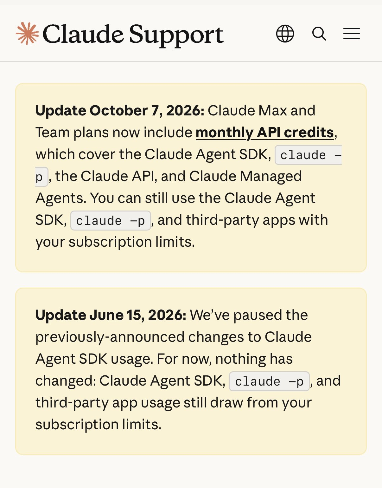

# Claude Coders: You CAN now use your Claude subs in third party harnesses without paying extra.

By Dan McAteer (@daniel_mac8) · X · October 12, 2026

Claude Coders: You CAN now use your Claude subs in third party harnesses without paying extra.

Works with:

- Claude Agents SDK
- claude -p
- Claude API
- Claude Managed Agents

~6 months ago this would have been HUGE positive news. It still should be.

