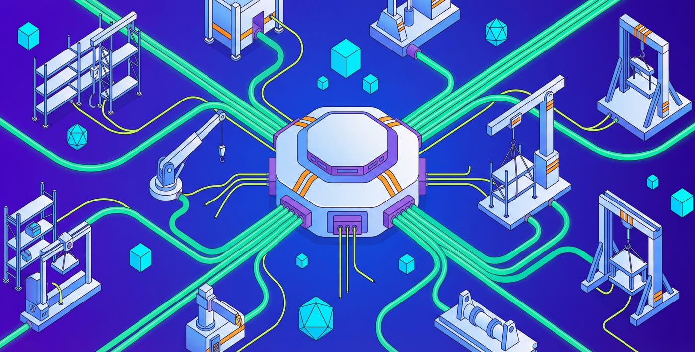
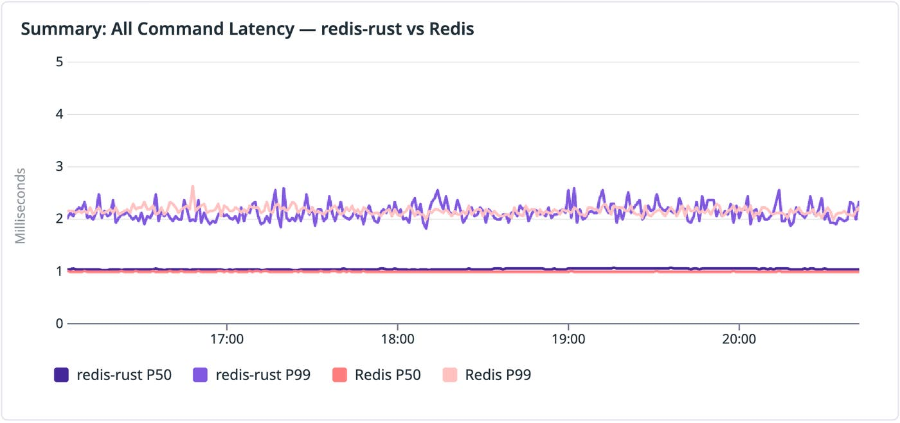
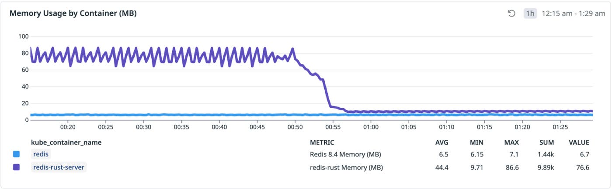
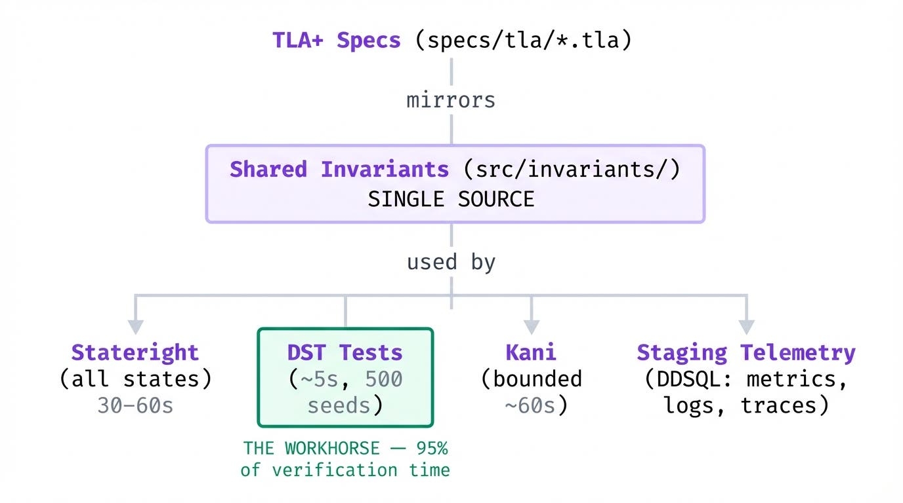
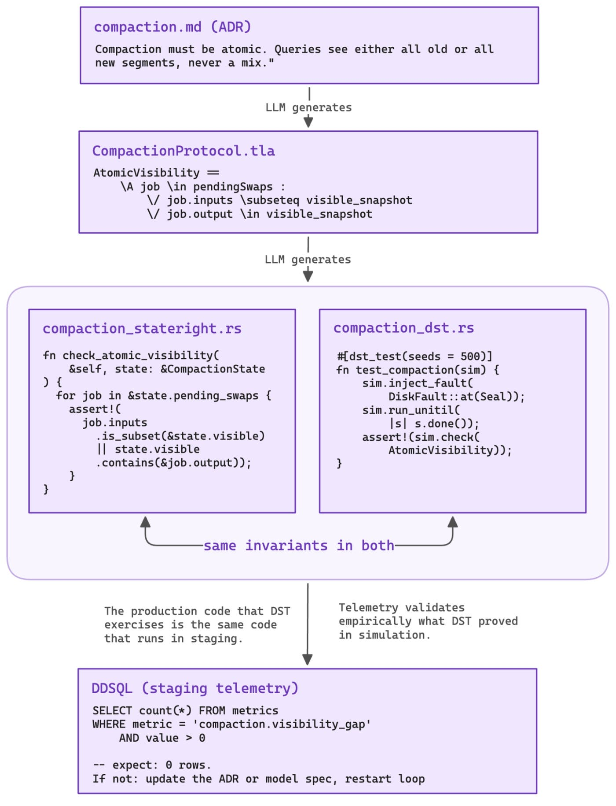
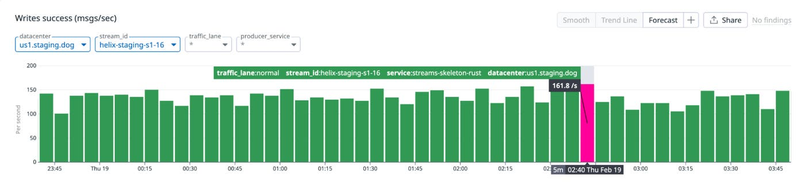
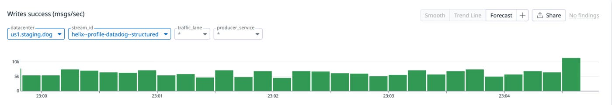
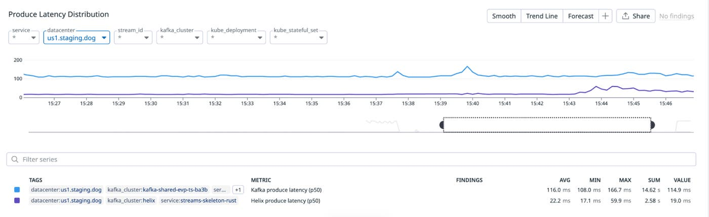
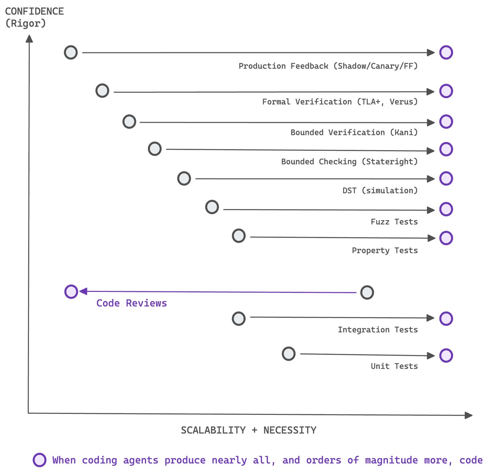

# Closing the verification loop: Observability-driven harnesses for building with agents
By Alp Keles, Jai Menon, Sesh Nalla, Vyom Shah · Datadog · March 9, 2026

AI agents can now produce software faster than any team can verify it. The bottleneck has moved from writing code to trusting what was written.

We have seen this pattern before. Early programmers resisted compilers because they could write better assembly by hand. Often they were right. Compilers earned trust because the languages they translate have precise semantics: The programmer defines what the program does; the compiler has freedom over how it is implemented. Automation has consistently won only when paired with verification.

With AI agents, building trust is more challenging than in the case of compilers. AI agents ingest unrestricted natural language, sometimes from untrusted sources, and translate it into running code. We must find new ways to verify the outputs of these new program synthesis engines.

At Datadog, we see this as our opportunity: preventing “vibe-coding” from spiraling into “yolo-deploys.” Our approach is **harness-first engineering**: instead of reading every line of agent-generated code, invest in automated checks that can tell us with high confidence, in seconds, whether the code is correct. The agent generates code, the harness verifies it, production telemetry validates it, and if something is wrong, the feedback updates the harness and the agent tries again. The specific methods to develop harnesses vary in rigor—deterministic simulation testing, formal specifications, shadow evaluation, observability-driven feedback loops—but the principle remains the same: make the verification fast and automatic, and let the harness do the work that human review cannot scale to do.

We have been building toward this vision for the past year. [BitsEvolve](https://www.datadoghq.com/blog/engineering/self-optimizing-system/), our LLM-guided evolutionary optimizer, uses production-driven feedback loops to keep evolved code honest. It shipped 10x speedups on key ingestion functions, 1.53x on a DeBERTa encoder for [sensitive data scanning](https://www.datadoghq.com/product/sensitive-data-scanner/), and 1.57x on [Toto](https://www.datadoghq.com/blog/ai/toto-boom-unleashed/), our timeseries forecasting model—all verified against live traffic. We learned that if the harness is tight enough, the LLM can explore freely and the results hold. A good harness makes iteration cheap. A weak harness cannot be compensated for by better models or more human review.

Then in late 2025, we observed a sharp jump in model capabilities. Until then, BitsEvolve operated at file and function level. We began asking what would happen if we pushed the harness-first approach to full systems. This post is a first in a series in which we describe how we evolved harness-first engineering to operate at system scale.

In this first post, we walk through two projects: [redis-rust](https://github.com/nerdsane/redis-rust), where we learned the methodology through trial and error, and [Helix](https://github.com/jm424/helix), a Kafka-compatible streaming engine where we refined it. In both cases, the harness proved strong enough to replace code review as the primary source of correctness: redis-rust reached production-like staging with comparable latency and an 87% memory reduction after agent-guided iteration, while Helix sustained millions of deterministic simulation runs and achieved about 93% of peak disk throughput,  without sacrificing Kafka-semantic guarantees. The pattern was consistent: once invariants were explicit and continuously checked, the agent could safely move faster than humans could review.

## redis-rust: Learning the methodology

[redis-rust](https://github.com/nerdsane/redis-rust) was our first attempt at pushing a coding agent to build a full system. We ran it with a single agent (Claude Code with Opus 4.5) and learned primarily by discovering issues as the codebase evolved.

Within a few hours of back-and-forth on architectural ideas—actor-per-shard design, conflict-free replicated data types (CRDTs)—the agent produced a working Redis-compatible server. It compiled and passed tests, but many details were subtly wrong in ways we initially lacked the infrastructure to detect. Error messages drifted from Redis compatibility in ways that seemed reasonable but were incorrect. The agent also had a tendency to over-engineer abstractions that we later simplified.

So we started building verification steps one layer at a time. Each layer was motivated by something that slipped through the layer below it.

We began with a shadow-state oracle: a simple `HashMap` running alongside the real executor that compared responses after every operation. That caught basic semantic bugs but could not exercise timing-dependent paths, so we added deterministic simulation testing ([DST](https://github.com/nerdsane/redis-rust/blob/main/docs/DST_GUIDE.md)) with fault injection.

DST required invariants to check against, which led us to write TLA+ specifications for the replication and gossip protocols. For the CRDT merge properties, we needed mathematical guarantees, so we added Kani, a Rust verification tool, for bounded proofs. For system-level correctness, we ran Maelstrom, a distributed systems testing framework, with the Knossos linearizability checker at 1, 3, and 5 nodes. We also ran the official Redis Tcl compatibility suite for the implemented commands. Design decisions, trade-offs, and verification methods are documented in the [technical report](https://github.com/nerdsane/redis-rust/blob/main/docs/PAPER.md).

The next step was empirical verification using real traffic. We used Ephemera, our internal caching system that operates a cluster of Redis shards behind a data/control plane API. For an apples-to-apples comparison, we set up a redis-rust shadow cluster that received the same workload as its [Redis 8.4](https://github.com/redis/redis/releases/tag/8.4.0) counterpart.

### Results

Using [pup](https://github.com/datadog-labs/pup) as a Datadog interface, the agent verified redis-rust was functional in a staging environment with nominal latency differences:

redis-rust’s latency profile was initially comparable to Redis.

However, it used 8x more memory than Redis 8.4 as it was hardcoded to pre-allocate 512 x 8 KB buffers (4 MB) at startup optimized for an exhaustive micro-benchmark, among other things. Within minutes, the agent suggested and implemented [three optimizations](https://github.com/nerdsane/redis-rust/pull/15) for an **87% reduction** in memory footprint:

The agent’s memory footprint optimization with metrics as feedback.

We’ll continue tuning performance using metrics for memory, network, and latency along with CPU profiles.

## Helix: Improving in the harness

[Helix](https://github.com/jm424/helix), a Kafka-like streaming service on object storage, is another full system we built using coding agents based on what we learned from redis-rust. This time, we ran with multiple coding agents, primarily Claude Code and Codex. The workflow was constraint-first: design artifacts are the contracts, semantics are stated explicitly (bringing our experience operating Kafka for over a decade), and every artifact is coupled to a feedback mechanism through a verification pyramid that can falsify mistakes.

### Verification pyramid

Each layer trades off speed against rigor:

| **Layer** | **Tool** | **Time** | **Confidence** |
| --- | --- | --- | --- |
| Symbolic | TLA+ specs | 2 min read | Understanding |
| **Primary** | **DST** | **~5 s** | **High** |
| Exhaustive | Model checking (Stateright) | 30–60 s | Proof |
| Bounded | Bounded verification (Kani) | ~60 s | Proof (bounded) |
| Empirical | Telemetry + benchmarks | seconds–minutes | Ground truth |

Shared invariants flow from TLA+ specifications into Stateright, DST, Kani, and staging telemetry, with DST as the primary verification layer.

### Contracts before code

We described core invariants up front—replicated log plus object storage, partition model, failure boundaries, Kafka compatibility—then had the agent design each subsystem independently: Raft (verified with TLA+), write-ahead log (WAL), tiering, DST, service layer, Kafka wire protocol. The agent is not allowed to invent system meaning. What is durable vs. acknowledged? What is committed vs. visible? What happens on crash at each boundary?

[Antithesis](https://antithesis.com/blog/2025/semi_formal_proofs/) and [AWS](https://queue.acm.org/detail.cfm?id=3712057) call this “semi-formal methods”: specifications and invariants explicit enough to be checked, and cheap enough to run continuously. The mental overhead is roughly **2–3x** the effort of writing the code itself. It pays back immediately—explicit invariants turn every agent iteration into an objective pass/fail decision instead of a judgment call.

**DST is the workhorse.** Popularized by [FoundationDB](https://apple.github.io/foundationdb/testing.html) and [TigerBeetle](http://tigerstyle.dev), DST abstracts physical time, makes execution deterministic, and injects faults synthetically. Each run takes about 5 seconds and exercises actual production code through randomized scenarios with fault injection.

**TLA+ specs provide the map.** They define the state variables, actions, and invariants that would otherwise take hours to extract from implementation code. We generate them from architecture decision records (ADRs), catching ambiguities early. Model checking and Kani escalate when stronger guarantees are needed. Telemetry grounds everything empirically. The lightest mechanism that can falsify a hypothesis is used first.

Architecture decision records (ADRs) generate TLA+ specifications, which define invariants reused across Stateright, DST, Kani, and staging telemetry to keep verification layers aligned.

### DST feedback loop

The initial agent implementation compiled and passed unit tests but lacked rigor. We had to go further to achieve deterministic validation: exhaustive property checks, explicit invariants, and configurable fault injection at the network, disk, and node level. We used the [BUGGIFY](https://transactional.blog/simulation/buggify) technique to deliberately widen the window in which concurrent operations can interfere.

We coupled these with property-based testing: metamorphic properties, roundtrip properties (for example, `decompress(compress(bytes)) == bytes`), and differential testing—techniques that have found [hundreds of bugs in GCC](https://users.cs.utah.edu/~regehr/yarpgen-oopsla20.pdf) and were used to verify [AWS Cedar](https://www.amazon.science/publications/cedar-a-new-language-for-expressive-fast-safe-and-analyzable-authorization).

Our target was **500 DST seeds per component**. Deterministic seeds make failures reproducible: the agent replays the exact sequence and traces the invariant violation to the line of code that caused it.

For example, DST caught a WAL bug where in-memory truncation happened before on-disk sync. An injected disk fault meant the segment was never retried, resulting in data loss. The fix was copy-on-write. Obvious once the simulation points at it. Easy to miss in review.

These bugs only manifest under specific fault timing. Unit tests do not find them. Code review might, on a good day. DST caught them deterministically, in seconds.

Once we were green at 500 seeds per component, we scaled to **10 million seeds** across all components, then to system-level integration with Kafka-semantic invariants: every acknowledged message must be consumable, consumer offsets must increase monotonically, and leadership changes must not lose writes.

### Performance: Hill-climbing with a safety net

In both redis-rust and Helix, with correctness locked in, performance work became controlled hill-climbing. The agent proposes an optimization, the full DST suite runs; if tests pass, we measure throughput and keep the change. If tests fail, we revert. An empirical example in redis-rust was when the agent [found CPU optimizations](https://github.com/nerdsane/redis-rust/actions/runs/22335526434) based on the profiling data, but ended up breaking the single-node linearizability test.

For Helix, the agent started with zero-copy handlers and contention elimination then proposed more consequential changes: Raft pipelining, a buffered WAL, and eventually an actor-based architecture. The shift to an actor-based design was a human decision. A day later, we were at approximately **93%** of peak disk throughput (measured via `fio`), still passing the full DST regimen.

### What the human actually did

In both projects, the human role was narrow but consequential: define the system idea and invariants, review and strengthen the DST harness, set measurable targets, and approve architectural changes.

Everything else—drafting designs, implementing components, fixing DST failures, optimizing throughput—was the agent running against the harness.

### Results

We integrated Helix in our staging environment with our [in-house streaming control plane](https://www.datadoghq.com/blog/engineering/streaming-platform-kafka-custom-abstractions/). This required minor configuration additions to the Helix deployment. With that, streaming platform clients are able to produce and consume from Helix transparently.

Helix operating as a Kafka-compatible replacement behind our internal streaming abstraction.

We then went further and were able to use a single Helix cluster (three-node Raft group) to store and serve the profiling data stream, approximately 10,000 messages per second, powering our APM profiling in our staging environment.

A single Helix cluster serving the APM profiling data stream in our staging environment.

For the profiling data stream workload, we observed significant improvement in produce latency, as measured by the streaming platform client. Producing to Helix averaged 22.2 ms, compared to 116 ms for the baseline Kafka cluster.

p50 producer latency comparison for the APM profiling stream across Helix and the baseline Kafka cluster.

## Scalability inversion

Helix could not have been built with code review as the primary verification method. The agent produced too many iterations, too fast:

Verification methods ranked by scalability and rigor, illustrating how coding agents invert the traditional tradeoff between formal methods and code review.

Before agents, code review was the most scalable verification method. Every team already does it. Formal verification was the least scalable—expensive, specialized, and historically justified only for high half-life safety-critical systems where failures had severe consequences.

Antithesis [frames](https://antithesis.com/blog/2025/semi_formal_proofs/#:~:text=Verification%20at%20scale) this as a tradeoff between scalability and rigor. We adapted that framing to show what changes when coding agents enter the picture. The economics invert. The LLM can generate TLA+ specifications, write DST harnesses, and run Kani proofs as part of its iteration loop, turning what used to be multi-month investments into automated pipeline stages.

Reviews are not obsolete. The human role shifts, the same way other engineering disciplines matured over time. Bridge builders stopped inspecting every rivet when they developed load testing. Metallurgists stopped eyeballing every batch when they got spectrometers. The expertise moves from checking the output to designing the checks.

Across all projects built this way, we found that the time we would have spent reviewing every aspect of the agent-generated diffs was better spent strengthening the harness—tightening invariants, expanding simulation coverage, and connecting telemetry feedback loops.

The harness compounds in a way that code review cannot. Every invariant we add catches an entire class of bugs across future iterations, not just the diff in front of us. With a harness, code reviews become bloom filters—a fast gate, not the source of correctness. What the reviewer reads is not the diff but the harness output: which invariants passed, which seeds were tested, what telemetry confirmed. Less like reading code, more like reading `EXPLAIN ANALYZE`.

Helix, redis-rust, and several larger experiments—some reaching 300,000 lines of code—still kept a human in the loop. The human designed the harness, set the targets, and approved the architecture. The agents iterated against it.

## Where this goes

Wherever a property can be verified automatically—through tests, proofs, simulations, measurements—more responsibility can be delegated to the agent. Wherever it cannot, the human stays in the loop. We think of this as the verification frontier.

The obvious objection is: What happens when the harness itself is wrong? Incomplete invariants can produce automated confidence in incorrect behavior. This is where observability closes the loop. Production telemetry—metrics, logs, traces, and trajectories—feed back into the verification pipeline, surfacing mismatches between modeled behavior and real-world execution and allowing us to refine the harness over time. Without observability, the loop is not closed. We are still early, but the direction feels right: humans define the work and outcomes, and the harness determines how they are achieved.

The value of formal methods is not the tooling itself. It is the discipline of expressing constraints that are precise, machine-checkable, and unambiguous. The property tests the agent generates, shadow evaluation on deploys, and telemetry that validates behavior in production are all expressions of invariant reasoning at different layers. What changes with agents is that all of these mechanisms are easier to produce and iterate on. Our advice is to invest in the harness in proportion to the cost of failure.

When the harness depends on observability to close the loop, the observability platform becomes the control layer for agent-built software. The best practices have not been written yet. We are discovering them as we go.

In [Part 2](https://www.datadoghq.com/blog/ai/fully-autonomous-optimization/), we describe Unicron × BitsEvolve—a system where the correctness oracle, the performance benchmark, and the safety sandbox are all automated, and the human steps out of the loop entirely.

If you are interested in industrializing the craft of software engineering—pushing rigor forward with formal methods, simulation testing, and observability-driven feedback loops so that agents can build what we could not build alone—we’re hiring. Explore [open roles on our engineering teams](https://careers.datadoghq.com/all-jobs/?s=ai&parent_department_Engineering%5B0%5D=Engineering&utm_source=engblog&utm_medium=corpsite&utm_campaign=engcommunity-2025-ai-harness-engineering&gh_src=hm4uekgj1us).
