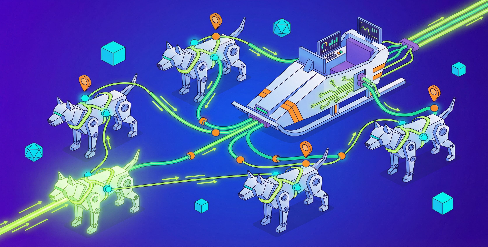
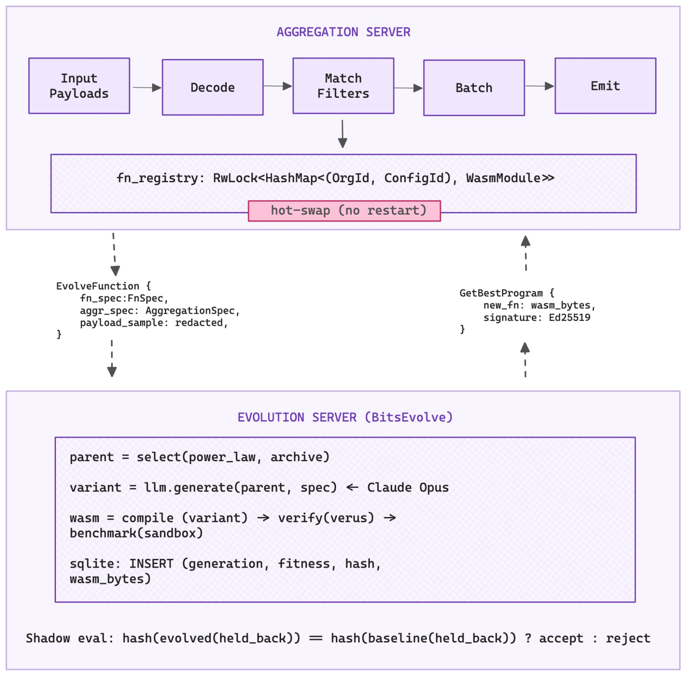
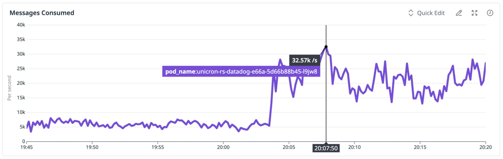

# Closing the verification loop, Part 2: Fully autonomous optimization
By Ming Chen, Sesh Nalla · Datadog · Mar 9, 2026

[What can be verified](https://alperenkeles.com/posts/verifiability-is-the-limit/) marks the boundary of what can be created, regardless of whether a human or an LLM wrote the code. Distributed systems—backend systems, distributed protocols, and data pipelines—are notoriously difficult to build. They require reasoning about concurrency, partial failure, network nondeterminism, and subtle invariants that hold across multiple machines.

Distributed systems are also notoriously difficult to test: the interesting bugs only appear under specific timing conditions that unit tests rarely exercise. If AI-assisted development could produce a verifiably correct distributed system, that would be immensely valuable. If correctness verification does not pass, understanding where it failed would be equally valuable. Make it cheaper and faster (without waiting for human review) to say “this is wrong,” and the agent can explore more aggressively.

In [Part 1](https://www.datadoghq.com/blog/ai/harness-first-agents/), we described how we built redis-rust and Helix under harness-first engineering—design contracts, verification pyramids, deterministic simulation testing. The human designed the harness, the agent iterated against it.

In this post, we remove the human from the loop for fully autonomous optimization to achieve optimal **proof carrying code** per workload, per tenant, in real time.

In earlier posts—[From hand-tuned Go to self-optimizing code: Building BitsEvolve](https://www.datadoghq.com/blog/engineering/self-optimizing-system/) and our [ADRS write-up](https://adrs-ucb.notion.site/datadog)—we introduced **BitsEvolve** as our evolutionary optimizer for CPU and GPU code. LLM-based evolution enables autonomous algorithmic synthesis to discover fundamentally new data structures and algorithms.

In comparison, techniques like just-in-time (JIT) compilation (e.g., PostgreSQL’s LLVM) optimize by eliminating execution friction through microarchitectural refinements. However, JIT optimization can be performed online in milliseconds, whereas earlier LLM-based BitsEvolve workflows required human review and software deployment, often taking hours. We wanted to see whether we could get the best of both worlds: discover better algorithms using BitsEvolve and apply them instantly, as in traditional JIT optimization.

To study that, we apply BitsEvolve to **Unicron**, Datadog’s time-series aggregation service, for fully autonomous, verified, live code optimization. Where BitsEvolve previously required humans to select targets, run benchmarks, and deploy results, the system described here does it all automatically: It proposes optimizations using LLMs, formally verifies safety properties, shadow-evaluates against real production traffic, and hot-swaps improved code into running services without human intervention or service restarts.

We evaluated our approach on two Unicron workloads and achieved improvements of 270% and 541% over the current production generic aggregation function (a workload-agnostic baseline implementation that supports all organizations and aggregation specifications) using LLM-based evolution. We were also able to verify and deploy the improved aggregation algorithm autonomously in minutes.

## Background: Time series databases and aggregation

A **time series** is a timestamped data point with a metric name, a set of key-value tags, and a numeric value—for example: `cpu.usage{host:web-01, region:us-east} = 73.2 @ 2026-02-08T10:00:00`. A single large customer may monitor 10,000 hosts, each emitting 200 metrics with 50 tag combinations, producing 100 million unique time-series. Across all customers, the total reaches hundreds of billions.

A **metrics database** stores these time series, sharded (partitioned) across hundreds of machines. Each machine holds a slice of the data, typically partitioned by customer or metric name.

When a user opens a dashboard showing “average CPU across all hosts in the us-east for the last hour,” the database must scan millions of raw data points. A **materialized view** pre-computes this aggregation continuously as data arrives, so the dashboard query reads a single precomputed result instead of scanning raw data. Unicron is the service that maintains these materialized views. For every incoming message and every configured query, Unicron decodes payload, matches against filter predicates, and batches matching points for downstream aggregation.

**Why this matters for optimization:** The aggregation loop—decoding the incoming payload, matching it against filter predicates, and computing SUM, MAX, or AVG—runs on every incoming message for every configured query. At hundreds of billions of time series, even small per-message inefficiencies compound into significant costs. Meanwhile, workloads shift constantly: new customers, changing instrumentation, seasonal patterns, and evolving infrastructure topology. The optimal code for today’s traffic is not the optimal code for tomorrow’s. To stay optimal, we need **online evolution**: the ability to customize and evolve the aggregation function per workload, per tenant, in real time.

The aggregation function has clear inputs, clear outputs, and a clear correctness oracle: Does the evolved version produce the same results as the baseline? That closed feedback loop made autonomous operation worth trying.

## Architecture: The two-server model

Unicron runs as two servers: an **aggregation server** and an **evolution server**.

The aggregation server receives metric payloads, processes them according to per-organization aggregation configurations, and emits aggregated points downstream. The workload shifts across three independent axes:

- **Dynamic aggregation configurations**: autogenerated from dashboard query patterns and changing daily, weekly, and monthly
- **Diverse multi-tenant traffic**: tens of thousands of customers with wildly different cardinalities and filter complexity
- **Shifting data flow topology**: upstream load balancing continuously reassigns organizations across nodes

The evolution server runs alongside the aggregation server. It continuously optimizes the aggregation code using an LLM-backed evolutionary agent and produces verified WebAssembly (WASM) modules that the aggregation server can hot-swap into its processing pipeline without a restart.

*Unicron’s two-server architecture: An aggregation server processing payloads and an evolution server generating verified WASM modules via BitsEvolve for live hot-swaps.*

## Five-stage pipeline

The BitsEvolve pipeline for Unicron operates in five stages. Each stage is a verification boundary.

### 1. Specialization

We bind the organization ID and aggregation specification directly into the function body. Runtime-variable parameters become compile-time constants.

Now that the LLM is aware of the organization ID and the full aggregation configuration ahead of time, it can work with the compiler to eliminate dead code paths, precompute filter lookup tables, and restructure the algorithm around the known workload.

### 2. LLM evolution

An LLM generates optimized code variants using evolutionary search. The evolver maintains a SQLite-backed database that tracks every candidate across generations. For each new generation, it selects a parent using power-law sampling and draws inspiration from a diverse archive of high performers.

The LLM explores the Git repository programmatically, using [RLM](https://github.com/alexzhang13/rlm) patterns to remember file structures in the Git repo and write [REPL scripts](https://arxiv.org/pdf/2512.24601v1) for analysis, rather than fitting the entire codebase into a context window. RLM helps retrieve critical context. For example, WASM guests run in `no_std`, so the Rust standard library’s `HashMap` is unavailable. The LLM needs to inspect `Cargo.toml`, find `hashbrown::HashMap`, and use the correct crate. Without full project context, it cannot.

We also learned to keep target files under approximately 16 KB. Above that size, LLM-generated code frequently contains unclosed delimiters or truncated functions. In one early run, all 30 optimization attempts failed to compile until we moved test functions to separate files.

Each generation produces a Git commit.

### 3. Formal verification

[Verus](https://verus-lang.github.io/verus/guide/), a formal verification tool for Rust, proves safety properties of the codec libraries that the evolved code calls: no overflow in varint decoding, bounded iteration, valid memory access, correct StreamVByte parsing, and so on.

Verus proofs live alongside the Rust implementation in the same source files. They cannot drift out of sync. If the code changes in a way that violates the specification, the build fails.

### 4. Shadow evaluation

The aggregation server splits incoming messages into training and validation sets. The training set goes to the evolver. The validation set is held back.

When a candidate WASM module returns, the server runs it against the held-back messages and computes a hash of the output. If the hash does not match the baseline, the candidate is rejected, regardless of its benchmark score.

The held-back messages prevent the evolver from hard-coding expected outputs. Without held-back data, a perfect score would be trivial: output the expected hash.

### 5. Live hot-swap

Verified WASM modules are registered in the aggregation server’s processing path via an `RwLock<HashMap>` keyed by organization ID and aggregation configuration.

In-flight batch processing completes on the old code. New batches pick up the improved version. Zero downtime, no restarts.

The `evolver_task` polls the evolution server every 5 minutes for improved candidates.

## WASM as a security sandbox

Evolved code runs inside the aggregation server’s process. WASM provides the isolation boundary. Code compiled to WASM cannot access host memory or system calls unless explicitly allowed.

The interface between host and guest is defined using WebAssembly Interface Types (WIT). We use step-wise decoding to avoid copying entire payloads into WASM memory. Wasmtime’s pooling allocator preallocates memory slots so each invocation avoids expensive syscalls.

Modules are validated with `wasmparser`, and Ed25519 signatures are checked for authenticity.

## Results

A concrete evolution run involved an organization monitoring CPU usage across 100 services, with each query filtering on a different service name using SUM aggregation over 30-second intervals. Unicron was purposefully scaled down to measure throughput under load.

- **Baseline**: 7,106 msg/s
- **Specialization**: `org_id` and 100-query configuration bound as constants
- **Evolution**: 3 generations with Claude Opus 4.6
- **Validation**: hash match on held-back messages
- **Hot-swap deployment**: 26,263 msg/s (270% improvement)

*Messages per second for the Unicron workload before and after specialization and evolutionary optimization.*

### Breaking down the improvement

| **Source** | **Contribution** | **Mechanism** |
| --- | --- | --- |
| Specialization (`bind_fn_params`) | 44.5% | Dead-branch elimination, constant inlining, precomputed filter data |
| LLM evolution (multi-generation) | 155% | HashMap-based O(1) filter lookup replacing O(N) iteration, loop restructuring, allocation elimination |
| Combined | **+270%** | Multiplicative: specialization simplifies the code surface that evolution restructures |

Specialization was consistently the single largest individual contributor across runs. The Rust compiler does much of the heavy lifting: eliminating dead branches, inlining constants, unrolling loops with known iteration counts, and precomputing hash values for known keys.

The LLM amplifies this by recognizing those constants and restructuring the algorithm around them. In our experiments, binding hot-path parameters before investing in evolutionary search made the biggest difference.

The O(N)-to-O(1) HashMap case is what clearly differentiates LLM-driven optimization from traditional compilation techniques. The baseline iterates through all filter expressions for every data point. The evolved version constructs a HashMap during initialization and does a single lookup per point, a structural algorithm change that profile-guided optimization (PGO) or JIT compilation would not easily produce.

The LLM discovered a fundamentally different algorithm because the feedback loop let it explore freely while the verification pipeline rejected any variant that produced incorrect results.

On a second workload—100 different group-by tag combinations on the same metric—the improvement reached **541%** over the baseline. The pattern mirrors [ShinkaEvolve](https://github.com/SakanaAI/ShinkaEvolve)’s dynamics: Most generations explore incrementally, but occasional mutations discover qualitatively different algorithms.

## What makes full autonomy possible

Every stage in the pipeline is a [verifiable abstraction](https://alperenkeles.com/posts/verifiable-abstractions/). Specialization is deterministic. Compilation and Verus proofs are checks. Shadow evaluation tests against unseen traffic. The WASM sandbox provides isolation. Ed25519 signatures verify authenticity.

Full autonomy is possible here because the aggregation function is constrained enough that every property we care about is machine-checkable.

As scope and complexity grow, so does the cost of being wrong. The harness must grow with it. Programming models will evolve toward designs that make verification easier—actor-oriented architectures, strongly typed languages, effect systems, and more. Observability platforms like Datadog track empirical properties in real time, and techniques like [temporal shrinking](https://alperenkeles.com/posts/temporal-shrinking/) make it possible to pinpoint the exact moment something went wrong.

If you’re interested in building complex systems with tight verification harnesses that raise the bar in software engineering rigor for what’s to come in the age of AI, [we’re hiring](https://careers.datadoghq.com/all-jobs/?s=AI&parent_department_Engineering%5B0%5D=Engineering&child_department_Engineering%5B0%5D=AI%20Engineering&utm_source=engblog&utm_medium=corpsite&utm_campaign=engcommunity-2025-ai-harness-engineering&gh_src=hm4uekgj1us).

*We’d also like to thank Rish Moudgil, Matthew Kim, and Emily Greene, who worked on Unicron, and Ameet Talwalkar for suggesting we write and publish this story.*
