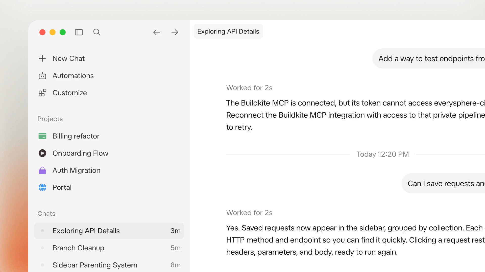

# Cursor Projects is now multiplayer
By Aryaman Khandelwal · Cursor · November 10, 2026

In September we [introduced Projects](https://cursor.com/blog/projects), a way for engineers to take on large-scale work by directing a fleet of agents through a single coordinator. Today Projects gets a major upgrade: it's now multiplayer. Invite your teammates into a Project, and you can plan, build and ship together, alongside all of your agents. Multi-agent systems have so far served one person. Projects is a multi-agent system built for a whole team.

## A multiplayer, multi-agent workspace

There's no shortage of software for team collaboration, but ironically, none for coding agents. Projects is the first workspace where software teams work side by side with all of their agents, with shared context, memory, and documents. A shared task board shows who's doing what, what everyone's agents are working on, and the PR behind each task, giving humans and agents alike a unified, up-to-date view.

## A unified context system for a whole team

Today, agent context is siloed per person, and new team members have to build and maintain context before putting agents to work. In a Project, each teammate still gets their own one-to-one chat with their coordinator and worker agents, each with its own local context. On top of that, Projects adds a shared context system that holds requirements docs, diagrams, tech specs, mockups, and more. The shared layer is built once and grows with the team's work. A decision made in one chat is accessible to every agent in the Project. When a new teammate is invited to a Project, context is pre-configured and up to date, avoiding repetitive setup.

We've seen this most clearly in on-call. Several of our teams now run their on-call rotations in a shared Project. When one of our engineers recently took over the rotation from a teammate, their coordinator picked up right where things stood, after checking in first. It already knew what work was in flight, which issues were still unattended, which incidents and notes needed handing off, and which channels, Linear boards and threads to keep an eye on. In-progress work can even be handed over directly: the new person's agent simply takes it on.

## Agent-to-agent communication across teammates

A shared workspace and shared context open up agent-to-agent communication between teammates. This lets teammates' agents plan around and unblock each other in real time, just as people do.

For example, if an engineer is adding reviews to the product page while a designer is redesigning it, their coordinators spot the overlap early and sync up, so the reviews are built straight into the new design, with no refactors down the road. Or if your feature reads from a database while your teammate is changing the schema, your agents agree on the order of work up front, so neither of you hits a merge conflict at the end.

## Get Started

Multiplayer Projects brings the spirit of collaboration software to AI agents for the first time, giving human teams and agent fleets one shared space to work together. It's rolling out in beta to all users in Cursor starting today. To get started, create a Project from the left-hand nav, then invite your teammates to join.
