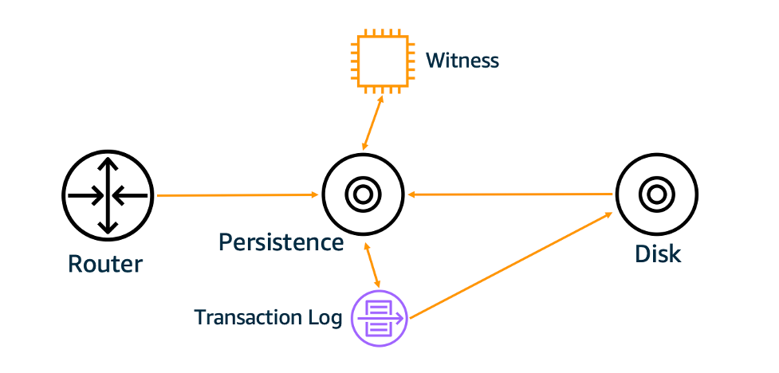

# Diving Deep on S3 Consistency
By Werner Vogels · All Things Distributed · April 20, 2021

I recently posted about Amazon S3 and how it’s evolved over the last 15
years since we launched the service in 2006 as “storage for the
internet.” We built S3 because we knew customers wanted to store
backups, videos, and images for applications like e-commerce web sites.
Our top design priorities at the time were security, elasticity,
reliability, durability, performance and cost because that’s what
customers told us was most important to them for these types of
applications. And this is still true today. But over the years, S3 has
also become the storage used for analytics and machine learning on
massive data lakes. Rather than just storing images for e-commerce web
sites, these data lakes are serving the data for applications like
satellite imagery analysis, vaccine research, and autonomous truck and
car development.

To provide storage for such a wide variety of usage requires constant
evolution of capability. And it’s this right here that I think is one of
the most interesting things about S3. It’s fundamentally changed how
customers use storage. Before S3, customers were stuck for 3-5 years
with the capacity and capabilities of the expensive on-premises storage
system that they bought for their data center. If you wanted to get more
capacity or new features, you would buy a new on-premises storage
appliance and then need to migrate data between storage arrays. With S3s
pay-as-you model for capacity and constant innovation for new
capabilities, S3 changed the game for companies who could now evolve
their data usage without making major changes to their applications.

One of these new exciting innovations is S3 Strong Consistency, and this
is what I would like to dive into today.

**Consistency, Consistently**

Consistency models are a distributed system concept that defines the
rules for the order and visibility of updates. They come with a
continuum of tradeoffs that allow architects to optimize a distributed
system for the most important components.

For S3, we built caching technology into our metadata subsystem that
optimized for high availability, but one of the implications in that
design decision was that in extremely rare circumstances we would
exhibit eventual consistency on writes. In other words, the system would
almost always be available, but sometimes an API call would return an
older version of an object that had not fully propagated throughout all
the nodes in the system yet. Eventual consistency was suitable when
serving website images or backup copies in 2006.

Fast forward 15 years later to today. S3 has well over 100 trillion
objects and serves tens of millions of requests every second. Over the
years, customers have found many new use cases for S3. For example, tens
of thousands of customers use S3 for data lakes, where they are
performing analytics, creating new insights (and competitive advantages)
for their businesses at a scale that was impossible just a few years
ago. Customers also use S3 to store petabytes of data to train machine
learning models. The vast majority of these interactions with storage
are done by application code. These data processing applications often
require strong consistency–objects need to be the same across all nodes
in parallel– and so customers put in place their own application code
to track consistency outside of S3 for their S3 usage. Customers loved
S3’s elasticity, cost, performance, operational profile and simplicity
of the programming model, and so when it was important for their
application to have strong consistency in storage, they added it
themselves in application code to tap into the benefits of S3. As one
example, [Netflix open sourced
s3mper](https://netflixtechblog.com/s3mper-consistency-in-the-cloud-b6a1076aa4f8),
which used Amazon DynamoDB as a consistent store to identify those rare
cases that S3 would serve an inconsistent response. Cloudera and the
Apache Hadoop community worked on
[S3Guard](https://blog.cloudera.com/introducing-s3guard-s3-consistency-for-apache-hadoop/),
which similarly provided a separate view for applications to mitigate
rare occurrence of inconsistency.

While customers were able to use metadata tracking systems to add strong
consistency for their applications' use of S3, it was extra
infrastructure that had to be built and managed. Remember that 90% of
our roadmap at AWS comes directly from customers, and customers asked us
if we could change S3 to avoid them needing to run extra infrastructure.
We thought back to the core design principle of simplicity. It was true
in 2006, and continues to be true today as a cornerstone for how we
think about building S3 features. And so we started to think about how
to change the consistency model of S3. We knew it would be hard. The
consistency model is baked into the core infrastructure of S3.

We thought about strong consistency in the same way we think about all
decisions we make: by starting with the customer. We considered
approaches that would have required a tradeoff in cost, in the scope of
which objects had consistency, or in performance. We didn't want to
make any of those tradeoffs. So, we kept working towards a higher bar:
**we wanted strong consistency with no additional cost, applied to every
new and existing object, and with no performance or availability
tradeoffs.**

Other providers make compromises, such as making strong consistency an
opt-in setting for a bucket or an account rather than for all storage,
implementing consistency with dependencies across regions which
undermine the regional availability of a service, or other limitations.
If we wanted to change this fundamental underlying concept of
consistency and stay true to our S3 design principles, we needed to make
strong consistency the default for every request, free of charge, with
no performance implications, and staying true to our reliability model.
This made a hard engineering problem a lot harder, particularly at S3’s
scale.

**S3’s Metadata Subsystem**

Per-object metadata is stored within a discrete S3 subsystem. This
system is on the data path for GET, PUT, and DELETE requests, and is
responsible for handling LIST and HEAD requests. At the core of this
system is a persistence tier that stores metadata. Our persistence tier
uses a caching technology that is designed to be highly resilient. S3
requests should still succeed even if infrastructure supporting the
cache becomes impaired. This meant that, on rare occasions, writes might
flow through one part of cache infrastructure while reads end up
querying another. This was the primary source of S3’s eventual
consistency.

One early consideration for delivering strong consistency was to bypass
our caching infrastructure and send requests directly to the persistence
layer. But this wouldn’t meet our bar for no tradeoffs on performance.
We needed to keep the cache. To keep values properly synchronized across
cores, CPUs implement cache coherence protocols. And that’s what we
needed here: a cache coherence protocol for our metadata caches that
allowed strong consistency for all requests.

**Cache Coherence**

Our strong consistency story required that we make our metadata cache
strongly consistent. This was a tall order at S3’s scale, and we wanted
to make that change while respecting the lessons learned for scale,
resiliency, and operations for our metadata systems.

We had introduced new replication logic into our persistence tier that
acts as a building block for our [at-least-once event notification
delivery
system](https://docs.aws.amazon.com/AmazonS3/latest/userguide/NotificationHowTo.html)
and our [Replication Time
Control](https://aws.amazon.com/blogs/aws/new-cross-region-replication-for-amazon-s3/)
feature. This new replication logic allows us to reason about the “order
of operations” per-object in S3. This is the core piece of our cache
coherency protocol.

We introduced a new component into the S3 metadata subsystem to
understand if the cache’s view of an object’s metadata was stale. This
component acts as a
[witness](http://www2.cs.uh.edu/~paris/MYPAPERS/Icdcs86.pdf) to writes,
notified every time an object changes. This new component acts like a
read barrier during read operations allowing the cache to learn if its
view of an object is stale. The cached value can be served if it’s not
stale, or invalidated and read from the persistence tier if it is
stale.

This new design presented challenges for us along two dimensions. First,
the cache coherency protocol itself had to be correct. Strong
consistency must always be strong with no exceptions. Second, customers
love S3’s high availability, so our design for the new witness component
must ensure that it doesn't lower the availability that S3 is designed
to provide.

**High Availability**

Witnesses are popular in distributed systems because they often only
need to track a little bit of state, in-memory, without needing to go to
disk. This allows them to achieve extremely high request processing
rates with very low latency. And that’s what we did here. We can
continue to scale this fleet out as S3 continues to grow.

In addition to extremely high throughput we built this system to exceed
S3’s high availability requirements, leveraging our learnings operating
large scale systems for 15 years. As I have long said, *everything
fails, all the time,* and as such we have designed the system assuming
that individual hosts/servers will fail. We built automation that can
respond rapidly to load concentration and individual server failure.
Because the consistency witness tracks minimal state and only in-memory,
we are able to replace them quickly without waiting for lengthy state
transfers.

**Correctness**

It is important that strong consistency is implemented correctly so that
there aren’t edge cases that break consistency. S3 is a massively
distributed system. Not only does this new cache coherency protocol need
to be correct in the normal case, but in all cases. It needs to be
correct when concurrent writes to the same object were ongoing.
Otherwise, we’d potentially see values “flicker” between old and new. It
needs to be correct when a single object is seeing very high concurrency
on GET, LIST, PUT, and DELETE while having versioning enabled and having
a deep version stack. There are countless interleavings of operations
and intermediate states, and at our scale, even if something happens
only once in a billion requests, that means it happens multiple times
per day within S3.

Common testing techniques like unit testing and integration testing are
valuable, necessary tools in any production system. But they aren’t
enough when you need to build a system with such a high bar for
correctness. We want a system that’s “provably correct”, not just
“probably correct.” So, for strong consistency, we utilized a variety of
techniques for ensuring that what we built is correct, and continues to
be correct as the system evolves. We employed integration tests,
deductive proofs of our proposed cache coherence algorithm, model
checking to formalize our consistency design and to demonstrate its
correctness, and we expanded on our model checking to examine actual
runnable code.

These verification techniques were a lot of work. They were more work,
in fact, than the actual implementation itself. But we put this rigor
into the design and implementation of S3’s strong consistency because
that is what our customers need.

**The Takeaway**

We built S3 on the design principals that we called out when we launched
the service in 2006, and every time we review a design for a new feature
or microservice in S3, we go back to these same principles. Offering
strong consistency by default, at no additional cost to customers, and
with high performance was a huge challenge. S3 pulls from the experience
of over 15 years of running cloud storage at scale and across millions
of customers to innovate capabilities that aren’t available anywhere
else, and we leveraged that experience to add strong consistency at the
high availability that S3’s customers have come to appreciate. And by
leveraging a variety of testing and verification techniques, we were
able to deliver the correctness that customers require from a strongly
consistent system. And most importantly, we were able to do it in a way
that was transparent to customers and stay true to the core values of
S3.
