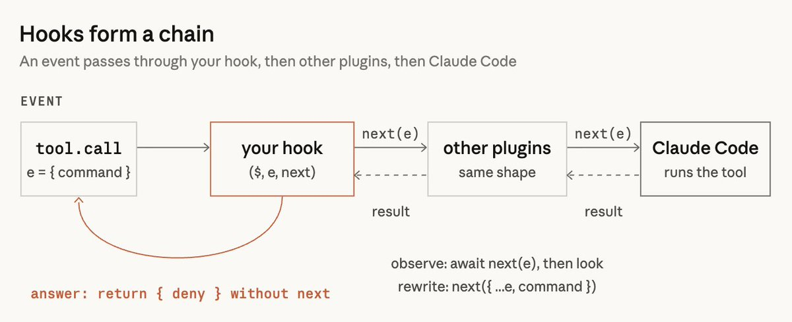
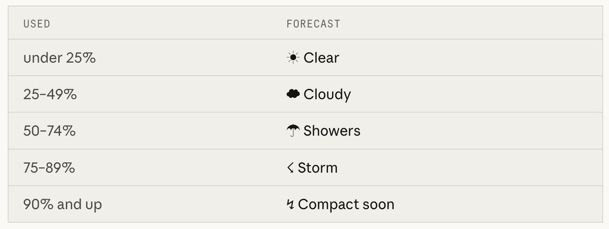
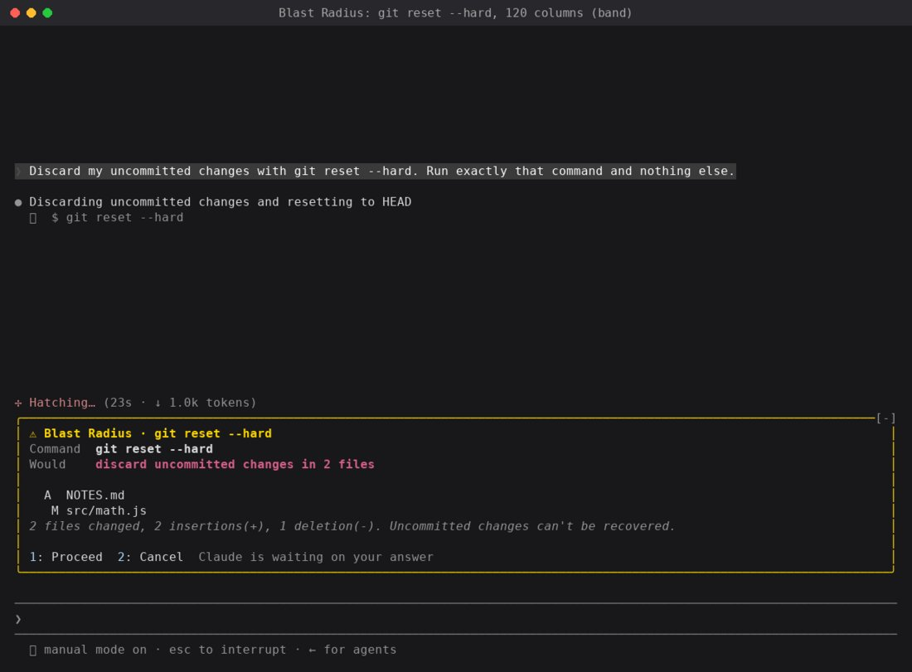

# Getting started with Claude Code Mods
By Addy Osmani

[Mods](https://code.claude.com/docs/en/plugins/mods/overview) were released in Claude Code a few weeks ago, and I'm sharing this guide to make it easier to get started with them.

Mods are small JavaScript or TypeScript files that you run within your Claude Code session. They allow you to react to events, modify the behavior of Claude Code or render your own interfaces in both the terminal and desktop applications. Here's a nice ~3m video on mods by Lydia:

What I love most about mods is that they can be created without learning their API. Run claude and describe the mod you want it to create. Approve the files as Claude writes them, say yes when asked to enable hot reloading, and your mod will be shown when the turn ends.

In this guide, you'll find a high-level overview of the capabilities of mods and how to prompt Claude Code to create one. You'll also learn how to persist, distribute and install your own mods. Btw, a more [code-heavy](https://claude.dev/blog/getting-started-with-claude-code-mods/) version of this write-up is available too but also just ask Claude to help build your mods.

While Claude Code already lets you customize a lot of its behavior, such as configuration settings, permission policies, slash commands, skills and status lines, mods allow you to do so much more. With mods you can alter or override the behavior of Claude Code or render your own custom interfaces. Folks have been having fun building mods, including multiplayer Doom!

That was pretty neat. With mods you can create a tailored experience for your own workflow. Create a constant display that you monitor. Have a safety net for risky commands. Design your own diff renderer in a way you prefer to read.

For our walkthrough we'll begin with **Token Weather**, a mod that displays a turn-by-turn forecast of the context window above the prompt. Then we'll look at two more complex mods, **Blast Radius** and **Replay Theater**, to explore the possibilities of mods further.

If you want to explore the finished code for all three mods at any point, you can find them in [anthropics/claude-code-playground](https://github.com/anthropics/claude-code-playground/tree/main/claude-code/mods).

## How mods work

At a technical level, mods are hooks bundled with plugins. Each hook can see all events occurring within the session, such as when tool calls are made, prompts are submitted, turns start and end, sessions start and end, slash commands are executed, and every rendering of any part of the UI.

Hooks are chained together like middleware. When an event occurs, it is passed through your hook, then through other plugins, before finally hitting Claude Code and performing its default action.



A hook can do one of three things when an event occurs:

- **Observe:** Allow the event to continue and observe the outcome. For instance, a hook could log every time a file is modified or take a snapshot after every turn.
- **Rewrite:** Change the event for the remaining hooks. For instance, a hook could add text to a prompt or change a tool call's input.
- **Answer:** Handle the event itself, so the default behavior doesn't run. For instance, a hook could deny a tool call or answer a command.

These terms are helpful when thinking about what a mod does and how to ask Claude for one: "Refuse this kind of command" is an answer, whereas "Take a snapshot after every turn" is an observation.

**What makes mods different from settings hooks**

A [settings hook](https://claude.com/resources/articles/how-to-configure-hooks) is a shell command that runs each time an event occurs. A mod is loaded once into a session and maintains its own state and UI which it can update in response to events. A mod can also call back into Claude Code. For example, it can open a pane, spawn a process, or register a slash command or tool that's callable by the model.

We use mods to implement some of Claude Code's own features, such as AGENTS.md support and the /diff pane. The code and tests are available in the public [anthropics/claude-code](https://github.com/anthropics/claude-code) repo in the mods/ directory.

## Write your first mod: Token Weather

Token Weather tells you how full the context window is, after each turn, by displaying one line in the band above the prompt that includes a weather icon and the percentage of the context window that's used. It also displays how many tokens have been used from the context window, a miniature chart showing the progression of the context window over the last few turns, and how many tokens have been added since the last turn.



Here's a demonstration of the mod in action. The terminal session shows progressively more files being read, with the band changing color from ☀ Clear to ☂ Showers to ☇ Storm:

**Tell it to Claude, and watch Claude build it**

Claude Code has an inbuilt way of creating mods, so you can just describe the mod you want, and Claude will make it for you. Start a claude session and paste the following into it:

~~~~markdown
```
Make me a Claude Code mod called token-weather: a live forecast of my context window, shown in the band above the prompt.

What it should show, on one line:

A weather icon and word for how full the context window is: 

under 25% ☀ Clear (yellow), 
25–49% ☁ Cloudy (cyan), 
50–74% ☂ Showers (blue), 
75–89% ☇ Storm (magenta), 
90% and up ↯ Compact soon (red).

The percentage used, then the tokens used out of the window, like "134.4k / 200k".

A small chart of the last 12 turns, drawn with ▁▂▃▄▅▆▇█.

How much the last turn added, like "▲ +98.3k last turn".
It should update after every turn.
```
~~~~

Approve the files as Claude writes them, then say yes when Claude Code asks to enable hot reloading for the session. The band shows up above the prompt when the turn ends.

You'll notice the prompt never mentions events, state or the API. It only says what you want to see. Claude Code ships with a guide for writing mods, so it already knows the how: where to keep state so a reload doesn't wipe it, how to check the plugin with claude plugin validate, which events to hook.

Change the "What it should show" bits and it's your mod, not ours.

**Iterate, by asking**

From then on you can change things on the fly, no restart needed. Ask for "make Storm start at 70%" or "add the dollar cost at the end" and the band updates right there in front of you. For me, that quick loop is most of what makes mods fun.

If a mod's visuals go missing, run claude --debug and look for a line saying a hook returned a tree that does not validate.

The API may change between releases. When Claude Code loads a mod, it writes the type declarations for your build into the mod's .claude-plugin/types/ folder, so treat those as the reference for your version.

**Staying around**

A mod built this way only loads for the current session, and its folder gets cleaned up later. To hold on to it, copy the folder out of ~/.claude/dev-mods/<session-id>/ and install it like any other plugin, which the next section covers.

If you'd like to see an example of the final product, you can see the [full Token Weather mod](https://github.com/anthropics/claude-code-playground/tree/main/claude-code/mods/token-weather) in anthropics/claude-code-playground.

## Publishing and installing mods

Mods are just Claude Code plugins, so publishing and installing them is the same as with any other plugin. To publish a mod, just put it in a GitHub repo and include a marketplace file in it; that will make it a marketplace you can publish to, and you can push updates to it in the usual way.

To install a mod, use three commands in Claude Code:

- /plugin marketplace add the GitHub repo (e.g. your-org/my-mods)
- /plugin install the mod name from that marketplace (e.g. token-weather@my-mods), then pick a scope
- /reload-plugins if the mod doesn't start on its own

You can add your mod as a plugin in the Claude directory if you like; submit it at [claude.ai/directory/manage](https://claude.ai/directory/manage) for discoverability without needing a link to your repo.

**Safety**

Mods are code that runs within Claude Code on your local machine, with your permissions. Mods aren't sandboxed: they can read your files and secrets, start processes, make network requests and approve tool calls. Mods are written by their author, not Anthropic.

As you would with any package, read the source and only install mods from people you trust. To see what a mod hooks and calls before you install it, run claude plugin validate on its folder.

## Two more examples

So far, Token Weather has been just observation and rendering. These next two mods involve events, panes, and user interaction. You can see the full code for both in anthropics/claude-code-playground: [Blast Radius](https://github.com/anthropics/claude-code-playground/tree/main/claude-code/mods/blast-radius) and [Replay Theater](https://github.com/anthropics/claude-code-playground/tree/main/claude-code/mods/replay-theater), each with a README explaining how it was made.

**Blast Radius: preview changes for a dangerous command**

Blast Radius intercepts calls from Claude to Bash that are potentially dangerous (e.g. rm -rf, git reset --hard, git clean, force push, database migration) and calculates what they would do. A pane opens with a **Proceed** or **Cancel** button.

- If you press 2, Claude gets a refusal with the reason.
- If you press 1, the command runs as usual.

In effect, this is the "answer" move from before. Blast Radius compiles the report from dry run output from each tool (e.g. git status --porcelain, git clean -n). It waits for a button press, or cancels if you press Esc.

If the terminal is wide enough, the pane docks on the side next to the transcript. If not, Blast Radius renders the report above the prompt. Only one mod can use that band at a time, so if another mod holds it the buttons may not appear, and the command is refused after 10 minutes.



Think of this as a safety net rather than a real firewall. It reads the command text, so $(…), aliases and scripts that call rm will get past it. If you want a hard block, use permission rules.

**Replay Theater: reviewing what happened at the end of the turn**

When a turn is running, Replay Theater watches all of the Edit and Write calls to see which files changed and what they changed to. At the end of a turn, you can see a message above the prompt to let you know that you can replay them. Type /replay (or press ctrl+x then Tab to focus the band, then r) and you'll see a pane that'll show the changes for each edit with diffs. It'll have a list of the step numbers and **Prev**, **Next** and **Close** buttons.

It never blocks or affects edits, it just watches.

Each turn gets its own replay, and subagent edits are included in the main turn's replay. Where the pane goes depends on the space: it's docked on the right in fullscreen and inline above the prompt at 80 columns.


## A few community mods I love

As you can imagine, there have been a bunch of creations that I would never have thought of since we launched. Here are just a few of my favorites.

**Stack viewer** by Daniel Avila. A /stack mod that displays all installed and available tools in your Claude Code session: skills, subagents, commands, hooks, MCP servers, plugins. Check out the video and installation instructions in the post.

[cc-stretch](https://github.com/pro-vi/cc-stretch) by pro-vi. Stretchtext mod for Claude Code. When Claude Code responds, it will respond briefly and any linked phrase you click on will be expanded to the full length. It's a beautiful modern expression of old hypertext concepts.

[Mindful Claude](https://github.com/halluton/Mindful-Claude) by halluton. When Claude starts working, you'll see an animation above the prompt that'll help you take a deep breath. This was also featured in an [XDA article](https://www.xda-developers.com/tried-claude-code-mods-now-waiting-for-it-to-finish-is-actually-fun/).

[RemCTL](https://github.com/viticci/remctl) by Federico Viticci. An Apple Reminders CLI and Claude Code plugin. The Today mod displays your reminders for today above the prompt.


## What will you mod?

Each of the three demos here began from a single question: *How much context do I have? What command is about to be run? What did Claude just change? Your* questions are likely to be different than mine, and so will your mods.

Follow the same process as in the Token Weather demo: Tell Claude what you want to see, under what conditions and leave the implementation details to Claude. Enjoy another game mod and link to a few more below!

**Share your mod!**

Once you've developed a mod that you use daily, please take a moment to post a video of it in action, so other developers can see what's possible. (You can also add your plugin to a marketplace and share the link. Anyone who likes your mod can install it with a few simple commands.)

We can't wait to see what you build!
