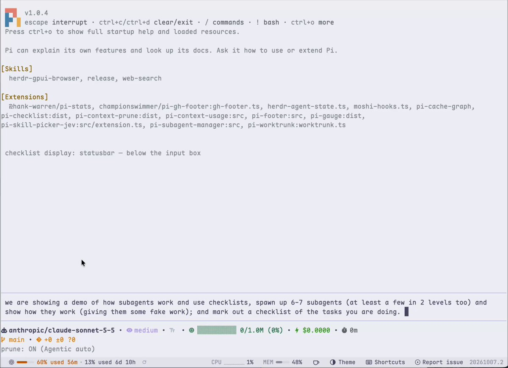
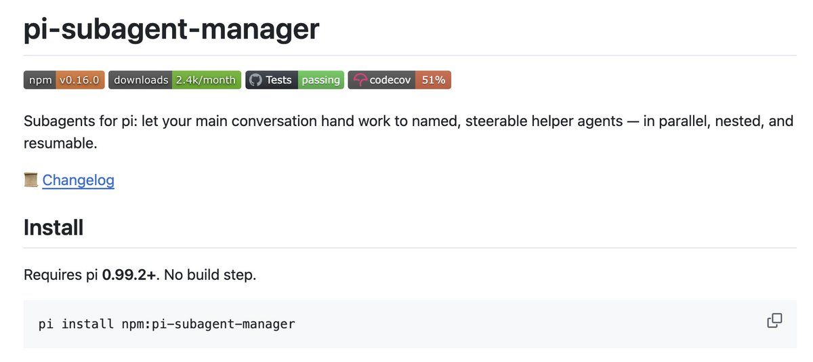
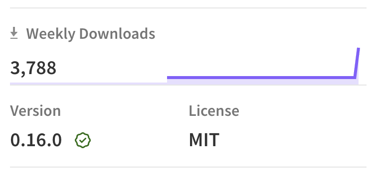

# I wrote my own pi subagent manager, and here's why
By Arnav Gupta (@championswimmer)

As anyone who follows me here knows I am a big time fan of Pi. The coding editor. 

While I will not get on a detour into fanboing over Pi in the second paragraph itself, it'll just suffice to say that I love how I can convert the coding harness to my liking, and I have done enough objective and subjective testing over a variety of tasks to see that pi clearly gets most tasks done faster and at much less cost than either claude code or codex cli, simply because it bloats the context much less.

Anyway, so about subagents.

(quick little video to hook you in so that you read the rest of my ramblings)

## upto H1'26: subagents = too fancy for my taste

I was not a big subagent user for most of the first half of this year, although I could see all the 'agent orchestration' psychosis going around with the wild west ones like OpenClaw or the software factory things like GasTown initially.

That said, the default amount of subagent use that Claude/Copilot CLI/Codex ship with (yes yes, Copilot CLI had a solid subagent mechanism from the early days) was visibly useful in some tasks to me increasingly. All the "I am spawning up a separate agent which will research/review/monitor this thing" was increasingly getting more reliable, actually not-slop, useful, and something that I started the models see get a better grasp over too. I think the GPT 5.3 / Opus 4.5 generation models could use subagents because ofcourse it is just another tool call, so they knew "how to hold the tool", but not exactly think of work in a subagentic paradigm, but as we came to the GPT 5.6 / Opus/Sonnet 5 generation the models knew how to use another instance of themselves as a separate agent better. They knew when to fork the context and when to start independent sessions with fresh context and all that. With the Claude 5.5 and GPT 6 generation I think the models are ready to be used regularly in subagent mode. In fact I would submit that it is better to use them as subagents than to checkout worktrees act yourself as the orchestrator of the subagents.

(Just to be clear 'agent orchestration' has come to mean two things - one is more high level like running multiple copies of Claude Code itself, ideally in worktrees, via tools like Conductor, T3 Code etc, but what I am talking about here is the same session within the same instantiation of the harness creating multiple threads internally)

## the best way to run subagents

Claude and Codex ship with internal support for subagents. Pi does not. It can call further "pi" calls by sub-shelling, but that's not exactly subagents.

As most people using Pi trying out subagents would have had, I started using subagents originally with @nicopreme's version `npm:pi-subagents`
He was the first to make a subagent extension, and with the first mover advantage it is the most popular one out there and works really well.

Then I later moved to using @nicht_tintin's version called `npm:@tintinweb/pi-subagents`. I would like to call out, @nicht_tintin has created a very nice bundle of his task list and subagent extensions that work really well together. The Claude-like UX for subagents, is actually really great. The ability to steer not just parent but the child is very useful, and the agent-to-agent communication is not over-engineered. The tasks + subagents together form the backbone for a "dynamic workflow" setup that Claude (and now Codex) ship out of the box.

I'll be honest, till before the drop of Opus 5.5 and GPT 6.1 Sol I was not a big user of subagents as a paradigm at all. For the reasons (already allude to above, but specifically drawing them out) -

1. while any model can use subagent-type tools if the harness provides them, before the release of Fable and Astra no model really "knew" how to maximise its own productivity using subagents. they weren't exactly good at a level of abstraction where it could run 5 more copies of itself that would not trip over itself with git conflicts and port conflicts and all that. In a way Fable/Astra were the first "Staff Software Engineer" class models that could effective break up a task into a multi-level hierarchical workflow and orchestrate it effectively
2. but; Fable and Astra are very costly (either dollar, or date of subscription burn) to run in unbounded subagentic workflows. If you let Fable/Astra create subagents without limits, they eat up $200 plan windows in 20 min. People made a lot of fun of /ultracode and /workflow type stuff for the same reason and Claude had to ship a fix so that just uttering "workflow" in the prompt should not spin up 20 Fables and cost you $100 per minute.

This latest generation, Opus 5.5 and 6.1 Sol are actually the first set of economically feasible models that can use subagents as a feature properly. And hence I have increasingly become someone who writes "use subagents" at the end of my prompts. (That's all it takes to nudge the model to use them)

## the ideal subagent UX

Let me not try to convince you I know better than Boris or Tibo how to make a coding harness, but I can tell you about my tastes and preferences instead.

the 'Claude' UX of viewing the subagents

- the agents show up near the input box, clicking ← arrow opens a list of agents, you can see their status (running/paused/errored) and you can open to see what they are doing
- manually steer subagents by dropping into a subagent's tree and type something to it

the Codex principle of /root/based paths to name subagents

- /root is the main agent. /root/task-1 is a subagent "forked" from root that inherits the context upto the point of its forking
- /task-2 is an "independent" subagent that is not forked from root. root can send it an initial prompt but its context is not 'tainted' and it can run adversarial reviews for example

the pi-subagents flexibility to set subagent defaults

- a subagent is a lot like a pi session itself; when spawing a subagent you pick which model it'll run with, what thinking level and so on; what I like about both the pi-subagent extensions is that you can create predefined "agents" that have these things set. you can use a luna-based low thinking fast agent to do quick logistical tasks (git push); and use a chonky unhallucinating model like fable/astra to research or create major refactor plans
- we should have the ability to create these predefined agents instead of having to rely on what the main model wants to use for its subagent or prompting it everytime like "use an opus subagent to research this..."

... that and a few more things

- ability to define how deep nested subagents to allow (3 levels is what I like, but it should be an option)
- how many parallel subagents can be allowed to run
- the entire history (of all subagents) all stored in the single .jsonl file. so that the whole parephernelia can be resumed from a crash/killed shell or old session
- have multiple models specified for an agent; and it will pick whichever one is available (provider is enabled) and allowed (via scoped models)
- have two modes: opportunistic: the main model will use subagents if it thinks it wants to, orchestrator: the main thread will always spin up subagents for all tasks and itself stay free to talk to you!

and that's why I ended up making my own

It borrows heavily many architectural decisions from both @nicopreme and @nicht_tintin versions; but it also is exactly the set of things I wanted.

It is on npm, I can see it already is having some downloads (I don't know why). But if these are the things that you also look from your subagent manager, feel free to download and use it.

