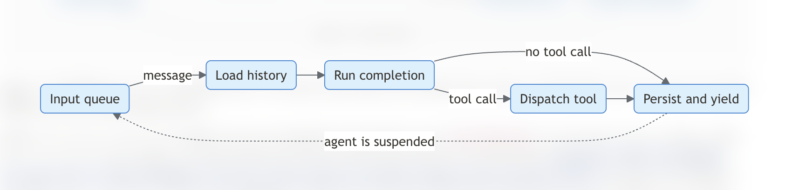
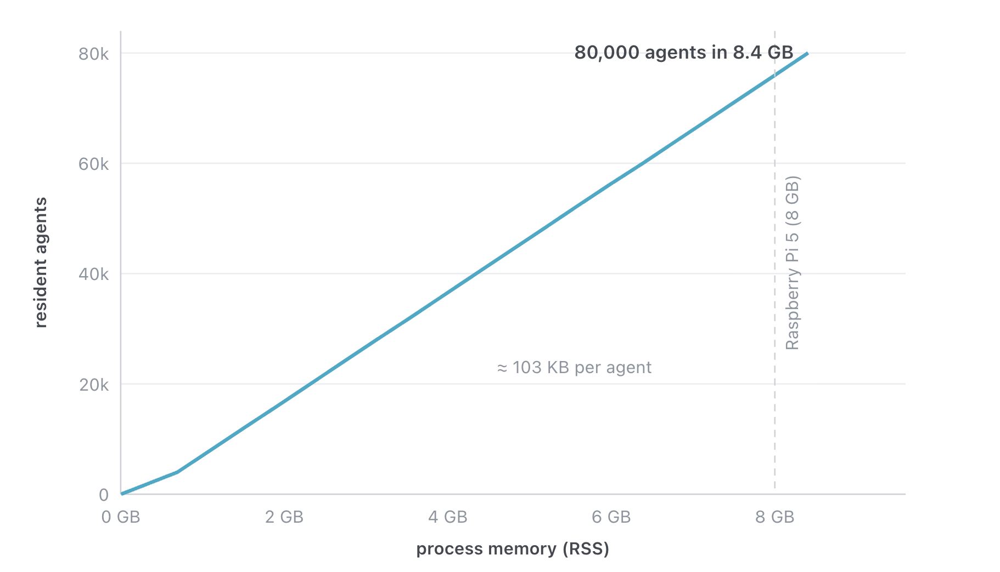
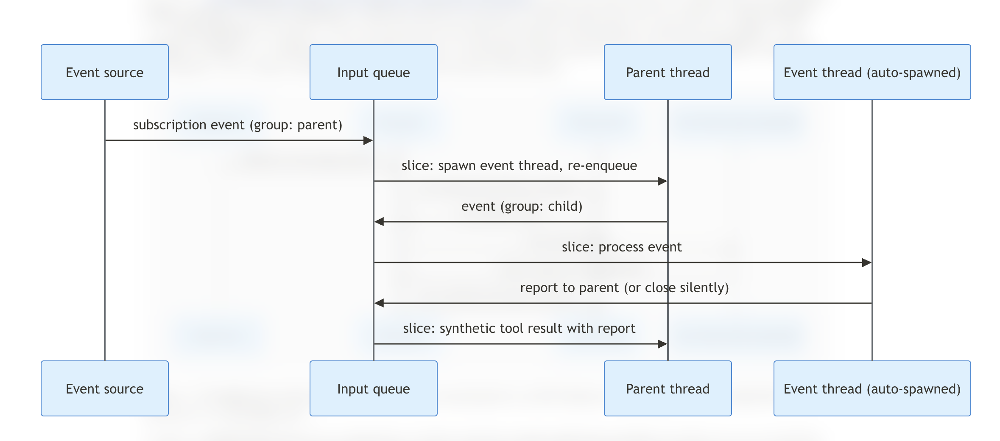

# Introducing Infinity: a runtime for extreme agent concurrency
By Shadaj Laddad · AWS Open Source Blog · 23 OCT 2026

Agents spend much of their time waiting on tools. A coding agent may start a build that runs for twenty minutes, a triage agent may wait hours for the next pull request on a repository, and an assistant may wait until the next morning for an approval. Most agent harnesses run the agent loop as a sequence of blocking steps: the harness calls the model, invokes a tool, waits for the tool to return, and repeats. While the agent waits, it holds a process and its memory, and it cannot respond to events that arrive in the meantime.

Today, we’re releasing [Infinity](https://infinity.hydro.run) under the Apache 2.0 open source license as part of the [Hydro](https://hydro.run) project, a collaborative effort between AWS and UC Berkeley. Infinity is a research project that re-imagines agent runtimes, based on the techniques that programming languages use to suspend and resume asynchronous functions. When an agent calls a tool, Infinity dispatches the call, saves the conversation, and *suspends* the agent. When the tool result arrives, the runtime *resumes* the agent from its saved state.

With Infinity, concurrent agents are extremely lightweight. For example, we can fit 75,000 concurrent agents in the 8 GB of a Raspberry Pi 5. Infinity also makes it possible to deploy concurrent agents on standard serverless platforms. When Infinity suspends an agent during a tool call, the serverless function can end. So even if a tool call takes days, nothing needs to run while the agent waits.

Infinity is an early research release, and we are sharing it to get early feedback. The rest of this post describes the ideas behind Infinity and its architecture. We start an overview of how languages suspend asynchronous functions with stackless coroutines, and why an agent can be suspended in the same way. We’ll explore how Infinity uses this to run many agents concurrently, even on serverless platforms. We then describe synthetic tool calls, which Infinity uses to deliver asynchronous events to existing models, and we use synthetic events for agent-to-agent communication. Finally, we discuss some open questions that we hope to explore further.

## Agents as stackless coroutines

Many languages, including Rust, JavaScript, and Python, let developers write asynchronous logic with `async` and `await`. When a function awaits an async operation, such as a network request, the function is suspended, and the thread that was running it moves on to other work. When the operation completes, the runtime resumes the function from the point where it was suspended. To make this possible, the runtime has to save the function’s *continuation*, which is the state it needs in order to resume.

Languages save this state in one of two ways. Operating system threads and stackful coroutines keep the task’s entire call stack in memory while it waits. Stackless coroutines, which Rust uses to implement `async fn`, instead have the compiler turn each function into a state machine that holds only the relevant values at each `await`. This approach results in a smaller memory footprint, so an executor can efficiently run a large number of stackless coroutines.

An LLM agent can be suspended in the same way as a stackless coroutine. At the moment an agent calls a tool, its conversation history contains everything needed to continue the agent once the result is available. If the runtime persists this history, it can discard all in-memory state, and any process with access to the store can resume it later.

The Infinity Runtime uses this idea to suspend and resume long-running agents. It executes each agent as a sequence of bounded *slices*. In a slice, the runtime loads the agent’s history from a pluggable store, runs one model completion, persists the output, and dispatches at most one tool call. The slice then ends. Tool calls play the role of `await` points: a slice never blocks for a tool, a timer, or any other external operation.



*Figure 1: The lifecycle of an execution slice. The slice ends when the model calls a tool, and the tool’s result starts a new slice when it arrives on the input queue.*

Everything that can resume an agent arrives as a message on a shared input queue, including user text and tool results. Because the queue absorbs pending events, the runtime does not need to keep an agent alive while it waits. When the Infinity Runtime dequeues a message, it launches a slice that reloads the agent state and processes the message.

## Running agents concurrently

Since a suspended agent occupies no memory, the runtime can manage a large number of agents and schedule them as messages arrive. Agents run inside an *agent system*, which is a pool of *agent* *threads* that share stores, tools, and a model. The runtime organizes the agent threads in a way similar to an actor system. Each conversation thread has its own input queue, threads do not share mutable state, and threads communicate only by sending messages to each other’s queues. Each message carries a `thread_id` that identifies its destination thread. The runtime guarantees that messages for the same thread are processed in order, one slice at a time, while slices for different threads run in parallel.

Ordering within a thread is required for correctness, because two slices that read and write the same history at the same time would overwrite each other’s turns. Different threads have nothing to coordinate. In a long-running process, the agent system gives each active thread a channel and a lightweight task, and schedules the pool in the same way that an async executor schedules futures. When a thread has no queued messages and no pending tool results, its task exits, and the runtime starts a new one when the next message for that thread arrives.

Because a suspended agent consists only of its history, the memory needed to keep agents resident is close to the size of their histories. To measure this, we wrote a benchmark that launches waves of agents in one agent system, backed by a simulated model. Each agent runs twenty turns, and each turn makes a full round trip through the runtime: the model streams a completion of about 1.2 KB that calls a tool, the tool result returns through the input queue, and a second completion ends the turn.



*Figure 2: Resident agents against process RSS, with a reference line at 8 GB for a Raspberry Pi 5.*

We ran the benchmark with 80,000 agents, for a total of 3.2 million completions, on a single thread of an AMD EPYC 9R14 with in-memory stores. Resident memory grew linearly, at about 100 KB per idle agent. At this rate, about 75,000 agents fit in 8 GB, which is the memory of a Raspberry Pi 5. Most of this memory is taken up by the conversation histories, since an idle agent has no task, stack, or connection associated with it.

## Example: a tool that does not block

Let’s look at how this appears to a developer who embeds the runtime in local (in-memory) mode. The following program builds an agent system with one custom tool, launches one agent, and prints the events that the agent produces:

```rust
let system = AgentSystemBuilder::new_local(
    InMemoryConversationStore::new(),
    InMemoryStateStore::new(),
    StaticModel::new(provider, "global.anthropic.claude-sonnet-4-6").await?,
)
.tool(Box::new(GetBuildStatus { builds }))
.start();

let mut thread = system.thread_builder().launch().await;
thread.send_user_text("Is build 42 green yet?").await?;

while let Some(event) = thread.recv().await {
    println!("{event:?}");
}
```

The difference from most agent frameworks is in how tools are written. Rather than returning its result, a tool’s `execute` method starts the work and returns immediately. When the work completes, the tool sends the result to the agent’s input queue:

```rust
#[async_trait]
impl Tool<ChannelSender> for GetBuildStatus {
    // name(), description(), and parameters() describe the tool to the model.

    async fn execute(
        &self,
        args: serde_json::Value,
        id: ToolCallId,
        call_id: Option<ProviderCallId>,
        context: &ToolContext<ChannelSender>,
    ) -> Result<(), Box<dyn std::error::Error + Send + Sync>> {
        let build_id = parse_build_id(&args)?;
        let (builds, sender, thread_id) =
            (self.builds.clone(), context.message_sender.clone(), context.thread_id.clone());

        tokio::spawn(async move {
            let text = match builds.status(&build_id).await {
                Ok(status) => format!("Build {build_id}: {status}"),
                Err(error) => format!("Error reading build {build_id}: {error}"),
            };
            // The result returns to the agent through its input queue.
            let message = tool_result_message(thread_id, &id, call_id, text);
            if let Err(error) = sender.send_to_input_queue(message, id.as_str()).await {
                tracing::error!(%error, "failed to deliver build status");
            }
        });

        Ok(()) // The slice ends without waiting for the build.
    }
}
```

When the model calls `get_build_status`, the runtime persists the turn containing the call, invokes `execute`, and ends the slice. If the status lookup takes a hundred milliseconds, the next slice begins almost immediately. If it takes three days, the agent occupies only its stored history in the meantime. The tool and agent code are the same in both cases.

The call to `send_to_input_queue` is the only point where the tool interacts with the runtime. `InputSender` is a trait, so the queue can be an in-memory channel in a long-running process, as in this example, or a durable message queue in the cloud, which we describe next.

## Running on serverless platforms

Because a slice does not wait on external operations and loads all of its state from storage, the runtime can run on serverless platforms, where a function is invoked for each unit of work and may exit as soon as the work is done. The library supports this through step mode. A step-mode agent system keeps no tasks running. Instead, the platform calls `step` once for each batch of messages it delivers, and nothing is retained in memory between calls:

```rust
let mut system = AgentSystemBuilder::new(conversation_store, state_store, model, sqs_sender)
    .tools(tool_impls)
    .build();

// One call per queue delivery; the process may exit as soon as it returns.
let collector = EventCollector::new();
let outcomes = system.step(inputs, &collector, &mut NoDeferral).await?;
```

Both modes run the same pipeline, and the local mode adds per-thread drivers that handle batching, interruption, and automatic compaction around it. Tools, model providers, and tests written against the core library therefore run in either mode without changes. The main difference between the two is the `InputSender`, which the runtime uses for anything that should happen later, such as a timer wake-up or a message for another thread. In step mode, the sender writes to a durable queue, and the message comes back as a later delivery.

Our reference deployment on AWS uses an SQS FIFO queue as the input queue, with one `MessageGroupId` per thread. Each delivery invokes an AWS Lambda function that runs one step and exits. Conversation histories are stored in Aurora DSQL and deduplication state in DynamoDB, and the `sleep` tools use SQS delivery delays and EventBridge Scheduler for their timers. The repository includes CDK constructs that provision these resources.

Running on such a platform places several requirements on the runtime:

- **Bounded execution time.** A slice consists of one completion and a small number of storage and dispatch calls, and it does not wait on any operation of unbounded duration.
- **No process affinity.** All state is stored by thread ID, so any invocation can process the next message for any thread.
- **At-least-once delivery.** Queues may redeliver messages, so each input carries a stable ID, and the state store records which IDs each thread has processed. The runtime recognizes and skips a redelivered message, which makes processing a slice idempotent.
- **Durable turns.** Streamed model output is buffered and committed only when the turn completes. If a stream fails partway through, the runtime discards the buffer and retries the completion. When a tool call ends a turn, the runtime persists the turn before dispatching the call, so the call is recorded before its result can arrive.
- **Serialization without locks.** FIFO message groups serialize the slices of each thread at the queue, and Lambda does not process the same message group in two invocations at once, so the runtime does not need distributed locks.

Traditional runtimes that block on tool calls can also be hosted on a serverless platform, but each invocation must then stay open while its tools run. In Infinity, a waiting agent has no running invocation, so an agent waiting on a three-day CI pipeline uses no compute until the pipeline reports its result.

## Synthetic tool calls

Agents that wait on tools also need a way to learn about events that happen while they wait. A long-running command may produce output over time, and a subscription to a repository should produce an event each time a pull request is opened. In both cases, a single tool call produces a sequence of results instead of one, and the runtime has to present each of them to the model in a form that the model can reason about.

Model APIs do not provide a way to represent an asynchronous event. A conversation consists of user turns, assistant turns, and pairs of tool calls and tool results, and each tool call must be answered by exactly one result. We considered several ways to fit events into this structure. Appending a second result to the original tool call violates the one-result rule, and models typically reject such a conversation. Adding the event as a user message is accepted by the API, but it attributes the event to the user, and the model can no longer distinguish something the user said from something a tool reported. Placing the event outside the conversation, such as in the system prompt, removes it from the order of events in the history, which the model relies on to understand when things happened.

The Infinity Runtime instead uses **synthetic tool calls**. When an event arrives, the runtime adds an assistant tool call that the model did not actually make, followed by a tool result containing the event:

```
▶ Synthetic:  receive_event__injected({
                 original_tool_name: "subscribe_github_events",
                 original_tool_call_id: "call_abc123",
                 original_args: { owner: "acme", repo: "api" }
               })
■ Result:     {"event_type": "pull_request", "action": "opened", "number": 42}
```

By delivering events as tool calls, the runtime preserves the capabilities that models acquire during post-training for interpreting tool results and deciding how to act on them. The arguments identify the earlier tool call that produced the event, which tells the model which of its requests the event belongs to. The call uses the dedicated name `receive_event__injected` instead of repeating the original tool name, so the model can distinguish an event from a new invocation of the tool. The `__injected` suffix indicates that the runtime created the call. The runtime never offers this name to the model as a tool, and it rejects the call if the model tries to invoke it.

A tool produces events in the same way that it produces its first result, by sending messages to the agent’s input queue. The tool marks its first result as the start of a subscription, which tells the runtime that more results for the same call may follow, and tags each later message as an event for that call. The agent can go idle between events, and each event resumes it when it arrives. Like any other message, an event can resume an agent in a local process or trigger a new Lambda invocation, so a subscription does not keep anything running while it waits for the next event.

### Communication between parent and child agents

The same model of asynchronous tool calls and events also supports communication between agents. Each agent has a built-in `spawn_thread` tool, which creates a child thread with its own input queue. From the parent’s point of view, `spawn_thread` behaves like a subscription. The call returns as soon as the child has been created, the parent continues with its own work, and the child’s reports arrive later as events on that call:

```
[Parent thread]

⚙ Tool call:  spawn_thread({ instructions: "Review src/auth.ts for security issues" })
■ Result:     "Child thread is successfully spawned and has ID: thread_a1b2. ..."

   ... the parent continues with other work, or goes idle ...

▶ Synthetic:  receive_event__injected({
                 original_tool_name: "spawn_thread",
                 original_tool_call_id: "call_spawn_a1b2",
                 original_args: { instructions: "Review src/auth.ts for security issues" }
               })
■ Result:     "Report from child thread: Critical: SQL injection in
                auth.ts line 42."
```

When the child calls `report_to_parent`, the runtime sends a message to the parent’s input queue that is tagged as an event for the original `spawn_thread` call, and the parent sees it as a synthetic tool call that refers to that spawn. A child can send several reports while it works, and its final report arrives the same way when it calls `close_thread`. Because the report refers to the spawn, the parent can tell which of its children sent it, even when many children are running at once.

As a result, the runtime does not need a separate messaging system for agents. Spawning a child and reporting to a parent are ordinary tool calls whose results and events travel through the input queues. The ordering guarantees described earlier apply to them unchanged, and a parent and its children run concurrently as separate threads in the same agent system.

### Choosing where an event is processed

Besides choosing how to represent an event, the runtime has to choose which thread processes it. If a subscription delivers a hundred events to a single agent, those events will take up much of that agent’s context window. Child threads give the runtime a way to avoid this, and the tool selects between two strategies for each event it sends.

By default, the runtime processes each event in a separate child thread. It does not add the event to the subscribing thread’s history. Instead, it spawns a temporary child that inherits the parent’s context, gives the child the synthetic event, and lets the child decide how to handle it. The child can act on the event and report to the parent, or close without a report if the event is not relevant, in which case the parent’s history is unchanged. When several events arrive close together, each one gets its own child thread, and the children process their events concurrently.



*Figure 3: Threaded event processing. The raw event is processed in a child thread, and the parent receives only the child’s report, if the child sends one.*

A tool can instead mark an event as associative, in which case the runtime adds the synthetic call directly to the subscribing thread’s history. This is intended for events that update an operation the agent is following, such as the output of a test run that the agent started in the background.

## Open questions

Several questions remain open, and we plan to explore them further:

- **Reasoning about interleaved events.** Synthetic tool calls keep the conversation well-formed, but models are mostly trained on traces in which tool calls are synchronous. We would like to understand how the number and ordering of events, and the choice between threaded and associative processing, affect the decisions an agent makes.
- **Scheduling policies.** The runtime currently processes threads in the order in which their messages arrive. Agent systems have priorities that a scheduler could take into account, such as running user-facing threads ahead of background event handlers.
- **Compaction in a tree of agents.** The runtime indexes compaction summaries by their position in the history, so a child spawned before a compaction can still reconstruct the history it inherited. We have not yet studied how compaction should work for large conversation trees that run for a long time.
- **Event authenticity.** The runtime anchors each event to its originating request, but agents exposed to the internet may receive inauthentic payloads. How should a runtime establish the provenance of events so that actions are traceable and accountable, while maintaining the stateless architecture?

## Conclusion

Agents are increasingly expected to run for long periods, react to events, and divide work among subagents. Infinity explores an execution model for such agents based on stackless coroutines: the runtime treats each tool call as a suspension point, saves the conversation history as the agent’s continuation, and resumes the agent when a message arrives. With this model, an idle agent costs about as much memory as its history, many agents can share a small number of threads, and the same agent code can run in a local process or on a serverless platform. Synthetic tool calls let the runtime present asynchronous events to the model within the structure that model APIs already support, and the same mechanism carries messages between parent and child agents.

Infinity is available now on [GitHub](https://github.com/hydro-project/infinity). In the [quickstart](https://infinity.hydro.run/docs/infinity-runtime/quickstart/launching-your-first-agent/), you can build a simple agent running on Infinity in just a few minutes! This is an early research release, and we welcome feedback on both the ideas and the implementation.
