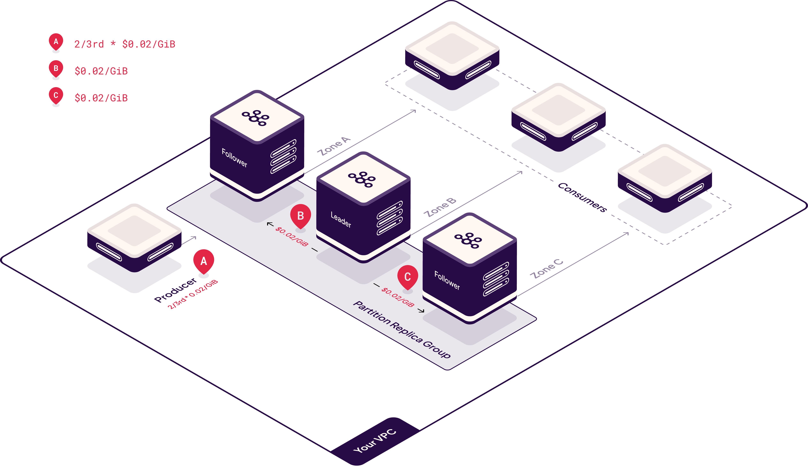
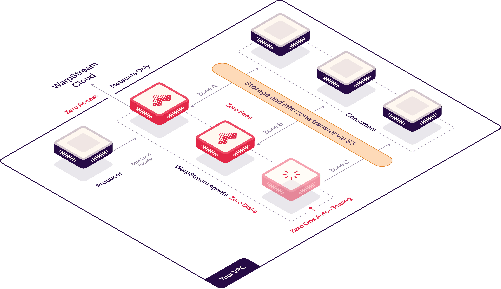
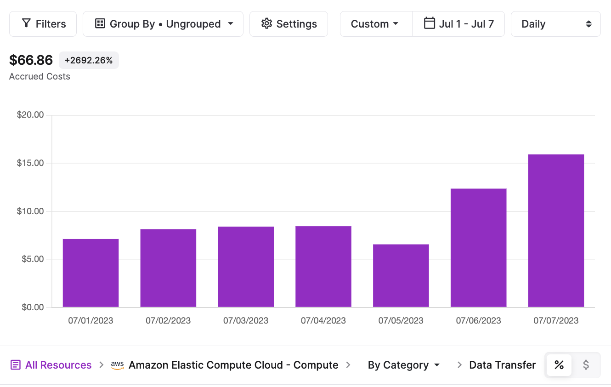
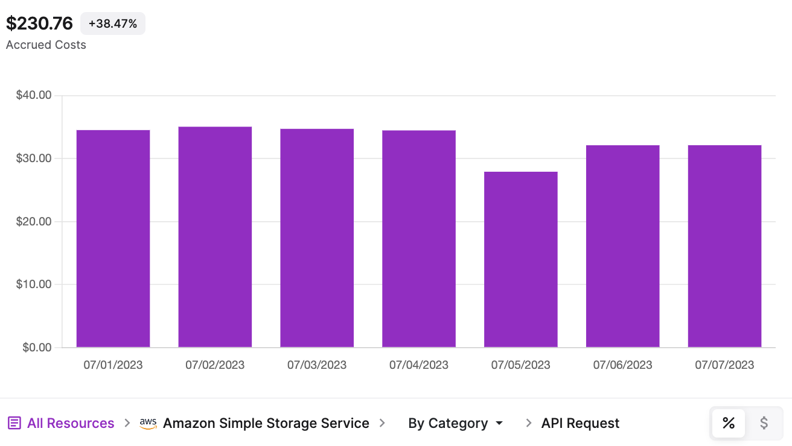
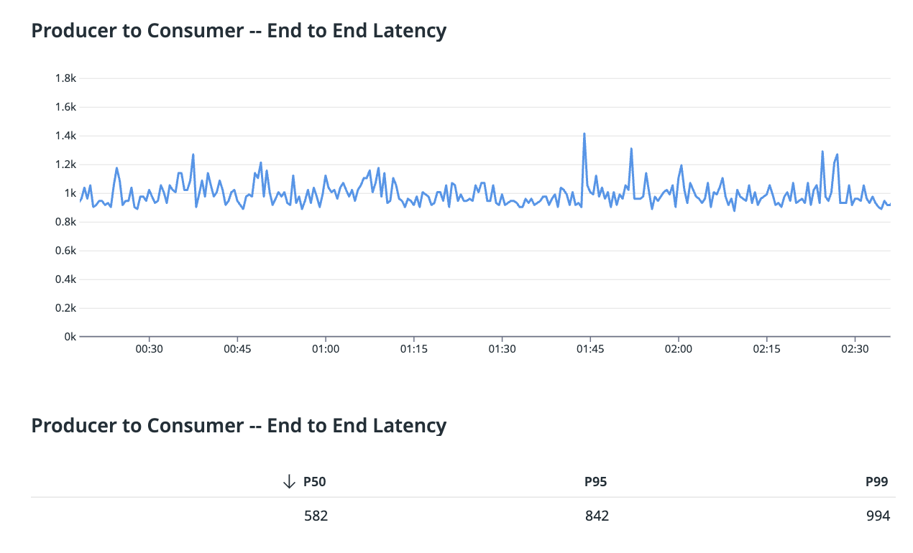

# Kafka Is Dead, Long Live Kafka: The Case for Diskless, S3-Native Streaming
By Richard Artoul · WarpStream · July 25, 2023

## TL;DR

WarpStream is a [diskless](https://www.warpstream.com/diskless-kafka), Apache Kafka® protocol compatible data streaming platform built directly on top of S3. It's delivered as a single, stateless Go binary so there are no local disks to manage, no brokers to rebalance, and no ZooKeeper to operate. WarpStream is 5-10x cheaper than Kafka in the cloud because data streams directly to and from S3 instead of using inter-zone networking, which can be over 80% of the infrastructure cost of a Kafka deployment at scale.

If you just want to get your hands dirty, you can try [our demo](https://docs.warpstream.com/warpstream/tutorials/demo) in under 30s.

```
$ curl https://console.warpstream.com/install.sh | bash
$ warpstream demo
```

Otherwise, read on!

## Kafka Is Dead, Long Live Kafka

Chances are you probably had a strong reaction to the title of this post. In our experience, Kafka is one of the most polarizing technologies in the data space. Some people hate it, some people swear by it, but almost every technology company uses it.

Apache Kafka® was first open sourced in 2011, and quickly became the default infrastructure for building streaming architectures. Jay Kreps' now well-known [The Log](https://engineering.linkedin.com/distributed-systems/log-what-every-software-engineer-should-know-about-real-time-datas-unifying) blog post is still one of my favorite blog posts ever because it walks through why the distributed log abstraction that Kafka provides is so powerful.

But it’s not 2011 anymore. A lot has changed about how we build modern software, primarily a major shift towards cloud environments, and yet Kafka has remained more or the less the same. Many organizations have managed to “lift and shift” Kafka into their cloud environments, but let’s be honest, nobody is really happy with the result. Kafka is expensive, finicky, and difficult to run for most organizations who use it.

Kafka *itself* is not the problem. It’s a great piece of software that was well suited for the environment it was created for: LinkedIn’s data centers in 2011. However, it is an unusually poor fit for modern workloads for two reasons:

1. Cloud economics – by design, Kafka’s replication strategy will rack up massive inter AZ bandwidth costs.
2. Operational overhead – running your own Kafka cluster literally requires a dedicated team and sophisticated custom tooling.

We're going to pick on Kafka for the rest of this post, but keep in mind that everything we're saying about Kafka applies equally to any similar system that stores data on locals disks (however briefly), regardless of which programming language its implemented in.

## Kafka-nomics

The diagram below depicts a typical 3 availability zone Kafka cluster:



Every GiB of data that is produced must be written cross zone 2/3rds of the time1, and subsequently replicated by the partition leader to the followers in the other two zones for durability and availability reasons. Every time a GiB of data is transferred across zones, it costs $0.022, $0.01 for egress in the source zone and $0.01 for ingress in the destination zone.

$0.02*⅔ + $0.02 *2 == $0.053 for every GiB of data that you stream through your Kafka cluster *in the best case scenario3*. The cost of storing a GiB of data in S3 *for a month* is only $0.0214, so for the same price as copying data from a producer to a consumer via Kafka, you could store that data in S3 *for over two months*. In practice, for any Kafka cluster with substantial throughput, the hardware costs are negligible since 70-90% of the cost of the workload is just inter-zone bandwidth fees. [Confluent has a good write up about this problem as well](https://www.confluent.io/blog/understanding-and-optimizing-your-kafka-costs-part-1-infrastructure/#networking).

It’s important to stress that this inter-AZ bandwidth problem is fundamental to how Kafka works. Kafka was designed to run in LinkedIn’s data centers, where the network engineers didn’t charge their application developers for moving data around. But today, most Kafka users are running it on a public cloud, an environment with completely different constraints and cost models. Unfortunately, unless your organization can commit to 10s or 100s of millions of dollars per year in cloud spend, there is no escaping the physics of this problem.

It’s not just a question of throughput either, even a low throughput Kafka cluster with long retention can have large storage requirements. In this case, Kafka’s approach of triply replicating the data on expensive local SSDs costs roughly 10-20x more5 per GiB than using object storage like S3 assuming the *best case scenario of 100% disk utilization.*

## Accidental SRE

Most developers first encounter Apache Kafka® because they have a real problem they want to solve. However, before they can begin solving their problems, they must first learn about:

1. Kafka (brokers, coordinators, watermarks, etc)
2. ZooKeeper (or KRaft)
3. Leader elections
4. Partitions (how many partitions do I need? Unclear, but better get it right because you can never change it!)
5. Consumer groups
6. Rebalancing
7. Broker tuning
8. Client tuning
9. etc

Kafka’s “data plane” (brokers) and consensus-based “control plane” (controllers, ZooKeeper, etc) all run directly on local SSDs that must be managed with expertise and care. In practice, self-hosted Kafka clusters require a dedicated team of experts and significant amounts of custom tooling before even basic operations like node replacements and scaling clusters can be performed safely and reliably. For example, the Apache Kafka built in partition reassignment tool cannot even generate plans for decommissioning brokers when you (inevitably) experience a hardware failure:

> The partition reassignment tool does not have the ability to automatically generate a reassignment plan for decommissioning brokers yet. As such, the admin has to come up with a reassignment plan to move the replica for all partitions hosted on the broker to be decommissioned, to the rest of the brokers. This can be relatively tedious as the reassignment needs to ensure that all the replicas are not moved from the decommissioned broker to only one other broker.

In many cases, offloading cluster management to a hosted provider like [AWS MSK](https://aws.amazon.com/msk/) doesn’t even solve the operational burden problem. For example, the [MSK documentation on how to rebalance a cluster](https://docs.aws.amazon.com/msk/latest/developerguide/bestpractices.html#bestpractices-balance-cluster) (a very routine operation) just links to the [Apache Kafka documentation](https://kafka.apache.org/documentation/#basic_ops_cluster_expansion) which involves hand-editing JSON to specify which partitions should be migrated to which brokers and includes helpful commentary like:

> The partition reassignment tool does not have the capability to automatically study the data distribution in a Kafka cluster and move partitions around to attain an even load distribution. As such, the admin has to figure out which topics or partitions should be moved around.

There are open source solutions like [Cruise Control](https://github.com/linkedin/cruise-control) that can help ease this burden, but that is yet another set of concepts that need to learned, services that need to deployed and monitored, and sharp edges that need to be encountered. Cruise Control itself is a JVM application that depends on both Apache Kafka and ZooKeeper. Hardly a lightweight solution.

Unfortunately, in many cases developers set out to solve a business problem, and end up becoming Kafka SREs instead.

## S3 Is All You Need

The high costs of using Apache Kafka® (both in dollars and engineering hours) means that today businesses can only afford to use it for their most high value use-cases like fraud detection and CDC. The cost of entry is simply too high for anything else.

When we were at Datadog, we built [Husky, a columnar database purpose-built for observability data that ran directly on top of S3.](https://www.datadoghq.com/blog/engineering/introducing-husky/) When we were done, we had a (mostly) stateless and auto scaling data lake that was extremely cost effective, never ran out of disk space, and was trivial to operate. Almost overnight our Kafka clusters suddenly looked *ancient* by comparison.

Kafka bandwidth volumes at Datadog were measured in double-digit GiB/s and broker storage was measured in PiB’s of NVMEs6. Maintaining this level of infrastructure using open source Kafka, custom tooling, and bare VMs was no small feat. Luckily the responsible engineering teams at Datadog were extremely capable and made it work, but even after many years of investment, the automation simply couldn’t compete with the millions of engineering hours that have gone into making systems like S3 extremely robust, scalable, cost effective, *and elastic*.

In general, large storage workloads running in cloud environments stand no chance of competing with the [economics, reliability, scalability, and elasticity of object storage](https://www.youtube.com/watch?v=sc3J4McebHE). This is why “big data” technologies like Snowflake and Databricks don’t even try. Instead, they *lean into* cloud economics by designing their systems from the ground up around commodity object storage.

Companies like Uber, Datadog, and many others have made Kafka work for them despite all of its flaws. But there are *so many* interesting problems that will never get solved if the existing Kafka implementation remains the barrier to entry. That’s why we care about this space, and that’s why we set out to build something that would make data streaming infrastructure as accessible as S3.

If we could build a Kafka-like system directly on top of S3, that would solve two of the major problems with Kafka in one fell swoop; costs would be massively reduced, and most traditional Kafka operational headaches would disappear overnight. No major cloud provider charges for networking costs between VMs and object storage, and AWS employs literally *hundreds* of engineers whose only job is to make sure that S3 runs reliably and scales infinitely, so you don’t have to.

Of course, that’s easier said than done, and there is a good reason no one has done it yet: figuring out how to build low latency streaming infrastructure on-top of a high latency storage medium like S3, while still providing the full semantics of the Kafka protocol, without introducing *any* local disks, is a very tricky problem!

So we asked ourselves: “What would Kafka look like if it was redesigned from the ground up *today* to run in modern cloud environments, directly on top of object storage, with no local disks to manage, but still had to support the existing Kafka protocol?”

WarpStream is our answer to that question.

## Introducing WarpStream

WarpStream is an Apache Kafka® protocol compatible data streaming platform that runs directly on top of any commodity object store (AWS S3, GCP GCS, Azure Blob Storage, etc). It incurs zero inter-AZ bandwidth costs, has no local disks to manage, and can run completely within your VPC.

That’s a lot to digest, so let’s unpack it by comparing WarpStream’s architecture to Kafka’s:



Instead of Kafka brokers, WarpStream has “Agents”. Agents are stateless Go binaries (no JVM!) that speak the Kafka protocol, but unlike a traditional Kafka broker, any WarpStream Agent can act as the “leader” for any topic, commit offsets for any consumer group, or act as the coordinator for the cluster. No Agent is special, so auto-scaling them based on CPU-usage or network bandwidth is trivial.

How did we accomplish this if Apache Kafka requires running Apache ZooKeeper (or KRaft) and a bunch of stateful brokers with local SSDs and replication?

1. We separated storage and compute (by offloading data to S3)
2. We separated data from metadata (by offloading metadata to a custom metadata store)

Offloading all storage to object storage like S3 allows users to trivially scale the number of WarpStream Agents in response to changes in load with *zero data rebalancing*. It also enables faster recovery from failures because any request can be retried on another Agent immediately. It also mostly eliminates hotspots, where some Kafka brokers would have dramatically higher load than others due to uneven amounts of data in each partition. That means you can say goodbye to manually rebalancing partitions, and don't need to learn about complex solutions like Cruise Control.

The other pillar of WarpStream's design is separating data from metadata, just like a modern data lake does. We store the metadata for every WarpStream “Virtual Cluster” in a custom metadata database that was written from the ground up to solve this exact problem in the most performant and cost effective way possible. In fact, we’re so confident in the efficiency of our metadata store, we’ll host WarpStream Virtual Clusters for you [*for free*](https://warpstream.com/pricing).

You can read more about [WarpStream's architecture in our documentation](https://docs.warpstream.com/warpstream/background-information/warpstreams-architecture), but to summarize: WarpStream offloads all of the hard problems of data replication, durability, and availability to an object storage bucket so you never have to think about it, but all of your data *stays inside your cloud account*. The only data that ever leaves your cloud account with WarpStream is the workload *metadata* that is required for consensus, like the order of the batches in your partitions.

Modern practitioners who want to introduce large scale data streaming pipelines into their infrastructure today don’t have many good choices. They either have to spend a lot of money *and* create an entire dedicated team of engineers whose only job is to operate Kafka, or they have to pay a vendor for a hosted solution and spend *even more money*, making many of their streaming use-cases economically infeasible.

We think WarpStream can provide a better option that leverages the cloud as a strength instead of a weakness, and unlocks a whole new set of possibilities in the data streaming world.

You don’t just have to take our word for it though, we brought receipts! The image below shows the interzone networking costs of our entire cloud account (measured using the excellent [vantage.sh](https://www.vantage.sh/)), including the continuous streaming workload we run in our test environment. This workload continuously produces 140MiB/s of data and consumes it with three dedicated consumers for a total of 560MiB/s in continuous data transfer.



You can see that we average < $15/day in interzone networking fees, whereas the exact same workload run using a Kafka cluster would cost 0.14GiB * $0.053/GiB * 60 * 60 * 24 == **$641** **per day** **in interzone networking fees alone.**

We didn’t just replace these interzone networking costs with hardware or S3 API costs either. This same workload costs < $40/day in S3 API operation costs:



It also only requires 27 vCPUs worth of Agent hardware / VMs.

In terms of total cost of ownership, WarpStream will reduce the cost of most Kafka workloads by 5-10x. For example, here is a comparison of the cost of running a sustained 1GiB/s Kafka workload vs the equivalent using WarpStream:


The table above demonstrates clearly that for high volume Kafka workloads, the hardware costs are negligible because the cost of the workload is dominated by inter-zone networking fees. WarpStream eliminates those networking fees entirely.

You can find a granular breakdown for the total cost of ownership (TCO) for WarpStream in [this blog](https://www.warpstream.com/blog/warpstream-benchmarks-and-tco).

Of course, it's not all sunshine and rainbows. Engineering is about trade-offs, and we’ve made a significant one with WarpStream: latency. The current implementation has a P99 of ~400ms for Produce requests because we never acknowledge data until it has been durably persisted in S3 and committed to our cloud control plane. In addition, our current P99 latency of data end-to-end from producer-to-consumer is around 1s



Update: produce latency is now tunable down to ~33ms median with Lightning Topics. See [current latency tiers.](https://www.warpstream.com/diskless-kafka#latency)

If your workload can tolerate a P99 of ~1s of producer-to-consumer latency, then WarpStream can reduce your total data streaming costs by 5-10x per GiB, with *almost* zero operational overhead. We don’t have a proprietary interface either; it’s just Kafka, so there is no vendor lock in. Finally, WarpStream runs in any environment with an object store implementation, so we can meet you where you’re at with S3 in AWS, GCS in GCP, and Azure Blob Storage in Azure.

If you’ve made it this far, you may have noticed that WarpStream mainly addresses two of the major problems with Kafka: cloud economics and operational overhead. We think that there is a third major problem with Kafka: developer UX. In our view, partitions are way too low level of an abstraction to program against for writing any non-trivial stream processing application, and we think that WarpStream’s architecture puts us in a unique position to help developers write stream processing applications in a novel way that’s much closer to how they’re used to writing traditional applications.

We’ll talk about that more in a future blog post, but the first thing we wanted to do is meet developers where they are and offer them an improved version of a tool they’re already familiar with.

If you just want to get your hands dirty, you can try [our demo](https://docs.warpstream.com/warpstream/tutorials/demo) in under 30s:

```
$ curl https://console.warpstream.com/install.sh | bash
$ warpstream demo
```

1. Because the partition leader is in a different zone.
2. See the [“Data transfer within the AWS region”](https://aws.amazon.com/ec2/pricing/on-demand/) section.
3. The worst case scenario is that your Kafka cluster is not configured with the follower fetch feature and you’re paying inter-zone bandwidth fees *for each of your consumers* as well.
4. https://aws.amazon.com/s3/pricing/
5. ($0.452/hr (i3en.xlarge) * 24 * 30)/(2500GiB) == $0.13/GiB month. $0.13 * 3x replication == $0.39/GiB month vs $0.021/GiB month on S3
6. https://www.datadoghq.com/blog/engineering/introducing-kafka-kit-tools-for-scaling-kafka/
7. 9 * i3en.6xl + ZK
8. ($(0.04 + ((2/3) * 0.02)) * 60 * 60 * 24 * 365)+$223000
