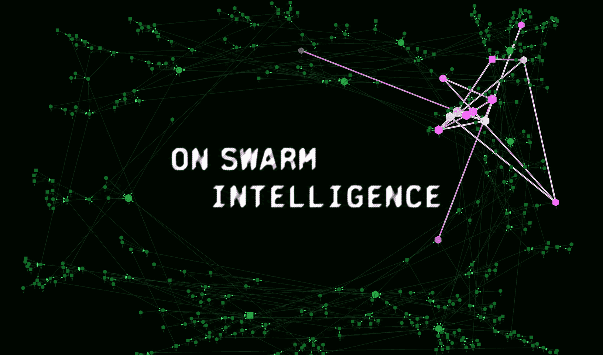

# On the Nature of the Swarm
By Konstantin Dunas · Prime Intellect · OCT 6TH, 2026

*or, why scaling inference ends in many agents*

*Originally published October 6th on my [personal blog](https://hallerite.com/posts/on-the-nature-of-the-swarm/).*

Let’s begin with something everyone should be able to agree on: inference scaling works. In fact, it works so well that LLMs are now capable of impressive feats like credibly claiming to have solved a Millennium Prize problem — something that would have seemed absurd before we discovered that inference follows scaling laws. Give a model more compute at test time (let it think longer, call more tools, check its own work) and it will perform better at the task. There’s just one problem: eventually, *you run out of context.*

I mean that *literally*: you fill the predefined context window.[1](#user-content-fn-1) Context windows haven’t been getting much bigger, either: the current frontier models all top out around 1M tokens. You don’t see any serious model with a 100M-token context window, for example. And yet agents these days regularly perform tasks that should be impossible to solve with only 1M tokens of context. How can this be?

If you’ve used a coding agent in the last year, you already know the magic trick that explains this discrepancy… *compaction!*

## Compaction

An agent fills its window, compacts it to a summary, and keeps going

Compaction works like this: as soon as you approach the end of the context window, you ask the agent to write a summary and hand off its work to a fresh context, where that work is picked up until the context window is full again and you have to compact again. You do this until (the agent thinks that) the task is solved.

Compaction is amazing. It lets you keep the same agent session going for days (or weeks) without running out of context. Problem solved, infinite context, infinite inference scaling, everything is possible. So why would I write this blog post?

Well… compaction doesn’t actually give you infinite context. It does something else. Something more subtle. It raises what I’ll call the **total context capacity**[2](#user-content-fn-2) of a model, hand-wavingly defined as the biggest task a model can take on, where a task’s size is how big a window you’d need to do it in one go. How far compaction goes beyond the predefined context window of the model depends on how much of what the agent has done has to survive each handoff.

The fundamental principle behind this limitation is that every compaction is a bet. The agent summarizing has to decide *now* what will matter *later*. Usually it guesses well enough,[3](#user-content-fn-3) but some tasks are less forgiving than others.[4](#user-content-fn-4) Most real tasks are also partially observable, so whether something you saw matters often depends on something you haven’t seen yet. As the saying goes, “it’s difficult to make predictions, especially about the future”.[5](#user-content-fn-5)

Compaction as a chain of agents

One way to make the summary less lossy (or, in our terms, to *raise total context capacity*) is to let the agent use a filesystem or a REPL to offload memory. For example, the agent can write the details of some complicated workflow to disk and put a pointer to the relevant files in the summary.

Compaction with context stored on disk

This actually helps a lot! Nothing is lost to the ravages of compaction. The summary just has to say where things are. So our bet got a lot less scary: the question used to be “What do I need to remember?” and now it’s “What do I need to know exists?” This is quite reminiscent of the famous quote: “A gentleman need not know Latin, but he should at least have forgotten it.”[6](#user-content-fn-6)

But it’s still a bet, and it comes with a new cost. The files on disk don’t do anything; they just sit there.[7](#user-content-fn-7) For any of that to help, the next agent has to (a) realize it’s relevant, (b) go find it, and (c) read it back into its context. The last step is quite annoying, as reading costs context, which is exactly the thing we were running out of in the first place.[8](#user-content-fn-8)

Put differently, offloading to disk lets us persist the information, but whatever the agent in the previous context window *understood* by reading all of it is gone, and has to be rebuilt every time someone needs it.

So are we cooked? Maybe. But we have a few more tricks up our sleeve.

## Multi-agent systems

First, notice that we can frame compaction as a (degenerate) multi-agent system:[9](#user-content-fn-9) every compaction starts a new agent whose initial context is a function of the last agent’s summary.

A second type of multi-agent system is a main agent coordinating sub-agents. The idea is simple: the main agent spins up a fresh agent with a task (“find where the retry logic lives”, “figure out why this test is flaky”) and gets back an answer. The sub-agent might burn 200k tokens reading files and running things. The main agent’s context only grows by the task and the answer, maybe a couple thousand tokens.

Now here’s the fun part. In our framing, the sub-agent’s answer is… a summary of its context. So a sub-agent is actually a way to do compaction, too! But with one crucial difference: the summary gets written *after* the question is known. Compaction has to guess what will matter later. Offloading to a sub-agent doesn’t require guessing, because you spawn a sub-agent when you need it.[10](#user-content-fn-10)

As an added bonus, if you have several independent questions, you can fire off several sub-agents at once. Parallelism is a nice extra, but even if they had to run one after the other, sub-agents would still beat compaction on these tasks, for the reason above. (This will matter later.)

Sub-agents work especially well for workloads that lend themselves to subtask decomposition with clear boundaries at hand-off and delivery. For such tasks, they raise total context capacity way more than compaction does, because the main agent never has to hold the messy middle part.

But sub-agents are not without their faults. They have the opposite problem from disk: they forget everything. Once the sub-agent answers, it’s gone, along with its 200k tokens of having read the code, run the tests, and ruled things out. Next time you have a related question, you spawn a new one and it does all that reading again. You can’t ask it a follow-up either, like “Wait, what did you mean by that?” ten turns later.

So now we have two half-solutions. Offloading to disk remembers, but can’t think. Sub-agents think, but can’t remember. Hmm.

State retention versus context handoff

## Hire the sub-agent

You can probably see where this is going. The fourth corner is the obvious one: just… don’t kill the sub-agent. Keep it around. Hire it if you have to. Just don’t tear it down.

A **persistent sub-agent** keeps its context around (and its files, and whatever it left running). When you have a new question about something it worked on, you just ask it. It has already read everything, so it doesn’t have to start over, and your own context only grows by the question and the answer.

Now we get the best of both worlds. Like with disk, nothing is lost. Like with sub-agents, the summary gets written once you know what you need. Unlike either, you can ask again tomorrow, with a different question. That means compaction stops being a one-time bet. You never have to decide upfront what to keep, because you can always come back and ask.

Now go back to our degenerate multi-agent system. Compaction is a chain of agents working in series, each one depending on the one before it, and only one of them is “alive” at any point. Whatever didn’t make it into the summary is gone, because the agent that knew it is gone.

With persistent agents, several are alive at the same time. Sure, they can also run at the same time: split the problem into subproblems, solve them in parallel, finish faster.[11](#user-content-fn-11) That’s the obvious argument for multi-agent,[12](#user-content-fn-12) and it’s true. There are great arguments to be made why this matters from an infra perspective. But even if they had to take turns, one after the other, their contexts would still exist side by side. They’re **parallel over context**, too, and that’s what is underdiscussed these days: total context capacity grows to (roughly) one window per agent.[13](#user-content-fn-13)

Of course, every one of these agents can still compact! A sub-agent that has been at it for a while can summarize and keep going, just like before. So the two stack nicely: compaction stretches each agent along time, and more agents stretch the whole system sideways. You end up with several chains side by side, which can ask each other things.

Persistent agents working in parallel over context

## No free lunch

Let’s zoom out for a second. What are all these tricks actually doing? Compaction, offloading to disk, sub-agents, persistent agents: they’re all ways of building context. In an ideal world, you’d already have exactly the right context in one window and just let the model spit out the answer (or take the right sequence of actions).[14](#user-content-fn-14) In practice the model has to build it. Reasoning builds it by thinking, agents build it by acting (reading files, running tests), and everything above is about building more of it than fits in one window.

Building context is what inference scaling mostly looks like once agents act in the world. This is also why I strongly disagree with calling multi-agent a “new axis of scaling”, as many have done. We are still scaling inference compute, but we’re just doing it in a more structured way.

Of course, there’s no free lunch. The price is communication. Every time a piece of context needs to get from one agent to another, it has to be squeezed into a message, and that costs tokens and is itself lossy.[15](#user-content-fn-15) If the hard part of a task needs everything in one place at once, splitting it up doesn’t help at all.

To be clear, none of this makes me less bullish. OpenAI just had 10,000 agents solve Navier-Stokes.[16](#user-content-fn-16) Two years ago, you’d have been hard-pressed to find anyone sane who thought this would happen. But swarms aren’t a silver bullet. You can’t just throw a million agents at a hard problem and expect an answer to fall out. The agents have to be good enough in the first place — and good enough to organize themselves and coordinate with each other effectively without just duplicating work. Granted, a lot of the overhead can probably be trained away (agents that are good at working with thousands of copies of themselves), but some of the communication cost is structural.

## From trees to swarms

So far, everything has been a tree: a root agent spawns sub-agents, which spawn their own sub-agents, and results flow back up. But once agents can message each other, a tree routes every conversation through the root. The root’s context fills up, so it has to compact, and… we’re back where we started, just one level up. The tree moves the context problem to the root.

The obvious fix is to let siblings talk to each other directly. But once siblings can talk to whoever they need, you have to ask: what’s the root even for? Nobody needs to be beholden to someone above them just to get work done. Might as well make them all peers.

So: no root. You put several agents into a shared world and let them coordinate among themselves, as peers in a mesh. Just like every agent can still compact, every agent can still spawn its own sub-agents. So you can have trees inside the mesh.

Tree and mesh agent structures

That’s fine. Dropping the root doesn’t mean hierarchy is useless, though — companies still have CEOs, after all. Coase asked about this almost 90 years ago: if markets are so good at coordinating, why do firms exist at all?[17](#user-content-fn-17) His answer: because using the market isn’t free. Every time, you have to find the right person, explain what you want, and agree on terms. Inside a firm, someone can just decide. So firms exist exactly where that’s cheaper than coordinating as equals. Same for agents: start without a hierarchy, and add a bit of one wherever it pays for itself.

One of the reasons this works is specialization. In a swarm, nobody has to assign roles; they just happen. Say one agent happens to look at the frontend first. Now it has context there, and maybe it built a little tool. So the next frontend question goes to it, because that’s cheaper than anyone else starting from scratch, and every question it answers makes it a bit better at frontend work. A random early difference solidifies into a role over time.

Here’s where trees really hurt. A sub-agent two levels down is beholden to its parent: it only does work for whoever spawned it. So if our frontend specialist lives in one branch, and an agent in another branch has a frontend question, it can’t just ask. The question has to go up to their common ancestor and back down, through contexts that don’t care about the frontend at all.

So the tree has two options, both bad. Either every branch grows its own frontend specialist, and we’re back to rediscovering the same things over and over (which is exactly what persistence was supposed to fix). Or the other branches do without it, and everything the specialist learned only ever helps one branch. In a mesh, anyone can just ask it. Its context gets reused by whoever needs it.

This gets worse the more agents you have. With 10 agents, a tree is probably fine. With 10,000, it makes way more sense to have peers that find each other and divide up the work themselves.[18](#user-content-fn-18)

Economists had this argument about 80 years ago. Hayek’s point[19](#user-content-fn-19) was that central planning fails because the knowledge needed to run an economy is spread across millions of people and can’t all be sent to the center. The root agent is a central planner. To plan well, it would need the whole context, and the whole context is exactly what doesn’t fit in one window. (A swarm doesn’t need prices or markets for the analogy to hold. The point is just where the knowledge lives, and who gets to act on it.)

## What should the swarm look like?

Now, I don’t yet know what the right structure is. A pure mesh probably isn’t it either. My guess is that we start by copying how humans organize. Give the agents the tools we use (a shared git repo, an issue tracker, Slack) and let them have structured access to the shared state, which can act as the single source of truth. The correct structure probably also depends on size: a five-person startup can run on a few Slack channels, whereas a 10,000-person company cannot. Brooks’s law and such.[20](#user-content-fn-20)

But here’s the thing: we don’t even have to lock in the structure. We can let the agents change it themselves, and that’s how we get the bitter lesson back in.[21](#user-content-fn-21) So we can seed the swarm with human structure, then let the agents improve on it over the course of solving the problem at hand.

A lot more can be said about how to structure a swarm of agents, but I will leave this for another time.

*Thanks to [Sebastian Müller](https://x.com/omouamoua) and [Sami Jaghouar](https://x.com/samsja19) for proofreading and giving valuable feedback!*

## Footnotes

1. Not to be confused with *context rot*: the observation that agents get worse as their context fills up, so the “effective” context window (where the agent performs at its peak) is smaller than the advertised one.
2. I made this up. If you have a better name, or already invented this concept under a different name, let me know.
3. In my experience, for most tasks a 1M-token working context compresses quite nicely into 16k tokens.
4. Think of a long debugging session: on day one, a flaky test run prints a weird line, and you write it off as noise, so the summary drops it. The flake never shows up again. On day three, that line would have been the key to the whole bug, but nobody remembers it existed. Note that a smarter summarizer doesn’t save you here: on day one, dropping that line was a reasonable call given what anyone knew.
5. Usually credited to Niels Bohr or Yogi Berra, but it seems to be an old Danish saying. The earliest version in print is in Karl Kristian Steincke’s memoir from 1948.
6. Usually attributed to Brander Matthews. Samuel Johnson made the same point more literally in 1775, as recorded by James Boswell: “Knowledge is of two kinds. We know a subject ourselves, or we know where we can find information upon it.”
7. And while they sit there, the world moves on: files get overwritten and state changes, so what you saved can quietly go stale. That problem has its own fixes and isn’t really a multi-agent one, so I’ll leave it at that.
8. Remember the weird line from the flaky run? It’s on disk now, somewhere. But the agent on day three doesn’t know it exists, let alone that it matters, so it doesn’t know to look for it or what to grep for. It’s back to reading.
9. There are many kinds of multi-agent systems, and we found some nice abstractions for expressing them. [This post](https://www.primeintellect.ai/blog/multi-agent-systems) has more.
10. It can still misread the question or bring back the wrong thing. But compressing toward a known target is a much easier problem than compressing toward an unknown one.
11. Without breaking Amdahl’s law, of course.
12. Noam Brown, on the [Dwarkesh Podcast](https://www.dwarkesh.com/p/noam-brown), calls it “a way of scaling test-time compute in parallel instead of purely serially.”
13. As long as the task splits into parts that can get by on short messages between them. If every part needs the full context of every other part, no amount of splitting helps, and you’re back to needing a bigger window.
14. This assumes the model uses its context perfectly. In practice, a small focused context often beats a huge messy one, but that’s the context rot thing I said I’d ignore.
15. The fancy name for this is *communication complexity*: how much the parties have to exchange to solve a problem when each of them holds a different piece of it.
16. [OpenAI’s claim](https://www.cnbc.com/2026/09/09/openai-navier-stokes-math-problem-solved.html), which mathematicians are still checking.
17. Ronald Coase, [The Nature of the Firm](https://www.jstor.org/stable/2626876) (1937).
18. Human orgs figured this out too: a database expert in a big company gets questions from every team. If they could only work for their manager, you’d need one per team.
19. F. A. Hayek, [The Use of Knowledge in Society](https://www.econlib.org/library/Essays/hykKnw.html) (1945).
20. From Fred Brooks’s *The Mythical Man-Month*: adding people to a late software project makes it later, partly because the number of communication paths grows roughly with the square of the team size.
21. Rich Sutton, [The Bitter Lesson](http://www.incompleteideas.net/IncIdeas/BitterLesson.html) (2019): general methods that scale with compute end up beating approaches built on human knowledge.
