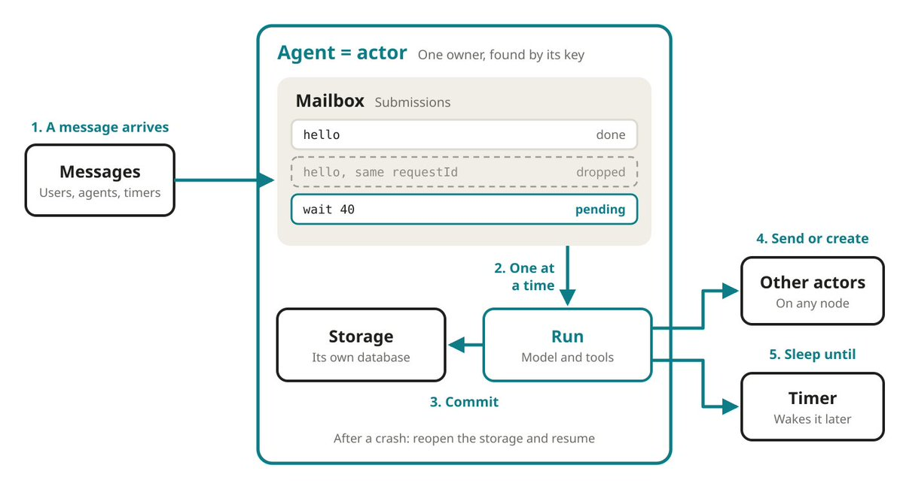
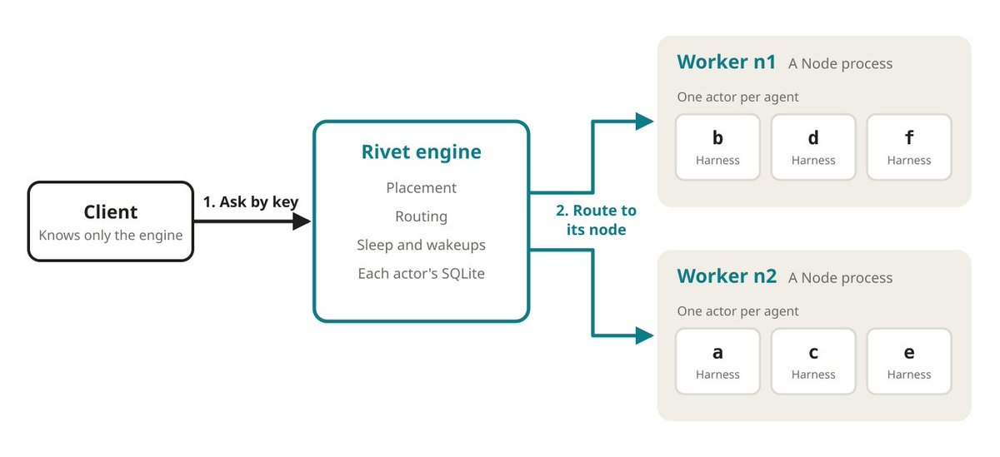
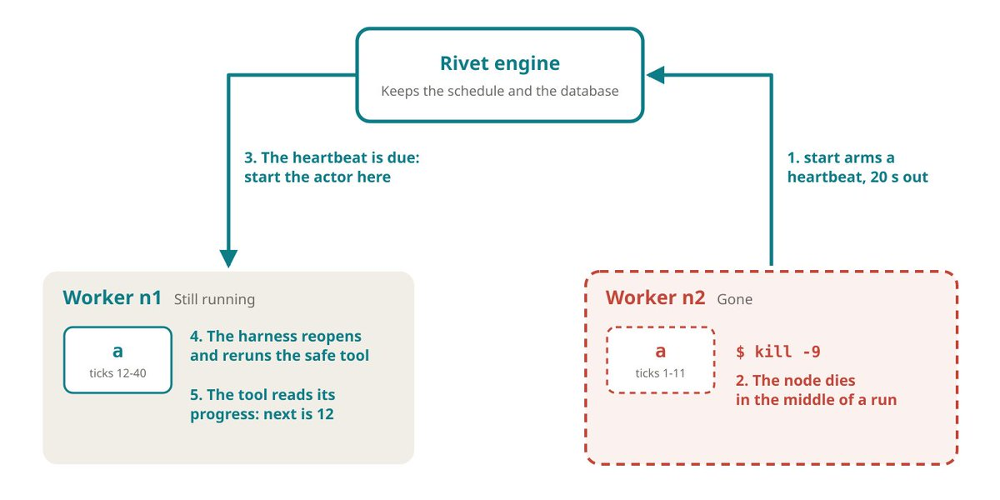

# Pi Durable ♥ Actors: One Agent, One Owner, Any Worker

By Manoj Mahalingam

I have a habit when I read about a new agent framework. I read "actor" wherever it says "agent" and check whether the page still makes sense. It nearly always does. If the framework is any good, that is.

The actor model has been around since the seventies. The one thing that is new is the behavior in the middle: a model deciding what to do next, where there used to be a function I wrote. **Agents are actors with, well, agency.**

[Pi Durable](https://stacktoheap.com/blog/2026/10/05/pi-durable), a harness that stores an agent's conversations, tasks, and recovery checkpoints, made me think this more, not less. Then I came across [Rivet](https://rivet.dev), which runs a Pi Durable harness inside each of its Actors. That gave me a way to try the idea: many agents, several worker processes, and no code of mine deciding who runs where.

This post covers why the two fit, the small cluster I ran, agents calling each other across nodes, a durable reminder, and what happened when I killed a node, including the part that did not recover by itself.

## Why agents look like actors

Carl Hewitt's actor model fits in a sentence. An actor receives a message, and in response it can send messages to actors it knows, create new actors, and decide how it will handle the next message. Its state is its own, and it handles one message at a time.

Erlang added the part that made it practical: let it crash, and have a supervisor start it again. Orleans added the *virtual* actor, which always exists as far as a caller is concerned. You address it by a key, and the runtime wakes it somewhere when a message arrives and puts it away when it is idle. Cloudflare's Durable Objects are the same idea with storage attached.

A long-lived agent wants all of it. Its conversation is private state. User inputs, follow-ups, and steering are a mailbox. A subagent is an actor it created. A crashed run is a crashed actor. And the support agent for customer 42 is a virtual actor addressed by a key.

I am not the only one describing agents this way. Anthropic's [Building always-on agents](https://claude.com/resources/articles/building-always-on-agents) came out last week and lays out five primitives: an event inbox, timers, memory, permissions, and an outbox. Its agent "spends most of its time asleep, waking up periodically to do work." One of its rules reads: "An inbox should only have one active worker at a time."

The article never says "actor", but the pieces are all there. A durable inbox with one worker is a mailbox. Memory that outlives the worker is private state. A timer that puts an event in the inbox is how a sleeping actor gets woken. Here is that agent with the names this post uses:



What the old actor frameworks did not have to deal with is a behavior that takes four minutes, costs money, and cannot be replayed for free. That is the job of a durable harness.

When I [wrote about Pi Durable's building blocks](https://stacktoheap.com/blog/2026/10/05/pi-durable), the table of things the host still has to do had this row:

> **Storage ownership:** Enforce one process per storage; the harness supplies no cross-process ownership lock.

I read that as a gap back then. Now it reads like the definition of an actor: state that exactly one process may touch. If each agent gets its own harness and its own storage, almost everything else in Pi Durable has an actor counterpart too:

| Actor | Pi Durable |
| --- | --- |
| Private state | The harness's storage: transcript entries, documents, task records |
| Mailbox | Submissions: admitted inputs that queue while a run is busy |
| A message is not delivered twice | A `requestId` that is admitted once, however often it is sent |
| One message at a time | One process owns a storage |
| Creating actors | Child conversations and background tasks |
| Let it crash, restart | Reopen the storage and `resume()` from the saved checkpoints |
| Waiting without a thread | `sleepUntil`: a task that holds no process while it sleeps |

Pi Durable gives you one very good actor. What it does not give you is the *system* around the actor: something that decides which machine an agent lives on, routes a call to it, wakes it when a timer is due, and moves it when the machine dies.

My own use of Pi Durable sidesteps all of that. It is a personal assistant app, a prototype along the lines of Grok's bots: a small team of AI teammates with their own conversations and routines. It runs one harness in one process on one SQLite file, and it runs well that way.

What I have been thinking about is heavier work. Several teammates on long tasks at the same time, routines that fire while I am away, tools that take minutes, and none of it stopping because one machine restarted. That is the point where one process stops being enough and you start to want workers, and something that decides which worker each agent runs on.

That missing system is what an actor runtime is.

## What Rivet adds

Rivet describes itself as infrastructure for agents. The part I care about has three layers:

- **The engine** is the control plane. It decides which worker node each actor runs on, routes calls to it, puts idle actors to sleep, wakes them for a call or a schedule, and notices when a node has gone.
- **RivetKit** is the TypeScript library. You define actors with typed actions, register them, and call them from a typed client. Each actor gets its own SQLite database. The data lives with the engine and not on the worker: my worker processes had no data directory at all, and the protocol a worker speaks to the engine has messages for fetching a database's pages and committing them.
- **[@rivet-dev/pi](https://rivet.dev/agents/docs/pi/)** puts a Pi Durable harness inside an actor.

That last package was announced on October 7, six days after Pi Durable itself shipped. The [announcement](https://x.com/rivet_dev/status/2107840906141335935) lists, in its own words, multiplayer streaming, about 1.3 MB per agent, "survives crashes, exactly-once input", "harness outside the sandbox", "vanilla Pi", and schedules, JWT, and sandboxes. I tried the crash claim, on @rivet-dev/pi 0.5.6, rivetkit 3.1.1 and Pi Durable 1.5.2. I did not try streaming, sandboxes, auth or cron schedules, and I did not measure the memory.

The engine is open source and self-hostable, and there is a cloud. I ran everything locally.

## One agent, one actor

Here is the whole actor. The tools and the task it installs are plain Pi Durable definitions, shown in the sections below, with nothing Rivet-specific in them.

```ts
import { createRegistry, defineExtension } from "@earendil-works/pi-durable";
import { pi } from "@rivet-dev/pi";
import { setup } from "rivetkit";

const extensions = createRegistry();
extensions.install(
  defineExtension({
    name: "spike",
    tools: [wait, askAgent, remind],
    tasks: [Reminder],
  }),
);

export const agent = pi({
  registry: extensions,
  models: scriptedModels(),
  model: "faux/scripted",
});

export const registry = setup({ use: { agent } });
```

Starting a worker node is one more line: registry.start(). With no engine configured, it starts an engine inside the same process, which is the whole development setup. With RIVET_ENDPOINT set, the process becomes a worker of that engine.

The client is typed from the registry and never names a node:

```ts
import { createClient } from "rivetkit/client";
import type { registry } from "./agent.ts";

const client = createClient<typeof registry>(process.env.RIVET_ENDPOINT);
const alice = client.agent.getOrCreate(["alice"]);

const result = await alice.prompt("hello", { requestId: crypto.randomUUID() });
```

getOrCreate(["alice"]) is the virtual actor. I never created alice. I asked for her by key, and the engine found or started her somewhere. prompt is one of the actions the package adds; there are others for submitting without waiting, reading a conversation, and watching it live.

Inside an action, c.pi is the real Pi Durable Harness, so anything the package does not wrap is still there.

scriptedModels() is my stand-in for a model. It uses the faux provider from pi-ai, which answers from a script: wait 40 becomes a call to the wait tool, ask bob … a call to ask_agent, remind 20 … a call to remind, and anything else is echoed. Every reply starts with the node that produced it, which is how I know where things ran.

## A cluster on my laptop

One engine process, and two worker processes started with RIVET_ENDPOINT pointing at it and a name each, n1 and n2. The client only knows the engine's address:



Six fresh agents, a to f, one hello each. The outputs in this post are trimmed to the fields that matter:

```jsonl
{"status":"done","text":"[n2:9381] echo: hello"}
{"status":"done","text":"[n1:0faf] echo: hello"}
{"status":"done","text":"[n2:9381] echo: hello"}
{"status":"done","text":"[n1:0faf] echo: hello"}
{"status":"done","text":"[n2:9381] echo: hello"}
{"status":"done","text":"[n1:0faf] echo: hello"}
```

Three on each node, and I did nothing to arrange it. n2:9381 is the node's name and a random ID the process draws at start, so a restarted node shows up as a different one.

## Agents asking agents

Actors send each other messages, so an agent should be able to ask another agent without knowing where it lives. The tool is a client call:

```ts
const askAgent = defineTool({
  name: "ask_agent",
  description: "Ask another agent, which may run on another node",
  parameters: obj({ agent: str(), task: str() }),
  replay: "safe",
  execute: async (args, api) => {
    const client = createClient<typeof registry>(process.env.RIVET_ENDPOINT);
    const peer = client.agent.getOrCreate([args.agent]);
    const result = await peer.prompt(args.task, { requestId: `ask:${api.taskId}` });
    const text = result.status === "done" ? (result.text ?? "") : `unanswered: ${result.reason}`;
    return { output: [{ type: "text", text }] };
  },
});
```

The requestId is the important line. It is derived from the calling task, so if the caller dies and the tool runs again, the peer should find the submission it already admitted and not run the question twice. That is why I marked the tool replay: "safe". I did not kill a caller in the middle of a call to check it.

An agent on n1 asking one on n2, and then the other way round:

```jsonl
{"status":"done","text":"[n1:0faf] tool said: [n2:9381] echo: what is up"}
{"status":"done","text":"[n2:9381] tool said: [n1:0faf] echo: what is up"}
```

One caveat: the call holds a connection open for the peer's whole run. That is fine for a quick question and wrong for an hour of research, where the answer should come back later as a message of its own.

## A reminder, with no timer code

A reminder is a Pi Durable task that sleeps until a time and then appends an entry to the conversation. here() is my helper that returns the current node's tag:

```ts
type ReminderState = { phase: "wait" } | { phase: "deliver" };

const Reminder = defineTask<{ text: string; at: number }, ReminderState, null, object>({
  name: "app.reminder",
  version: 1,
  initial: () => ({ phase: "wait" }),
  phases: {
    wait: (task, runtime, ctx) =>
      runtime.sleepUntil(task.input.at, { phase: "deliver" }, ctx),
    deliver: async (task, runtime, ctx) => {
      const { text, at } = task.input;
      await runtime.commit(async (tx) => {
        await tx.appendEntry(runtime.conversationId, {
          kind: "app.reminder",
          data: { text, due: at, deliveredAt: Date.now(), by: here() },
        });
        return { status: "terminal", outcome: { status: "completed", result: null } };
      }, ctx);
    },
  },
  abort: (_task, runtime, ctx) =>
    runtime.commit(() => ({ status: "terminal", outcome: { status: "aborted" } }), ctx),
});
```

I wrote no timer code for this. The harness reports its earliest wake time, and @rivet-dev/pi turns that into a scheduled wake of the actor.

To see that it works on an agent that is not running, I logged the actor's onSleep and onWake hooks and set a reminder 90 seconds out on an agent with nothing else to do:

```jsonl
{"at":1795123375556,"event":"wake","agent":["zed1795123374"],"node":"n2:ef96"}
{"at":1795123405660,"event":"sleep","agent":["zed1795123374"],"node":"n2:ef96"}
{"at":1795123465651,"event":"wake","agent":["zed1795123374"],"node":"n2:ef96"}
```

Rivet unloaded the agent after 30 idle seconds, which is its default, and loaded it again 60 seconds later, 24 ms after the reminder was due. The entry was in the conversation 3 ms after that:

```jsonl
{"kind":"app.reminder","data":{"text":"stand up","due":1795123465627,"deliveredAt":1795123465654,"by":"n2:ef96"}}
```

For that minute the agent was not loaded on any worker. It existed as a schedule and a database in the engine.

## Killing a node

This is the test I built the whole thing for. wait 40 makes an agent work for 40 seconds, one tick a second. Each tick is a transcript entry that records which node wrote it. Progress is a Pi Durable document, a piece of typed state that changes only through commits, and here it holds the last tick each call reached (the tool is trimmed a little):

```ts
const wait = defineTool({
  name: "wait",
  description: "Work for n seconds, one tick a second",
  parameters: obj({ seconds: num() }),
  replay: "safe",
  execute: async (args, api, ctx) => {
    const progress = await api.snapshot(Progress, api.conversationId, ctx);
    const done = progress?.ticks[api.callId] ?? 0;
    for (let tick = done + 1; tick <= args.seconds; tick++) {
      await sleep(1000);
      await api.commit(async (tx) => {
        await tx.appendEntry(api.conversationId, {
          kind: "app.tick",
          data: { tick, by: here() },
        });
        (await tx.doc(Progress, api.conversationId)).ticks[api.callId] = tick;
      }, ctx);
    }
    return { output: [{ type: "text", text: `waited ${args.seconds}s` }] };
  },
});
```

The tick entry and the progress document go into **one commit**. So "tick 11 happened" and "the next tick is 12" are stored together or not at all, and a rerun on another machine starts after the last tick that was really recorded. My first version kept the progress in a task memo, which is a named value on a task where the first write wins. It repeated ticks after a crash, because every later write was ignored. The single commit is the thing Pi Durable is for.

**First attempt.** I started a 40-second run on six agents with the package's built-in action that submits an input without waiting, let it run a few seconds, and sent kill -9 to node n2.

The agents on n1 finished. The agents that had been on n2 did not continue. I checked after 50 seconds and again after 3 minutes, and they sat at their last tick. The moment I called one of them, it started on n1 and finished correctly, so nothing was lost, but nothing woke up either. An actor whose node dies in the middle of a run stays down until something calls it. I tried creating the actors with the engine's crash_policy: "restart" and saw the same thing.

**A heartbeat.** To recover by itself, an agent needs something durable that calls it while it has work. A scheduled action is that:

```ts
export const agent = pi({
  registry: extensions,
  models: scriptedModels(),
  model: "faux/scripted",
  actions: {
    start: async (c, content: string, requestId: string) => {
      await c.schedule.after(20_000, "heartbeat");
      const root = await c.pi.root(BACKGROUND);
      const input = { type: "input", content, requestId } as const;
      const submission = await root.submit(input, BACKGROUND);
      return { submissionId: submission.id };
    },
    heartbeat: async (c) => {
      if (c.pi.wake().active) await c.schedule.after(20_000, "heartbeat");
    },
  },
});
```

start arms a heartbeat 20 seconds out before it submits anything. (BACKGROUND is the context Pi Durable calls take; this one is never cancelled.) The schedule belongs to the engine, so it survives the node. When it fires, the engine has to start the actor somewhere to deliver it. The action reads c.pi, which opens the harness, and the harness resumes its unfinished work. wake().active says whether work is left, and while it is, the heartbeat arms itself again.

It is about ten lines, and closer to a watchdog than to an Erlang supervisor: recovery waits for the next beat instead of reacting to the failure. I may have missed a setting that does this for me, and I would be glad to delete those lines.

**Second attempt.** The same test with start. Just before the kill:

```jsonl
{"agent":"a","servedBy":"n2:9381","liveTasks":2,"ticks":["n2:9381: 1-11"],"repeated":0}
{"agent":"b","servedBy":"n1:0faf","liveTasks":3,"ticks":["n1:0faf: 1-10"],"repeated":0}
{"agent":"c","servedBy":"n2:9381","liveTasks":2,"ticks":["n2:9381: 1-9"],"repeated":0}
{"agent":"d","servedBy":"n1:0faf","liveTasks":2,"ticks":["n1:0faf: 1-8"],"repeated":0}
{"agent":"e","servedBy":"n2:9381","liveTasks":2,"ticks":["n2:9381: 1-7"],"repeated":0}
{"agent":"f","servedBy":"n1:0faf","liveTasks":2,"ticks":["n1:0faf: 1-6"],"repeated":0}
```

liveTasks counts the tasks that have not finished: the model turn and its tool call, plus, for b, a reminder I had set on it earlier, which was still asleep.

I did not touch anything for 80 seconds. Then:

```jsonl
{"agent":"a","servedBy":"n1:0faf","liveTasks":0,"ticks":["n2:9381: 1-11","n1:0faf: 12-40"],"repeated":0}
{"agent":"b","servedBy":"n1:0faf","liveTasks":0,"ticks":["n1:0faf: 1-40"],"repeated":0}
{"agent":"c","servedBy":"n1:0faf","liveTasks":0,"ticks":["n2:9381: 1-9","n1:0faf: 10-40"],"repeated":0}
{"agent":"d","servedBy":"n1:0faf","liveTasks":0,"ticks":["n1:0faf: 1-40"],"repeated":0}
{"agent":"e","servedBy":"n1:0faf","liveTasks":0,"ticks":["n2:9381: 1-7","n1:0faf: 8-40"],"repeated":0}
{"agent":"f","servedBy":"n1:0faf","liveTasks":0,"ticks":["n1:0faf: 1-40"],"repeated":0}
```

Agent a wrote ticks 1 to 11 on n2 and ticks 12 to 40 on n1. No tick is missing or repeated. The three agents that were on n1 all along did not notice.



Each layer did one job. Rivet started the actor on a node that was alive and gave it its database. Pi Durable reopened the storage, found a tool task that had been running, saw it was replay-safe, and ran it again. My tool read its own progress and carried on. None of the three knows much about the other two.

Two limits on what this shows. I killed the node. I did not cut it off from the engine while leaving it alive, which is the case where single ownership is really tested. And no tick was repeated because my tool commits its progress together with its effect, in one storage. An agent that sends an email from a tool has the same problem on Rivet as anywhere else, and the answer is still an idempotency key the other side honours.

## What I would have to build otherwise

It is worth listing, because Pi Durable makes the single agent feel so finished that the rest looks small:

1. **One owner per agent, enforced.** Leases, and a fence so that a node that was only slow cannot write after it has been replaced. This is the one that is easy to get subtly wrong.
2. **Storage that outlives a machine.** A SQLite file on a local disk dies with the disk.
3. **Placement and routing.** A record of where each agent is, and a front door that forwards to it.
4. **Wakeups that survive restarts.** Something that starts a sleeping agent when its earliest timer is due.
5. **Failure detection.** Knowing a node has gone, and giving its agents to another.
6. **Sleep and streaming.** Putting idle agents away, and fanning live output to whoever is watching.

A prototype of that is a few days. Something I would trust with unattended work is a lot longer, and I would own items 1 and 5 for as long as it ran. An actor runtime does most of that list as its main job. The heartbeat shows that "most" still needs checking: you have to find out which failures it handles by itself.

The cheapest alternative is to need none of it. One Pi Durable harness in one process runs many conversations, and my assistant app has not outgrown that yet. I did this to find out what the next step looks like before I have to take it.

## Closing thought

Actor runtimes were built to keep one small stateful thing addressable, alone with its state, and running somewhere after a machine dies. Long-lived agents need the same things, and most setups get them from a single process that had better not die.

Pi Durable already keeps to the one-owner contract. Rivet supplies the runtime around it, and the code that is specific to Rivet in my spike is small: the pi() call, the client, and the heartbeat. The tools, tasks, and documents are plain Pi Durable and would move to another host.

So the next time I read "agent" as "actor", I have something to run it on.
