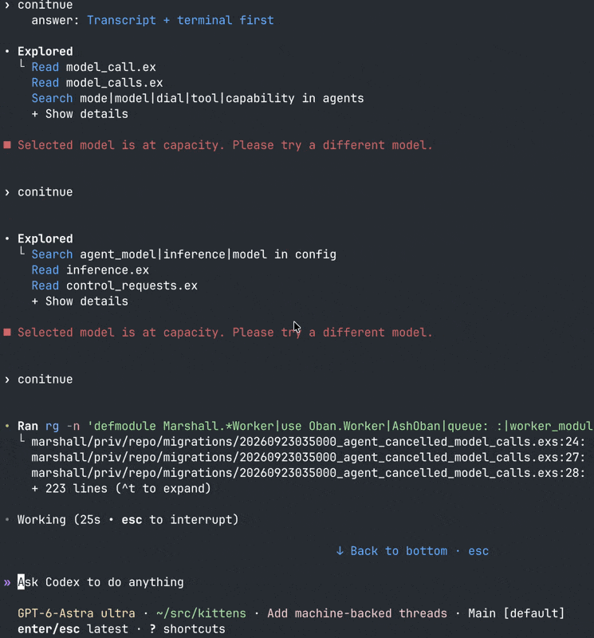
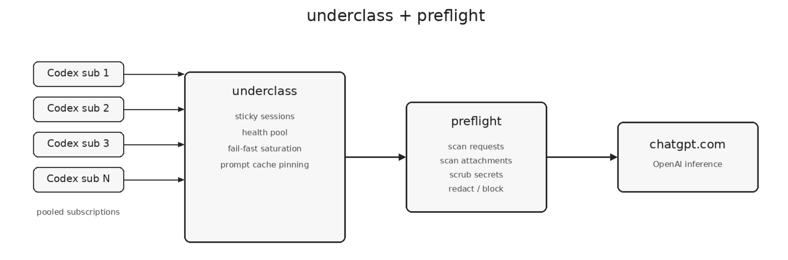

# pooling OpenAI subscriptions and bypassing regional inference capacity limits
By Geoffrey Huntley · Geoffrey Huntley · October 17, 2026

by now, most people should be aware that we're in a cost of compute crisis. The cost of CPU and memory is through the roof. There just isn't enough. Meanwhile, there definitely aren't enough GPUs in the world.

If you've been using ChatGPT lately, you might have seen the meme circulating in the space that OpenAI just doesn't have enough inferencing capacity. Heck, even Tibo admits publicly that they're having compute issues.

In the last couple of weeks, I have lost so much time babysitting agents because of inferencing capacity issues, and it's got me wondering: what if inferencing capacity constraints were region-based? Last year, before this crunch, even with Anthropic models, inferencing was noticeably faster in Australia because everyone else in America was sleeping.

Day to day, I do all my open-source software development on bare-metal machines in Germany, and I've started to notice similar patterns when Europe wakes up: all of a sudden, inferencing performance plummets and I'm being greeted with walls of 'model is at capacity, try again' errors.

Above is what I woke up to this morning. Imagine my dismay at losing time on a strict get-overalls-done-and-released-before-my-conference-talk timeframe. You can complain online all you want, but we're software engineers. We can solve these problems.

## underclass

The first piece of the puzzle is a piece of software that I wrote last month called Underclass. Underclass pools many ChatGPT subscriptions together and works as a proxy. It can automatically claim resets and correctly handles the prompt cache key to ensure usage isn't wasted.

I haven't written about it before, but it is now a month old, and I consider it stable. It's available on GitHub, and I use it with six ChatGPT 500 accounts, but there's no real upper limit on how many accounts you can configure.

Installation is easy, and it's well documented. It's also available as a Nix Flake.

## preflight

Another piece of software I wrote last month is a local LLM proxy that scans requests and attachments for secrets and proactively scrubs and redacts them before they hit the model. It's on GitHub (below)

To use Preflight, run a single instance of Preflight and one instance of Underclass, then point Underclass to use Preflight. Preflight scrubs requests and sends them out for inference, ensuring sensitive material never reaches the inference providers.

## unburying the lede

By now you're probably wondering either, "Wow, that's two really cool projects," or why I opened with geographic routing. It's because... today I'm releasing a new *experimental prototype* called `geoclass` which routes your requests to different inferencing regions around the world. Like underclass and preflight, it is composable. You can use all of them, none of them, or any combination you can imagine, since they are separate pieces of software that compose well together.

How it works is simple.

Set up a Tailscale network and deploy virtual machines around the world, then tag those virtual machines with a Tailscale tag; GeoClass can then identify these machines via the tag. From that point forward, all you need to do is point UnderClass to GeoClass, and the rest just works (in theory!).

I don't know *yet* if `geoclass` will solve my inferencing woes, but there's also no way in hell I'm going to sit here and stew when the performance of OpenAI in Europe has been miserable over the last 30 days.

So I'm going to try experimenting with geo-routing. If the below works for you, let me know; I'm keen to catch up with folks thinking along the same wavelength. You never know until you try!
