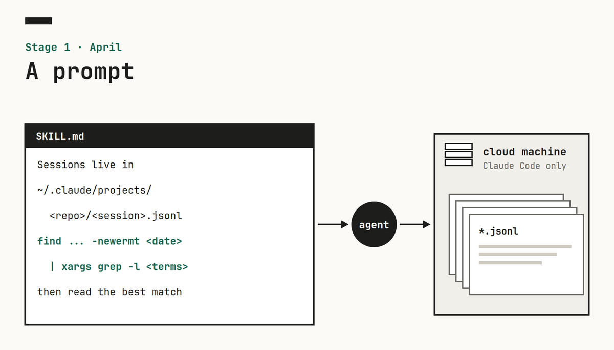
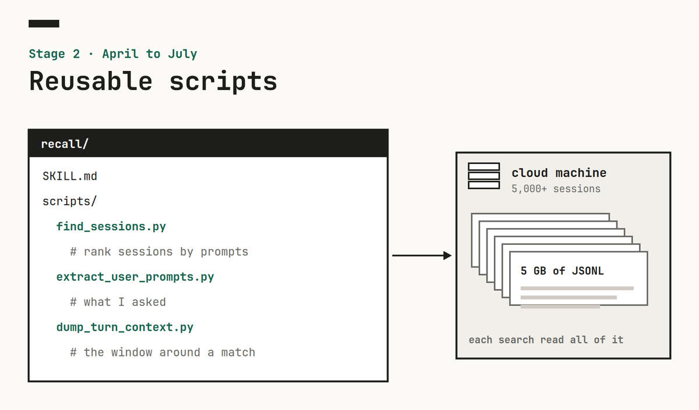
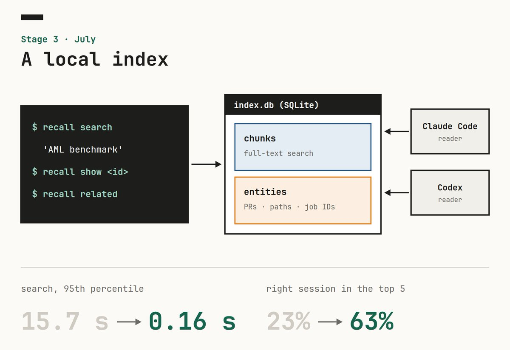
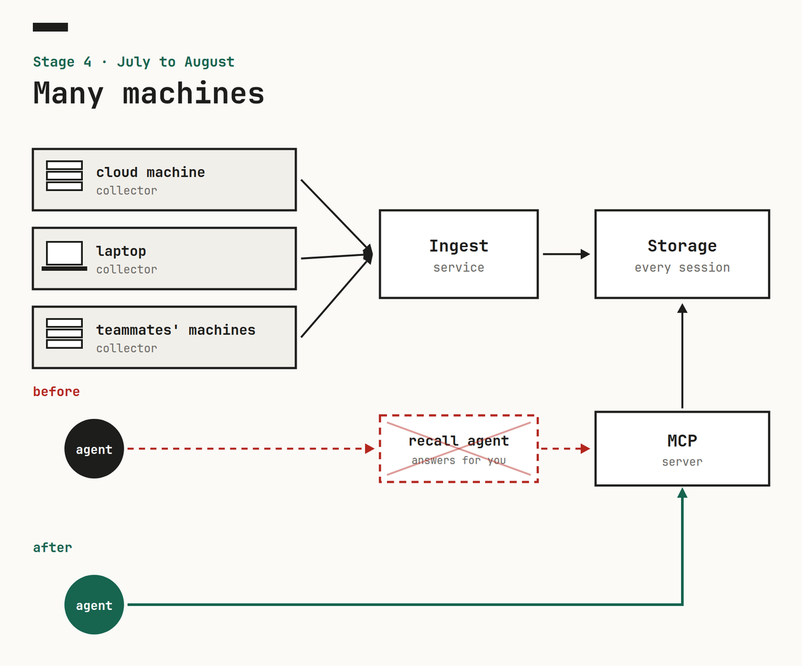
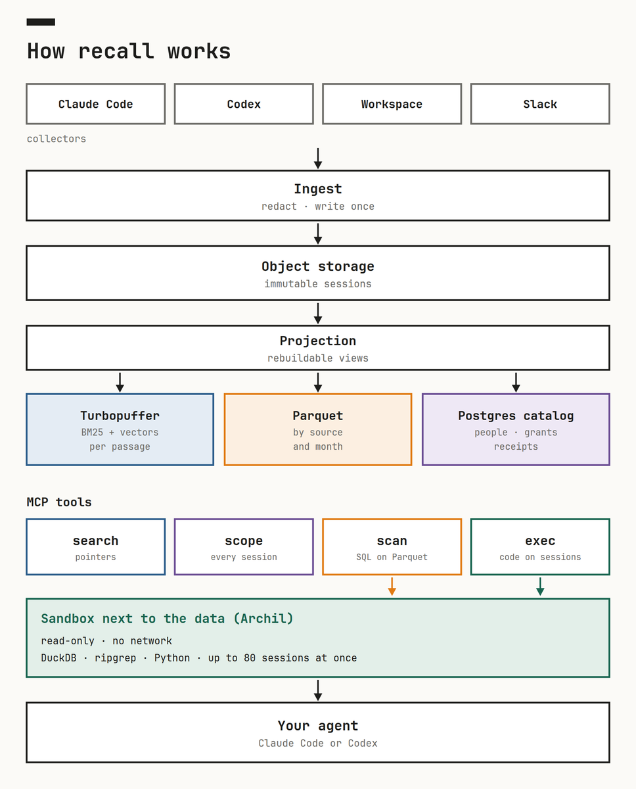
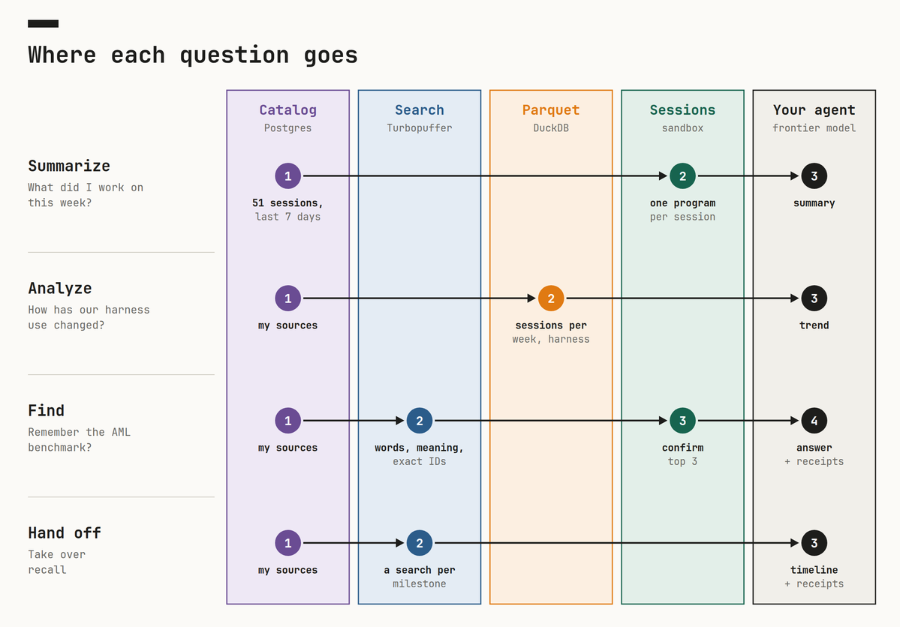
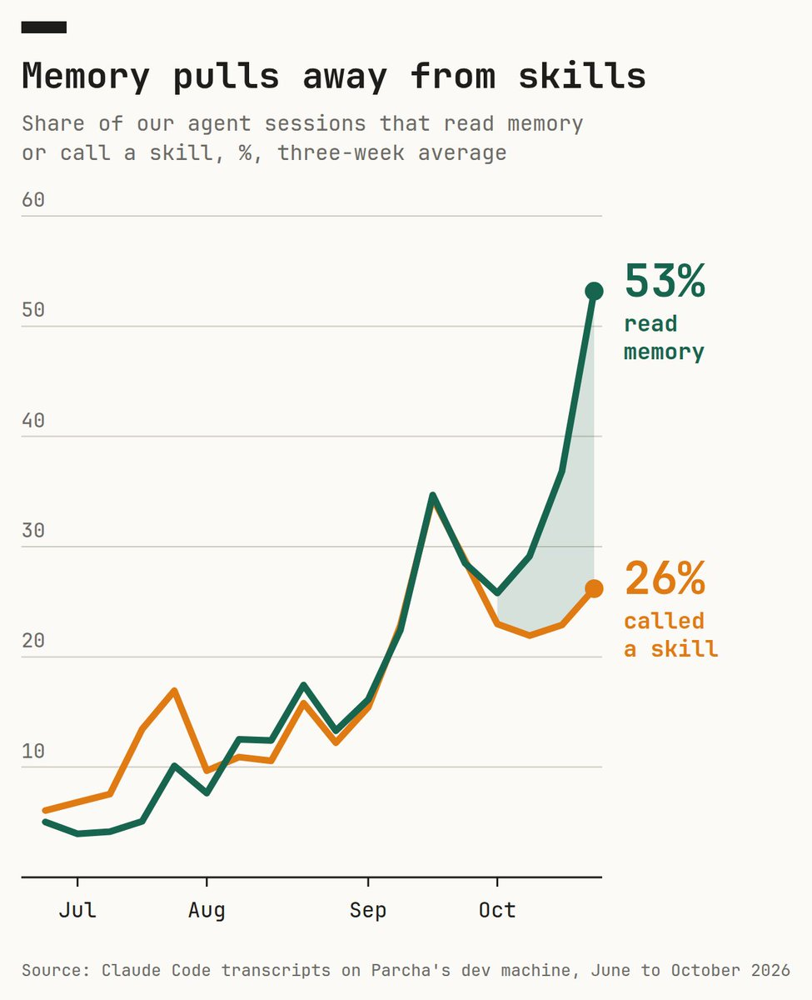
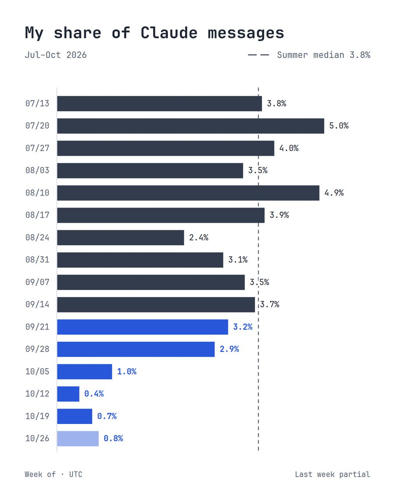

# Recall: how a skill became our company brain

By Miguel Ríos Berríos

*Recall, the skill we use for retrieving context from Claude Code and Codex sessions is open source here: https://github.com/Parcha-ai/parcha-skills. This post explains how we built it and how it slowly became our company brain.*

[Recall](https://github.com/Parcha-ai/parcha-skills/tree/main/recall) started because I wanted one coding session to remember what another one did. I'd ask an agent "remember when I did X? put all the details down so we can keep working," and it would search my old Claude Code and Codex sessions and hand back a compacted context about that topic. It was a simple way to resume a session I'd lost the thread on, or to fix a bug in a system I hadn't touched in weeks.

As the team grew, I gave it to everyone. When someone new joins, I tell them that if they have a question, they should start with recall. We use it every day to get context on technical decisions we made, to hand work from one person to another, and to look at trends in how we use coding agents and how the harnesses behave over time.

## It started as a prompt

A lot of our skills follow the same path. They start as a markdown file, pick up a few scripts, and some of them grow into a system we end up hosting and running, which is where recall ended up.

In April it was just a prompt, a SKILL.md that told the agent where Claude Code keeps its transcripts (one JSONL file per session under ~/.claude/projects) and how to grep them, read the matches and write down what it found. All of my sessions lived on one cloud machine, so that was all it needed.



Then we gave it a few scripts so the agent didn't have to improvise every search: find_sessions.py ranked sessions by matching prompts, extract_user_prompts.py pulled out what I had asked, and dump_turn_context.py showed the window around a match. They worked, but each search read every transcript on disk. By July there were more than 5,000 Claude Code transcripts on that machine, about 5 GB, plus Codex sessions the scripts couldn't read at all. The agents had gone back to grepping by hand about nine times for every time they used the scripts.



So I pointed an agent at @garrytan [gbrain](https://github.com/garrytan/gbrain) and asked it to build us something like it. In one night recall became a local index, a single [recall.py](https://github.com/Parcha-ai/parcha-skills/tree/main/recall) with search, show and related on top of a SQLite full-text index. It also kept an entity table for PR numbers, file paths and job IDs, and it could read both Claude Code and Codex sessions. On a frozen set of 57 questions, the right session showed up in the top five 63% of the time, up from 23%, and searches came back in 0.16 seconds instead of 15.7.



That worked while everything lived on one machine. Then I wanted my laptop's sessions in it too (Codex, Claude Code, ChatGPT and Cowork), and after that my team's. Three things were missing:

1. A place to store every transcript.
2. An ingest service, with a collector on every machine sending sessions to it.
3. A way for the agents on every machine to ask that service questions, which is what MCP is for.

The first version of that service had a recall agent inside it. Your agent asked the recall agent, and it searched and answered. We took it out once we realized the agent calling recall is already Claude Code or Codex, running a frontier model, and it's very good at pulling evidence into files, running its own searches and summarizing. A second agent in the middle repeated that work and hid the evidence. What the calling agent needed was good tools for recall and fast retrieval, so that's where the rest of the work went.



## Why it's called recall

The name is the design, since recall's job is to make sure the agent doesn't miss anything, and precision is up to the agent. I wrote it down for the agents building it: "focus on recall so much. Make sure that you have everything... the serverless execution and all the grep should focus on precision." Every tool returns pointers to where the answer could be, with a receipt for each piece of evidence, and the agent opens the exact session before it cites anything.

## What's inside



We added each piece when we hit a problem it solved.

A collector runs on every machine and account and sends new sessions to ingest, which redacts secrets and writes each session exactly once. We redact there because everything downstream is built from what ingest writes.

Object storage keeps every session exactly as it arrived, a manifest plus its JSONL parts, and nothing edits it afterwards. Everything else in the system is a projection we can rebuild from it. We picked this over gbrain's page model and over managed memory APIs because those store a summary of the source, and we wanted the source.

A projection worker builds three things from storage. @turbopuffer indexes every passage by its words (BM25) and its meaning (vectors), with person, source and time as filters, and it computes the embeddings itself. We moved search there after a month where we spent $800 on embeddings, and since it's a projection we can rebuild the index in a few hours.

Parquet files, one set per source and month, hold documents, records, passages and actors in columns, which is what makes the broad questions cheap. A question about one person over one day went from 40 seconds to about 0.15 once we had them.

A small Postgres catalog holds people, sources, grants and receipts, which is what we need to decide what each agent is allowed to see.

The last piece is a sandbox next to the data. @archildata mounts object storage as a disk with compute attached, so instead of copying gigabytes of sessions to the agent, the agent's code goes to the sessions. The sandbox mounts the sessions and Parquet files the caller is allowed to see, read-only and with no network, and runs @duckdb, ripgrep and Python. It can fan one program out across 80 sessions at once.

The agent reaches all of this through four [MCP](https://modelcontextprotocol.io/) tools. search runs a scoped query on [Turbopuffer](https://turbopuffer.com/) and returns pointers. scope asks the catalog for every session that matches a person and a time window, complete and unranked. scan runs the agent's DuckDB query over the [Parquet](https://parquet.apache.org/) files. exec runs the agent's program over exact sessions in the sandbox. Every call checks the catalog first, so an agent only sees what its user is allowed to see.

## What happens when you ask it something



**"What did I work on this week?"** This one needs every session, so the agent skips search and calls scope with me and the last seven days. The catalog resolves me to my sources (my cloud machine and my laptop, in Claude Code and Codex) and returns every session that overlaps the window, 51 of them, each with a receipt. Then the agent writes one small Python program and sends it to all 51 with exec. The sandbox splits them into shards, mounts each session read-only and runs the program in eight sandboxes at once, and each run prints the repo, the branch and my prompts from that week. The sandboxes read about 1.1 GB in about a minute, nothing left storage, and the agent got a few kilobytes back to write the summary from.

**"How has our use of Claude Code and Codex changed since June?"** This question never opens a session; the agent calls scan with a DuckDB query, the catalog decides which sources it can see, and the sandbox mounts the Parquet passage files for those sources and months. The query counts distinct sessions per week by harness and returns a small table. Codex went from a small share of our sessions in June to most of them by mid-September, then back to about a third in October.

**"Remember when we built the benchmark for our AML agent? Give me everything."** Here the agent doesn't know where to look, so it calls search. The catalog turns my grants into a filter, and Turbopuffer runs one query that matches the words, the meaning and any exact identifiers, then reranks the results, in about two seconds. It returns pointers: session IDs, the passages that matched, and their receipts. The agent opens the top three with exec and runs an exact match in the sandbox to confirm them. It found the session where we first built the benchmark, the one where it grew and got a baseline, and a later one where a teammate moved it into our backend repo, and it answered with a receipt for each.

"I need to take over recall. Give me the timeline, with receipts." The agent searches once per milestone, each search scoped to the days around it, and each one comes back in two to four seconds. When a search returns a passage near the moment instead of the moment itself, the agent narrows the time window and searches again. It keeps the strongest passage from each search, and every passage carries a receipt that opens the exact record in its session. Then it writes the handoff: what recall is, how it works, the story of the project in order with a footnote on every claim, the decisions to keep and where to start. That doc becomes the system prompt for the next agent. It's like handing someone my session and telling them to resume it, and probably better, since the doc has context from outside that session too.

````markdown
```
# Handoff: recall

What it is
Recall is the team's memory of its own work: every Claude Code and Codex session from every machine, plus Google Workspace and Slack, searchable by any agent over MCP. You ask it something like "remember when we built X," it hands your agent pointers and receipts, and your agent reads the evidence and answers.

How it works
A collector on each machine sends new sessions to ingest, which redacts secrets and writes each session once to object storage. A projection worker builds three things from there: a Turbopuffer index for search, Parquet files by source and month for the broad questions, and a small Postgres catalog of who can see what. Agents use four tools (search, scope, scan and exec), and the last two run in an Archil sandbox next to the data.

Timeline
Recall started as a homegrown skill, and on July 11 Miguel asked to rebuild it because it "could be way better" [1]. The first rebuild was a local index that beat grep on a frozen set of test questions [2]. Two weeks later the sessions moved to S3 "so we can use Archil serverless execution" [3], which meant code could run where the data lives, and the design settled on one rule: embeddings point to where the answer could be, and the sandbox reads the exact session [4].

In August Miguel asked "What if there's an agent already calling that MCP?" [5], and the recall agent came out, leaving the reasoning to whichever agent calls recall. A few days later Parquet came in for questions about a person, a team or a time range [6]. September was about measuring and scaling it: a daily scorecard for accuracy and latency [7], search moving to Turbopuffer [8], and proving that every teammate's sessions land and can be retrieved [9].

Decisions to keep
Object storage is the source of truth, and everything else is rebuilt from it [3]. Search returns pointers, and the calling agent decides what's true [4] [5]. Code goes to the data instead of the data going to the agent [3] [6].

Where to start
Read the scorecard first [7], since that's what the search tuning is measured against. Then pick up from the team rollout [9], which is where the most recent work is.
```
````

## We made it work, then we started climbing

Agents wrote most of recall's code, and I spent my time on the architecture. Once it worked end to end, we started climbing: we picked a metric, set a goal on it and had the agents work toward it. We built a daily scorecard for accuracy and latency. In its first week, search went from 20 seconds at the 95th percentile to 1.4, and the share of questions with the right session in the top 20 went from 54% to 88%. The bar we hold it to is the right session in the top five at least 90% of the time, with search under two seconds.

## How we use it

Anyone can use it by telling their agent "recall when we did X," or with the /recall command. It's how we pass knowledge to new team members and to agents, and the agent part surprised me. Sometimes an agent says "I'm going to recall how we did this before," finds it, and then saves a note in its own memory so it remembers next time. It's also how we do analytics on our own use of coding agents; the numbers in the two posts below came from it.

In my post on [skills and memory](https://x.com/MiguelriosEN/status/2117341153200894238), recall showed that memory is already pulling away from explicit skills. By late October, 53% of our agent sessions read memory while 26% called a skill.



In [running agents like an engineering org](https://x.com/MiguelriosEN/status/2115891556251234339), recall showed the management layer absorbing the coordination work. My share of Claude messages fell from roughly 4% in the summer to under 1% after the org started running.



## Build your own brain

We're making an open version of this part of [AgentRun](https://github.com/Parcha-ai/agentrun), so anyone can build a company brain on the same pieces: object storage as the source of truth, Turbopuffer for search, Parquet and DuckDB for the broad questions, a sandbox next to the data, a small catalog for who sees what, and MCP for whatever agent you already use.
