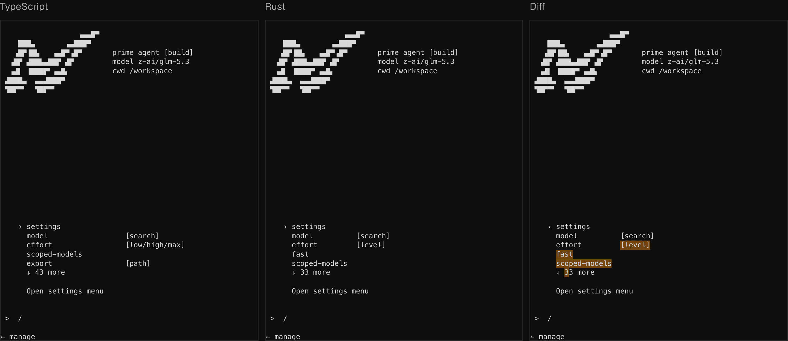
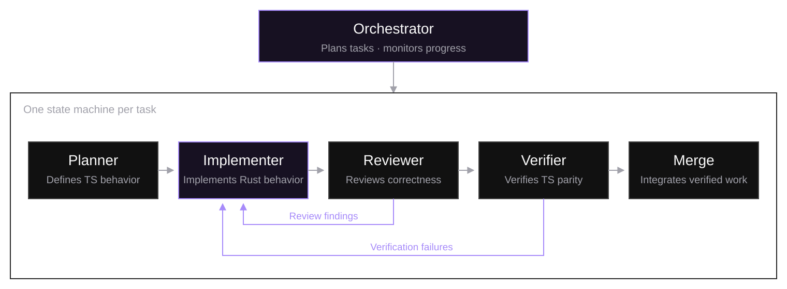

# Rewriting Prime Agent in Rust
By Kevin Thomas, Sebastian Müller, Seth Karten · Prime Intellect · OCT 9TH, 2026

Since we launched Prime Agent [[1]](https://www.primeintellect.ai/blog/prime-agent-rust#reference-1) in August, it has been downloaded more than 300,000 times and has processed over 8 trillion tokens. Today, we're excited to ship a faster, cleaner and more reliable Prime Agent, rewritten from the ground up in Rust.

Over two weeks, Prime Agent orchestrated a swarm of over 2,000 agents to rewrite itself end to end, operating across 10,000+ Prime Sandboxes with over 200 billion tokens from Prime Inference’s GLM-5.3 endpoint. The Rust rewrite stress-tested Prime Agent’s multi-agent capabilities, including the sandbox and inference infrastructure we’ve been building to power large-scale agent swarms, autonomous research, and reinforcement learning.

To ensure feature parity with the TypeScript version, Prime Agent orchestrated subagents to topologically sort dependencies, with finite state machines structuring looped computations and correctness checks. In parallel, we rewrote the code architecture for easier maintenance and development. We then used runtime benchmarks and real Prime Agent traces to hillclimb performance metrics and triage bugs. Now, Prime Agent runs faster and uses fewer resources than most coding agent harnesses.

## Why Rust

TypeScript helped us ship Prime Agent quickly, but its types are optional and disappear at runtime, errors travel as unchecked exceptions, CPU-heavy work like rendering and parsing large sessions competes with keyboard input on a single event loop, and every process pays for a JavaScript runtime and garbage collector. We want to keep shipping as fast as we do, while holding the code to a higher standard as it grows, and Rust suits that well:

- **Performance:** Prime Agent is a long-running daemon with a worker process per session, and native code without a garbage collector accounts for most of the memory and startup gains we’ve made.
- **Concurrency:** one daemon streams model output, runs tool calls, relays messages between agents and serves every attached client at once. Rust's `Send` and `Sync` traits let the compiler check which data can move between threads and which can be shared.
- **Compile-time guarantees:** exhaustive enums, ownership and lifetimes rule out whole classes of bugs before the code runs, and Clippy's pedantic lints add hundreds more checks, which matters when agents write most of the code.

In addition to these clear performance gains, the rewrite gives us the opportunity to rethink our design choices. We have significantly modularized our codebase, and are reaping the rewards of this rewrite, including Windows support, session crash isolation, and a more consistent daemon protocol.

## How Prime Agent rewrote itself

Our goal was for agents to perform the rewrite autonomously with as little human intervention as possible. Thus, the human work required was to setup proper verification to enable autonomous deployment at scale. We followed similar setup to previous work on automatic Rust translation [[2]](https://www.primeintellect.ai/blog/prime-agent-rust#reference-2). Each specification covered a different kind of parity:

- **TUI parity:** a differential test suite compares the TypeScript and Rust binaries side by side against the same scripted model and diffs the terminal frames each one renders. It covers user flows, including launch, slash menus, tool calls, compaction, agents view, session resume, subagents and crash recovery.
- **Harness parity:** the same run diffd session transcripts and the requests each binary sends to the model provider, so both produce the same sessions from the same inputs.
- **Protocol parity:** all message types in the daemon protocol are checked against the TypeScript implementation, ensuring our ACP and daemon protocol APIs are consistent.
- **Feature parity:** since scripted flows cannot cover an entire interface, agents audited the TypeScript product component by component, classifying each as matching, partial or missing.

With an objective check for every kind of parity, the agents could measure their own progress and catch regressions before changes merged, which let us cut back on human review. Remaining bugs and behavior differences were largely found through internal use, which guided our follow-up work on missing features, reliability and interface polish.

We ran all orchestrators and their agents on two 8-core on-demand CPU nodes, each supporting over 100 concurrent subagents and their respective CPython kernels. Additionally, since compilation, type-checking and diffing would saturate any single machine when dozens of agents are running at once, we built out utilities for our agents to outsource heavy work to Prime Sandboxes, allowing us to heavily parallelize our port.



An objective TUI parity verifier compares terminal frames from the TypeScript and Rust versions and highlights differences.

### Orchestration of Finite State Machines

A single root agent orchestrated the rewrite and divided the work into a topological ordering of tasks. The root agent wrote no product code, keeping it free to monitor every task, merge finished work, and maintain an overview of the rewrite while working with us on priorities and decisions. We also kept generation and verification in separate agents, since an agent that writes code is biased when evaluating it. Therefore, each task assigned by the orchestrator moved through four agents:

- **Planner:** creates overall machine specification, including the feature design, ground-truth TypeScript behavior, and verifier (parity check)
- **Implementer:** writes the Rust code in a dedicated worktree so features can develop in parallel.
- **Reviewer:** inspects the pull request adversarially, using a different model and in a separate context from the implementer, looking for reasons the change is wrong.
- **Verifier:** compiles and runs the feature's parity checks and tests in a fresh Prime Sandbox.

A failed review or verification sends the feature back to the implementer with the findings, and the PR merges once both pass. We are building this pattern into Prime Agent to orchestrate a factory of finite state machines, so workflows like this one can be defined once, reused, and updated.



### Architecture re-design

Porting to Rust also gave us a chance to restructure the codebase. This is where much of the long-term benefit comes from:

- **Modularity:** the code is split into nine crates with a one-way dependency graph that Cargo enforces, and the TUI’s only internal dependency is the shared types crate. The largest source file is now ~2,500 lines, down from ~15,000 in TypeScript, with no files over 5,000 lines compared with four in TypeScript.
- **Isolation:** each session runs in its own worker process under a small supervisor, so a failure in one session leaves the others running, and sessions persist on disk so clients can reattach after a restart.
- **Platform abstraction:** transport, process control and file locking sit behind platform-specific interfaces, so something like Windows support came down to implementing those traits rather than rewiring the daemon.
- **One protocol definition:** the client, the daemon and every worker compile against the same message types in the shared types crate, so a change to the protocol is checked everywhere it is used.
- **Catalog-driven models:** ported our model and MCP lists to a separate catalog fetched at runtime, allowing us to ship new models and plugins without a Prime Agent release.

### Refining the work

While the autonomous workflow went further than we expected, the parity checks only verified the behavior they exercised. Once parity on the main RLM loop was achieved, we moved all our rewrite agents onto Rust, allowing us to dogfood the Rust version at scale (and now Prime Agent Rust was recursively improving itself!). Later, we moved our internal team onto the Rust build for daily use, which exposed bugs and missing behavior outside the coverage of the differential tests. Throughout our dogfood cycles, we had agents review logs and traces from all beta users, allowing us to automatically diagnose and resolve runtime and agent issues identified by users. We also took the rewrite as an opportunity to redesign some of the UX/TUI flows and model-facing API.

Bringing the rewrite to release quality took follow-up work over the following weeks, from finishing feature ports and fixing bugs to improving performance and polishing the interface. Prime Agent still wrote and tested these changes, while we had humans in the loop involved in finding problems, directing the changes, and reviewing all results.

### Hillclimbing performance

With feature parity achieved, we wanted to optimize Prime Agent runtime performance across all user flows. We approached it the same way as the rewrite: by giving the agents an objective way to measure their own progress. We built a benchmark harness that measures Prime Agent performance across a variety of runtime metrics, and let Prime Agent hillclimb its speed and resource usage with well-deliberated improvements.

The performance benchmark evaluates Prime Agent in Rust and TypeScript, as well as other agent harnesses, on a fresh 4-core, 8 GB Prime Sandbox per benchmark, with noise checks that withhold any result too unstable to compare. Agents run in a real terminal driven through a screen emulator against a scripted model, so timings reflect what a user sees and exclude inference.

With the harness in place, a second orchestrator ran a hillclimbing loop for three days with a single objective: improve the benchmark results without breaking parity. Each experiment followed the same procedure:

1. Agents profile the benchmarks to find where time and memory go, turning the largest costs into a backlog of hypotheses that the orchestrator then assigns to workers.
2. Workers build the current code and the candidate change on the same sandbox and run them in alternating order, along with neighboring benchmarks to catch regressions elsewhere.
3. Two reviewer agents, each on a different frontier model, check that behavior still matches TypeScript, that output stays byte-identical wherever the change claims it, and that nothing regresses on the model-facing surface.
4. The change merges, and the next experiment measures from the new baseline.

We deliberately gave the loop no numeric targets, since a fixed threshold tends to become a stopping point. The agents' only objective was to keep improving the benchmarks without breaking parity for as long as measurable gains remained. Over the hillclimb cycle, the loop logged over 144 experiment and audit records, merging over 69 valid changes that boosted performance. Below are some significant improvements we’ve seen in important areas:

Most of the gains came from three kinds of change: moving work off the startup and render paths, replacing polling loops with event-driven waits, and releasing memory as soon as large sessions finished loading.

## Results

Overall, our Rust rewrite and following performance hillclimbing has made Prime Agent significantly faster and more resource efficient. With time to input roughly 14x faster than TypeScript and using over 80% less memory after startup, Prime Agent is amongst the fastest coding agent harnesses available.

| | Prime Agent (Rust) | Prime Agent (TypeScript) | Claude Code v2.1.289 | Codex CLI v0.160.0 | Pi v1.0.3 | Hermes Agent v0.21.5 |
|---|---|---|---|---|---|---|
| First paint: Launch until first visible output | 23.6 ms ± 0.6 30.63× faster | 722.8 ms ± 15.1 | 264.6 ms ± 5.8 | 296.8 ms ± 2.7 | 306.3 ms ± 6.7 | 1,715.3 ms ± 10.3 |
| Time to type (cold): Fresh launch until typing works | 55.8 ms ± 4.9 13.22× faster | 737.8 ms ± 13.9 | 348.4 ms ± 8.2 | 324.6 ms ± 4.9 | 317.7 ms ± 8.0 | 2,094.5 ms ± 23.5 |
| Time to type (warm): Repeat launch until typing works | 42.4 ms ± 4.3 12.96× faster | 549.6 ms ± 10.0 | 345.1 ms ± 6.2 | 321.3 ms ± 9.2 | 240.4 ms ± 5.9 | 2,097.1 ms ± 40.8 |
| Installed size: Disk space used by installation | 59.6 MB ± 0.0 2.89× smaller | 172.1 MB ± 0.0 | 492.4 MB ± 0.0 | 446.8 MB ± 0.0 | 456.0 MB ± 0.0 | 960.1 MB ± 0.0 |
| Memory (RSS): Whole process tree after startup | 106.0 MB ± 1.3 5.73× smaller | 607.4 MB ± 0.9 | 226.9 MB ± 0.4 | 344.4 MB ± 3.1 | 138.1 MB ± 0.7 | 194.6 MB ± 0.3 |

External harness results were measured with our custom runtime suite. Without a common benchmark standard, comparisons should be interpreted with caution.

This more modular codebase and stronger compile-time checks will also help us ship new capabilities faster and catch more mistakes before they reach users.

## What's next

With our Rust port in, we’re bringing the same attention to detail to every part of Prime Agent, from everyday systems interactions to complex work cross many agents. Now that infrastructural improvements are out of the way, we are accelerating on capabilities and evals, and making the multi-agent workflows behind this rewrite available to you.

Prime Agent will also be more tightly knit into the Prime Intellect ecosystem, allowing you to work across the stack with cloud agent swarms, inference, traces, sandboxes, evals, hosted training, and more.

With this rewrite, we are also releasing Prime Agent with native Windows support (beta) and installation through homebrew. Prime Agent remains [open source](https://github.com/PrimeIntellect-ai/prime-agent) and installs with one command:

```bash
curl -fsSL https://app.primeintellect.ai/prime-agent/install.sh | sh
```

or on Windows:

```powershell
irm https://app.primeintellect.ai/prime-agent/install.ps1 | iex
```

If you'd like to work on Prime Agent, [we are hiring](https://www.primeintellect.ai/careers/8597d151-46db-4c67-a809-5d40daae7185).

### References

[1] Karten, S., Zhang, A. L., Thomas, K., Müller, S., Bakouch, E., Auras, D., Senghaas, M., Obeid, F., Dunas, K., Hagemann, J., & Jaghouar, S. (2026). Prime agent: A self-improving RLM harness [Preprint]. arXiv. [https://arxiv.org/abs/2608.23552](https://arxiv.org/abs/2608.23552)

[2] Karten, S., Appapogu, R. D., & Jin, C. (2026). Automatic generation of high-performance RL environments. In Proceedings of the Third Conference on Language Modeling (COLM 2026). [https://openreview.net/forum?id=UmpTwqxiY0](https://openreview.net/forum?id=UmpTwqxiY0)
