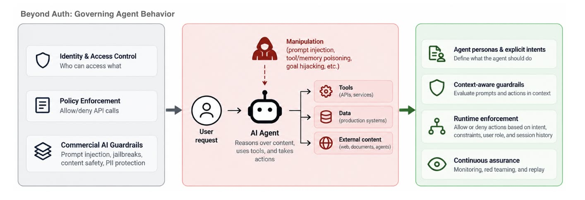
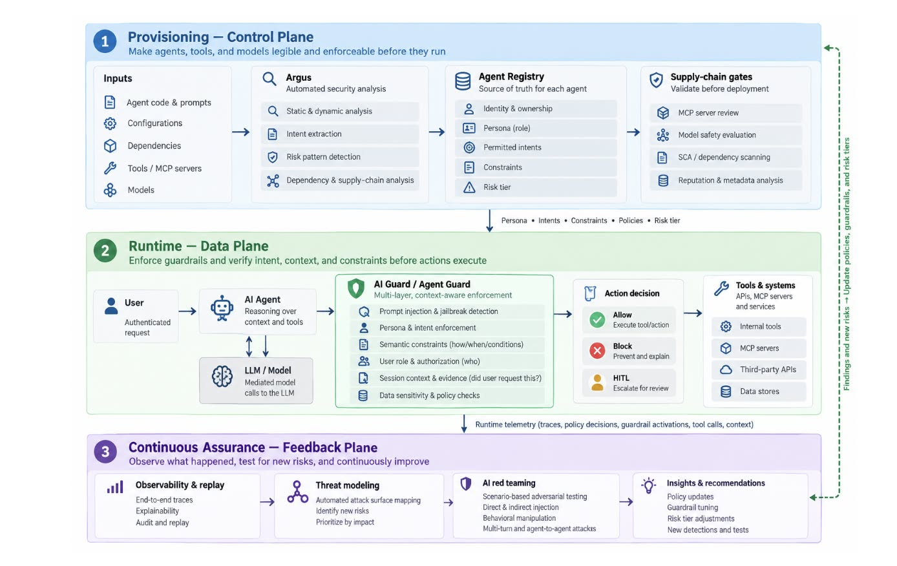
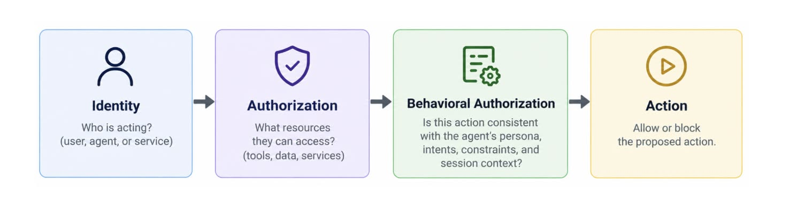
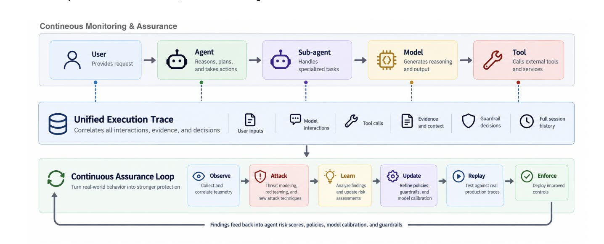

# Securing AI Agents: Lessons From Real-World Deployment
By Sean Tout, Max Zhurovich, Adi Raghavendra · Uber · November 6, 2026

# Introduction

Agentic AI introduces a fundamentally different security model from traditional software. Unlike conventional services that execute predefined logic, agents dynamically reason over content from users, webpages, documents, tools, and other agents—and can translate that reasoning into real-world actions. This shifts part of the attack surface from traditional identity and API controls into the semantic layer, creating risks such as prompt injection, tool and memory poisoning, goal hijacking, behavioral drift, and hallucination-driven actions. Traditional authorization can determine *who* is allowed to act, but securing agentic systems requires answering a broader question: is the proposed action consistent with what the user requested, within the agent’s defined persona and intents, appropriate for the user’s role, and valid given the full session context—including the actions and decisions that preceded it?

To address this challenge, we developed a defense-in-depth security framework spanning the full agent lifecycle: provisioning-time validation, runtime enforcement, and continuous assurance. The framework combines an agent registry, personas and explicit intents, constraints, tool and MCP validation, context-aware guardrails, and continuous red teaming with end-to-end observability and replay. At runtime, we introduced prompt provenance and evidence chaining to correlate privileged actions back to what the user actually requested, providing an additional defense against indirect prompt injection, goal hijacking, and unintended agent behavior.

Securing agents requires more than adding guardrails; it requires designing security into the agent architecture itself. By sharing our framework, implementation approach, tradeoffs, and lessons learned, we aim to provide engineering teams with practical patterns for building these protections into agentic systems from the outset, rather than retrofitting them after agents reach production.

### Beyond Authorization: Governing Agent Behavior

We built this framework because traditional security controls weren’t designed to govern how AI agents reason and act at runtime. Identity and authorization systems can determine whether a user or service has permission to access a resource, but they can’t determine whether an agent’s proposed action is appropriate in context. As agents gained greater autonomy and access to production tools and sensitive data, we needed controls that could govern behavior, not just access, and continuously adapt as agents, capabilities, and attack techniques evolved.

Before developing the framework, our primary alternatives were traditional identity, authorization, and policy-enforcement controls supplemented by AI-specific point solutions. We evaluated several commercial AI security and guardrail platforms, including technologies designed to detect direct prompt injection, jailbreaks, unsafe content, and sensitive data exposure. We also considered traditional policy engines and authorization technologies for controlling access to tools and data. These technologies remain important parts of a defense-in-depth architecture, but none fully addressed the broader threat model we were trying to solve: an agent manipulated into an unintended action even when the user, agent, tool, and every API call are legitimately authorized.

Figure 1 : Extending access controls with behavioral enforcement to ensure AI agents act as intended.

This led us to reconsider the control model itself. Rather than attempting to identify and maintain detection rules for the near-infinite variations of direct and indirect prompt-injection attacks, we shifted toward semantic, behavior-based enforcement. The framework evaluates prompts and proposed actions against the agent's defined persona, permitted intents, semantic constraints, user context, and multi-turn session history. Actions that fall outside those boundaries can be denied regardless of whether the specific attack technique has been observed before. This adds a contextual decision layer that asks not only “Is this agent authorized to perform this action?” but also, “Should it, given what the user requested and everything that has happened in the session?”

Designing these controls for production introduced a second set of challenges. Security effectiveness had to be balanced against accuracy, latency, cost, developer experience, and agent autonomy. Stronger enforcement can reduce unsafe actions but also increase false blocks, so we moved away from uniform thresholds toward continuous, per-agent calibration based on each agent’s behavior and risk profile. Runtime evaluation also introduced latency and inference costs, leading us to establish strict latency budgets and favor small, specialized models over large general-purpose LLMs where possible.

Developer adoption was equally important. A technically strong control provides limited value if onboarding complexity or false positives encourage teams to bypass it, so we invested in automated onboarding and guardrail assignment to make the secure path the easiest path. We also found that generic controls could provide broad baseline coverage, but some of the strongest protections—particularly persona, intent, and semantic constraint enforcement—required deeper integration and understanding of each agent.

These tradeoffs shaped the framework as much as the underlying security model. Our central lesson was that security, accuracy, latency, cost, agent autonomy, and developer experience can’t be optimized independently. Effective agent guardrails require treating them as a distributed systems and engineering problem as much as a security problem, with controls designed to operate continuously and reliably at production scale.

### Architecture

Uber Secure AI is a defense-in-depth architecture that secures agents throughout their lifecycle across three integrated layers: provisioning-time validation, runtime enforcement, and continuous assurance. It’s built on a simple premise: traditional identity and authorization remain essential, but they’re no longer sufficient when software can reason over untrusted content, dynamically select tools, and take actions on a user's behalf. Agentic systems require an additional semantic and behavioral control layer that can determine not only whether an agent *can* perform an action, but whether it *should* perform that action given its defined purpose, the user's request and permissions, and the context of the session.

Figure 2 : A three-layer architecture securing AI agents from provisioning and runtime enforcement through continuous assurance.

#### **Establishing the Agent's Behavioral Contract**

The architecture begins at provisioning, where the Uber AI Registry provides the authoritative record for an agent's identity, ownership, persona, permitted intents, constraints, dependencies, and risk tier. These properties collectively establish a behavioral contract describing what the agent is designed and permitted to do.

Rather than relying entirely on developers to declare that contract manually, Argus, our automated agent security analysis platform, analyzes the agent's source code, prompts, configurations, dependencies, exposed endpoints, and tool-invocation paths. This analysis identifies security weaknesses while also deriving structured intents from the agent's implementation, allowing declared behavior to be compared with observed capabilities.

The same principle extends to the agent's supply chain. Third-party MCP servers and tools are evaluated using techniques such as static and dynamic analysis, software composition analysis, reputation signals, and semantic inspection of tool descriptions and metadata to identify vulnerabilities, indirect prompt injection, tool poisoning, and other malicious behavior. LLMs (Large Language Models) also undergo security evaluation before deployment, while monorepo scanning identifies unregistered agents, unauthorized MCP endpoints, and attempts to operate outside required security controls.

Together, these capabilities establish what the agent is, what it is intended to do, which tools and resources it may use, and the security controls that must follow it into production.

#### **Extending a Familiar Security Model**

At runtime, the architecture builds on the familiar separation between policy administration, policy decision, and policy enforcement, but extends the policies from resource authorization into semantic behavior.

The AI Registry acts as the PAP (policy administration point), where agent policies, personas, intents, constraints, and required guardrails are defined and managed. AI Guard acts as the PDP (policy decision point), evaluating interactions and proposed actions against those policies. Agent Guard runtime hooks, along with enforcement logic integrated through LangFx or the AI Guard SDK, act as PEPs (policy enforcement points), invoking AI Guard at critical checkpoints and applying its verdict before an interaction or action is allowed to proceed.

Conceptually, the model extends traditional authorization, as shown in Figure 3.

Figure 3 : Extending access control to evaluate not just who and what, but why and whether an action is appropriate.

Traditional controls establish *who* is acting and *what resources they can access*. The behavioral layer evaluates *why the action is being taken, whether it’s consistent with the agent's purpose, and whether the current context supports it*.

An agent may therefore possess valid credentials to invoke a tool—and the user may legitimately have access to the underlying resource—while the specific action can still be denied because it falls outside the agent's defined intent or is inconsistent with the overall context.

#### **Designing Runtime Security for Production Scale**

Because guardrail decisions occur directly in the agent’s execution path, performance is a core architectural requirement. Runtime controls must operate within a strict latency budget, making it impractical to rely on general-purpose SaaS LLMs for every security decision, where network round trips and remote inference can introduce significant and unpredictable latency.

Instead, AI Guard uses small, specialized models hosted locally, including models fine-tuned for specific guardrail functions, to keep inference close to the execution path and minimize response time. These models execute in parallel and, where appropriate, leverage in-memory vector search for low-latency semantic matching. By combining local inference with models optimized for narrowly defined security tasks, the architecture reduces latency and cost while allowing individual guardrails to be continuously calibrated to the behavior and risk profile of each agent.

#### **Embedded Across Uber's AI and Engineering Stack**

Secure AI isn’t designed as a standalone security gateway that product teams must independently adopt. It’s embedded at common infrastructure points across Uber's existing AI development and engineering stack so that agents can inherit protections as they’re created, deployed, and operated.

Integrations with Uber's code and no-code agent development platforms discover and register agents early in the development lifecycle, establishing identity, ownership, persona, intents, risk, and required controls. LangFx and the AI Guard SDK provide standard integration paths for applications to invoke AI Guard, while Agent Guard provides runtime interception and enforcement at agent and tool-execution boundaries.

AI-specific supply-chain defenses integrate with existing development and DevOps workflows to identify vulnerable or malicious dependencies, MCP servers, tools, and other risks before deployment. At runtime, AI Guard becomes a shared decision service for security, privacy, and safety policies across application, model, and tool checkpoints.

This approach makes agent security an inherited platform capability rather than an implementation responsibility repeated by every product team. Security follows the agent from registration and development through model interaction, tool execution, and production operation.

#### **Closing the Loop with Continuous Assurance**

The third layer of the architecture provides end-to-end observability, explainability, auditing, and replay across the complete execution chain, as shown in Figure 4.

Figure 4 : Continuous assurance unifies execution telemetry, replay, threat modeling, and red teaming into a feedback loop.

A unified execution trace connects agent actions, tool calls, and guardrail decisions so teams can understand what happened and the context behind it. Traces capture the metadata needed for troubleshooting and auditing, with prompt and response content included only when needed and sensitive information minimized or redacted. Access is restricted based on data sensitivity, and defined retention periods ensure traces are deleted when no longer needed.

Recorded interactions can subsequently be replayed against candidate guardrails and updated policies as new attacks emerge, allowing teams to evaluate security changes against real production behavior before enforcement. Automated threat modeling combines design information with source analysis to maintain a living view of the attack surface, which drives scenario-based penetration testing and continuous AI red teaming. Findings then feed back into agent risk scores, policies, model calibration, and guardrails.

### Development and Deployment Challenges

Moving AI guardrails from architecture into production exposed several practical challenges, particularly around accuracy, latency, developer adoption, and the limitations of generic controls. Addressing these issues required us to evolve the platform based on real production behavior.

#### Balancing False Blocks and False Allows

Persona and intent enforcement required finding the right balance between overly restrictive policies that disrupted legitimate activity and overly broad policies that weakened protection. We addressed this through shadow-mode deployment, traffic replay, and per-agent calibration, allowing teams to measure false blocks and false allows against real behavior, tune intents and constraints, and validate changes before enforcement.

#### Reducing Runtime Latency

Layering static, contextual, and semantic guardrails introduced measurable latency into user-facing workflows. Rather than executing controls sequentially, we parallelized guardrail evaluation and shifted appropriate decisions from large general-purpose LLMs to smaller, specialized models. This reduced latency and inference cost while helping maintain round-trip latency goals.

#### Reducing Developer Friction

Requiring teams to manually register agents, define personas and intents, assign guardrails, and test policies created significant onboarding overhead. We automated much of this process through Argus, which analyzes agent code, prompts, configurations, dependencies, and tool paths to pre-generate personas and intents. Teams can then review and refine these outputs rather than starting from scratch, making the secure path significantly easier to adopt and maintain.

#### Moving Beyond Generic Controls

We found that uniform guardrails and static thresholds couldn’t account for the different purposes, behaviors, tools, and risk profiles of individual agents. We moved to agent-specific personas, intents, constraints, and risk-based calibration, continuously informed by production telemetry, replay, and testing. This made enforcement more contextual and precise, strengthening protection against behavioral manipulation without unnecessarily restricting legitimate agent behavior.

### Next Steps

The next phase of Secure AI will extend the framework beyond its initial focus on first-party and third-party agents and strengthen defenses against increasingly sophisticated agentic attacks. We’ll expand Prompt Provenance and Evidence Chaining to defend against indirect prompt injection, advance semantic constraints and operating principles to better govern agent behavior, and continue reducing latency, false blocks, and false allows through specialized models and per-agent calibration. We’ll also further automate agent discovery, registration, persona and intent generation, guardrail assignment, red teaming, and regression testing—making security increasingly transparent to developers while enabling protections to continuously evolve as new attacks emerge.

## Conclusion

Core security, safety, and privacy guardrails were in place from the start for both first-party and third-party agents at Uber. Building on that foundation, additional layers of control—including advanced guardrails such as PersonaGuard and end-to-end visibility into agent activity—further strengthened our security posture. These controls reduced risk and raised the cost of exploitation, but did not eliminate it. Guardrails helped mitigate known threat patterns, while their effectiveness against new prompt injection and manipulation techniques remained less predictable.

The most effective mitigation we found was also the least glamorous: restricting agents to explicit intents and constraints that tightly govern what may happen and under what conditions. It substantially reduced the ability to act on manipulated instructions, at the cost of some of the flexibility that makes autonomous designs attractive in the first place. That tradeoff is real, and worth making today.

As agents take on longer and more autonomous workflows, traditional forms of human oversight must be complemented by increasingly robust, automated controls. Personas, scoped intents, constraints, and provenance mechanisms provide important additional safeguards as agent autonomy increases. Constraints bind each action to the conditions that make it legitimate. Operating principles govern the goal-seeking behavior that grows more consequential the longer an agent runs unattended. Provenance and evidence chaining keep every step of a long sequence traceable to something a person actually asked for. These four aren’t scaffolding we expect to remove as models improve—they’re the controls we expect to matter most as autonomy increases.

Durable protection will require defense at both layers: stronger safeguards built into the models themselves, complemented by the agent-level controls described here. Because agentic AI presents evolving security threats, effective protection requires layered defenses, ongoing evaluation, and continuous improvement.

This blog is the first in a series. In future blogs, we’ll describe the design and implementation of individual controls: Agent Persona, Context-Aware Guardrails, and End-to-End Observability, as well as intent filtering, constraints, prompt provenance, and secure onboarding.

### Acknowledgments

Secure AI is the result of a collective effort across many teams and engineers who helped turn the vision into a production-ready security architecture at Uber scale. We’d like to thank the core team (Lei Sun, Junyan Guo, Yuqing Wu, Alon Levy, Amy Zuo, Mitch Strong, Jonathan McClanahan, Vaibhav Prakash, Arnab Chakraborty, Bijeeta Pal, Howard Yu, Junhee Lee, Omar Abosamaha, Sridhar Reddy Maddireddy, Yuxin Duan, Zoltan Puha, Navanit Tikare, and Wei Liu) and our many partners (Raghav Gupta, Sameera Poduri, Mohammad Islam, Uday Kiran Medisetty, and Gaurav Bansal) who contributed their expertise, innovation, and engineering effort across the various components of Secure AI.

Cover Photo Attribution: Generated using ChatGPT
