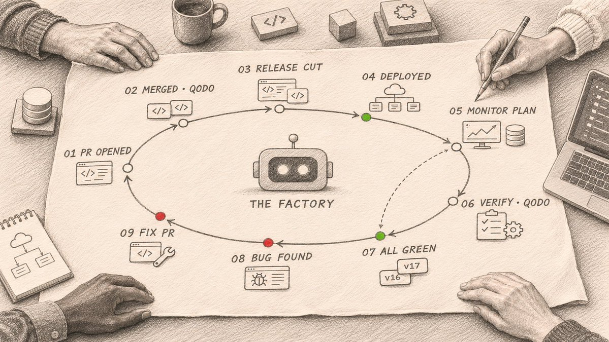

# Software Factory Engineer: Job Description

By Itamar Friedman

*An emerging engineering role for the transition from AI-assisted development to L4 Autonomous Software Factories.*

## The Role

We are looking for a Software Factory Engineer to design, build, operate, and continuously improve the system that produces our software.

The role is responsible for leading the transition from AI-assisted development, through increasingly agentic software development, toward an L4 Autonomous Software Factory: a system capable of independently executing, verifying, and delivering defined classes of software changes within explicit organizational boundaries, while recognizing when high stakes, uncertainty, or decisions beyond its delegated authority require escalation to humans for advice and judgment.

The objective is to increase the velocity at which meaningful software reaches customers and users, while maintaining and even improving quality, reliability, security, and organizational control.

You will work across software architecture, AI agents, orchestration, context engineering, verification, governance, CI/CD, and production operations. You will be responsible for connecting these capabilities into a coherent system, rather than optimizing isolated tools or development tasks.

Your primary engineering artifact is the Software Factory itself.

And just like any other production system, it needs to be designed, tested, observed, maintained, and continuously improved.

More on L4 Software Factory: [here](https://www.linkedin.com/pulse/path-l4-software-engineering-itamar-friedman-xkg1c/)

## What You Will Own

## 1. Factory Architecture and Orchestration

Design and operate the architecture connecting agents, tools, environments, workflows, and humans across the software development lifecycle.

This includes defining how software requirements become executable tasks, how tasks are decomposed and assigned, how agents collaborate, how dependencies are handled, and how completed work moves through verification, approval, deployment, and production feedback.

You will define interfaces and contracts between agents so that individual agents and models can be replaced or upgraded without redesigning the entire factory.

You will make build-versus-buy decisions across the factory, adopting external solutions where they meet organizational needs and building custom capabilities where requirements or meaningful differentiation justify it. You are expected to evaluate vendors, integrate their solutions, and continuously assess quality, security, interoperability, reliability, and total cost of ownership. Your responsibility is to make the complete factory work, whether its components are built internally or purchased.

The factory should coordinate multiple agents, resolve routine failures, recover from interrupted execution, manage concurrency, and escalate exceptions without relying on continuous human supervision.

A key responsibility is making these workflows observable and reproducible. When an agent fails, the system should preserve sufficient context and execution history to understand what happened, recover where possible, and prevent similar failures.

The objective is not to create the most sophisticated individual agent. It is to create a coherent production system that can reliably use different agents to accomplish engineering goals.

## 2. Context Engineering and Organizational Knowledge

Build and maintain the infrastructure that gives agents access to the organizational knowledge required to make good engineering decisions.

This goes beyond indexing source code. The factory needs to understand architecture, cross-repository dependencies, ownership, business requirements, organizational standards, historical decisions, previous incidents, production behavior, and the original intent behind changes.

However, making information accessible is not sufficient. The factory must be able to distinguish validated organizational knowledge from assumptions, outdated documentation, and unverified agent-generated conclusions.

You will establish mechanisms to discover consequential knowledge gaps, identify authoritative sources, validate information with responsible owners, determine where it applies, and translate it into reusable engineering infrastructure.

The output may include versioned knowledge records, executable engineering rules, investigation skills, architectural constraints, test cases, and evaluations.

These artifacts should preserve their source evidence, applicability, ownership, and conditions for revision. When a business definition changes, a security rule is updated, or a production incident exposes an unknown constraint, the relevant factory workflows need to reflect that change.

Domain experts retain authority over their business definitions and operating constraints. The Software Factory Engineer is responsible for making that validated knowledge available and enforceable wherever it affects software production.

Knowledge should persist across agent sessions, development tasks, repositories, and individual employees.

Every meaningful engineering decision, incident, and review outcome should have the potential to improve the factory's future understanding.

## 3. Independent Verification and Software Governance

Design the verification and governance systems that determine whether agent-generated software is correct, safe, compliant, and ready to ship.

The author should not self-approve.

You will establish independent review and validation mechanisms grounded in protected acceptance criteria and organizational requirements. An agent can misunderstand a requirement, generate tests that encode the same mistake, and receive approval from a reviewer sharing that assumption. Verification must challenge those assumptions using authoritative context and observable behavior; the authoring agent must not be able to redefine the criteria under which its output is accepted.

The verification system should understand more than the code diff. It should reconstruct the intent of a change, evaluate its potential blast radius, determine the business criticality of affected systems, identify unverified assumptions, and collect evidence supporting release decisions.

Blast radius, criticality, and change risk must be understood as related but distinct concepts. A change can affect many components without being highly likely to fail, while a small change to a critical authorization path can carry enormous consequences.

You will define how automated tests, independent reviews, security checks, behavioral evaluations, runtime validation, and production signals contribute to decisions about whether software is ready to ship.

Verification must produce inspectable evidence, not just an agent's claim of confidence. The factory should be able to explain what was validated, which requirements were satisfied, what could not be established, and why a particular action was permitted or blocked.

You will also establish mechanisms for evaluating the verification system itself, including its ability to detect meaningful defects, avoid irrelevant interruptions, and apply organizational rules only where appropriate.

Most importantly, verification and governance should be integrated into the factory's execution flow, rather than added as disconnected checks after implementation.

## 4. Autonomy Boundaries and Human Decision Rights

Define which classes of engineering work the factory can execute autonomously, under what conditions, and with which safeguards.

Not every change requires the same degree of supervision. A documentation update, an isolated bug fix, a database migration, and an authentication change represent different levels of potential consequence.

You will design policies that account for blast radius, business criticality, verification evidence, reversibility, and the organizational authority required to proceed.

These policies should be explicit, testable, and enforceable. Where appropriate, they should be represented as executable controls rather than informal instructions that agents may interpret inconsistently.

The factory must be able to determine when it has sufficient evidence and permission to continue, when additional verification is required, and when the decision needs to be escalated to a human.

It must also know when to stop safely.

Humans should not become the default exception handler for every agent workflow. At the same time, increasing autonomy must never mean sacrificing accountability or transferring business authority to agents simply because they are technically capable of executing an action.

Engineering leaders, security owners, domain experts, and service owners retain their respective decision rights. The Software Factory Engineer builds the mechanisms that translate those rights into factory behavior.

Your objective is to expand the factory's verified autonomous operating domain, while preserving explicit human ownership of consequential decisions.

## 5. Production Feedback, Reliability, and Continuous Improvement

Build the feedback systems that connect software generation with actual production outcomes.

The factory's responsibility should not end when code is merged.

It needs to observe deployment results, detect regressions, investigate incidents, understand failures, and determine when changes should be reverted, repaired, or escalated.

You will design mechanisms through which operational evidence continuously improves future implementations, verification strategies, organizational rules, and agent behavior.

When the factory repeatedly makes the same mistake, the right response is not simply to fix the latest output. It is to understand why the production system continues to generate that class of mistake.

Was important context missing? Was the original requirement ambiguous? Did an agent rely on outdated organizational guidance? Was the verification system insufficient? Did the orchestration process allow an invalid transition? Was the problem outside the factory's approved autonomous operating domain?

Different failures require different improvements.

You will establish feedback loops that connect observed failures to changes in the relevant factory components, followed by evaluations demonstrating whether those changes actually improve future outcomes.

Changes to the factory itself should also be reviewed, evaluated, and governed. A self-improving production system cannot be allowed to weaken its own controls without appropriate authorization.

The Software Factory should accumulate knowledge and improve its performance with every iteration.

## 6. Factory Performance and Economics

Define and continuously improve how the organization measures the performance of its Software Factory.

Traditional engineering metrics remain useful, but they are insufficient on their own.

You will establish measurements for cost per accepted change, time from intent to validated production outcome, escaped defects, verification quality, human intervention, recovery time, and work completed autonomously within approved boundaries. Measure human verification effort and cognitive burden alongside intervention frequency: fewer interventions can still conceal longer, harder investigations.

You will also measure the effectiveness of the factory's knowledge and governance infrastructure: whether relevant organizational knowledge reaches the appropriate workflows, whether policies are correctly applied, whether verification identifies consequential issues, and whether improvements reduce repeated failures.

Increasing code output or agent activity is not necessarily progress.

A faster factory that creates more incidents, consumes more human attention, or generates poorly understood software may be less productive than the system it replaced.

Equally, a highly governed factory that requires human intervention for every consequential decision may achieve excellent compliance but fail to realize the economic benefits of agentic software development.

You will continuously identify bottlenecks, compare models and agent strategies, improve workflows, and optimize the factory for meaningful customer value, cost efficiency, and controlled autonomy.

The goal is to expand autonomous throughput while improving, rather than compromising, the organization's ability to understand and control what it ships.

And, cost efficiency, goes without saying.

## What You Will Build

The work should produce concrete, inspectable engineering artifacts.

These may include factory workflow definitions, agent interfaces, execution and recovery mechanisms, versioned organizational knowledge records, context retrieval systems, executable policies, independent review workflows, behavioral evaluation suites, and evidence-based release controls.

You will define the factory's autonomous operating domains, including which tasks are supported, which conditions must be satisfied, what evidence is required, and what happens when the factory cannot safely proceed.

You will also build the measurement and observability infrastructure required to evaluate software outcomes and factory behavior, with traceability from intent and agent actions through verification evidence, authorization, deployment, and production outcomes.

These artifacts should be maintained with the same engineering discipline applied to other production systems: version control, testing, monitoring, clear ownership, and controlled changes.

## What You Bring

We are looking for a strong software engineer who can operate at the system level.

You should have deep experience designing, building, and operating real software systems, along with an understanding of why software fails in production. You need the engineering judgment to distinguish between an implementation that appears correct and one that is actually reliable in its intended environment.

You should be comfortable working across software architecture, distributed systems, testing, CI/CD, developer infrastructure, and production operations.

Experience with AI coding agents, agent orchestration, context engineering, evaluation frameworks, and automation systems is important, but fluency with a particular model or framework is less important than the ability to evaluate and integrate new capabilities.

You should understand software quality, security, and governance well enough to build reliable automated controls. You should be able to reason about system dependencies, failure modes, operational risk, observability, and recovery.

You should also understand the limits of automated knowledge and reasoning. Not every rule inferred from existing code is an organizational standard, and not every pattern found in historical decisions remains valid.

You should know when to seek authoritative input, how to turn that input into reusable engineering infrastructure, and how to evaluate whether the resulting guidance improves decisions.

Most importantly, you should be able to improve the engineering system itself.

When an agent fails, you should know how to determine whether the problem was the model, missing context, an ambiguous specification, poor orchestration, insufficient tools, inadequate verification, or a flaw in the factory's operating environment.

And you should be willing to get your hands dirty.

This is not a role for someone who only writes prompts, coordinates agents, maintains documentation, or manages engineering processes.

The Software Factory Engineer remains a builder, but increasingly builds the machinery, knowledge infrastructure, and control systems that enable reliable software production.

## Bonus Qualifications

1. Open to make jokes on open and closed Software Factories - this specific section e.g. includes some so-so funny jokes, and we expect you to have opinions about them.
2. Five years of experience with [DeepSeek Harness](https://x.com/DeepSeekHarness/article/2116857257245987236).
3. At least 11 software factories built with @langchain's DeepAgents and [Pi](https://pi.dev/).
4. Three published papers on graph loops, with at least $1 million in token spend per paper.
5. Equivalent experience debugging one agent that confidently reviews its own mistakes will also be considered.

## What Success Looks Like

Success does not mean that the factory has generated a certain number of lines of code or completed an impressive number of agent runs.

Success means the factory can reliably handle a growing set of engineering tasks with fewer unnecessary human interventions, stronger verification, and measurable improvements in software delivery.

Developers should spend less time manually coordinating agents, reconstructing context, reviewing routine changes, or recovering from preventable failures.

They should spend more time defining intent, understanding users, making architectural decisions, improving the factory, and addressing the complex problems that still require human judgment.

Previously implicit engineering knowledge should become increasingly available as validated, maintainable infrastructure. Recurring failures should generate improvements to factory behavior, not merely fixes to individual code changes.

Over time, more classes of software changes should move into a bounded autonomous operating domain, supported by measurable evidence and explicit governance.

The factory should become faster, more economical, more knowledgeable, and more trustworthy as it operates.

Ultimately, your success will be measured by how much meaningful software the organization can safely produce, and how much control it retains as the system becomes more autonomous.

## ---

## Appendix: Why Software Factory Engineering Is Becoming a Distinct Discipline

In my previous article, [The Path to L4 Software Engineering](https://www.linkedin.com/pulse/path-l4-software-engineering-itamar-friedman-xkg1c/), I explored the difference between an increasingly agentic SDLC and a software factory that can carry defined classes of work through delivery, verification, and safe fallback. That distinction provides the foundation for this role. The question here is who designs, builds, and operates the system that makes that autonomy possible.

## The Engineer Is Moving Up an Abstraction Level

As agents take on more implementation, engineering effort increasingly shifts toward defining intent, supplying context, coordinating execution, verifying outcomes, and improving the production system around them. A capable coding agent is one component of that system; making the components work reliably together remains substantial engineering work.

The Software Factory Engineer applies software engineering discipline to the factory itself. Workflows, agent interfaces, recovery mechanisms, knowledge systems, and release controls become production artifacts that need testing, observability, maintenance, and clear ownership. The role remains hands-on: its output is a working system whose performance can be inspected and improved.

## Organizational Knowledge Becomes Production Infrastructure

Much of the understanding required to change software safely lives outside the code: in architectural decisions, incident history, business definitions, customer commitments, and the experience of service owners. An agent can have access to the entire repository and still miss an exception established after a production incident. Larger context windows do not establish which information is authoritative, current, or applicable.

The factory therefore needs a maintained path from organizational knowledge to engineering decisions. A consequential exception should be traceable to evidence, validated by its owner, represented in the relevant guidance or controls, and tested where it should and should not apply. The Software Factory Engineer builds that path while domain experts retain authority over the underlying definitions and constraints.

## Verification and Human Attention Need Engineering

As software generation accelerates, verification must scale without turning every change into a demand for human attention. The factory needs independent checks grounded in intended behavior, protected acceptance criteria, and evidence about the wider system. Assigning another agent to review is only a starting point: it may share the author’s mistaken assumptions, and its ability to detect consequential defects also needs evaluation.

Human involvement should follow consequence, uncertainty, and decision rights. Routine failures may be recoverable automatically; ambiguous requirements or decisions outside delegated authority may need an owner. Within its approved operating domain, the factory must be able to reach a safe state before relying on timely human rescue. Engineering that boundary includes deciding which work remains outside autonomous execution.

## Every Failure Should Improve the Production 

## System

When an agent repeatedly makes the same mistake, fixing each output leaves the cause intact. Missing context, ambiguous requirements, a weak verification strategy, and a broken workflow require different remedies. The Software Factory Engineer investigates those causes and changes the relevant factory components, then evaluates whether the changes improve subsequent outcomes.

This learning process needs controls of its own. Historical patterns are not automatically organizational standards, and a self-improving factory must not silently weaken the conditions under which its output is accepted. New knowledge requires validation; changes to workflows, policies, and verification require review and evidence. Production experience should make the factory more reliable without accumulating unexamined assumptions.

## A Discipline with Clear Ownership

Organizations will buy many factory components from vendors, but they still need engineers who integrate those capabilities, operate the complete system, and translate organizational decisions into executable behavior. Business leaders, domain experts, security owners, and service teams retain their authority. The Software Factory Engineer ensures that the factory consistently respects it.

In a smaller organization, this responsibility may sit with a platform engineer or an experienced product engineer. In a larger enterprise, it may be shared by specialists across factory execution, knowledge infrastructure, verification, and governance. The job description defines an engineering discipline whose responsibilities can be distributed across a team, with explicit ownership of the interfaces between them.

The career opportunity is to make engineering judgment compound across future changes. A better context system can improve every agent’s decisions; a better verification gate can prevent a recurring defect; a better recovery path can safely expand the work the factory handles. Success is measured by the meaningful software the organization can reliably deliver, supported by evidence and accountable human control.

Let's go.
