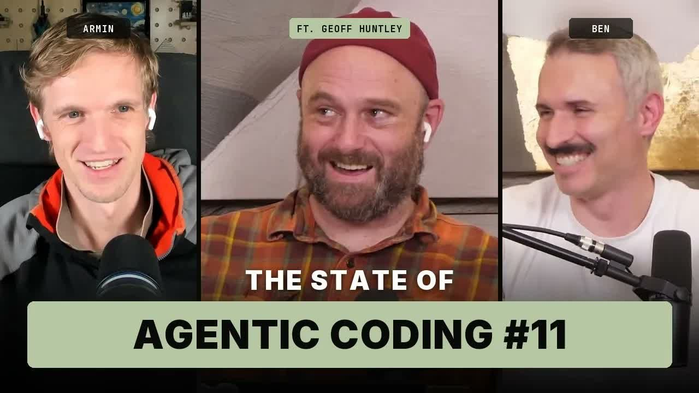

# state of agentic coding #11: the curiosity test, lisp, and labs that can't fail

By Geoffrey Huntley · 16 Oct 2026

people are failing a curiosity test right now. Armin Ronacher and Ben Vinegar had me on State of Agentic Coding to talk about it, along with DHH coming around, durable agents, a Lisp you program by talking to it, and why the labs cannot afford to fail.

[State of Agentic Coding #11 with Geoff, Armin, and Ben](https://www.youtube.com/embed/HDdbU10r7Js?feature=oembed)

Ben Vinegar (co-founder of [Modem](https://modem.dev/?ref=ghuntley.com)) and Armin Ronacher ([Earendil](https://earendil.com/?ref=ghuntley.com), and the person most people know from Pi) run a podcast called State of Agentic Coding, and I was the guest for episode 11. Ben and I were in the same room in Toronto. I'd landed the day before after 22 hours of flying, I was there for two days, and then I was flying back to Sydney. Armin stayed in Vienna, sensibly.

We covered a lot of ground in an hour and a half. Here's the gist, written up properly, with chapter links at the bottom if you want to jump to a specific part of the conversation.

> DHH did the funeral last week and he's right.

## the curiosity test

Ben opened by asking what my contribution to the GDP of AI development has been from Ralph loops. The OpenRouter folks personally came up to me to say thanks for the uptick, so I know it has burned a lot of tokens. I published the research in July last year. When I first showed it to Cursor they thought it was garbage. Nine months later they'd implemented it, then Anthropic did it, then OpenAI did it, and now everyone's talking about loop engineering. Dex calculated it at about $10.42 an hour when you run it in the loop and it builds AFK overnight.

That weighed a lot on my shoulders when it first came out.

[Ralph Wiggum as a "software engineer"](https://ghuntley.com/ralph/)

I've spent this year traveling the world giving talks, pleading with people to invest in themselves. My shortest take is this: software developers are failing a curiosity test. If you're displaced by AI as a software developer, it's self-inflicted, because you haven't been curious in a time of rapid transformation. As an employee, you trade time and skill for money. Employers' tastes are changing rapidly, but there's no reason you can't keep up with what's going on.

Just harshing everybody's vibe right out of the gate.

Ben pushed back here, and fairly. When people come into the industry they're young and have infinite time on their hands. Now many of them are in their thirties or forties and have racked up responsibilities. It's the same reason video games get harder to stay into as you age. It's hard to retool at this rate of change, and it's hard to feel optimistic when the thing at the centre of your income and your self-worth is in flux.

I concur. Dex Horthy has described my writing over the last two years as the depression era of Geoff: mourning the profession while pleading with people to be curious and to put themselves and their family unit first. This change has been forced on the world non-consensually. It displaces your identity. Are you a .NET developer? A Golang developer? A Python developer? It doesn't matter anymore. What matters is how good a developer you are, and whether you're using the thing employers now expect as the bare minimum.

Armin made a sharp observation: a lot of people in AI talk a very confident game externally, and that probably applies to us too. I'm straight up about this. I don't bloody know. Every time I discover something new, it strips me raw. You discover a new technique or capability, you thought you had a mental model of how it would play out, and then the game changes.

## boom and bust

Ben, playing tour guide, pointed out that the closest US cities to Toronto are Buffalo and Detroit. Buffalo was once the third most populous city in the US, prosperous because of its rail access to the Great Lakes. It's now one of the most rapidly declining. Detroit is a later, similar story, tied to the auto industry. His point: there's a long history of people with hubris believing the good times will never end.

I've been through a few of these cycles, going back to the original dot-com boom and bust. Senior compensation went through the roof during the ZIRP era because, in the previous bust, we didn't develop enough talent. That created a scarcity of knowledge. Hold on, folks: the same cycle will repeat. CS enrolments are down; I remember seeing something like 22% in Singapore this year.

[Dear Student: Yes, AI is here, you're screwed unless you take action...](https://ghuntley.com/screwed/)

If you really love computers, you should be all in on loving computers right now. Everyone's having the time of their damn life. If you've stayed curious and kept your skills up to date, you can get placed anywhere right now. That means being able to stand at a whiteboard and explain how to build a coding agent as a sequence diagram, how inferencing works, and what a prompt cache is.

Armin had a slightly different read. Detroit not growing doesn't mean cars stopped being a thing; the industry went worldwide and commoditized. Software engineers got paid really well because we were scarce and our only competition was other software engineers. Automation didn't play a role. That's changing. He's absolutely convinced the exceptional role our profession has had over the last twenty years won't return in the same form. There will probably be a period with more demand for software engineers, but it will commoditize quickly. He's also curious what happens to San Francisco, a city that hasn't grown its housing stock, when the Anthropic IPO mints a pile of multi-millionaires competing for it.

I'm hoping for another PayPal-mafia-type thing. When people get minted, they invest in what they know.

## dhh did the funeral

If you're in love with typing on a keyboard in an IDE, I'm sorry to say it, but DHH did the funeral last week, and he's right. You can still type code; you just do it in your personal workshop. Employers now want you to use the CNC machine and be very good with the CNC machine. They don't want artisanal woodworking anymore.

[Rails World 2026 Opening Keynote - DHH](https://www.youtube.com/embed/vDjW_dRyKXY?feature=oembed)

Ben summarised the Rails World keynote nicely. DHH walked through three generations of family pictures: a single drawing from his grandfather, a handful of photos from his childhood, and his kids with every second of their lives photographed. Portrait painting was an economic outcome. When photography made drawing reality uneconomic, painting went to impressionism and cubism: let's draw what isn't reality.

Armin had been on a panel at a Ruby conference in Austria earlier this year with Chad Fowler, who already said that the agent never writes Ruby for him anymore. When you sample which languages agents actually use, Ruby doesn't show up meaningfully. The online reaction to the keynote was largely dismissive, but the in-person reaction was much better received. Armin's point is that communities are disintegrating and reforming around the ideas that brought them together in the first place, even as the technology underneath changes. The Rails community is really a descendant of how DHH thinks software should be built; Ruby was just the tool.

So what's the point of a programming language or framework full of sugar designed for humans if humans aren't writing the code anymore? I've been chatting with the creator of Elixir, and he gets it. Language designers have dumbed down their languages to make them easy to learn for the human operator. All of that is falsified now that the agent writes the code. What does an agent need? What's the point of LSPs? Will we get new forms of interpretability, like an agent driving GDB, on a per-language basis? The languages won't go away, but the communities that swallow this tough pill and evolve will be the ones that survive.

Developers mostly speak to other developers. It's like a couple of cows in a field going moo to each other, completely missing that the cows are headed for the abattoir. Grim, I know. Stop being a cow. Learn a bit about business. Speak with founders and investors. Learn to be a product engineer. If you're working at a company that has banned AI outright, you should quit that company.

[if your team is too busy doing their 'normal job' to experiment with AI, you're preparing them to be replaced](https://ghuntley.com/replaced/)

Armin said the strongest signal for him isn't his own belief; it's that the experienced, vocal holdouts are turning. DHH was dismissive early on. Notch was dismissive and recently turned. Ben noticed that DHH was transparent about having tried AI for design, pulled it back, and now landed firmly on the other side. It felt like an invitation: come join me. Armin's worry is that because DHH is polarising, the message may not land as widely as it should.

On where to find the signal: if you've been on X for the last two years, you're ahead of the game, because that's where all of this has happened. I don't love the platform; the number of AI reply bots is through the roof. But if you want the alpha, you have to push through. Go to the fediverse and talk about AI and you'll get your whole Mastodon instance banned. Bluesky has some high-alpha accounts. Unfortunately, the tech community has fractured along political lines, which means a lot of this isn't getting out.

[Multi Boxing LLMs](https://ghuntley.com/multi-boxing/)

Back in December 2024 I was writing that IDEs are dead as a product, and everyone called me crazy. I've taken a lot of unpaid time off work this year to give talks. You can't carry all that water yourself. The best you can do is this: if someone gets curious, help them get to their own moment. Find the thing that makes their mind explode, then ask them to show the next person. For me, that moment was seeing how easy it is to build a coding agent and realizing the entire game now is to build product recursively.

[how to build a coding agent: free workshop](https://ghuntley.com/agent/)

Ben brought up the Bob Dylan biopic with Chalamet. Dylan is folk royalty, goes electric, and the old caretakers practically call the police to shut it down while the younger audience wants the new stuff. Folk was one of the most popular genres of its time. The reason you know Dylan's name and not most of the folk scene's is that he evolved. Boy, we don't like change.

The one thing I wrote that really landed with juniors was "dear student, you're screwed". ThePrimeagen narrated it (thank you, Prime), and I wrote it as if I were giving career advice to my own kid at twenty. Now, at the AI Engineer World's Fair and in my travels, people come up and tell me they got a promotion because they turned up with the attitude and the skills. Don't thank me; you did the work. You were curious and you invested in yourself.

[Dear Student: Yes, AI is here, you're screwed unless you take action...](https://ghuntley.com/screwed/)

## four months in 2026

Armin and the Earendil crew shipped Pi 1, and they also shipped something that's around 10,000 lines of code but took four months to build. Four months, in 2026. That's like a five-year project.

Armin's explanation is the bit I want everyone to hear. LLMs suck at the shape of a contract and the human feel of an API. You can express an idea really fast, but getting the right feel takes a lot of knowledge and experimentation. They solved the problem something like twenty times, each in about two hours, and none of those solutions felt right. The agent solves every problem in record time, but that doesn't give you a system with the right trade-offs. Finding the right trade-offs is what took four months.

The result is [Pi Durable](https://earendil.com/posts/pi-durable/?ref=ghuntley.com), which is how they now think an agent should be structured. You can shut down the harness, restart it, and it picks up exactly where it left off. That holds over the network, and through complex interactions such as sub-agents spawning and talking to each other.

[Pi Durable | Earendil](https://earendil.com/posts/pi-durable/?ref=ghuntley.com)

Fourteen or fifteen months ago, Armin, Mario, Peter and others had a strong conviction that file systems and bash were the way to go, but nobody really knew how to build a harness around that. So everyone copied what Claude Code was doing, which is a very simple idea of a session: a transcript, a tool call, a tool result, in a loop. That model has stayed at the core of more or less every agent. At its simplest, all it does is automate copying and pasting.

But demands have changed. Background compaction means doing two things at once. A Slack experience means five people talking to the same agent, some in the same sub-thread and some branching off. That mapped incredibly poorly onto Pi's original design. Armin called it a little bit of cargo culting that we're all suffering from: we keep building on a basic primitive that causes pain everywhere. We don't notice, because an agent will happily build you a decent-looking agent, but under the hood it's messy, horrifying and not reliable.

> this technology is moving really, really quickly and is held back by ideas about how it should work that are a year plus old.

Can I get that louder and printed on a shirt? Here's my hot take: your AGENTS.md and many of your skills should be deleted after every model release, or at least every couple of months, and redone. We carry so much that we think of as best practice, and we perpetuate it. Steering messages versus follow-ups were a UX paradigm; the loop underneath stayed the same. Async tasks for bash were one of the last big advancements. Go further back: why do we even have a shell? Because we used to have a human operator. If that need had never existed, would we have an operating system shell at all? That's the level at which we need to rethink the substrate.

## a lisp you grow by talking to it

Ben asked what we'd actually thrown out lately, so I showed the thing I'd published that morning. We've raised two generations of software developers who have probably never seen Lisp and what it can do. Armin was very curious, because three months earlier he'd given a talk saying Lisp was the worst language for agents since they're terrible at counting closing parentheses. That's the old joke.

[an application in lisp you grow by talking to it](https://ghuntley.com/lisp/)

The usual mental model of a coding tool goes like this: you prompt it, it runs bash to look at your project, finds the file and uses the edit tool to change it. Then comes compilation, then CI/CD, then code review. What I showed throws all of that out.

I've connected an LLM to a running Lisp. I asked what functions were defined, and the LLM asked the running image. I asked for a string reverse function, typos and all, and it defined one directly into the image. Then string uppercase. Then a function to fetch a URL and parse the JSON. I can undo a change and roll back to the previous generation. There are only two tool calls in the inferencing loop: evaluate an expression, or define one as a function. I'm editing the Lisp image and its runtime environment through a chat. Once a function is defined, it's defined.

Now don't think of this as a chat interface. Imagine you're logged into your website and there's a secret little Hackers-style menu that only shows for staff. You don't load up an IDE. You pop a prompt and evolve the running program by chatting with it. What if that's how a user feedback request gets actioned?

Ben mentioned that the opencode folks had just written about how much work it took to make individual plugins hot reload, never mind be programmed live. Armin said that on a single-player level this is very much what made Pi interesting, since Pi can rebuild and reload itself. The challenge is that JavaScript is not a language built for hot reloading.

## why lisp died

Ben's question was the right one: if this is so fantastic, why does it feel like you're digging up a grave?

Lisp has always been about these things. But you had to be a Lisp programmer to do Lisp. Now there's a natural-language interface that lets anyone do Lisp-type stuff. Armin gave the more precise answer. The problem with software is effects. That's partly why Pi Durable exists: if you shut down Pi and reload it, it doesn't come back exactly as it was, because not everything is serialisable. Lisp can serialise its entire state out more than most languages can, and functions are defined much like data.

Why did it go away? Lisp was slow unless you had a machine that really suited it, and it didn't survive the shift to the personal computer, where people wrote assembly. Armin's bluntest point: it's a horrible language to look at. It's awful for humans. Maybe it's great for LLMs. Many of our trade-offs as engineers exist because we're lazy and pick the things that let us stay lazy.

That's the Ruby thing again: designed to be beautiful and easy for humans, but less powerful. Paul Graham's [Beating the Averages](https://paulgraham.com/avg.html?ref=ghuntley.com) covers this with the Blub paradox.

I also want to give credit to [Krzysztof Cieślak](https://github.com/krzysztof-cieslak?ref=ghuntley.com). He doesn't get credit for it, but he's the person behind what everyone now calls spec-driven development. He's at GitHub Next, he's one of the people behind Ionide for F#, and he published research back in the GPT -3 era asking whether Markdown could be the future of how we publish software. When I was doing my Ralph loops, I remembered his research and thought: the models got better, let's redo it. The rest is history. For the record, though: code is the spec, folks. Markdown is not a spec. As Armin put it, there are specifications and there are vibe specifications.
