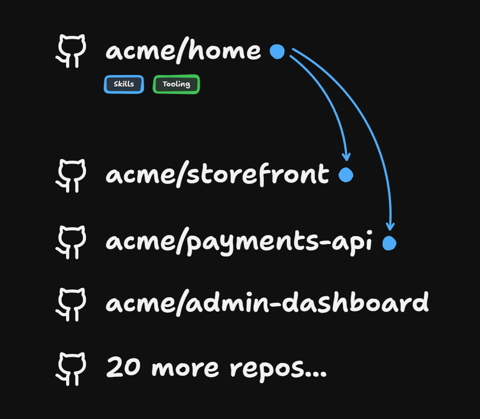

# The Home Repo Pattern
By Matt Pocock · AI Hero · Updated Nov 12, 2026

A [Home Repo](https://www.aihero.dev/ai-coding-dictionary/home-repo) is one repository that holds your [skills](https://www.aihero.dev/ai-coding-dictionary/skill), your [AGENTS.md](https://www.aihero.dev/ai-coding-dictionary/agents-md) and your shared docs. You run your [agent](https://www.aihero.dev/ai-coding-dictionary/agent) in the Home Repo. Its AGENTS.md holds a navigation pointer to each of your other repos, so the agent can open or clone them as it needs to.



## The problem it solves

When a project spans several repos, an agent started in one of them sees only that repo. Each repo ends up with its own copy of the skills and the agent setup, and planning a feature that crosses repos means working without the whole overview.

A Home Repo gives you:

1. One place for your steering files and tooling
2. One place to run all your agents
3. Sweeping changes across multiple repos from a single [session](https://www.aihero.dev/ai-coding-dictionary/session)

## Set one up

Paste this prompt into a new session with your coding agent, started in the folder that holds your repos. The agent finds your repos and their skills itself, [grills](https://www.aihero.dev/ai-coding-dictionary/grilling) you about the decisions in rounds, and changes nothing until you approve its plan.

```markdown
Set up a Home Repo with me: one git repo that holds my shared skills,
AGENTS.md and shared docs, and points at my other repos. I'll run my agent
from it.

## How to work

- Look up every fact yourself (filesystem, git, gh), using subagents for
  wide searches. Bring me only decisions.
- Put decisions to me in rounds. Number each question, give your
  recommended answer, and word it so "yes" accepts it. A question that
  depends on one still open waits for a later round.
- Until I approve the plan in Step 3, only read.
- Secrets stay where they are: leave .env and other secret files unread.

## Step 1: Inventory the repos

Find every git repo under my home directory, skipping dependency folders.
For each, record its path, remote, visibility (public or private) and
last commit date.

In the first round, ask:
- which repos the Home Repo points at (recommend those with recent commits)
- where it lives, and whether it's new or an existing repo (recommend a
  new private repo beside the others)
- whether it's personal or shared with a team
- which file my harness loads at session start: AGENTS.md, CLAUDE.md or
  both (recommend what my setup shows)

Done when every repo found is marked in or out, and the other three
questions are answered.

## Step 2: Inventory the shared material

Across the chosen repos and my user-level skill folders (such as
~/.claude/skills), list every skill (a folder with a SKILL.md), every
AGENTS.md and CLAUDE.md, and every doc written for agents: coding
standards, glossaries, ADRs.

Sort each item into one bucket:
- shared: true across repos
- duplicate: the same item in several places; diff the copies and mark
  the newest
- repo-specific: about one repo's code, commands or domain
- installed: from a published skills repo or marketplace

Done when every item sits in exactly one bucket.

## Step 3: Agree the plan

Show a table of every item, where it is now, and its destination:
- shared and duplicate: move to the Home Repo, one copy, newest version
- repo-specific: stays in its repo
- installed: stays installed

Under it, show the Home Repo's AGENTS.md: a short intro, then an
"Other Repos" section with one pointer per repo:

  <name> (<what it is>): <local path>. Clone from <remote> if missing.

Add a hint where a repo needs one, such as "read its AGENTS.md first".
Past about 20 repos, group the pointers into one file per area and point
at those files instead.

Settle open items in further rounds. Done when I approve the table and
the AGENTS.md.

## Step 4: Apply the plan

1. Create the Home Repo and its AGENTS.md. If my harness loads a
   different file, add that file as a one-line pointer to AGENTS.md.
2. Copy each shared item in, keeping skill folders whole.
3. In each child repo, on a new local branch, remove the copies that
   moved. Repo-specific material stays.
4. Commit in the Home Repo. Pushing is my call.

Done when every row of the table is applied. Report each row's outcome,
the branches you created in each repo, and anything you skipped, with
the reason.
```

## FAQ

### Contents

**What goes in a Home Repo?**
Skills you use across repos, AGENTS.md with its pointers, steering files, and shared docs such as coding standards, a glossary, and decisions that affect the whole system. Coding standards are the first doc worth sharing: one universal set transfers across projects. A Home Repo can also hold a small wiki of Markdown files, and tooling.

**What stays in each repo?**
Anything true of that repo alone: its own AGENTS.md, its build and test commands, its repo-specific docs. The Home Repo points at it. Code stays where it is, and each repo keeps its history, remote and issue tracker.

**Why a repo, and not `~/.claude/skills`?**
The ideal end state is that everyone uses the same skills, kept in the project. A user folder is the stopgap until then. A Home Repo is a project: its skills are versioned with git, and a team can share it.

**AGENTS.md or CLAUDE.md?**
This guide says AGENTS.md. Put the pointers in whichever file your harness loads at the start of a session. Claude Code loads CLAUDE.md.

### Navigation pointers

**What does a pointer look like?**
One line per repo, naming the repo and where it lives:

```markdown
For skills, clone mattpocock/skills to ~/repos/skills.
For Sandcastle, clone mattpocock/sandcastle to ~/repos/sandcastle
```

Add a hint where a repo needs one:

```markdown
## Other Repos

Storefront (Next.js app): ~/repos/acme/storefront. Clone from git@github.com:acme/storefront.git if missing.
Payments API: ~/repos/acme/payments-api. Read its AGENTS.md before changing it.
AI Hero: ~/repos/ai/ai-hero (git pull to view latest, likely out of date)
```

**Does the agent clone the repos, or use the copies already on disk?**
Both. If the repo is already at the pointer's path, the agent works there. If it isn't, the agent clones it there. Some setups clone the repos inside the Home Repo and gitignore them instead.

### Working across repos

**Where do sessions start?**
In the Home Repo, not inside a single repo. It's also the place to grill a feature that crosses repos.

**How do worktrees fit in?**
Each repo is cloned once. Each feature gets a worktree inside that clone, so several agents can work in one repo at the same time.

**Where do issues go?**
The agent can reach every repo's issue tracker, so it can make sense of them together. Letting it file each issue where it fits works fine.

**Can a team share a Home Repo?**
Yes. For a team, the Home Repo is the thing you share, and everyone runs their agents in it.

### Scale and alternatives

**How many repos does it handle?**
About 20 repos works fine. At around 400, one pointer per repo is too many decisions for the agent. Use [progressive disclosure](https://www.aihero.dev/ai-coding-dictionary/progressive-disclosure) instead: point at one file per area of the business, and list that area's repos in its file.

```markdown
## Other Repos

Billing (invoices, payments, tax): see repos/billing.md
Storefront (web and mobile apps): see repos/storefront.md
Internal tools: see repos/internal.md
```

At thousands of repos, the skills have so many consumers that a skills marketplace makes more sense.

**Should I use git submodules?**
You can. At 5-10 repos a submodules-style setup is fine. Plain pointers do the same job without submodules.

**How does it relate to a monorepo?**
A monorepo is a good fit when you can have one. A Home Repo replaces it when you can't, for example when you mix public and private repos, or when your team won't adopt a monorepo.

### Tooling and CI

**Do I need a CLI or other tooling?**
No. Pointers in AGENTS.md and the tools you already have are enough to start. Later, the Home Repo is a good place for tooling, such as a CLI that connects the agent to external services, with the environment variables it needs kept in the same repo.

**Does it work in CI?**
Yes. In a [software factory](https://www.aihero.dev/ai-coding-dictionary/software-factory), put the Home Repo in the [sandbox](https://www.aihero.dev/ai-coding-dictionary/sandbox), and it clones the other repos as it needs them. The code that runs the factory lives in the Home Repo, or in one of the repos it points at.
