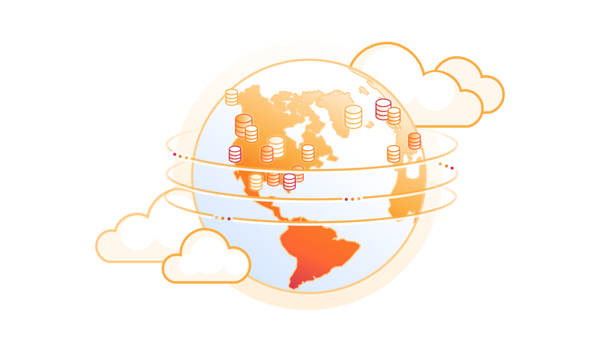
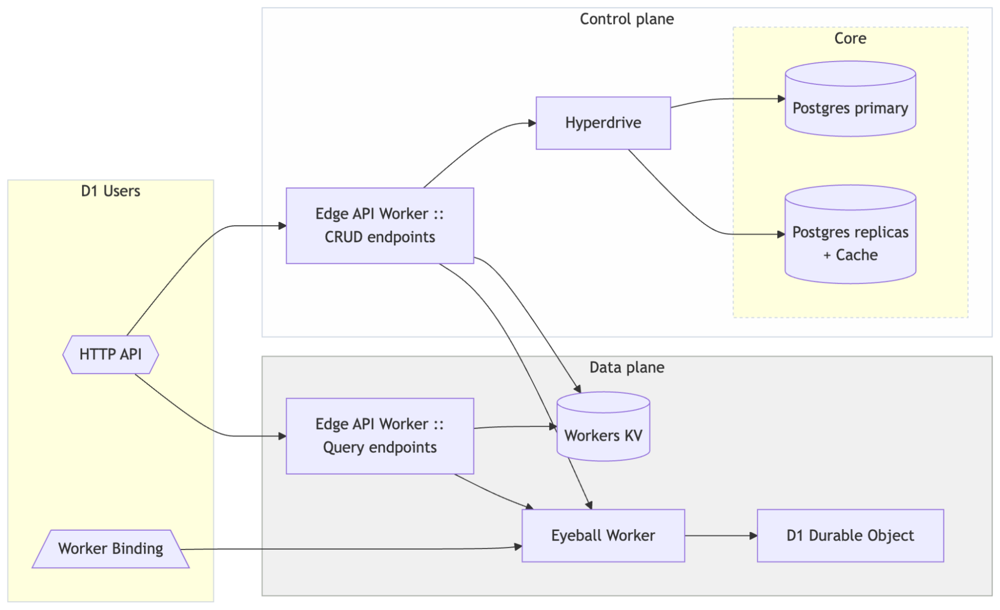
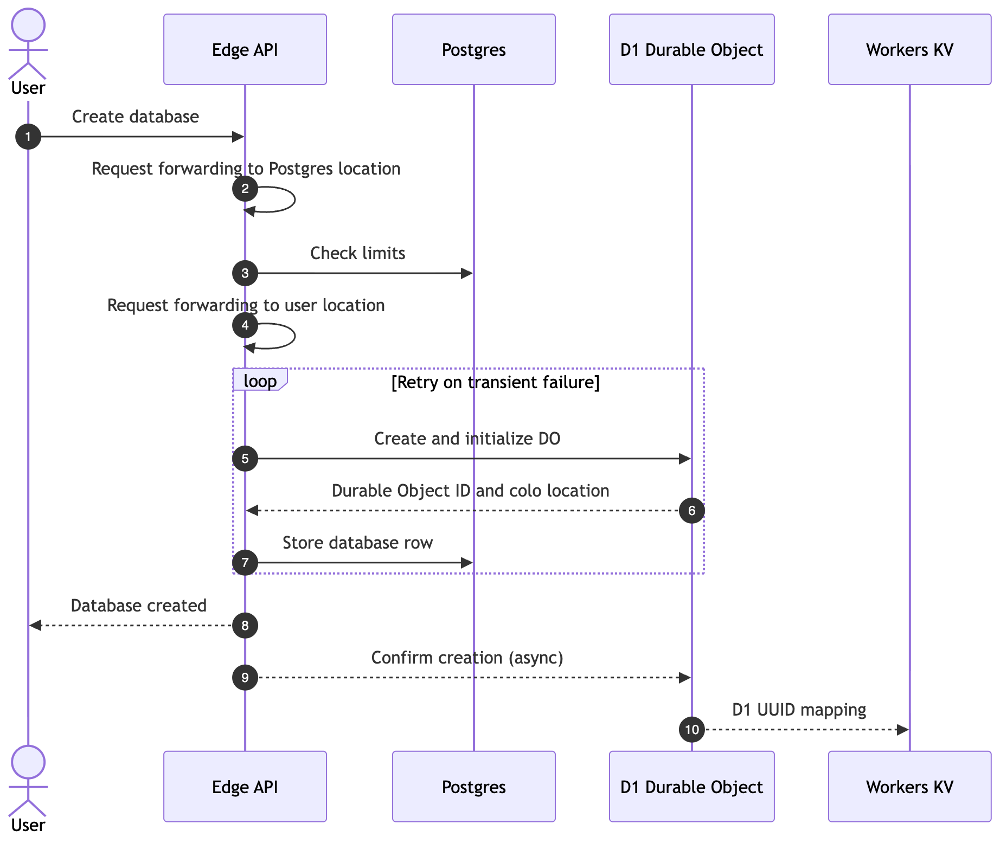
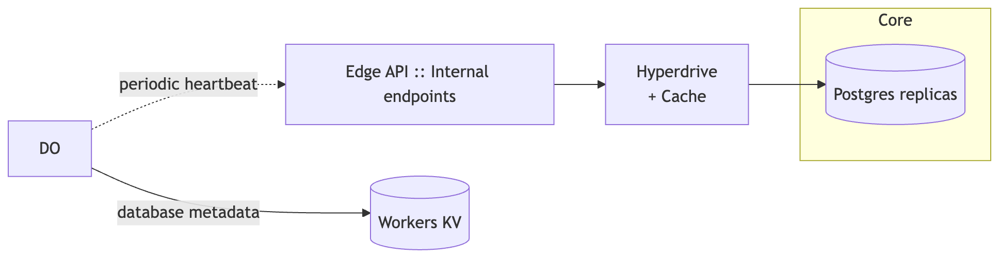
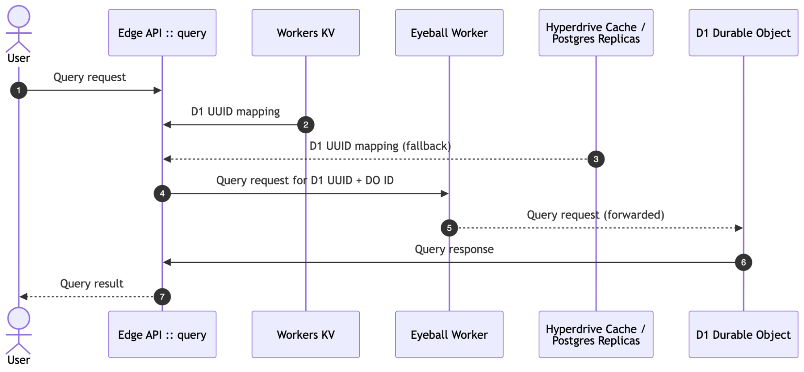
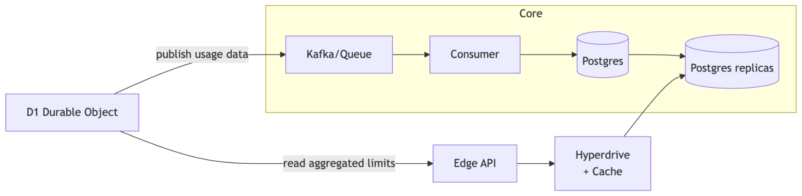
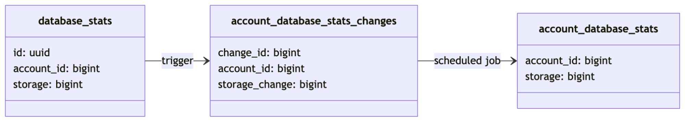
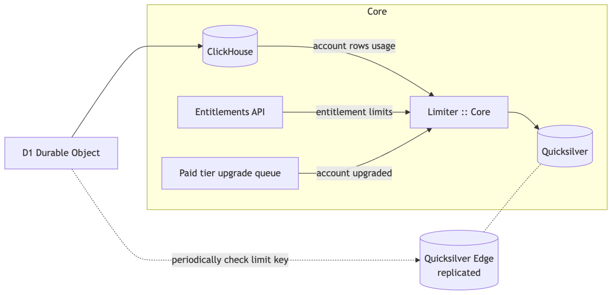

# Under the hood, off the hot path: How D1 scales to millions of databases
By David Laban and Lambros Petrou · Cloudflare · October 13, 2026



Traditional database architecture assumes you have one or two big database clusters per application, usually accompanied by a connection pooling solution. AI-assisted development and vibe coding platforms turn this model inside out and are driving applications toward many small databases: one per user, application, preview environment, or tenant.

That model fits D1 particularly well. D1 is Cloudflare's managed, serverless database based on SQLite. It allows you to create millions of databases and only pay for what you use.

The question becomes: how do you scale the control plane for millions of databases without making every query slower by sending it through centralized bottlenecks?

We made a lot of architectural changes to scale out D1 to support platforms with millions of created databases, hundreds of thousands of which are active at any point.

This post is a behind-the-scenes deep dive into how the D1 control plane works. Many of the architectural patterns we will describe can be used by anyone building on top of Cloudflare's Developer Platform. The post also gives a glimpse into how we build our own control planes.

## Growth in numbers

There was already a steady growth in D1 usage when we started planning these changes, but we knew we would need to support a much bigger scale once large platforms started building with D1.

Here is how things have played out so far.

D1 has seen a **15x growth in the number of live non-deleted databases over the past one year**, and a **65x growth over the past 2 years** (as of October 8, 2026).

We have also seen **18x growth in the number of daily active databases over the past year** (as of October 8, 2026). A database is considered active if it executed at least one query during that day.

Established and successful platforms are already building with D1, using the same tools available to all Cloudflare users.

> "ChatGPT Sites lets anyone turn ideas into shareable experiences. D1 gives our users a simple, scalable way to add features like custom metrics, leaderboards, and comments to their dashboards, games, and tools."
>
> - Jon Abrams, ChatGPT Sites @ OpenAI

While we were making the changes described in this blog post, we periodically load-tested against a target well above our expected growth. This guided where to focus our optimization efforts.

## Guiding engineering principles

Applications built on the Cloudflare Developer Platform range from full-stack applications to service APIs, from internal single-user portals to massive multi-tenant vibe coding platforms, and everything in between.

While building out the D1 control plane to support millions of databases, the following tenets and principles were guiding our architecture decisions and are useful for anyone building their control and data planes on our platform.

1. Design all processes with failure and idempotency in mind. Failures will happen, so the system needs to self-correct where possible and continue making progress.
2. Avoid centralized single-region components in any hot path for data plane operations (in our case all query requests).
3. Use [Workers KV](https://developers.cloudflare.com/kv/), a globally distributed KV store, for critical routing metadata so that cache misses only rarely need to query central databases.
4. Use [Hyperdrive](https://developers.cloudflare.com/hyperdrive/) to access central Postgres databases for [efficient connection pooling](https://blog.cloudflare.com/how-hyperdrive-speeds-up-database-access/) and optimized routing and caching, using read replicas wherever possible.
5. Periodically precompute aggregations in the database to avoid scan queries during user request processing.
6. Use eventual consistency and queuing between components that don't need strong consistency to increase reliability and availability.
7. Load-test the application with realistic workloads to discover bottlenecks and inefficiencies, and focus on optimizing those first.

There are more engineering principles we follow internally to build our systems, but the above are generic enough and apply to anyone building on Cloudflare.

The following sections will dive into the main system components and processes of the D1 control plane regarding the lifecycle of a D1 database, and showcase how to put these principles into practice with a real-world system.

## High-level architecture

Let's start off by introducing the main components of D1.



There are a few more arrows and boxes missing from the diagram for secondary processes supporting D1, but these are the ones providing D1's public feature set. We will explore the rest in dedicated sections in the rest of the blog post.

First of all, each D1 database is [backed by one SQLite Durable Object](https://blog.cloudflare.com/d1-read-replication-beta/#under-the-hood-how-d1-read-replication-is-implemented), which makes it very easy to create millions of them.

The "HTTP API" shape represents all our API surfaces including the Cloudflare dashboard, Wrangler, and Cloudflare CLI. All API requests go through Cloudflare's edge gateway and are served by the D1 Edge API Worker.

The diagram shows the HTTP endpoints that allow users to execute SQL queries against their databases as the "Query endpoints". The remaining endpoints include the usual database operations like creating, deleting, and listing databases, along with import/export and time travel features. These are shown as the "CRUD endpoints".

The CRUD endpoints use Hyperdrive to query a Postgres cluster in our central data centers (referred to as "Core"). There are two configurations. One configuration [has caching enabled](https://developers.cloudflare.com/hyperdrive/concepts/query-caching/) and targets the Postgres read replicas. The other configuration has caching disabled and targets the Postgres primary.

The Edge API Worker might invoke the D1 Eyeball Worker (depending on the type of request). The Eyeball Worker is our proxy for all requests that need to be handled by the underlying D1 Durable Objects (DO). This allows us to put all query handling inside the Eyeball Worker, including observability, automatic retries, error handling, and other query-specific behaviors.

Workers KV acts as our caching layer at the edge for read-heavy metadata and can be read by all the D1 Workers.

The "Worker Binding" shape represents all users' Workers with a [D1 Worker binding](https://developers.cloudflare.com/d1/worker-api/). Requests from the D1 Binding go directly to the D1 Eyeball Worker, which in turn forwards the request to the Durable Object backing the database and proxies the response back to the User Worker.

We have two methods for users to execute queries in their databases. One is over the HTTP API query endpoints, and the other is through a Worker they deploy in their accounts with a D1 Binding.

In terms of operations, we fold each operation into one of the following categories:

1. **Data plane**: any database query related request; should be as fast as possible and always at the edge.
2. **Control plane**: any HTTP API operation or internal flows that run in response to a non-query user request; they can depend on central single-region components.
3. **Background asynchronous plane:** any analytical and billing-related workflow; can be eventually consistent and runs anywhere.

There is a lot more under the hood, so let's dive into the key flows.

## Fast on-demand database creation close to the user

Multi-tenant platforms and AI agent-driven development require creating a lot of database instances in a fast, cost-efficient, and reliable way.

The following is an example [Wrangler command](https://developers.cloudflare.com/d1/wrangler-commands/) to create a D1 database:

```
% time wrangler d1 create "demo-01"

✅ Successfully created DB 'demo-01' in region WEUR
...
0.56s user 0.13s system 42% cpu 1.614 total
```

When a user creates a D1 database, several things need to happen before the database is ready to receive queries.

- Check that the account can create more databases against the free tier limit or its account limits.
- Generate a unique D1 database UUID, a unique Durable Object ID ([`newUniqueId()`](https://developers.cloudflare.com/durable-objects/api/namespace/#newuniqueid)), and initialize the underlying Durable Object (DO) with the account and database information.
- Persist the newly created database's information in Postgres (one row per database, including metadata and the mapping to the initialized Durable Object ID).
- Write the mapping from a database ID to the Durable Object ID in Workers KV (later used by the data plane and the query endpoints).

Let's examine the actual flow and how we recover from failures at each step.



Once a database creation request comes in, our Edge API Worker handler is invoked in the nearest Cloudflare location at the edge. Edge API queries our Postgres read replicas over Hyperdrive with caching enabled (with cache TTL of a few seconds) to get the number of non-deleted databases for the given account.

The Edge API Worker forwards control plane requests to data centers near our Postgres cluster for endpoints that do multiple round-trips to Postgres (step 2), and the "create database" endpoint is one of them. The reason is that a round-trip from afar can be hundreds of milliseconds, whereas being near Postgres can be a few milliseconds. For endpoints that do at most one Postgres query we don't need to do this optimization since Hyperdrive already handles efficient routing through the Cloudflare network.

Creating a D1 database without any options places the database near the request's location by default. You can influence the location of the database by providing an [explicit location hint or a jurisdiction](https://developers.cloudflare.com/d1/configuration/data-location/). The location hints and jurisdiction options are identical to what [Durable Objects support](https://developers.cloudflare.com/durable-objects/reference/data-location/), so when these are provided they are just passed straight through to the underlying Durable Object initialization.

With the default creation we want the D1 databases to be created near the original location of the request, close to the user. To achieve this, during step 4 of the diagram, we internally forward the request execution to a data center close to the original request's location and invoke the underlying Durable Object from there. This ensures that the underlying Durable Object is placed near the user.

You can implement similar routing techniques by using [explicit Worker placement hints](https://developers.cloudflare.com/workers/configuration/placement/#specify-a-cloud-region) and at runtime invoking the right Worker via Service Bindings.

The creation endpoint is a bit of a weird case in terms of placement because even though we query Postgres at least two times, we also do a long-distance call to the underlying Durable Objects, which differ per request, so running the request to either side of the world could be inefficient. That's why we leaned towards forwarding the initial request near Postgres.

The next step is to generate the database UUID along with a [new unique Durable Object ID](https://developers.cloudflare.com/durable-objects/api/namespace/#newuniqueid) using the `newUniqueId()` API and invoke the `init(options)` RPC function on the new [Durable Object's stub](https://developers.cloudflare.com/durable-objects/api/stub/). The Durable Object stores the information in its durable storage so that every incoming request from that point on has all the metadata for the linked database.

Once the Edge API Worker gets the initialization response, it persists the database metadata into our central Postgres primary database over Hyperdrive, one metadata row per database.

The steps above are wrapped in a retry loop (steps 5-7 in the diagram). When the DO initialization or the write to Postgres fails we retry with different IDs (this is important, as we will see in the next section).

The write to Postgres is the "creation checkpoint" where a database is considered created even if the final response fails to reach the user. The database from that point on is included in all the control plane operations and can be bound to a Worker to serve queries.

At this point the D1 database is ready to receive queries.

The final creation confirmation RPC to the Durable Object happens in a [`waitUntil()`](https://developers.cloudflare.com/workers/runtime-apis/context/#waituntil) and is OK to fail. This call signals the DO that the database is now active, and the DO updates Workers KV with the database metadata so that any subsequent query can immediately read the information from Workers KV cache without needing to query Postgres.

A common question is why can't the creation flow run entirely inside a Postgres transaction to simplify the process? The answer is simply that it cannot scale, since it leads to connections being held while the Durable Object is being initialized, which could be on the other side of the world.

## Heartbeats for self-correcting databases



Each D1 Durable Object periodically heartbeats the control plane to get the latest database state (active or deleted) and account limits (more on this in the enforcement sections later). The interval is 30 seconds with a per-database jitter on top. We also have knobs to change the interval by database or account, or disable heartbeats entirely.

Heartbeats can tolerate slightly out-of-date data, meaning they can be served by Hyperdrive's multiple caching layers or by a Postgres read replica. This heartbeat flow enables the Durable Object to self-correct to reflect the source of truth (Postgres) regarding the creation and deletion of databases.

One clarifying detail before we move on. The reason we use different database UUID and Durable Object IDs for each retry in the creation flow of the previous section (step 5) is that if we reused the database UUIDs with fresh Durable Object IDs, multiple Durable Objects would think they own the same database leading to difficult-to-debug situations. The periodic heartbeats also act as a cleanup for orphaned objects.

Also, it's important that we first initialize the Durable Object before we persist the database mapping in Postgres, otherwise query requests could start to flow to the Durable Object and would be rejected due to uninitialized state.

For example, let's assume the following failure scenario and why it is self-correcting:

1. We executed everything from the previous section until we initialized Durable Object A, and then, the write to Postgres fails.
2. The Worker retries the loop and initializes a new DO with a different ID B, and this time it persists to Postgres.
3. We now have two Durable Objects initialized and running as part of this request, but only one of them is valid.
4. The user can only query Durable Object B because that's the only ID available in Postgres, which is our source of truth.
5. Within 30 seconds, DO A sends its next heartbeat to the control plane and receives back a response that its database does not exist. This will trigger DO A to mark itself as deleted.

A similar flow happens for the deletion endpoint.

Another self-correcting behavior of the heartbeats is making sure the Workers KV data eventually reflects reality: whether a database is active or deleted.

The final step of the creation flow to update Workers KV is "best-effort" and can fail without causing problems. It's eventually consistent, and the next time the Durable Object heartbeats it will ensure that the Workers KV item has been written with the correct value. Since Workers KV is eventually consistent without a way to do a consistent read, the Durable Object acts as the serialization point for the writes to the Workers KV items.

Deletion works the same way in reverse: the Durable Object owns writing its "deleted" state to Workers KV, again best-effort during the actual deletion operation, and if that fails the heartbeat will correct it eventually. The Durable Object stores the active or deleted state in its storage too, so it can reject or accept query requests immediately, even if Workers KV is stale and allows requests through.

Overall, the database heartbeats are the fallback mechanism for getting into a consistent state when operations need to write into an external datastore and also update the Durable Object itself.

## Decoupling the hot path: keeping queries off the central database

The key principle for query endpoints is to avoid talking to Postgres or any other centralized single-region component. Each query request over HTTP executes our Edge API Worker close to the original user request location, and then goes straight to the D1 Durable Object via the Eyeball Worker.

The Edge API Worker is responsible for doing standard HTTP API authentication, resource-based authorization, rate limiting at the account and database level, request validation, checking the entitlements of the account, and other API-related functions before executing the actual business logic.

The Eyeball Worker, on the other hand, skips these extra checks (apart from its own dedicated rate limiting), since under the hood, a D1 Binding is a [Service Binding](https://developers.cloudflare.com/workers/runtime-apis/bindings/service-bindings/) to the D1 Eyeball Worker. Each user Worker's D1 Binding carries encoded information that authorizes access to one specific D1 database that the D1 Eyeball Worker validates and allows the request through.

The following diagram shows the execution of a query through the HTTP API.



1. A user sends a query request over the HTTP API.
2. The Edge API Worker first tries to load the mapping from a D1 UUID to the database metadata from Workers KV.
3. In rare cases, the item cannot be found in Workers KV, either because the write failed as described earlier or potentially due to an availability issue. We then fall back to reading the mapping from Hyperdrive targeting the Postgres replicas. Before querying the actual replicas, Hyperdrive first checks its cache in the caller location, then its cache near the Postgres cluster location, and only if both are cache misses queries the Postgres replicas for the mapping.
4. Once we have the mapping, the Edge API Worker calls the Eyeball Worker over Worker Service Bindings passing the relevant IDs.
5. The Eyeball Worker does its validation and forwards the query request to the D1 Durable Object.
6. The D1 Durable Object executes the SQL query and returns the result through Eyeball Worker to the Edge API Worker, which returns it back to the user.

```
// Edge API Worker
const parsed = parseQueries(request);

const cachedDB = await withRetries(getCachedDatabase(parsed.dbUuid));

const response = await env.EYEBALL_WORKER.query({
  db: cachedDB,
  queries: parsed.queries,
});

return response;
```

If you are wondering why we use `newUniqueId()` during the database creation rather than addressing Durable Objects by "name" to eliminate steps 2 and 3 above, the answer is to [avoid a lookup round-trip to a central mapping](https://developers.cloudflare.com/durable-objects/api/namespace/#newuniqueid) of "name" to "Durable Object ID" during query requests. The Durable Object ID alone would not be enough, since we also need other metadata to help us pick the right Durable Object Namespace to use in our Eyeball Worker. Hence, we would replace one lookup with two.

In most cases, even with many of our own applications, addressing Durable Objects by name works great, and it removes the need for a lookup from your own IDs to a Durable Object ID, so use that as a starting point and only move to unique DO IDs if you have to.

You might also wonder why we use Workers KV when we already have Hyperdrive Caching.

Workers KV is a durable datastore, not just a cache: if an item falls out of KV's edge cache, the read is served from KV's own storage rather than Postgres, keeping Postgres out of the data plane. In a catastrophic cache purge scenario, a million databases trying to fetch their routing information would lead to metastable failures.

As a reminder, query requests from a user Worker with a D1 Binding do not need to resolve the D1 UUID mapping metadata because the binding itself holds that information internally, so requests go straight to the Eyeball Worker and the Durable Object.

For the query execution itself and how Durable Objects are implemented under the hood, [read our blog post about D1 read replication](https://blog.cloudflare.com/d1-read-replication-beta/#under-the-hood-how-d1-read-replication-is-implemented) that dives into all the nitty-gritty details.

Next, let's look at the asynchronous processes that support D1.

## Enforcing storage usage limits

All platforms that reach a certain scale eventually need to enforce billing and usage limits. At the time of writing, D1 has a [5 GB per-account storage limit](https://developers.cloudflare.com/d1/platform/limits/) on the Free plan and 1 TB on Workers Paid (can be raised on request).

In general, usage limit enforcement and billing systems are good candidates for eventual consistency and asynchronous processing, and in the following sections we will explore how D1 implements the enforcement of these limits.



### Asynchronous update processing with queues

The first step of the journey is that each Durable Object publishes storage usage updates to a Kafka-like queue for batching and asynchronous processing. The control plane does not need to process every update synchronously: it is fine if a load spike is not reflected immediately and our usage information is stale. The important thing is that it cannot overload Postgres and impact users of D1. We ensure this by limiting the number of queue consumers, and therefore the write load on Postgres.

The queue consumer system runs inside Cloudflare's central data centers ("Core"), whereas the Durable Objects themselves are spread everywhere in the world at the edge. The usage is aggregated locally per edge server and then published into the internal queue system.

The guiding principle here is that we use a queue to smooth out and batch writes to our central regional Postgres data store.

### Batching usage deltas and pre-aggregations



The queue consumer writes the latest reported size for each database into a Postgres table. This isn't what we need for enforcement decisions though. For enforcement decisions, we need the sum of all storage usage across the whole account. When we come to read the usage at enforcement time, we can't afford to run `SELECT sum(storage) FROM database_stats WHERE account_id = ?`. The cost of this query scales linearly with the number of databases on each account. This doesn't scale for accounts with millions of D1 databases, like some of the agentic coding platforms built with D1.

Ideally, we want a lookup table that will allow us to go directly from account ID to total database storage. The solution is to use incremental view maintenance to precompute the total, and keep it up to date when we have database storage changes.

Let's call this table `account_database_stats`.

In theory, we could make the queue consumer update `database_stats` and `account_database_stats` itself for every update that comes in. In practice, this would end up with a lot of write lock contention on a single row for large accounts. Instead, we add a third table called `account_database_stats_changes` that acts like a queue of changes. This is a log of all changes, and can have multiple entries per account. We then periodically aggregate updates from that table into `account_database_stats`. The flow looks like this:

- The queue consumer writes usage info to the `database_stats` table for a specific database.
- A trigger calculates the difference in storage for that database and puts the delta in an `account_database_stats_changes` table (one row per delta).
- A scheduled job runs every second to consume everything in `account_database_stats_changes` and update `account_database_stats` with the sum of those deltas.

Concretely, the scheduled job runs this query:

```
WITH updates AS MATERIALIZED (
  DELETE FROM account_database_stats_changes
  RETURNING *
),
changes AS MATERIALIZED (
  SELECT
    account_id,
    SUM(storage_change) AS storage
  FROM updates
  GROUP BY account_id
)
INSERT INTO account_database_stats (account_id, storage)
SELECT
  account_id,
  storage
FROM changes
ON CONFLICT (account_id) DO UPDATE
SET storage = account_database_stats.storage + EXCLUDED.storage;
```

It gets a list of updates from `account_database_stats_changes`, aggregates them by account, and then writes the deltas to the per-account table. This avoids write contention on any particular row, because we aggregate the changes before writing them.

The [Common Table Expression (CTE)](https://www.postgresql.org/docs/current/queries-with.html) `DELETE ... RETURNING` atomically consumes the pending changes and passes the deleted rows to the next CTE. Postgres executes the data-modifying CTE exactly once and to completion. The query then groups those changes by account and applies one aggregated update per account, reducing write contention.

This schema design is a pattern used by many other Cloudflare teams, and it lets us scale to millions of resources per account without each additional resource making common operations more expensive.

It's worth noting that the total is eventually consistent. It's not like first-class incremental view maintenance that you find in some other databases. We are already using a queue to get the updates from the Durable Objects into Postgres, so we are already fine with eventual consistency.

### Cached reads via Hyperdrive

We now have a lookup table for each account's total storage. What next?

Each D1 Durable Object periodically retrieves the account's usage through the periodic heartbeat we mentioned earlier. We query Postgres with  `SELECT storage FROM account_database_stats WHERE account_id = ?` and compare that to the account's entitlement and tier limits. If the total is over the limit then we forbid all writes that would increase the database size.

The query goes to Postgres replicas through Hyperdrive, and uses Hyperdrive's built-in cache. Hyperdrive's cache key is made up of the query and all parameter values, with the expiration time-to-live being a few seconds. By using the account ID as the only parameter, every database on that account will share the same cached value, which is what we want.

Time for a neat cache trick. Cached reads via Hyperdrive by default have a 60s expiration, and the [Hyperdrive cache configuration](https://developers.cloudflare.com/hyperdrive/concepts/query-caching/#default-cache-settings) applies to all queries. For specific queries we want cached values with lower expiration time. By adding a `dynamic_ttl` parameter to the query we generate a different cache key every X seconds, therefore reading fresh values sooner.

```
-- $2 = Math.floor(Date.now() / (X * 1000))
SELECT storage, $2 as dynamic_ttl
FROM account_database_stats WHERE account_id = $1
```

It might be tempting to make a query that takes account ID and database ID as parameters. That would let you find the account total and subtract the total for the current database. That would get an exact answer to the question "how much storage is this database allowed to use before we start enforcing?", which would allow the database to start enforcing limits earlier.

Doing this would mean that the database ID would be included in Hyperdrive's cache key, which would make cache hit rates very poor. For accounts with millions of active databases, an account-based cache key means that most of the heartbeats use the same cached account information from Hyperdrive and never reach Postgres.

Limit enforcement is slightly slower than it could be in terms of reaction to usage changes, but this is acceptable.

Separately from the above flow, we have a process that periodically snapshots the storage usage information from Postgres into a ClickHouse cluster, so that we can get a historical view of storage over time. These ClickHouse events are also the source of truth for storage usage billing purposes.

## Enforcing row usage limits at the edge

D1 also enforces daily execution usage limits for free tier customers. The pattern we use here is different, and is worth mentioning as well.



Whenever an SQL query is executed in a Durable Object, we track how many rows it reads and writes (including index updates if needed) to perform the query. When the query execution completes, we publish a usage event that ends up in another ClickHouse cluster. These events are what drive our row-based usage billing.

A central component, call it "Limiter", runs in our Core data centers and periodically queries the usage events from ClickHouse since the start of the day:

```
SELECT account_id, sum(rows_read) as reads, sum(rows_written) as writes
FROM requests
WHERE timestamp > toStartOfDay(now())
GROUP BY account_id HAVING reads > ? or writes > ?
```

ClickHouse deals with this kind of query better than Postgres, and we also benefit from not overloading our Postgres cluster for analytical queries.

For every account that is over the limit, we check their entitlements and tier (this limit applies only to free tier users). If they are over a limit, we email them (deduplicated throughout the day), and set a key in [Quicksilver](https://blog.cloudflare.com/quicksilver-v2-evolution-of-a-globally-distributed-key-value-store-part-1/), our internal globally distributed key-value store with fast sub-second replication, with an expiry date at the end of the day. If the account upgrades to the Workers Paid tier, we receive a message on a queue and clear the Quicksilver key.

Each D1 Durable Object periodically checks Quicksilver at the edge to find out whether its account has been limited, and in case it is, they reject any future query execution until the limit is lifted.

Someone building on the Developer Platform can use [Workers KV Instant](https://blog.cloudflare.com/workers-kv-instant/), which is built on top of Quicksilver.

This pattern avoids any load into the regional Postgres for the entire flow and uses the right tool for the right job. Doing analytics queries with ClickHouse is more efficient than doing them in Postgres.

This pattern is common across the company, but different from the approach we use for storage usage limit enforcement. In the future, we may migrate other limit enforcements to use this pattern instead.

## Conclusion

The D1 architecture is designed around separating control plane concerns from hot-path query execution.

Each decision follows our guiding principles: reducing central regional bottlenecks, using caching and read replicas along with eventual consistency when possible to scale out read throughput, and choosing the right data store for each job: Postgres for transactional metadata, ClickHouse for analytics, and Workers KV for globally replicated routing data.

If you are building a vibe coding platform and want to offer your users managed SQLite databases in a fast, cost-efficient, and reliable way, consider using D1.

If you are building applications on Workers and the Developer Platform, the patterns and trade-offs covered here reflect real decisions made for D1. Use them as a foundation in your own applications.

Check out the D1 [documentation](https://developers.cloudflare.com/d1/), and let us know what you build in the [D1 Discord channel](https://discord.com/channels/595317990191398933/992060581832032316)!

## Acknowledgements

Massive thanks to Cloudflare's internal Databases and Hyperdrive teams, who helped us find problematic usage patterns and suggested improvements.
